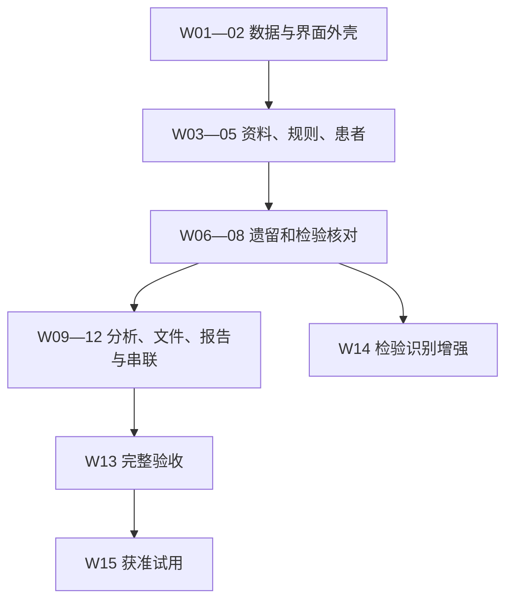

# 技术路线与逐项实施架构

技术执行版 v0.2 · 2026-10-29。承接现有SYSTEM.md、14个模块和45条理论，不建立第二套业务规范。完整实现按16份[Codex任务卡](../plan/CODEX_TASKS.md)推进。

## 1. 系统由什么组成

浏览器工作台（React/TypeScript/Vite）→ 后端API（Python/FastAPI）→ 14个职责模块 → PostgreSQL与私有文件存储。长时间解析、提取和识别交给同代码包worker；模型和OCR经端口接入。M13是工程同步工具，M14负责平台和验证，不是额外临床页面。

先采用一套应用和共享记录。规则、事实、问题、覆盖及报告各有职责；页面不另存一套完成状态，provider不能直接改数据库。具体数据/API约定沿用DATA_MODEL与API_CONTRACTS。

## 2. 按什么顺序做

| 顺序 | 工作包 | 临床上能增加什么 | 主要实现 |
| --- | --- | --- | --- |
| 已有基础 | W00 | 理论变化能找到对应技术 | 固定编号、映射、内容指纹、CI |
| 数据与可运行外壳 | W01—W02 | 正确进入项目/中心并可靠保存操作 | PostgreSQL迁移、授权、审计、幂等、API及浏览器 |
| 项目要求和患者上下文 | W03—W05 | 资料有出处，list有完整条件，知道患者阶段 | 原文解析、分层规则、适用性、事实与时间窗 |
| 现场核查核心 | W06—W08 | 先复核遗留，再核对检验和EDC | 分项整改、Query、快照导入、匹配与比较 |
| 分析、中心文件与输出 | W09—W11 | 具体异常核实、缺件提醒及报告 | 分维度分析、目录、阶段清单、模板导出 |
| 完整串联及验收 | W12—W13 | 一次监查到下一次可继续 | 真实API端到端、能力/限制与总耗时 |
| 识别增强（V1B） | W14 | 从照片减少人工抄录 | 识别候选、图像定位及人工复核 |
| 获准环境试用 | W15 | 用真实操作反馈完善 | 身份/存储/备份、部署与试用记录 |

W01—W13为默认V1A主线。W14依赖W08但默认在V1A主线后接入，不重新实现比对。W15依赖W13及实际环境授权；本轮没有创建收费资源或启用真实资料服务。

## 3. 统一代码结构

以下位置是计划，任务完成前不代表文件已存在：

| 区域 | 计划位置 | 约束 |
| --- | --- | --- |
| 应用及共用底座 | backend/cra_app/main.py、shared | 只放身份范围、事务、标识、时间及通用错误 |
| 业务模块 | governance/documents/rules/subjects/monitoring/issues/edc_import/laboratory/safety/site_files/reports | 每模块按domain或models、service、repository、api组织；按实际需要拆分 |
| 能力接入 | backend/cra_app/providers | 解析、候选提取、检验OCR和分析端口，不改业务完成状态 |
| worker及运维接口 | backend/cra_app/platform、deploy | 持久作业、能力状态、构建与恢复 |
| 浏览器 | web/src/features、pages、api | 按实际工作场景组织，API类型由契约生成 |
| 迁移及契约 | migrations、contracts | 模块增量迁移，OpenAPI从实际API导出 |
| 验证 | tests/unit、integration、api、acceptance及web/tests/e2e | 当前既有tests继续保留；按需求增加有效测试，不用数量表示成熟度 |
| 理论和执行 | theory、traceability、plan、changes | 单一JSON基线与生成视图，避免多份清单失步 |

目标文件、方法和验收逐项列在任务卡。路径调整时更新同一个tasks.json再生成视图；不能只在聊天中说新路径而留旧图。

## 4. 依赖、接口和运行约定

Python采用pyproject.toml + uv.lock，W01核实并锁定工具及依赖；前端采用package.json + package-lock.json，W02通过npm ci构建。当前没有声称这些应用依赖已经安装或锁定。

开发时Vite代理/api到后端；正式环境优先同源提供静态前端和API，避免随意放开跨域凭证。正式身份经后端可信OIDC接入，合成演示身份严格限制在synthetic模式。精确配置在W02/W15实测，不要求用户作IT选择。

每模块新增持久对象时增加迁移及事务测试；不在W01提前建所有未来表。API实现后导出contracts/openapi.json并生成前端类型，后续接口更改同时检查契约和消费者。

普通日期/数值和状态流转由业务程序处理；模型提供候选提取、基本分析和草稿。OCR识别结果经确认后接同一M08比对，报告从同一事实/问题生成。项目具体数字与模板属于版本化配置，不写死在通用业务代码中。

## 5. 怎样才算完成一项

先核实前置verified及实际代码，再按任务卡实现。代码、真实运行证据、相关UI/文件产物和对应场景缺一不能用计划替代。未配置供应商可实现并验证人工路径，但不能把自动能力标成已经验证。

每份任务卡列出可用与待实现命令。CI拦截漏字段、任务卡过时、错误完成标记以及理论漏同步；这些工程检查不能替代临床适用性和语义审阅。遇到阻塞不自动跳项，保留原因和可独立推进部分。

## 6. 官方工具依据

本轮核对[uv项目指南](https://docs.astral.sh/uv/guides/projects/)、[uv与GitHub Actions](https://docs.astral.sh/uv/guides/integration/github/)及[Playwright CI](https://playwright.dev/docs/ci-intro)。它们支持依赖锁、云上测试及端到端检查的选型；实际版本、CI安装和兼容性由相应工作包核实后锁定，不把文档示例直接写成已验证配置。
