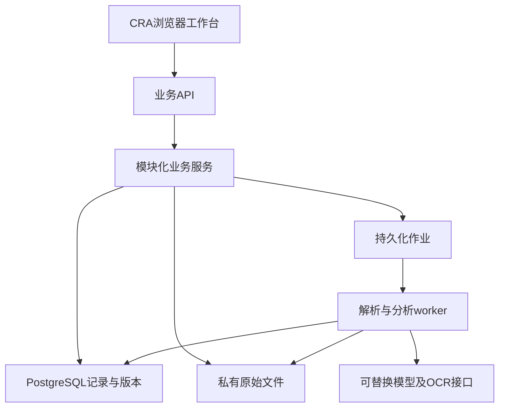

# 系统架构与第一版实现路线

状态：技术方案 v0.3；模块边界已设计，尚未实现完整应用。约束来源为[业务基线](../theory/BASELINE.md)和固定理论编号。

逐项代码实施、依赖锁、目标文件和Codex执行约定见[IMPLEMENTATION_ROUTE](IMPLEMENTATION_ROUTE.md)及[任务卡](../plan/CODEX_TASKS.md)。

## 1. 推荐形态

采用**模块化单体**：一套浏览器工作台、一套后端业务应用、同一代码包的异步worker、PostgreSQL和私有文件存储。14个模块是代码和职责边界，不是14台服务器或14个独立Agent。明确依赖和接口后，局部需求变化可以替换模块实现，避免过早引入分布式服务。

M13是仓库中的理论同步工具，不属于临床运行时服务。M14是云开发、部署和验证，不能据此宣称临床功能已经存在。

## 2. 技术框架

| 层 | 首选方案 | 采用理由与实施限制 |
| --- | --- | --- |
| 浏览器 | React + TypeScript + Vite | 表单、列表、并排核对和来源抽屉；不以长聊天记录代替业务界面 |
| API | Python 3.13 + FastAPI + Pydantic | 与文档/检验处理使用同一语言，公开OpenAPI契约；HTTP层不承担长时间OCR |
| 业务核心 | 普通Python服务及类型对象 | 规则、事实、问题状态与模型分离；首批核心示例已放backend/cra_core |
| 数据 | PostgreSQL 18 + SQLAlchemy 2.x + Alembic | 事务、版本、结构化关联、JSON字段和迁移；精确兼容版本在W01/W02验证并锁定 |
| 文件 | 私有S3兼容对象存储接口 | DB保存版本和定位，文件保存原件及图像区域；云供应商待获准环境确定 |
| 作业 | PostgreSQL持久化job表 + 同镜像worker | 作业幂等、租约和重试可追踪；V1不额外依赖Redis或复杂调度平台 |
| 原文解析 | python-docx/受控OOXML解析、pdfplumber、openpyxl | 分别适配DOCX、文字PDF和Excel；扫描内容另接OCR，不伪装文本PDF可直接读 |
| 图像 | 独立OCR接口，PaddleOCR作为优先评估候选 | 仅限检验报告；须以真实格式或获准样本验证，未选定部署和性能 |
| 模型 | 服务端Provider接口 + 结构化输出校验 | 不绑定单一供应商；未配置时显式人工模式，业务数据不依赖供应商会话 |
| 开发与检查 | GitHub + Codespaces + Actions | 云上编写、版本、测试及同步检查；Codespaces用于开发，不作为稳定生产托管 |

上表是选型基线，不是已安装依赖清单。W01/W02产生可重现锁文件、容器版本和SBOM；不得在发布环境使用未锁定的latest依赖。官方资料及采用状态见[SOURCES](SOURCES.md)。

## 3. 模块调用与数据流

M02接收资料并生成可定位来源；M03把来源形成有条件和版本的规则；M04关联患者事实和时间；M05展示当前工作；M06管理问题及分项行动。M07/M08完成检验导入与比对，M09提供分析，M10管理目录，M11从同一记录生成材料。M12只提供受控能力端口，不能绕过M01权限或直接改变问题完成状态。

业务模块通过服务接口调用，不跨模块直接更新数据库。单体内可共享事务，但跨模块状态变化需显式命令和审计。长任务使用作业记录；生成报告与事实更新通过事务性outbox关联，避免API成功而材料使用旧状态。

建议后续代码结构：backend/cra_app下按模块slug分包，每包含domain、service、repository、api；shared只容纳范围、时间、标识和通用错误，不能变成所有业务混在一起的大包。前端按工作场景组织pages/features，模块契约通过API类型生成共享。

## 4. 一次监查的运行路径

1. M06读取上次完整问题，M11按模板和选定条目生成访前信，不改变问题状态。
2. M05进入现场时优先展示遗留复核。M06展示原问题、位置、整改建议来源及已知进展；CRA点击确认即可完成对应整改，说明和附件可选。
3. M04/M03确定当前患者、阶段和适用规则。M05显示关键点与子list，范围简记单独入库。
4. M07读取EDC快照，M08先匹配同一检验实例，再自动比较通过结构/来源校验的字段，集中复核低可信、歧义及异常；未知、跳过、未导出分开返回。
5. M09用事实及具体规则分析，生成候选解释和待确认问题；M06承接跟进。紧急提示不依赖报告签发。
6. M11按模板形成报告和track，签发时固定事实及规则版本。下一次只接续现状，不重写旧报告。

## 5. 第一版拆分

V1A目标是完整工作流可试用，主线包含支持格式的检验源文件自动读取及EDC Excel匹配比较；手动仅少量失败兜底，V1B/W14增强复杂格式。遗留、规则和报告仍按前置依赖开发，但不能把纯人工检验版当核心自动版验收。

V1A仍需资料候选提取、分层list、患者上下文、问题、检验比对、基本分析、目录、四阶段引导及输出；其中模型能力必须实际配置并验证，未配置只能交付标明限制的演示或人工模式。任务状态和试用门槛不能被分期命名掩盖。

本轮已有的领域示例不是生产API；后续在W01—W12逐项落地。不得直接把公开Actions或GitHub Pages当作存放真实临床资料的生产后台。

## 6. 避免未来整体重建

规则内容、模板和目录属于配置与版本化业务数据；工作流和完成条件属于服务策略；供应商属于adapter；数据/API变更属于契约及迁移。不同变化采用不同规模的更新，而不是每改一条规则都动数据库。影响定位、同步检查和版本处理见[SYNC_POLICY](../traceability/SYNC_POLICY.md)。

## 7. 本轮工作流契约

[WORKFLOW_CONTRACTS](WORKFLOW_CONTRACTS.md)定义用户确认整改、缺口跳过、条件分支、版本启用日、简单目录及自动检验主线。模块与任务依此同步，历史v0.2审查保留为当时证据。
