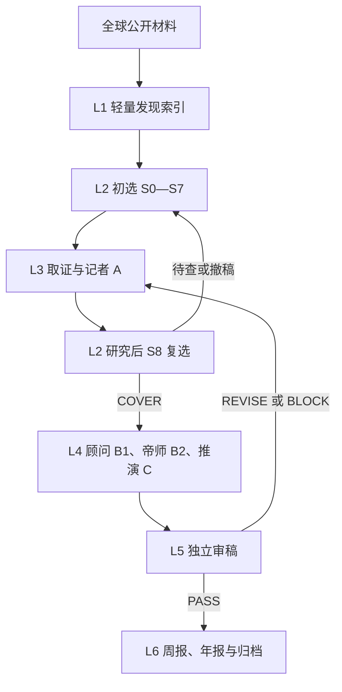

# 内参系统 V5｜唯一现行完整架构基线

> 状态：**唯一权威、完整、自足的 V5 产品与架构施工说明书；软件、样刊及生产效果尚未验证**。制定于 2026-10-14（新西兰时间），适用 `newspaper/strategic-intelligence/`。接手者直接从本文件理解使命、产品、栏目、六层流程、数据、审稿、四阶段施工与验收。实施不得以模型提示词、局部模板、代码现状或方便施工为由删减本说明书的要求。

## 0. 效力、定义与阅读方式

**唯一规范入口**：本文件本身完整规定系统目前的理念、产品、方法、施工与验收边界。`README.md` 和 `AGENTS.md` 只指向这里；其它项目资料不构成实施前的必读前置文件，也不能单独改变本文件。未来任何获用户确认的新要求，必须直接更新本说明书中所有受影响的正文、规则和验收条款，再发布新版本；不能让实施者到其它资料里拼出当前设计。任何系统及平台层面的安全和法律要求照常遵守。

**确认的内容**：系统只服务用户本人；正式产物为供其阅读和自行思考的杂志式周报与年报文档，不建设读者答题、对话或学习反馈系统。系统使命、独立全球发现、两级选材、A/B1/B2/C、七问三检验、新闻完整性、世界知识教学、年度周刊主干加独立全年核查、六层职责、质量与历史保真、九领域同等初始机会均已确定。**尚未确认的执行参数**：具体周刊出刊日期、面向本人交付的渠道、模型供应商、API与服务器预算、主机环境、是否以及何时自动交付、整刊双语、特刊。没有这些参数不妨碍继续制作离线样刊和文档，但不能把空白项视作授权。

**规范词**：`必须/禁止/BLOCK`是硬约束；`应/REVISE`是达标前返工要求；`建议/可`为编辑默认值，允许有理由地调整。试用数字和分数不是科学定律，也不允许越过事实、权限与审稿门禁。

**六层**指职责和工序，不意味着六个微服务或六位独立 Agent。**S0—S8**是选材的九个动作，其中 S8 发生在 L3 完成证据与 A 初稿之后。**七问**是 L4 的内部思路，不是七段外显正文。**年报 A01—A12**是年度出版十二道工序，不能和上述编号混淆。**L1 初筛指数、L2 选文评分、L5 文稿质量评分**分别管理发现优先级、编辑研究价值和稿件质量，不互相充当通行证。

## 1. 最高理念：把真实世界变成可独立运用的知识

本系统**只为用户本人**持续从全球新闻、重大事件、公开调查、财报、政策、学术和机构报告中，选择这一周确实有意义的现实变化。大模型帮助连接人类已经公开、合法可用的跨领域智慧与研究方法，但不能冒充读过未取得的著作、取得机密或拥有全部人类知识。先用专业记者方法让读者完整、客观、准确地知道发生了什么；再由同一研究工作台中的顾问研判现实问题、权力和资源约束、利益与行动、互相竞争或协同的机制；由帝师从事件中找到真正欠缺的学科知识，用定义、过程、算例、历史及现实对照、反例、边界和陌生场景迁移来教授；最后将已经论证的机制用于有条件的后续推演，留给读者自行思考。

最终成果不是替读者永久提供现成观点，而是逐渐形成**对世界当前状态与运行方式的有证据认识，学会自己观察、查证、解释、反驳和修正**。世界知识范围开放：人性、商业、财经、政治、军事、人事、管理、制度、组织、法律、医学、科技、能源、历史、文化、社会、地理、心理、统计以及新事件要求的其它学科。既不能把所有事件压进一个术语，也不能假设每件事背后有唯一终极规律。

以“面向总统或顶级家族的内刊”为质量比喻时，具体指：广泛看到重要世界，敢于追问重大现实问题，区分事实和判断；把智囊团查过的原始依据、机制和最强反方呈现清楚；对可能后果作条件化分析；尊重读者的独立判断。不得假称获得国家秘密、私人内幕、未做的现场采访或某机构未公开的内部选文算法。可借鉴[《半月谈内部版》公开介绍](https://paper.xinhuanet.com/bytnbb_m.html)的问题意识、正反与深度，[《求是》公开办刊材料](https://www.qstheory.net/20260530/0645227d6f1149d482b83682c298949e/c.html)的现实与学理结合，以及[美国总统每日简报的公开说明](https://www.intelligence.gov/publics-daily-brief/presidents-daily-brief)所体现的精选和综合分析；本刊自主确定价值标准，不继承机构立场。

所谓“正确的世界认识”指事实有出处、概念和数量正确、推断有可检查的中间条件、重要反例没有被藏起、结论随证据修正；对无法判定的问题坦诚说明未知。现实含多种机制、共同原因和反馈，强证据可以支持强判断，弱证据不能借权威语言提高确定性。

**最高编辑要求**：每一篇值得刊登的**重要主文**，应使读者比阅读前多理解至少一项真实世界的运行机制、适用条件以及何时不能照搬。政治稿应能从实际制度、权限与博弈讲清一个现实问题；投资稿应能解释价格、预期、现金流与风险的有关传导；创业稿应查需求、买方、价值创造与取得利润；技术稿应查物理/工程限制、采用成本和产业后果。具体知识由事实决定，不因栏目而固定，不能把弱证据包装为所谓普遍定律。记者 A 的事实是起点，概念和理论帮助解释，历史同类与反例检验边界，之后的真实结果用于修正判断。紧急或影响重大的事即使一时无法支持机制教学，也可以按 L2/L6 明确标识为短讯或待研究事项，不能为了满足这句话凭空发明 B2。

**六项长期目标在文档中的实现方式**：

| 长期目标 | 周刊、年报和研究档案须提供的内容；不测读者成绩 |
|---|---|
| 1. 全面理解世界如何运行 | 多地区、多制度、多行业的真实事件与正反例逐年覆盖；每篇写明机制的地域/时代边界，而非仅累计新闻条目 |
| 2. 建立独立判断与分析能力 | 在陌生题目中示范如何辨认原件、主体权限、竞争解释和可推翻条件；文档提供开放问题与查证路径，不要求相信顾问结论 |
| 3. 提高美股投资与创业能力 | 在真正相关的案例中拆解财报/估值/风险及客户/成本/竞争，给出迁移到另一真实问题所需的查证步骤；不等于交易收益承诺，也不设置领域固定配额 |
| 4. 积累、跨年复盘和修正知识 | 周刊原文、证据、概念、旧判断及其版本可按当时截面找回；年报审计证实、推翻、未决和遗漏，不用事后信息改写旧稿 |
| 5. 摆脱信息茧房 | 主动抽查偏好之外的地区、语言、阶层与正面/负面重大变化，寻找有依据的不同利益和解释；刊物须指出某个判断因何证据而修订，不能拿机械观点对半替代核查 |
| 6. 形成深度、真实、一线、前沿认知 | 尽量接近当事机构原文、政策/法源、公司披露、原始统计、原论文和可靠在地原创报道，分清实际观察与机构宣称；不假装取得机密、内幕、独家采访或没读过的原件 |

这些是三年等长期方向，不按一篇文章、一周或固定数值假装全部达成。系统只核**文档所提供的事实、机制、案例、反例、迁移和旧判断复盘质量**；不收集读者答案、测验结果、阅读行为或个人能力档案，因此不得宣称已实际测得用户能力提高或已经掌握知识。

### 1.1 读者实际应得到什么

1. 不读原文也能从 A 知道本周重要事情发生的完整经过、制度或科学背景和事实边界。
2. 从 B1 知道问题的真实结构：谁决定、付钱、执行、阻止、受益或受损，为什么会得到目前结果，以及其它解释为何也可能成立。
3. 从 B2 学到至少一项与本事真正相关、可以跨事复用的知识或判断步骤，而不只是记住本刊说过什么。
4. 从 C 看到条件不同如何改变参与者行为和后果，能够独立回答开放问题，甚至提出有据反对意见。
5. 以后复盘时可以找回当期原文、来源和旧判断；年报展示这一年现实怎样验证或改变认识。

### 1.2 产品北极星与成功指标

事实可信、研究深度、世界覆盖、独立思考空间和知识可迁移性，依次在真实样刊中由编辑与独立审稿核验。每篇主文要能指出所教概念、具体证据、适用边界、反例与陌生事例中的查证方法；周报与年报要能准确找回和复盘旧观点。**这些是刊物质量指标，不是读者学习成绩。**不设置读者答题、反馈、对话入口或个人学习状态；出刊篇数、字数、来源数量和模型调用量也不能替代内容质量。

## 2. 产品边界与本周/本年时间逻辑

正式产品只有 `WEEKLY`（全球战略周报）与 `ANNUAL`（全球战略年报），均为**仅供本人阅读的完整杂志式文档**，而不是多人账号、互动学习应用或对外发行服务。重大事件特刊尚未批准；既有每日新闻早报是独立项目，其采集、选题、双语、中美三篇、北京时间发送、邮箱、Actions、Secrets、预算和历史数据不自动移入内参。日报只可作可选只读线索；即使日报停产，本系统仍应独立找到全球重要主题。

**周报**聚焦这一周真实发生、正式发布或出现重要新进展的全球事件和报告：

- `EVENT`：事件在周内发生，需核实际发生与报告时点；
- `REPORT`：本周新发布的研究或财报，即使样本和数据跨多年，也以本周发布的新认识入选并写明数据期；
- `DEVELOPMENT`：旧事件本周出现正式生效、新披露、新结果或重大反证，报告本周具体变化；
- `INVESTIGATION`：本周公开的可信调查成果，明确原调查者是谁；
- `RESEARCH_FEATURE`：本周新证据将一段跨期问题变成新的研究议题，说明新证据为何现在改变认识。

已经过去、周内没有新材料的事例可作背景和帝师课堂，但不得伪装本周新新闻。周界、时区、知识截点和出版日属于未来需要确定的运行参数；设计和样刊均须明确写出所选区间和截点，不把未公开材料“提前知道”。每周没有足够合格故事时如实说明、调整刊物结构，不能凑数量。

**年报**以全年真实周刊为主干，重新从已刊重要事件中筛选、合并、汇编，展现相互关联和一年后的真实结果；同时必须独立回查当年全球公开原始新闻、报告与数据，补足周报遗漏、纠正错误、审核事后数据修订。顾问形成年度世界变化的综合分析，帝师跨案例解释真正值得学的机制及边界，最后推演未来一年的不同条件路径。它既提供精选原刊回看入口，也提供全新年度长文和知识综合；缺期明确列出，不伪造52期。

## 3. 领域覆盖与资源分配：广泛认识世界居中

**九个领域进入 L1 和 L2 时具有同等初始机会**，不设置长期固定百分比或文章配额；创业、美股、政治、科技和其它领域按同一价值标准选题。每周最终篇幅由真实影响、典型性或突破、证据与能教的世界知识决定。对投资、美股和创业保留严肃专业能力，但它们不能成为全球发现的中心过滤器。重大事件可以占据整期主要篇幅，重要慢变量亦可以被写成主文。

| 领域索引（允许交叉） | 事实入口和专业核查 | 可能触发的跨域知识 |
|---|---|---|
| 投资与资本市场 | 上市披露、财报、估值、债券、资产、市场预期和风险 | 组织激励、会计、利率、资金与时间、价格形成 |
| 创业与商业 | 客户付款、产品替代、采购、单位经济与竞争 | 信任、管理、法律、产业链、组织采用 |
| AI、科技、能源与医学 | 原论文、试验、工程复现、成本、临床及监管 | 科学方法、基础设施、资本配置、社会影响 |
| 宏观与金融 | 财政、央行、统计、贸易、信用、汇率 | 分配、制度权限、传导时滞、历史路径 |
| 中国、美国及相互影响 | 两国制度、政策、社会、企业和国际互动 | 比较制度、组织、外交、产业与普通人生活 |
| 全球政治、军事与地缘 | 法源、公开预算、外交文件、能力与后勤 | 博弈、信号、联盟、国家能力与人性 |
| 企业、产业、管理与人事 | 利润池、价值链、激励、人才和组织执行 | 委托代理、权责、治理、文化与战略 |
| 社会、人口、生活与消费 | 人口、医疗、教育、劳动、民生与可比调查 | 行为、规范、家庭、代际、政策执行 |
| 跨域战略研究 | 结构变化、重大背离、过去错误及重大新问题 | 联合机制、历史对照、判断方法与反例 |

领域索引用于发现和领域事实核对，**不决定这篇必须教授什么**。军事新闻可能主要讲组织与资源，商业事件可能主要教权力与信任，医疗政策可能主要讲财政激励。覆盖多语言、地区、阶层、在地社会现实，新闻价值不以权贵姓名、热度、坏消息、美国股市或读者原有兴趣定义。地域和政治观点分布不机械平均；对重大缺口作覆盖审计。

九个领域是**同一研究引擎使用的九种发现及专业核查视角**，不是九套来源库、九组自动化、九位常驻模型或九份强制栏目文章。对美股重要公司或小团队可经营的创业模式，可以在有选题价值时建立跨周专题档案；它们使用同一 `Theme`、证据、旧判断和审稿机制，不另建常驻“投资中心”“创业中心”或按月强制复盘。只有真实变化和证据支持，才在周刊或年报呈现；小团队创业的预算、买方、获客、现金回收和可复制性是相关稿件的分析问题，不自动等同读者个人可投资/可创业的结论。

## 4. L1 全球持续发现：轻量索引、成本控制与防漏

### 4.1 输入与运行

周内分批检查已审核可用的原生 RSS/API、公开政府/司法/统计/公司/科学资料、地区与语言媒体、合法的新闻广域索引；按新问题补充检索。`SOURCE_REGISTRY.json` 中的124条是**待审核候选**（A116、B8），均未完成生产验证及AI处理许可审核；另有6条标为弃用，不能自动启用。新来源逐项审核，首版用少量经核实合规的来源证明可用性，不宣称已覆盖全球所有媒体。

发现的工作单位是“一个可能重要的事件/正式结果/报告/政策/调查”，而非每个转载网页。保留原语言、地区、原发和转引链、发布时间、事件日期、发现时间、类型、同源关系及查询来源；对跨语言转载聚类，不能把十篇同源转载当作十份独立证实。日报为空、一个广域平台故障时，原生来源和另一个渠道仍能提供候选，并记录缺口。

### 4.2 轻量候选卡（L1唯一必交）

对广域大量线索，先只保存合规的**标题、原始链接、出处、时间、来源给出的摘要或从实际获取材料形成的短说明**，以及地区/语言/领域/初步疑点。额外记录：本周新增什么、可能影响谁、是真实行动还是单方声称、下一步应取得什么原件、转载血缘、无法访问和权限状态。来源没有摘要则记缺失，绝不从标题补写成事实；受限全文不可因索引需要而先行保存或送模型。

已有重要机构或职位的公开立场、正式决定、预算与实际行动在本周出现可证变化时，L1 可标记“变化线索”及前后原件指针；这只让 L2 查验，不意味着人物档案更新本身就是本周新闻，也不要求对所有人物持续抓取。

初筛权重指数比较四类信息：①潜在现实影响范围与程度；②是否出现真实新规则/结果/关键证据或可能突破；③这周为何值得进一步查；④原始出处和合法核查路径。每项保留依据、未知和置信状态，初始分数只决定**先查哪一条**。被摘要低估的偏远地区、基层调查、正面成果、非英语世界、低热慢变量或可信重大异常应通过探索队列、抽样漏报与编辑直通人工复核。原始材料不足标`NEEDS_CHECK`，不是直接给零分永久剔除。

### 4.3 接口和失败

交给 L2：`CandidateIndex + EventClusterProposal + SourceLineage + CoverageGap`。L1 仅提出候选，不认定因果、不提供整篇新闻、不把摘要当已证证据。来源故障标`SOURCE_UNAVAILABLE`，其它来源继续；索引平台无法显示原发则留线索待查。主动记录覆盖的地区、语言、机构所有权、领域和抽检漏报，不以124个名字代表真实覆盖。

## 5. L2 严格编辑筛选：S0—S8、第二把尺子

研究目标是挑出**重要的真实世界变化且能教会有用知识**。选的是事件、实际政策、科研结果、财报或具有方法的报告，材料链接是取证入口。参考《半月谈》的问题意识与正反兼具、《求是》的现实问题和理论阐释，但我们的选文判断由可核事实、现实影响、典型性/突破、研究价值、全球视野和读者学习决定，不继承任何外部机构的预设立场。

### 5.1 八种判断维度

1. **影响范围**：生命健康、安全、自由、收入、权利、公共预算、资本和产业、国家制度、科学认识或组织运行影响了谁、多大范围；已产生与潜在影响分开。
2. **深度与持续性**：一次性冲击、可逆价格变化与长期制度/技术/能力变化区别；短期重大公共风险可凭严重程度入选。
3. **典型性**：有助理解更大类现实问题，须查其它例子与总体代表性，不能由单一病例概括全世界。
4. **突破性**：不典型但真实改变可行性边界的科技、制度、方法或公共成果，需要特别核查验证水平。
5. **可核查度与报道条件**：能否合法获得足量原文、过程、数据、方法、受影响主体和不同观点，写出独立完整 A。
6. **认知价值**：能否从现象讲清具有边界的机制、读者未来自己怎样查证；新闻影响重要但暂时无法深课时可作为信号，不硬讲帝师。
7. **独立发现与反茧房**：是否揭示非热门重大现实、重要被忽略的正面进展、其它国家语言或主流叙事中的证据裂缝。
8. **时间价值与可行性**：本周哪项新事实使旧认识需要更新；深研能否取得关键材料，不能以历史知识冒充本周新闻。

### 5.2 九道工序及准确时序

| 步骤 | 怎么做、应留下什么 | 何时停止或回退 |
|---|---|---|
| S0 全球发现 | 接 L1 轻量索引，主动寻找主流与探索队列，记录本周原始时间、来源、领域及背景 | 无真实出处则待核，不造新闻 |
| S1 事件归并 | 跨语言、跨报道合并同事件，标源头/转载/真正独立证据；不同报告可围绕不同真实研究问题拆分 | 同一事实重复不得刷版 |
| S2 四道硬门 | 核事件/报告真实与准确时点；重要现实或有依据潜在影响/典型/突破；有合法可查足量材料或合理取证计划；整刊不重复 | 任一门失败不得靠打分洗白。信息可补者`RESEARCH_PENDING` |
| S3 影响地图 | 按主体写`BENEFIT/HARM/MIXED/UNCERTAIN`与`OBSERVED/POTENTIAL/PARTIAL/UNKNOWN`，列实际变化、规模、来源、代价及二阶影响；如跨领域传递明显，列需要核查的中间条件与时滞 | 未来预测不能写成已兑现；不能从“可能传导”直接提高已证影响分 |
| S4 典型或突破 | 走`REPRESENTATIVE`并核同类样本/失效条件，或`BREAKTHROUGH`并核实际完成水平/独立验证 | 不以一个案例证明总体，不以宣传视频证明突破 |
| S5 试行评分 | 有事实理由逐维打分：影响25、持续15、典型或突破20、证据与可写性15、教学/判断15、独立/国际/新进展10 | 只作排序；不得取代S2与审稿 |
| S6 整刊编辑会议 | 比较同题稿及漏掉的地域、社会领域、正面成果、长期结构和反证；由重要性定封面与篇幅 | 不因九领域固定配额删重要稿 |
| S7 报道计划 | 确定 EVENT/REPORT/INVESTIGATION/DEVELOPMENT/RESEARCH_FEATURE；列原始资料、方法、关键数据、各方、反证和可写范围 | 没有可行A报道路径退回待研 |
| S8 查证后复选 | **L3 完成证据包和 A 草稿之后**，核初选分数是否被事实推翻，记前后决策、理由和未决，决定`COVER/REVISE/WATCH/DROP` | 只有最终`COVER`可进L4；L4找到改变题目的反证时重访S8 |

S5 初始参考阈值：`≥75`考虑主文，`60—74`可考虑信号或进一步研究，低于60通常降优先；重大公共安全等可用`URGENT_RESEARCH`进入快速查证。阈值须以跨地区、正负、技术和基层真实样稿校准；对于证据弱者不得自动提为封面，对于低热但影响大的线索可记录例外理由。分数适用于每个候选，九领域同等初始机会，不能用栏目配额替代逐条评价。

### 5.3 三个具体判例（仅模拟，绝非本周新闻）

- 某地已发布可查的长期疫苗覆盖和疾病结果评估，独立核对方法和成本后显示显著改善：有正面现实影响与治理典型性，即使热度低也可能是封面；外推到别国前重查资源和制度。
- 一家公司宣称新技术“效率提升90%”，只有演示影片、无测试条件与独立实测：可留在 L1/L2 待查，不能把该数字写成独立证实的技术突破。
- 两位名人社交媒体争吵传播很广，却无制度、资源、民生或可研究的典型机制变化：通常降级或舍弃，热度本身不构成价值。

## 6. 来源宇宙、接入与证据权利

媒体本地报道、各国政府和监管文件、法院与议会记录、统计机构和央行、公司披露、学术论文/预印本、临床与药监、公开机构/投行研究、资管和咨询研究、工程测试及可靠的现场调查，都可以做发现入口。媒体原创调查须归属作者；政府声明、企业公关、交战方消息、机构投资意见分别标其身份及利益，不能因机构名气自动认定为真。

**贴近一线的可执行取证顺序**：按具体主张先找能够直接核验该主张的原件或一手数据，例如正式法案及投票、政策文本及生效记录、监管命令、SEC/交易所披露及附注、统计定义与修订、论文方法及底层数据、公司合同/订单的可公开证据；再找独立的现场原创报道、采访记录或专业复核解释遗漏的背景。找不到原件时记明搜索路径、访问/权限障碍、已取得的替代证据与确定性下降，不把二手转述改写成“核查了原件”。原件本身也可能只是当事方宣传、行政目标或尚未验证的预印本；核其权限、测量与实际执行，并与可靠反证比对。“一线/前沿”描述**可证明的材料距离和研究时效**，不暗示本刊亲临现场、预知未来或拥有秘密线人。

每个正式接入的来源须分别记录：①访问是否可用；②所取内容与方法是否符合站点/API条款；③是否允许用该内容做模型处理；④是否允许本系统保存、保存多久；⑤是否允许对读者引用、节录或再发布。网页HTTP200、免费浏览、可抓文本、可发给模型、可再发行，是五种不同状态。无法确认具体用途的许可时以原链接/合规元数据、允许的短摘以及其它可用原始资料为研究范围，不能先拿受限全文再补许可。不得绕收费墙、反爬或登入限制，也不将公共仓库变成版权全文仓。

事实证据建立`Claim→Evidence→DocumentVersion→OriginalSource`路径。记录数字原表或页码、单位/分母、统计期间、发表与取得时间、独立性、反证和修订。可核来源相互矛盾时按证据强度解释；未能证实的匿名消息、敏感军事数字或医学效果明确归属且降级，不写成已证事实。来源失效、数据被修订和报告撤回，需在受影响稿件及旧判断上追加更正或待查标记。

## 7. L3 记者 A：完整事实报道和三类专业写法

**A 必须单独可读。** 读者即使跳过 B 与 C，仍知道发生了什么、前后时间、主要数据、制度/历史背景、争议双方和不知道什么。它是基于实际公开来源重新调查核对与原创写作的专业报道，不是百字摘要、整篇复刻版权原文或未经核实的翻译拼贴。篇幅按事实复杂程度确定，避免AI腔与重复水分，长报告按章节检查而不静默截断。

### 7.1 六要素和实际核对

`Who`谁作决定/发布/承担后果；`What`做了什么，声明、草案、表决、签约、施行和实际兑现不可混写；`When`事件、报告、数据期和本刊截点；`Where`地点、样本地域与法律适用范围；`Why`已披露理由及可证背景，未证私人动机须标明未知；`How`法律/预算/资金/工程/试验/组织实施过程。

正文还须有准确导语、可读时间线、历史基线、关键数字及币种单位/分母/数据修订、重要当事方与独立意见的合理权重、足以理解事件的专业背景和重要未知。多家媒体复制一条稿件只能算一个源头；外文翻译不能改变原文语气、条件及证据等级。不得冒充现场记者、采访当事人或取得内部机密材料。

### 7.2 按材料类型完成报道

- `EVENT/DEVELOPMENT`：核正式文件与真实动作、适用主体/区域、实施进度和最新更正。政策提案不写成已生效；军事实况区分各方主张、可信独立核验与仍不明的结果；公共卫生避免把模型预计称实际拯救人数。
- `REPORT`：写清机构、直接作者/资助或利益、研究问题、发表日与样本期间、国家/人群、抽样/实验/会计/模型方法、原报告具体发现、数字和图表、研究局限、不同结论及现实意义。报告中的机构预测必须归属，不得被本刊新闻正文转换成已证事实。
- `INVESTIGATION`：写原媒体/记者、采访或文件方法、证据与指控的区别、被调查方回应、司法或监管进展；本刊独立取得了什么材料分别交代。不得转述成“本刊独家调查”。

交付`EvidencePacket + ClaimRegister + NewsDraftA + FactLimitations`，返回 L2 S8。若 A 的重要事实不足，不能靠精彩的 B 补救；材料可补则继续研究，不可补则降稿/撤稿。

## 8. L4 联合顾问—帝师：七问、三门、双向返工

本层只有一份共享研究案卷，B1、B2、C 共享同一事实、研究截点、竞争解释和领域资料。顾问与帝师是互相校正的研究职责；新闻 A 和 B1/B2 的读者叙事保持清楚。七问是**内部研究过程**，不把读者文章强制切成七标题。

| 七问 | 研究输入与实际调查动作 | 应留下的成果与不可越界线 |
|---|---|---|
| 事：发生什么 | 对照原始文件、新闻、日期、行为、数字、实施状态；区分“谁说”与“已做” | 已证事实包、主张引用；缺关键原件则停在`RESEARCH_PENDING` |
| 题：真正疑问 | 将标题暗示的故事与实际变化比较；查过去基线与事前预期、影响对象、反常点 | 可研究的问题；没有增量不硬写深课 |
| 势：条件与约束 | 查法定权限、财政/现金、工程、时间、供应、组织与历史路径；问哪些必要条件具备，哪些不能绕过 | 约束地图与瓶颈；必要条件不能自动当充分原因 |
| 人：主体与选择 | 列谁可批准、否决、付钱、执行、退出；实际行动、信息、收益、损失、信誉、信念和承担风险 | 行动/资源地图；私人心理无证据时只列可证伪假设 |
| 因：解释机制 | 提出有实际理由的竞争或协同解释；每条写条件→中间过程→结果，并寻找真正可区分的数据 | 多机制假设、最强反方、反事实与缺口；不强凑固定数量 |
| 断：当前判断 | 分开确证事实、合理但待证推断、已知未知；实际存在决策问题时分析方案、代价、对手回应及退出条件 | 有条件判断；没有可行投资/创业结论就如实说无 |
| 道：教会什么 | 从解释所必需的知识中挑选最有解释力、证据强且可迁移的原理，核定义、程序、数字、反例及陌生情境 | 完整教学单元；栏目不能封闭学科范围 |

**三道门持续在线**：①事实门核源头、时间、数值、权限；②反证门核最强竞争解释、因果中间环节、失效条件；③教学门核知识定义、操作/算例、反例及迁移。缺真实来源的重大断言`BLOCK`；合理但资料不够的研究停在未知，不能用文学语言把未知填满。

**两条返工回路**：顾问发现关键事实或传导缺口，回 L3 补证，并可能重做 L2 S8；帝师在正式教学、真实例子或跨域迁移时发现原机制解释不了事实，回顾问重新问因，必要时再回 L3。L4 出现足以改变题目重要性的反证必须回 S8。停止深挖的条件是已能以可定位证据和清楚边界解释重大现象，或者新资料暂不可得而坦诚保留不同解释；不无限追问“最后一个终极原因”。

### 8.1 如何找原因而不编故事

**溯因**：观察利润下降、政策执行迟缓、技术无法扩产等现象，提出多条具体机制。**演绎**：分别问如果 H1/H2 真，原始数据、时间顺序、审批行为、成本和中介变量应该怎样变化；尽量找能够区分的证据。**归纳**：在口径可比的季度、地区、企业或病例中检查是否重复出现；检查共同原因、选择偏差、修订和一次性事件。最后判断机制可以并存、强弱随时间改变。没有反事实或数据时，标为“合理假说”，不能写“已证明”。

需要加深研究时，可在七问之内继续做这些动作：现实锚定→检查表面叙事与矛盾→倒推必要条件→比较跨层结构与竞争解释→逐环检验因果→识别知识缺口→逐层教授→迁移陌生事例→归档并用后来结果再检验。按本题证据需要选用，不强制每篇走完或把它们印成固定目录。

## 9. 顾问 B1：世界实际怎样运行、当前怎样判断

顾问从 A 的可证材料出发，先用一段明确说明“本刊要解释什么现实问题”。随后按本题相关性调查：

1. 画出受益与受损者；直接、间接和长期变化分别是什么，代价由谁实际承担。
2. 重建行动结构：国家的立法/行政/司法/财政权限、企业的董事会/经理/员工/客户、技术的监管/工程/采购或军事的指挥/后勤，按本题确实涉及者选用，不能将不同国家制度套成一样。
3. 查可行选择：各方可执行什么、可否阻止、受什么预算/法律/时间/物理/政治与信息条件限制；把“想要”与“能做”分开。
4. 比较主要解释及其证据：为何 H1 可能最能解释，H2 是否同样能解释现象，H1/H2 是否并行；给最有利的真实反证，避免稻草人。
5. 用实际的法律程序、产业链、现金流、数据、自然条件或历史时序补足每条关键因果箭头；金额、同比、分母和市场事前预期需核准。
6. 写有条件的判断：若哪个条件继续存在，各方可能怎样行动；何种新证据会推翻结论。事件与普通投资/创业无实质联系时不要硬给股票买卖或创业机会。
7. 若本事涉及长期重要机构或关键职位，按第 16.1 节调取**当时版本**，比较公开主张、正式决定和实际执行是否改变；写清权限与资源限制、任职更替、资料截点。若涉及产业、财政、能源、科技等跨域传导，按第 16.2 节逐环区分已发生、待验证与可能共同原因，而不是仅画一条诱人的故事链。

顾问不能把 A 新闻复述成辞藻更密的评论；不能因商业机会看起来迷人，忽略买方、付款、利润和进入门槛；不能因政治人物争执便断定其内心或秘密交易。观点可以有力度，但强度须与证据一致。

**重要稿的六问交付检查**（依现有 B1/B2/C 和 L5 完成，不新增第八套思考框架）：①为什么此事此周值得读，真实变化和受影响者是什么；②由哪些可查的主体、约束与中间过程驱动，哪些仍只是合理推断；③主流解释的出处、成立条件和局限是什么；④最有力的替代解释、被忽略的风险或机会以及可区分证据是什么；⑤哪些知识可迁移至其它现实、投资或创业问题，若不相关不得硬作交易建议；⑥未来什么实际观察可以支持、修正或推翻当前判断。前两问主要见 A/B1，第三、四问见 B1 与审稿，第五问见 B2，第六问见 C 与命题版本；可以自然成文，不印六个题头。若关键驱动没有可核依据或第六问不可回答，应降判断确定度、补证或暂缓深稿。

## 10. 帝师 B2：从这一件事实教会可迁移的世界知识

### 10.1 选择教什么，而不是先套课程

从 B1 的候选机制中比较：若删除这条机制，当前现象是否仍可解释？其关键传导有没有资料？同一分析问题能否帮助读者理解另一个行业、国家或组织？是否新知识而不是“利益重要”这种常识？学科定义是否正确？最终可讲一条关键机制、几条互相作用的机制，或仍有竞争的解释；不硬凑九门课，更不把社会经验提升成自然定律。

将所教规律正确归类：①算术/物理等形式约束；②在特定前提下成立的机制；③有资料支持但不普遍的经验模式；④有启发价值的历史/文化比喻。具体法条具有辖区与时点边界。必须说清哪一类、能解释什么、不能据它推出什么。

### 10.2 每个重要教学单元的八个实际动作

1. **事件起点**：引用 A 的实际变化与 B1 的真正难题，不从一段空洞“大道理”起笔。
2. **识别读者知识缺口**：少了哪个概念或程序就无法理解关键传导？只教授必要的先修知识。
3. **准确讲定义和来历**：若涉及经济、政治、法律、科学、组织或心理概念，应确认其正式含义、分析对象、时间和辖区。
4. **揭示传导**：按行动顺序写“谁在何条件下作选择→资源/权力/价格/时间如何变化→为什么产生结果”，每个关键箭头对应事实或明确假设。
5. **用可检查的细节教透**：一个来自现实材料的例子，再用有单位的小数字、制度批准步骤、现金/物资流、人员行动或试验过程真正演示；虚构数值显著标为假设。
6. **认真处理反例**：举出条件变动后该机制失效或不足的情形，也列最强竞争解释；读者学到何时不可以套用。
7. **回到本次事实**：刚教的知识究竟解释了什么、还有什么没解释；若不符合事实，退回顾问修正。
8. **迁移陌生情况**：给一个表面不同的国家、企业、行业或历史情境，告诉读者应查哪份文件、问哪几个问题、如何判断类比失效；开放让读者反驳。

正式稿可以自然叙事，不强制印出八个小标题。判定“教得深入”的依据是读者能够复述**方法与适用范围**，不是读到名人名言、长术语或很长的文字。必要时从基础定义重新讲，不预设读者已有金融、法学或军事专业训练。

**四种适用的讲解动作**：第一性原理只用于分解可查事实、物理/制度约束及必要条件，不把复杂政治或市场变成一条万能公式；费曼式解释要求用准确的普通语言、适量数字或直观例子使读者能复述，不为通俗而失真；苏格拉底式追问要求质疑本刊与流行叙事各自的假设、反证和可区分证据；案例与反例要求检验跨国、跨期、跨行业时哪些条件仍成立。以现有七问和八动作完成，**不另设四条模型流水线**。面向读者可自然呈现“事实→关注理由→必要概念→机制→案例与边界→条件判断→可迁移问题”七种内容功能，但不得强制七个标题、重复 A 或把未获证据的判断写成教学定论。

### 10.3 人性、人事、组织与中国传统思想

人性研究须从可观察行动及真实选择出发，核权力、资源、信息、短长期利益，再把恐惧、身份、声誉、信念、互惠、道德承诺、群体规范等列作可能机制；寻找公开行为、激励制度、投票/交易、可信访谈或适用研究支撑。即使不假设当事人自私，仅制度是否已能产生类似行为？若能，就不能把私人动机写成已查明的唯一原因。

管理与人事事项要落在谁招聘、考核、奖惩、拥有信息、能否执行、谁承受离职或组织冲突上。企业文化与权力不能只靠领导人的一句口号推断；看流程、激励、预算与实际员工行为。国家军事决策涉及正式权力、可动员资源、物理后勤和盟友反馈；心理猜测和古典谋略不能代替公开能力证据。

《孙子兵法》的虚实与信息、《韩非子》的制度奖惩、儒家义利与信任、《道德经》的反向反馈、《史记》和《资治通鉴》的具体史事，均可在有帮助时作为思想或历史比较：核原文篇章与语境、时代制度差异、现代可观察证据和类比在哪失效。它们可启发新问题，不能证明现代政治家私下想法、预测一只股票或证明某民族本性。不相关就删去引文。

### 10.4 可复核的案例展开（本段为假设教学材料）

某医院行政 AI 产品声称“节省30%的医生文书时间”。A 首先查该数字的样本、观察期、原任务定义、有无对照、产品是否真实部署、谁宣布、医院与医护的回应。B1 问使用者是谁、实际采购付款者是谁、预算批准和隐私/系统接入谁有否决权；H1 时间节省带来可兑现现金价值，H2 只是让医生把时间转用于更多服务而工资总额不降，H3 增加人工复核与计算成本，H4 现有供应商可捆绑相同功能。各 H 需要不同合同、工资、工时、费用和续约证据。

B2 教“价值创造与价值捕获的区别”：即使假设100位员工各每月节省10小时，也不能直接把1000小时乘工资当作已经省下的现金；排班是否减少、产出能否增加、患者实际付款机制、合同价格、服务和合规成本决定谁获得何种价值。再讲医院财务、IT和临床职能之间的否决权，举反例：有些场景虽不裁员，但加快服务或降低错误也可有可证价值。迁移到律所合同审查或政府办事系统时重查买方、工作流和规则。C 再分别推演“采购合同与实际续费确立”以及“效果存在但成本/否决权阻止购买”的路径，向读者问什么新数据最能区分。**示范数值与场景均为假设，不能作为当期真实新闻。**

### 10.5 可复用知识卡：服务写作与查阅，不记录读者表现

只有某项概念或机制**跨具体事件可重复解释、已有可核学科定义或足够真实材料、能写出必要条件和反例**时，才为其建 `Concept` 卡；一篇可以没有或只引用旧卡，绝不按栏目/篇数硬产。卡片应有稳定 ID、标题、用读者能复述的核心命题、命题类型（形式约束/条件机制/经验模式/历史类比）、必要条件与适用地域时期、简短的实际正例和有来源的反例、常见误用、还不能解释什么、相关周刊/原始依据/领域专题、建立及审核版本。假设算例和真实案例分开；卡与某篇文章的 B2 有关联但不能代替那篇文章从其新事实出发重新解释。

遇到相似现象时，先判断旧卡前提是否仍成立：成立则引用 ID 与旧解释、补本次新事实及相异条件；不成立则写明失效、补充反例或修订为新卡版本，保留旧版在原刊中的原话。不得只贴一张“预期差”卡就断言本次股价变化由预期差造成；还须核当时的市场预期、贴现率、风险与其它可能解释。同样，创业单位经济假设为每月收100、直接服务成本20、获客成本400时，静态直接贡献回收期为 `400/(100−20)=5个月`，**不含研发、管理、税费、流失与现金收款延迟，不能称净利润回本或真实公司财务结论**。

知识卡只记录**本刊在哪篇真实解释了什么、引用了何种原据、后来何时复用或修订**；可用`EXPLAINED_IN_ARTICLE`、`REUSED_IN_ARTICLE`标识稿件关系，均不描述读者能力。系统不要求回答知识卡、自动测验或反馈，不创建个人学习记录与掌握状态。用户可以私下思考或自行保存笔记，系统不依赖也不收集这些行为。内容从第二阶段按实际跨周重用需要积累，第一阶段可先在样刊中人工记录概念及其来源，不能为了卡片而推迟样刊。

## 11. C 事件推演与开放性思考

C 从 B1/B2 已分析的现实条件推导未来，不能用预测代替没查清的事实。默认至少写**两条实质不同的条件路径**（条件、行动主体、中间传导、可能受益/受损、二阶反馈、何时失效），必要时第三条是共同作用或仍不可裁决；路径数量依事件复杂程度调整，不为凑数臆造概率。时间范围按事件实际机制确定，周刊不自动给十年精确预测。

涉及机构态度转变或跨领域关联时，应明确哪位主体在什么权限和预算下必须先行动、跨域每一环可能经过多久、哪些替代材料或政策会截断路径。路径形成时存原话、当时证据与截点；以后结果不同，追加新版本复盘，禁止把结果写回原预测。

建议提出2—4个真正开放的问题：改变一个关键前提会怎样？换成拥有否决权者会作何选择？最强反方要什么证据才站得住？同一结构移到另一行业哪些前提需要重新查？这些是有用的编辑默认，不可为了固定题数写引导题。读者版标题为《事件推演与开放性思考》，问题印在文档中供用户**自行思考**；系统不索取答案、不开展问答、不追踪完成状态。后台只保留研究命题的现实验证指标，方便年报或后续真实进展审查，不记录读者作答。

一条路径模板：**可查起点→必须满足的条件→谁会作何决定→何种资金/权限/物理/社会传导→对不同人的结果→与竞争路径如何区分→哪条新证据可能推翻**。不使用凭空精确概率、绝对股价或必然胜负。材料只允许谨慎判断时明确说“当前不能区分”。

## 12. 九领域研究与教学的实际专业动作

以下为本说明书内完整的九领域事实检查入口。它们用于**相关时**深究，不是每篇九栏打卡；具体知识仍由现实事件、专业证据与读者理解所需决定。

| 领域 | 完整的研究顺序与可教授机制 | 易犯错误、反证与迁移 |
|---|---|---|
| 美股/资本 | 核价格与交易时间及宏观同日事件→读原始10-K/10-Q等或本地等效披露→分解营收、利润、营运现金、资本开支、债务、稀释→还原事前预期→按合适方法、真实参数评估未来现金流、折现与风险→解释不同主体的持仓约束。可教利润/现金、估值/价格、利率/久期、复利/期权真实尾部风险。 | 盈利增加不保证股价涨；无事前预期无法确定“超预期”；股息、利差与权利金没有无风险保证。迁移到陌生企业须重查报表与市场背景。 |
| 创业/商业 | 找痛点与现有替代→分清用户/买方/收益者/否决者→核实际付费、续约、现金和合同→计算定价减直接人工/算力/实施服务成本、销售周期与CAC→核竞争、监管、扩张与小团队可行实验。 | 融资不等于收入、试点不等于续费、毛利不等于自由现金；行业龙头可能内嵌同功能。迁移到新行业须重查预算/合规/分销。 |
| AI/科技/医学 | 核论文/预印本/实验设计、样本与结果、第三方复现→工程可靠性、吞吐、成本/TCO、基础设施→商业采购和实际使用→临床终点/药监状态、利益冲突及适用人群。 | 基准进步不等于规模化、监管批准或利润；初期临床信号不等于治疗有效已确证。迁移到另一技术时重查物理与制度。 |
| 宏观/财政/金融 | 查统计原始定义、基期与修订→谁有财政/央行正式权限→政策到银行、企业、家庭和资产的传导与时滞→分开名义/实际、存量/流量、利率/汇率、信用变化。 | 政策宣布不等于实际执行；同期涨跌不证明因果；跨国数据须核口径和汇率。迁移到另一国家重查本地制度。 |
| 中国/美国及互动 | 分别核两国法律、行政、地方与司法程序→政策目标、正式文件、预算与实施→企业/社会/第三国反馈→比较两边谁有决定权与受损受益。 | 不能拿一国议会程序套另一国，也不能因媒体声音大就视为政策已生效。迁移需重查地方及中央权限。 |
| 政治/军事/地缘 | 先核表态/法源/投票/命令及对方正式回应→资源、财政、物资、后勤、联盟承诺与时间→比较威慑、谈判、国内制度、真实理念等不同解释→核战况来源不确定性。 | 公开争吵不自动意味着私人恩怨；交战方宣称不等于独立证实；兵法不是胜负证据。迁移到新国家不可照抄制度。 |
| 企业/产业/组织人事 | 画价值链与利润池→客户、供应商、替代、资本与现金→管理层承诺对比投资、回购、薪酬考核和实际执行→分析员工、经理和所有者权责及竞争反应。 | 企业宣传不等于订单，名望不等于业绩；成本下降可被竞争者降价抵消。迁移到新行业重画买方与组织权限。 |
| 社会/人口/消费 | 先定义人群、地域、时点→核抽样、分母、加权和结构差异→查住房、就业、医疗、教育、法律与家庭约束→比较心理、制度、收入和平台分发等假设。 | 一个热搜或访谈不能代表整代人；民族、年龄和性别不是固定本性。迁移到异国重查购买力、制度与样本。 |
| 跨域战略 | 从重要背离或新证据提出命题→核两组变量各自定义/时间/单位→比较共同原因、替代解释与旧研究→识别哪些条件变化会改变世界运行结构。 | 反常不是内幕，融资增与收入不增也可能由观察口径差引起；旧判断必须按当时资料复盘。迁移强调可证伪边界。 |

所有领域均须允许正面、负面与混合结果；人性、文化和历史只在对现实解释有增量时使用。遇到学科争议优先原始事实、可复查法源/数据、适用的研究方法，再区分历史比较和文化隐喻。读者可以学多个互补规律，但不得把类比称为证据。

## 13. 周刊完整杂志：编辑、阅读体验与稿件关系

一期周刊作为**可独立阅读和归档的杂志文档**，包括：封面/覆盖区间/截点；可跳转目录及简明导读；连贯的总编辑卷首判断；依据重要性编排的完整主文，每篇 A→B1→B2→C；有价值但不足以成为主文的可选全球信号导航；真实新证据触发的历史观点更正；来源、方法、限制和许可说明。长篇叙事应像专业杂志，读者能先快速找到重要变化，再进入详尽报道与知识；目录和导航不能代替正文。栏目动态组合，允许空栏、跨栏、一件大事多视角而避免同一事实重复出版；封面不能永远固定美股或政治。内核可以用结构化稿件与档案支持审稿和排版，交付物仍是完整文档，不另建读者账户、答题页、讨论界面或多用户门户；PDF/HTML等具体版式由第一阶段真实样刊验证。

主编决定不同重要事件的篇幅与次序，保证事实与评论明确归属、同刊文章不互相矛盾、正面与负面重大事件都有公平机会。全文引用能返回原始材料，不引入结尾突然新增未经查证的事实。自然中文翻译保持源文不确定度和术语；外文名称和必要原词可保留，完整中英双语未决定。字数和篇数由真实研究决定，不设置固定期数字数或篇数。

内部编辑可为难以作完整 A 的题目写明确标识的短信号，但不得把每条短信伪装成已有 B2 深课。更正要标原刊、具体错处、新证据、影响到的判断、当前版本；用户可同时取回旧刊和新刊。

## 14. 年报：以周刊为骨架重新认识一年的世界

年报的第一个输入是**本年确实出版的周报全集**：保留每期原稿、当时观点/反方、证据、所教概念和未解决问题，列出缺期。第二个输入是**独立回查同年度全球新闻、正式文件、数据、行业与机构报告**：为了核兑现结果、发现周报漏掉的正面/负面变化、数据修订和过去判断错误。这第二条输入是已确认的查证责任，不把年报重新变成不依托周刊的独立日报集合。年度报告以周刊精选汇编和重组为阅读脊梁，穿插新的年度事实、顾问综合与帝师跨案例教学，面向未来一年给条件路径。

### 14.1 年度十二道动作（每步实际产物）

| 步骤 | 实际工作 | 必交成果及失败边界 |
|---|---|---|
| A01 | 固定报告年、知识截点、实际刊次和缺期 | 周报清单与原稿指针；缺期不得编造 |
| A02 | 独立回查全年重要原始新闻、报告、统计和权限 | 新证据清单及覆盖缺口；只读周报为不合格 |
| A03 | 取回周报重要问题、原判断原话、当时实际引用的支持/反对证据与知识截面 | 旧判断台账及证据版本清单；不能用新模型重写当年观点，也不能让后来取得的资料混入旧依据 |
| A04 | 按实际发生时间、披露时间串全年事件及后续结果 | 年度变化时间线，识别转载和同事件重复 |
| A05 | 核对跨年数据可比性、定义、单位、发布与修订日期 | 关键指标表与修订说明，避免年初年末口径混搭 |
| A06 | 将独立资料集与周刊双向比较 | 哪些选对、漏掉、夸大、低估；没有漏报也须写查法与结果 |
| A07 | 对有事前定义条件的判断逐项复盘 | 支持/反对/未决/不可测与错因；没有足够样本不报胜率 |
| A08 | 跨事件、跨领域解释结构变化和相互作用；比较重要机构公开立场、决定和行动的一年变化 | 年度机制地图、逐环证据、时滞与最强替代解释；不能以年末结果倒填年初已知 |
| A09 | 重新核金融、创业、政策、科技、军事、社会等真正重要领域 | 年度专题案卷；不为九领域凑篇数 |
| A10 | 跨多个年度案例教授值得保留的世界知识 | 正例、反例、条件、程序/演算、陌生迁移；不能重贴周刊段落 |
| A11 | 写新的年度顾问长文、帝师课程、未来一年条件推演并独立审核 | 全年真实影响、未知、重大错误与审核决议 |
| A12 | 排版、附周刊精选原稿入口、索引、修订和归档 | 年报版本；真实外发另看已获授权参数 |

年报正文应包含：全年最重要变化与旧认识的差异、若干精选问题的发展过程、全年顾问致读者的综合分析、政治与国家、资本与经济、产业和创业、科技医学与能源、社会人事与组织、被忽视的重要成果/问题、错误和未决判断、帝师跨案例课程、下一年度的不同条件情景以及参考文献/旧稿入口。具体次序和专题数量由年度真实价值决定，避免机械“年度十大”。

年度专题先讲当年的完整事实与数据来源、方法和修订，再讲顾问、帝师、情景与开放题。未来一年推演有分支条件、谁行动、资金/权力/社会或物理传导、受益损害、使判断失效的证据。三/五/十年可作观察视角，不能冒充精确预测。年报发布得晚时要区别报告年内事件和次年才公布的新资料；后者可用于后见审计，但不能改写当时读者和编辑已经知道的内容。

## 15. 整体六层架构、交接和实际返工

上图表达职责和关键回路，具体运行时存储、权限、成本、审计、归档服务于全部层。核心从真实事件、原始证据、报道到知识教学，不能反过来先让模型编通用课程再搜索新闻装配。

| 层 | 必须完成的职责 | 输入→产物 | 失败后的动作 |
|---|---|---|---|
| L1 全球发现 | 周内分批多语、多地区、多领域采集；轻量候选、去重、反盲区 | 经审核来源/索引→候选卡、来源血缘、覆盖缺口 | 源不可用记故障，其余渠道继续；不根据标题编事实 |
| L2 编辑筛选 | S0—S7评估影响、典型/突破、证据路径、知识价值；S8核研究后真实价值 | 候选/历史议题→选文理由、报道计划、最终决议 | 素材不足待查，价值被证伪撤/降级；不得以分数越硬门 |
| L3 新闻与证据 | 查原件/数字/法定时点，写独立完整A，报告核样本方法，注明未知 | 报道计划→事实包、主张映射、新闻A、限制 | 引用/授权/重大时间错误时暂停、补证或BLOCK |
| L4 联合顾问帝师 | 七问三门，B1判断、B2教学、C条件推演，适时引入真实历史 | 已通过S8的A和证据→共享研究案卷、B1/B2/C与反证 | 实证空洞回L3，机制被反证回L2 S8，教学错误重做 |
| L5 独立审稿 | 核事实、因果、领域知识、翻译、许可和教学实际展开 | 完整稿及原始证据→PASS/REVISE/BLOCK及逐项理由 | BLOCK不能进L6；修订后重审，不给自评通行证 |
| L6 主编、刊物与档案 | 整刊去重、事实一致、卷首、来源、完整渲染；归档旧版与更正 | 通过稿件→周报/年报及历史材料，已授权时方交付 | 目录漏篇、内容被截断、批准内容后变更或交付状态不明均停发 |

**返工的三种实际情形**：L3 查出“立法提案”只是讨论稿，回 L2 降低其新闻影响并更新 A；L4 发现原教学机制不能解释另一份同期数据，回 L3 查反例再重做 B；L5 发现古籍错引、金额单位错误或证据不能支持结论，给具体理由要求 REVISE/BLOCK，不能直接润色掩盖。每次返工保留修改前后的选材依据、证据版本和审核结果。

### 15.1 职责不等于模型数量

主编、记者、各领域研究员、顾问、帝师、独立核查员是必须履行的专业责任。初版可以由一个应用分阶段调用适合的模型和工具，重要事实仍须独立查验并有人工验收样稿；不得让生成者仅凭另一句提示词为自己宣布 PASS。跨医学、法律、军事等领域要加载适用的事实标准并检查可信来源，不假称无职业资格的模型有当事人亲历。只有样稿表明多模型或多个专门模块有真实增益时才扩展。

从读者价值反推的**五个不可丢功能**是发现真实事实、深入研究事实、从事实解释机制、保留可回放的知识与原判断、根据后续结果验证并修订判断。它们依次分布在已有 L1—L6，不是另五套系统。现行最小架构是**一个研究引擎、一套带时间和版本的共享档案、一个联合顾问/帝师教学工作台、一个独立审核机制、周刊与年报两种正式出版物**；“单一”指共享案卷、标准与接口，不表示一个提示词既写又自审或只有一名人类。每增加常驻 Agent、领域独立库、知识图谱、仪表盘或中间刊物，须指出现有功能的真实瓶颈、相同样本的可测增益、权限/费用/维护代价，并经相应阶段门；无证据则使用简单档案和研究流程。

## 16. 资料与记忆：为周刊报道和年报复盘而保存

资料与记忆只服务于周刊背景、事件新进展、认识纠错和年报回放，不单独出版或运行第三种情报产品。保存足以完成这些职责的原刊全文、实际取得且允许保存的资料或定位、来源/时间/证据、重要参与者与关系、事实与分析版本、年报所需的判断前提和教学知识。未来用户查找研究时应返回**当时原文和具体资料**，摘要只能做入口。战略判断、商业机会和结构异常是选文及深研时的可选视角，不作为独立系统或每期必填栏目。

**最小概念对象与必要含义**：

| 对象 | 记录的最小真实内容 | 错误时怎样处理 |
|---|---|---|
| `Source`/`DocumentVersion` | 出版机构、原链接、允许用途、原文版本/哈希、发布和取得时间 | 源失效/更改则追加新版本和限制，旧指针保留 |
| `Candidate`/`Event` | L1摘要与发现轨迹、事件日期、转载血缘、地区语言及L2结论 | 同源去重而不丢各媒体原报道与异议 |
| `Evidence`/`Claim` | 可定位页段、统计口径、支持/反对的具体主张、事实/宣称/推断层级 | 原件推翻主张时给受影响稿件和命题待修订标记 |
| `ResearchDossier` | 实际七问、机制、最强反方、领域检验、资料缺口、顾问/帝师返工 | 重大假说变更保留旧案卷，更新说明理由 |
| `Article`/`Review` | A/B1/B2/C、来源、审核意见、改稿前后版本 | 任何改动使绑定旧稿的审核失效，须再审 |
| `Theme`/`ThesisVersion` | 具体长期问题、原判断原话、当时证据/反证、条件和新的修订 | 不删除旧意见，不用后知结果冒充当时证据 |
| `Concept` | 有准入的可迁移知识卡、稳定 ID/版本、正反例/适用边界、原始依据、已在哪篇解释与再次引用 | 卡片被新证据修订时保留旧版及原刊指针；不建立读者练习或掌握记录 |
| `Weekly`/`Annual`/`Run` | 期号、覆盖期、资料截点、最终全文、模型/费用/执行与修订 | 缺期公开说明，未完成不得标正式出版 |
| `Institution`/`RoleAssignment`/`PublicPosition`/`DecisionAction` | 机构及正式权限、职位任期、带来源的公开立场、已作决定、执行行为与资源约束 | 换人不等于机构自动换立场；旧公开原话和旧任期不覆盖 |
| `TransmissionLink` | 两个领域/变量之间的条件、传导方向、时滞、证据、替代解释及观察状态 | 一环被证伪或口径变动则标受影响的后续链条待复核 |

至少区分事件发生时间、来源发表时间、材料取得时间、研究知识截点、数据所属期间及以后修订时间。回放旧判断时只展示当时已有来源，再把后来的新发现并列评估，不偷偷让年末数据进入年初分析。受限来源只保存被允许的元信息、链接/必要摘录；版权撤回或内容更正时按权利记录处理，不因“版本不可变”就违规继续公开受限全文。

### 16.1 机构与关键人物：观察其可证的公开变化

这是一种**围绕实际周刊议题积累的研究档案能力**，不是监控所有知名人士的独立雷达，也不为人物履历另设刊物。优先对象：对重大变化具有正式权限、预算、否决权或真实市场/产业影响的政府机构、央行、企业、监管者、政策制定职位、行业组织、产业领袖和大型资本机构。只有与可核现实议题有关时才建档；人物在不同任期、不同组织的权限须分别记。

每条时间线至少区分四类材料：①`POSITION`：本人/机构公开讲了什么、何时何地讲、原话是什么；②`DECISION`：法定文件、董事会公告、投票、预算批准等正式决定以及其生效状态；③`ACTION`：可查的拨款、采购、任命、执行、投资或监管行为，区别公告和实际完成；④`OUTCOME`：有证据的现实后果及其观察期。另记机构正式权力、资源和反向约束，以及真正可验证的职位、隶属、合同或持股关系。媒体分析、未经证实的人脉、揣测的私人关系/动机另标`INFERENCE`或`UNKNOWN`，不得写成秘密事实。

“改变立场”的检测必须给**前版本原句/行动、后版本原句/行动、各自时间及原件、语义或权限是否可比、改变由谁造成**。可能是同一机构换了负责人、同一人换了职位、原文件被修订、实施条件改变，不能把关键词情绪差异直接等同政策逆转。L1 只给变化索引，L2 依据本周新闻价值选题，L3 重新查两端原件和背景，L4 B1 研究权限/利益与行动差异，年报按年度截面复盘。没有本周新事实时只用作背景。相关数据沿用第 16.3 节版本和时间规则。

### 16.2 跨领域关联：逐环证明传导，保留不成立的路径

从已核事实提出影响链，而非先画大图再替每个箭头编理由。每条`TransmissionLink`保存：起点变量及单位/地区/期间、终点变量、方向、必要条件、中介主体与物理/制度/资金过程、预计时滞、支持/反对原始资料、共同原因或替代解释、适用边界。状态至少区分`OBSERVED`（两个变化本身已见）、`SUPPORTED_MECHANISM`（中间传导有证据）、`HYPOTHESIS`（待验证）、`CONTRADICTED`（重要证据不支持）；**观察到两端同时变化不等于证实了箭头的因果**。需要时写反向反馈，不能无限延伸至与证据无关的行业。

**假设教学例，不代表当前世界事实**：数据中心电力需求增长→某地区电网容量是否不足→监管和预算是否批准扩容→设备厂商是否取得实际订单→特定工程所用铜/替代材料是否增加→地区电价按何种机制变化→数据中心是否转移选址→相关企业资本回报在折旧、融资、竞争后是否真正改善。每一箭头可能受工程时滞、替代技术、库存、能源结构、当地法律、价格上限或合同锁价阻断。L2 S3 只标跨域影响候选；L4 B1 查中间机制及强反方，B2 教会读者传导方法和反例，C 给条件路径；年报独立回查哪些环节真实发生、哪些被阻断。初版可用结构化表格和来源 ID 做此工作；图数据库、自动“关联引擎”只有样稿证明检索/误报瓶颈后才选择。

### 16.3 三种必辨时间、原判断版本与历史截面检索

对于可以取得时点的每条重要事实或证据，**尽可能保存三个不同时间**：`event_at`（行为发生/政策正式生效的时间或时间区间）、`published_at`（这项信息实际公开、发布或修订的时间）、`recorded_at`（本系统实际获得并保存这一具体版本的时间）。各有原始时区、可用精度、出处和不确定性；无日时不能擅填午夜或用抓取时间冒充发生时间。报告覆盖的数据期另存`data_period`，后续更正的公开时间和重新获取时间形成**新材料版本**。原件链接、原文允许留存的哈希/页段及取得状态使三个时间可回查。

每项重要研究结论形成不可覆盖的`ThesisVersion`：稳定命题 ID＋递增版本号、作出/发表时间、知识截点、**当时实际使用的证据版本 ID 清单**、原判断原话、适用条件、主要竞争解释、信心表达的原义、可区分的后续证据、作者/审核和所涉周刊。修订写新版本，记录“什么新材料、何时公开、何时取得、如何改变判断”，旧版与旧证据不被后来正确答案覆盖。若原稿用“大概率”而无数字，保留原措辞，不虚构成事前的70%；评价时同时检验事前的条件。

至少提供两种**明确标名**的历史检索：①`KNOWN_TO_SYSTEM_AS_OF(t)`只返回`published_at ≤ t`且`recorded_at ≤ t`的那个原始材料版本，以及当时已存在的结论版本；复盘“我们为什么当时那样判断”时，优先返回该结论**实际引用**的证据清单与原文，不把当时可获取但并未使用的资料冒称依据。②`PUBLICLY_AVAILABLE_AS_OF(t)`可在事后研究“当时外界公开了但系统漏掉什么”，允许返回`published_at ≤ t`、`recorded_at > t`的**后来补录**资料，必须显著标为“当时系统未知”，并与第一种结果隔离。第一种可回答历史责任，第二种可审计当时漏报；两者不能混在一段未经说明的引用中。事件早已发生、文件却在 t 后首次公开时，两种检索都不能当作 t 时已知；t 后发布的旧期数据修订同理。

**政治假设演练**：1 月 31 日的命题 V1 认为某政策“大概率通过”，保存当时的草案、投票结构、公开表态、权限和最强否决理由及证据版本。3 月议会否决，形成新事件/资料版本、命题 V2 与复盘；查询“截至 1 月底我们为何作此预测”时先恢复 V1 原话、当时实际引用的原始资料、知识截点与不确定性，再**单列**3 月否决与当时可能未注意的、后来补录的1月公开资料。不能把3月的否决或3月新披露的1月内幕写入 V1，也不能因结局错误自动宣布 V1 在当时毫无根据。相反，若一份1月已经公开但系统3月才录入的文件足以推翻预测，应在漏报审计里诚实承认当时本可发现、系统确实没有使用。

实施时应支持按时间与版本精确定位，不要求首版上复杂时序数据库。首个真实样稿即以冻结材料清单、追加式版本文件/表和可重复的 as-of 查询验证；后续采用数据库时要保持同一语义。审稿者用事后材料污染的逆向测试验证：后发布早发生、先发布后采集、原文件更正、旧机构表态、旧预测覆写、时区与缺失时间，任一情况都不能让历史旧结论凭空预知未来。对资料依法须删除或限制使用时保留允许保存的审计指针与删改记录，而不违反权限继续保存全文。

## 17. 开源工具与 LLM 的职责边界

**优先复用成熟 GitHub 项目处理已有的通用问题，同时保留可替换接口。** 本节是已批准的复用方向和候选顺序，不表示已经安装、完成许可证尽调或生产测试。项目状态以实际代码、样稿和可重复测试证明。

| 工作 | 首选/候选项目 | 只让工具做什么；何时实际采用 |
|---|---|---|
| 订阅解析 | [feedparser](https://github.com/kurtmckee/feedparser) | 解析合法原生 RSS/Atom；第一批来源确有 Feed 时采用 |
| 网页正文与元信息 | [Trafilatura](https://github.com/adbar/trafilatura) | 对允许读取和处理的具体站点取文本、发布时间；不替代版权/真实性判断 |
| 扫描报告/PDF表格 | [Docling](https://github.com/docling-project/docling) | 对复杂合法文件获取结构，重要数值回到原表页核；按实际样稿需要启用 |
| 研究检索 | [GPT Researcher](https://github.com/assafelovic/gpt-researcher) | 独立的受控专题研究适配器；先测试来源明细、预算、调用和中文质量；其自动报告不是本刊成稿 |
| 流程与可恢复返工 | [LangGraph](https://github.com/langchain-ai/langgraph) | 当单线样稿验证通过且分支、恢复确有需要时引入；它的检查点不等于长期新闻档案 |
| 结构化校验 | [Pydantic](https://github.com/pydantic/pydantic) | 未来开发时校验来源、事实、编辑决议、审核和年报输入的可执行字段 |
| 美股披露读取 | [EdgarTools](https://github.com/dgunning/edgartools) | 有相应稿件时定点接 SEC 公告，核历史披露时点；数据供应商权限另查 |
| 编辑回归评测 | [promptfoo](https://github.com/promptfoo/promptfoo) | 比较固定正反样稿、模型与提示词表现，最终事实核验仍需查原文 |
| 排版 | [WeasyPrint](https://github.com/Kozea/WeasyPrint) | 有完整审核版 HTML 后才转 PDF，不在渲染时改写研究 |
| 无原生订阅的合法来源 | [RSSHub](https://github.com/DIYgod/RSSHub) | 只对经审查的具体路由按需启用，先核自身 AGPL 许可证及源站条款 |
| 金融广域数据 | [OpenBB](https://github.com/openbq-org/OpenBB) | 形成真实数据需求、查各数据提供者费用及授权后评估；非首版必要依赖 |

GraphRAG、n8n、向量索引、观测平台等只有量化质量或实际运维瓶颈证明收益时再引入。**多 Agent 审稿在第三阶段才比较试验**：先以真实专题和共同的事实错误/反证样本，对比单一独立审稿流程与分角色专业审稿的漏错、误报、耗时及成本；只有证据证明增益才成为运行依赖，不按 Agent 数量验收。对于依赖必须记录版本、许可证、可替代接口、允许外发的内容范围和样稿验证结果；不得因“GitHub星数多”而自动安装全套服务。

**LLM职责**：轻量候选分类和归并、深度研究计划与多解释、A写作辅助、B1/B2/C草拟、独立反证与语言编辑分别给定输入权限、输出结构和成本上限。实际事实、来源许可、最后评分和出刊授权不交给模型自报；必要核查必须返回原文。不同模型供应商可参与同题评测，最终供应商/价钱未获确认，不能将日报 DeepSeek 或其单期1元预算套入本刊。不能按无证据的模型“想象”填补最新法律、财报、临床或战况。

## 18. 审稿、硬规则与对照实例

**先过硬门，再谈分数。** L5 重读高影响原文、关键单位和时间、原发/转载、作者断言和受限引用；先独立提出疑点及真正能挑战本刊结论的证据，再对照文章。法律、医疗、财务、文化引文按对应领域真实方法核查。整刊主编另核稿件间重复、封面/卷首误导、语言完整和覆盖盲点。

| 编号 | 强约束及判定 | 实际结果 |
|---|---|---|
| V5-R01 | 重要事实无可定位来源、伪采访、时点或单位关键错误、非法处理受限材料 | `BLOCK`；修正并重审前不得出刊 |
| V5-R02 | A 只有标题摘要，缺必要5W1H、事件时间线、数值背景或报告方法 | `REVISE`；无法补到翔实准确则撤稿 |
| V5-R03 | B1 将猜测动机、相关性或模型推演冒充已证原因；隐藏强反方 | 严重者`BLOCK`，可修复者`REVISE` |
| V5-R04 | B2 只说“人性/利益/博弈/第一性原理”，缺定义、真实传导、实例反例和迁移 | `REVISE`；伪法理/古籍错引严重者`BLOCK` |
| V5-R05 | C 只写“继续观察”、一种必然预测、伪精确概率或引导读者认同的假开放题 | `REVISE`或严重者`BLOCK` |
| V5-R06 | 重大正面/负面/非英语/非热门价值因固定栏目配额或读者既有兴趣被排除 | 退回编辑会议，记录覆盖盲点 |
| V5-R07 | 年报只拼周刊，没有独立年度资料、漏报/旧判断/修订审查或年度知识综合 | `BLOCK`，重做年度工序 |
| V5-R08 | 历史旧文稿被事后覆写、未来资料冒充旧判断依据、以出刊事实声称用户已经掌握 | `BLOCK`或撤回失实声明，恢复历史原文 |
| V5-R09 | 未经确认就改日报、启新调度/收费、发送邮件、交易、提交密钥/私人资料 | 停止有关外部动作，隔离与修复 |
| V5-R10 | 代码实现或材料标题写“已通过”但只有设计，没有真实样稿/测试 | 标实际状态，不能越级验收 |
| V5-R11 | 把事后才发布或取得的证据写入旧预测的原始依据、无痕改写旧判断、混淆旧公开时间与系统记录时间 | `BLOCK`；恢复旧版和证据快照，重做第16.3节双模式复盘 |
| V5-R12 | 把公开立场当实际执行、把未经核验的人物关系或私人动机写成事实 | 严重者`BLOCK`，可修复者退回 L3 查原件/权限/前后版本 |
| V5-R13 | 跨域链条把相关性冒充已证因果、漏中间条件/时滞、将多环假说写成确定结果 | 退回 L4 逐环核查并修正确定度；关键影响被夸大时`BLOCK` |
| V5-R14 | 在样刊质量和研究可回放性未达阶段门槛时，因流程方便就扩大全量采集、并行 Agent、自动出刊或高成本模型调用 | 停止扩容，回到当前阶段修订稿件、证据或方法；不能以出刊量/Token 消耗替代研究质量 |
| V5-R15 | 重要主文虽有大量新闻及抽象议论，却无源于本篇事实、可检验中间过程、条件/反例和陌生事件迁移的实际机制教学 | `REVISE`；材料目前不足以完成时改明确标识的短讯/待研究，不能伪造规律或以知识卡代替 B2 |
| V5-R16 | 将转载当独立来源、从单一利益方材料推定事实、找不到原件仍称“已核原始资料”，或机械拼正反观点充当反茧房 | 关键事实失实则`BLOCK`，可补的取证及覆盖缺口退回 L1/L3/L5，并保留漏题与解释审计 |
| V5-R17 | 为私人杂志增加读者账号、答案采集、对话/测验、完成率、学习画像或多人发行功能，或把 C 的开放问题变成必须回应的任务 | 取消该产品范围，回到文档式双刊；研究命题的现实验证与知识卡修订继续保留 |

编辑质量另可试用100分：来源事实20、因果机制20、反方与边界15、历史与情景15、可迁移认识15、任何领域的现实判断价值10、写作5。不能以本期没有证券或创业机会扣分。`≥85`可成为 PASS 候选，但任何硬门不合格仍不能刊登；70—84通常返工，低于70通常重研。L2 的100分完全不抵销 L5。样稿审核须具体指出句子/证据/资料期/机制，不以模型自评分代替审查。

**反茧房**从 L1 就检查地区/语言/机构血缘和被忽略的正面变化；L2 主动搜索读者偏好之外的重大题；L4 建立最强反方而非稻草人；L5 检查证据强弱分配。没有证据要求正反立场各占50%，也不将不同党派标签当事实等级。

每次整刊的覆盖检查留下可审的**漏题与解释审计**：①候选中被读者既有兴趣、语言或热门源排除的高价值主题有哪些，重读其原始线索并说明去留；②对每篇重要稿列主流说法及其原始依据、本刊最强可成立替代解释或关键未知，说明哪份证据可能改变结论；③同一事件的多篇报道是否来自一个通稿或共同利益方，把真正独立的现场/研究证据和不同立场分别标出；④正面成果和社会基层影响有无被热度或精英人物故事系统性遮蔽。审计记录具体被补入、待查、合理舍弃的题及理由；不能强迫找一个与事实等量的反对意见来凑平衡。

## 19. 工程施工、运行边界与阶段验收

### 19.1 最小系统和连续性

内容验证优先。第一阶段可以人工编辑和少量受控模型辅助，**不以自动化为样刊合格的前提**；后续再用一套模块化研究应用跑冻结样本和离线周刊，逐步接合法来源与经验证有益的专业审稿。结构化记录至少从**第一篇**保存材料版本、证据、当时判断、完整文章、审核与更正，不可等第二阶段或年报阶段才追建历史。开发可先用本地数据和文件，持续运行需要真正持久化数据库和私有归档、备份恢复；具体服务器、供应商、存储地和经费在实际投入前再定。

工作流的阶段状态、编辑决定、审稿状态分别表达，不能把 `COVER`、`PASS`、`PUBLISHED`当成同一个字段。每一步留任务ID、规范版本、输入证据指针、所用模型、结果、成本和失败原因。重试要有限；证据变化后使依赖的稿件、审稿和发布批准失效。发布批准绑定最终全文版本；交付需区分文件生成、服务商接受、确认到达和状态未知，结果未知时不能宣称已收到也不能盲目重复投递。外部网页/报告属于不可信输入，其内嵌命令不准改变系统规则或调用外部动作。

### 19.2 唯一施工顺序：四阶段及阶段门

本说明书是**施工依据**，不是待开发的“第零产品阶段”。工程只按下表第一至第四阶段推进；后阶段可以小范围研究和准备，但其验收、扩容和正式运行不得越过前阶段的质量门。每阶段保留输入材料、产物、独立审核、成本、失败和返工证据；上一阶段被后续反例推翻时退回修订，不能靠新的工具掩盖。

| 建设阶段 | 先建设什么；必须交出什么 | 准入下一阶段的实际验收与禁止的捷径 |
|---|---|---|
| **第一阶段：编辑体系** | 定栏目与跨栏原则、S0—S8选题、记者A、顾问B1、帝师B2、推演C、独立审稿和整刊结构；选择真实、有意义的**同一周**全球事件/报告，人工主导完成**一份真正可阅读的完整内参周报样刊**：封面、目录、卷首、经证据核对的完整主文、来源索引、必要更正。第一篇就留三时间、资料版本与旧判断指针。 | 主文逐篇经过真实原件与使用权核查，A能独立讲清事件而不是短摘要，B1有竞争解释，B2有定义/过程/算例/反例/迁移，C有有条件路径与非引导问题；L5独立列出具体证据及PASS/REVISE/BLOCK，整刊无误导。交主编和用户按样刊实物审读，未达要求继续修稿，**不能以模板已写、打分≥85或自动生成PDF代替真实样刊**。不启自动发信。 |
| **第二阶段：研究体系** | 对少量经核许可的来源形成可回查资料包、事实和引文核对、机构/跨域研究、长期主题与结论版本；同一议题在**至少两个真实不同周截面**更新、比对旧判断与新证据，能运行第16.3节两类历史查询；用冻结样本建立最小可重跑的L1—L6内部研究闭环。逐步扩展到至少**六份真实、合法、跨领域**的完整A/B1/B2/C证据案例，已用于第一阶段样刊的合格案例可计入。 | 能在不接既有日报的情况下重演同一主题的跨周演变、源失效/更正、旧判断原话与当时实际依据；后来公开/后来补录不能混入旧截面。六例包括非金融、非创业、非中美地区的重大题，至少一例核机构前后变化、一例逐环跨域传导；全部有独立审稿和版权边界。缺资料时正确停研或降确定度。不能把归档摘要当完整事实原件，也不能为达到案例数凑新闻。 |
| **第三阶段：专业能力** | 在第二阶段真实案卷之上按题接入必要的金融原始数据、企业披露、商业付款/成本/合同研究，以及政策、社会、科技、医学等专业资料；制作跨领域深度专题。对专业审稿可试行分角色/多Agent：事实来源核查、领域方法核查、因果反证和主编复核共享原件但各自留下疑点，模型不得自我签发PASS。 | 至少完成来源、单位、口径、时点、实际权限及商业/财务传导可追溯的真实深度专题；对同一固定样本比较专业多Agent与已有独立审稿的重大漏错、误报、中文质量、耗时及Token/金额成本。只有实际提高审稿质量才保留复杂编排；专业专题同样服从九领域价值标准，不得牺牲其它世界领域。 |
| **第四阶段：生产体系** | 质量与研究可回放已过门后，再做自动调度、候选索引增量化、工作流恢复、整刊编排、版式/PDF、审后版本锁定、授权交付、告警、日志、预算门、私有归档、备份与恢复。对已有实际周刊加全年独立原始资料，执行年报A01—A12的缩区间回放；真实年度刊物仍须等真实全年资料。 | 经批准的小规模合法来源完成**连续多次完整离线周刊预演**，测断源、超预算、重复任务、模型故障、审后改稿、邮件服务商不确定返回、重复发件防护与备份恢复，记录质量及成本；年报能交旧周刊、独立年度资料、漏报/纠错、旧判断时间截面和年度新综合。**正式自动发行、邮件、收费和具体预算/渠道仅在用户另行明确授权并通过相应运行验收后启用。** |

**六案例覆盖检验**：第二阶段的六个题目由全球真实价值决定，可覆盖资本、创业、科技医学、政治军事、社会治理、宏观及非热门地区。模拟案例可验教学逻辑，**不得**冒充真实六案例或合格周刊。第三阶段多 Agent 审稿若不能证明相对单流程有价值，应保留独立审稿职责而简化技术实现，不因此跳过质量门。

**阶段门的愿景补充**：第一阶段每篇重要主文回答第9节六问的适用部分，能由原始证据指出文稿实际解释的具体机制、反例和迁移，整刊提交第18节漏题与解释审计；第一篇可人工登记文稿讲过的概念，不为知识卡平台推迟样刊。第二阶段在跨周真实需要时按第10.5节选择、重用或修订少量卡，旧卡失效留痕，不建立读者成绩。第三阶段专业专题须证明一线材料、专业方法和竞争解释比普通摘要多了什么；第四阶段核长期档案、杂志文档、交付与纠错是否可恢复。六项目标是产品追求，阶段验收只评估内容和研究的可核质量，不声称已经测得用户学习效果。

**成本原则**：每轮记录取得/清洗材料、L1候选筛查、L2深研、写作、审稿、排版各步模型与工具用量、金额、失败重试和相应质量产出；低价值候选在 L1/L2 提前停止，已有合法资料优先重用许可范围内的版本。成本控制不以牺牲原件核查或把完整报道压缩成摘要换取。任何“更复杂、更多 Agent、更多 Token”都只在相同真实案例上比较其额外价值，内容仍浅就回第一/第二阶段修改选题和研究方法。

### 19.3 必须实际执行的逆向验收

转载十次仍是一条来源；花边热搜落选；重要正面基层成果可以入选；匿名消息不变成确定新闻；利润增长与股价下跌仍比较预期和替代解释；融资不变营收；政治口角不变已知私下动机；预印本不变正式临床效果；旧报告的数据期不变本周事件发生日；年报有真实双重输入、旧刊缺期和后见时点；删掉日报仍能发现世界；引用、数值和历史版本错误能被BLOCK。每项留下输入、预期、实际和失败证据，不能因文档存在就宣称测试成功。

新增三个必测负例：重要机构同一句措辞被断章截取为“立场逆转”，但前后政策权限/执行未变，应被退回；用电增长与铜价同涨却没有扩网/材料/采购证据，不得生成确定收益链；1月决策、3月公布否决、3月补录一份1月已公开但旧稿未使用的原文，旧预测复盘必须分别列原证据、事前公开但系统漏掉的资料、事后结果，不能把三者合并。

愿景相关的逆向样本还须包括：全球热门稿只重复媒体摘要而无新可迁移机制，应退稿或降级；十篇转载同一通稿不能充作十个独立立场；一个冷门地区的可靠正面成果不能仅因读者偏好或栏目配额遭淘汰；一篇稿件虽然正反措辞各占半篇，但反方无原件和相关证据，不能以此宣称“破除信息茧房”；旧卡经新的可核案例显示适用前提不成立，必须修订卡、保留原刊并重新教条件；杂志末尾的开放问题不能变成答题提交或掌握度追踪；读者收到知识卡也不能被宣称为已掌握。每个反例记录具体源、旧/新版本及审稿决定，不拿这份测试清单冒充已经通过。

## 20. 唯一规范的版本治理与执行状态

**施工入口**：实施者完整阅读本说明书，按具体工作定位相应章节，直接执行其中的字段、硬门、失败分支和四阶段验收。入口文件只提供链接，任何模板、代码、讨论纪要或工具默认值均不能单独增减本说明书的要求。对未写清的必要操作，不从别处猜测出“同样有效”的规则；先在本说明书补足，经核实后再实施。

**新要求怎样成为现行规则**：核对 GitHub 最新版本及用户明确的新决定，逐节识别对使命、栏目、流程、数据、审稿、阶段门及权限的影响；提出具体修改和验收方法。获确认后在同一次规范变更中更新本文件所有相关章节、规则表和交接题，检查内部引用与相互矛盾，再发布新版本。版本记录可留在 Git 历史和档案中供审计，但实施者不必阅读决策沿革才能理解当前系统。未写进本说明书的讨论、摘要或新建议不自动成为约束；发布后以本文件的最新版本为准。文档中的设计状态与真实软件、源许可、样刊、审稿、交付和读者实际学习效果分别报告，不以文字通过代替运行验收。

**当前状态**：V5 是已确认的设计基线，首份完整样刊、来源生产许可、跨周回放、自动工作流及连续出刊尚须按第19节验收；本系统不实施用户实际掌握测评。`SOURCE_REGISTRY.json` 是候选来源目录，不代表许可已过；`ISSUE_BACKLOG.md` 中未关闭的实际问题仍是建设任务。公开仓库不得存真实身份、交付地址、交易账户、密钥、内部文件或受限全文。每阶段报告真实提交、代码、样刊、来源、失败、成本及交付状态。

## 21. 换人、换模型、换电脑后的首轮交接演练

新接手者只凭本说明书回答并据其正文定位：谁是唯一读者、交付什么文档、开放问题为何不收答案？六项目标和主文教学门槛是什么？本周新事实如何从全球合法源进入轻量候选？L1为何不能当事实？S2四门及S5评分分别干什么？为什么 S8 必须在 L3 后？一篇 A 新闻的六要素、报告方法和来源边界是什么？B1与B2怎样分工、七问三门怎样真正展开？知识卡何时建、何时修、为何不记录用户掌握？C 怎样推演不同后果？年报为何从周报筛选且还须独立回查？九领域如何获得同等初始机会？机构公开表态与实际行动如何比对？跨领域每个传导环节如何验真？1月旧预测如何只用当时实际依据解释、又如何单列当时已公开但系统漏掉的资料？四阶段为何必须从一份真实优质样刊开始、六例在哪一阶段验收、何时才试多Agent和自动发行？来源、模型、交付、日报哪些尚未授权？

接着选一个**显著标注为模拟**的政治或商业案例，完整演示“轻量候选→L2理由→A事实与资料缺口→B1竞争机制→B2正式知识/算例/反例/陌生迁移→C条件路径与开放题→L5能否通过”。任何一项只能用抽象标签回答，均说明交接或本文件仍有缺口，应指出具体缺口补写；不得先称系统已经准备好正式发行。

