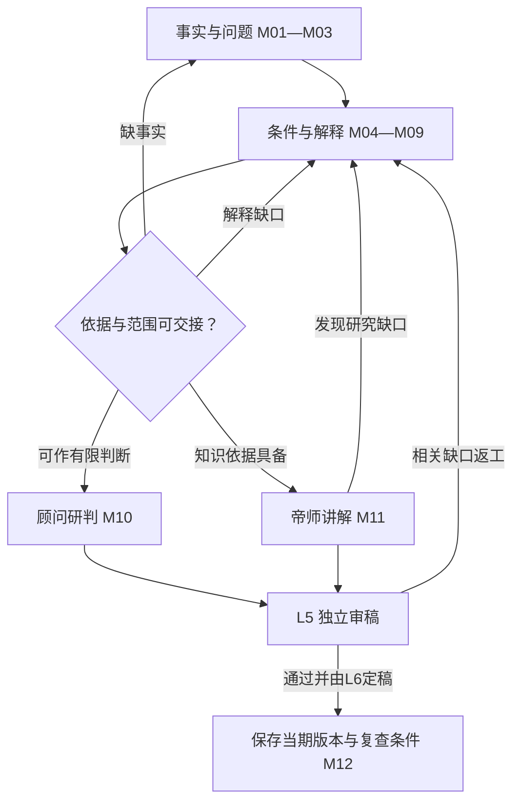

# 内参系统 V5｜唯一现行完整架构基线

> 状态：**唯一权威、完整、自足的 V5 产品与架构施工说明书；软件、样刊及生产效果尚未验证**。制定于 2026-10-14、修订于 2026-10-18（新西兰时间；本次按用户要求已依次完成NC-025—030的说明书修复，明确交接、实际取证、深度成果、审稿与专业条件，并补足具体模型及任务配置的分项验证、有限使用范围和变更复验，逐项标记完成；程序与内容实际验收仍待执行；此前已复核14项问题的建议方案，修正评分折算、交接证明范围与纠错演练次序等，并保留待验证状态；此前依用户要求新增自动派生的《问题.md》统一入口，集中登记14项审查问题、建议方案、理由及验收办法，后续说明书修复按问题顺序推进；已落实顾问帝师主动发现并检验深层机制、从本案形成可迁移认识及正式杂志无固定篇幅上限；此前已融入用户认可的教学展开及不同能力模型的连续约束设计：M01—M12交接、原典到操作的约束组合、逐步校验与返工、顾问和帝师分别交付；原有跨周研究、知识纠错与单一原文治理继续适用；自动研究控制器和实际模型能力仍待验证），适用 `newspaper/strategic-intelligence/`。接手者直接从本文件理解使命、产品、栏目、六层流程、数据、审稿、四阶段施工与验收。实施不得以模型提示词、局部模板、代码现状或方便施工为由删减本说明书的要求。

## 0. 效力、定义与阅读方式

**唯一规范入口**：本文件本身完整规定系统目前的理念、产品、方法、施工与验收边界。`README.md` 和 `AGENTS.md` 提供入口，`问题.md` 机械展示§23.2的统一问题记录；当前工作树不再保留独立规则、模板或SOP；其它文件仅按§24作为派生入口/配置、事实数据或执行代码存在，不能另立规范。未来任何获用户确认的新要求，必须直接更新本说明书中所有受影响的正文、规则和验收条款，再发布新版本；不能让实施者到其它资料里拼出当前设计。任何系统及平台层面的安全和法律要求照常遵守。

**确认的内容**：系统只服务用户本人；正式产物为供其阅读和自行思考的杂志式周报与年报文档，不建设读者答题、对话或学习反馈系统。系统使命、独立全球发现、两级选材、A/B1/B2/C、七问三检验、围绕现实问题的多原作研究、重点选读与权限内引文/译文、世界知识教学、年度周刊主干加独立全年核查、六层职责、质量与历史保真、九领域同等初始机会均已确定。本次又明确：顾问与帝师是核心价值，事实原作是共同基础，深度不能靠增加猜测获得；周刊以本周变化为主，按§2允许少量有充分理由的长期重大专题；研究可跨周推进，研究问题按类型分别验收；理论须指导取证，文章须把必要背景、作用过程与可迁移知识讲清；知识选择来自选题材料及其解释要求，不推测读者掌握状态；同一知识可依§10.7借新事实回顾；积累须支持新问题与依赖纠错；任务视图只由唯一原文派生，不能另立规则。**尚未确认的执行参数**：具体周刊出刊日期、面向本人交付的渠道、模型供应商、API与服务器预算、主机环境、是否以及何时自动交付、特刊。没有这些参数不妨碍继续制作离线样刊和文档，但不能把空白项视作授权。

**规范词**：`必须/禁止/BLOCK`是硬约束；`应/REVISE`是达标前返工要求；`建议/可`为编辑默认值，允许有理由地调整。试用数字和分数不是科学定律，也不允许越过事实、权限与审稿门禁。

**六层**指职责和工序，不意味着六个微服务或六位独立 Agent。**A**是经精选与核对的原作证据及阅读材料，按问题提供重点选读、必要导读和原文定位；**B1**是决策研究顾问，**B2**是帝师教学，**C**是条件推演与开放问题。**S0—S8**是选材的九个动作，其中 S8 发生在 L3 完成来源、权限、事实与 A 方案之后。**七问**是 L4 的内部思路，不是七段外显正文。深度主文按“有边界的核心判断→真实材料和分论点→顾问深入研判→帝师讲解与拓展→条件推演”连续呈现；研究时先证据后结论，写作时可结论先行，见§8.2及§13。**年报 A01—A12**是年度出版十二道工序，不能和上述编号混淆。**L1 初筛指数、L2 选文评分、L5 文稿质量评分**分别管理发现优先级、编辑研究价值和稿件质量，不互相充当通行证。

### 0.1 同一说明书内的三层效力

| 层级 | 约束内容 | 如何变更 |
|---|---|---|
| 使命与边界 | 服务本人、广泛认识世界、真实可核、独立思考、私人周报与年报、历史保真、日报独立 | 改变须经用户明确确认，不能因工程方便或模型偏好改变 |
| 必须达到的质量与流程 | 来源与主张可定位、证据与推断分开、解释有中间过程及边界、教学清楚、译文忠实、独立审稿可复核、旧判断可回放 | 允许改进方法，但不得降低要求；调整须说明如何继续满足目标并保存验证依据，实质降低标准须经用户确认 |
| 可校准的方法与参数 | 试行评分、篇数与编排、相关教学动作、情景数量、模型与开源工具、存储实现；篇幅依§13.6以讲清为准 | 在已有权限与预算内用真实样刊比较后调整，记录默认值、理由、版本和效果；不能视为新增费用、部署或外发授权 |

本轮已确认专题组织、重点选读、三种内容形态、顾问不强求新观点、按题调用方法、有价值的未知与轻量知识地图。长报告默认仅处理主题所需重点并附原文链接，不以全篇复制、全篇翻译或全篇附件为出刊条件。引文/译文的范围和完整标识仍须准确。七问、三门、教学动作和六问是同一研究的入口、研究、教学与检查视角，统一由§8.2的M01—M12衔接，不能叠加成数套重复长文；按题调用不能跳过关键事实、反例或解释边界。规则定义位置及变更传播按§20.1。

### 0.2 怎样阅读并把设计接成实际工作

首次接手仍须通读；下表帮助定位，不另写一份简化规则。产品用周刊和年报交付，研究围绕主题推进，所有角色共享证据与版本；以下章节共同组成同一流程。

| 想弄清的问题 | 阅读位置 |
|---|---|
| 给谁读、为什么做、最终文章和整刊长什么样 | §1—3、§13—14 |
| 怎样找材料、选题、安排长期研究并核原件 | §2.2、§4—7 |
| 怎样问对问题、分析、讲透并作条件推演 | §8—12 |
| 每层接什么、交什么、出错回哪里 | §15，具体填写位置在§22 |
| 怎样保存背景、旧判断、知识及更正依赖 | §10.5—10.6、§16 |
| 什么算合格、按什么顺序建设、哪些尚未实现 | §18—19、§23 |
| 规则怎样修改、交接、自动同步和按任务提取 | §20—21、§24 |

具体操作遇到引用时回到唯一定义处。先确认任务的阶段、问题与证据，再做该层交付；内部表格用来保证研究可核，读者正文按§13自然展开，不要求人类读者阅读全部工序。

## 1. 最高理念：把真实世界变成可独立运用的知识

本系统**只为用户本人**持续从全球机构研究、政治报告与政策原文、财报及企业披露、学术研究、公开调查、原创新闻和重大事件中，以这一周确实有意义的现实变化与值得精读的人类作品为主要入口，同时按§2选择仍具现实重要性、研究已经成熟的长期重大问题。大模型帮助连接已经公开、合法可用的跨领域智慧与研究方法，但不能冒充读过未取得的著作、取得机密或拥有全部人类知识。编辑的首要工作是**发现、比较、筛选和核对优秀原作**；围绕有意义的现实问题选择一份或多份原作，将相关重点与必要上下文组织成连续可读的专题。英文入选部分在许可范围内配准确中文译文，或明确标识的中文独立说明，并能定位原文；长报告不默认全文复制、全译或全部附后，篇末保留链接及章节/页段。短原作有实际阅读价值且权限允许时可全文收录，不为了“本刊原创”再把优秀文章重写一遍。随后，由像家族办公室、企业战略室或公共决策智囊团一样工作的顾问研究现实行动者、制度权限、利益与约束以及可执行的判断；帝师像给决策者授课的老师一样，从事件和原作中选择值得讲解、且有材料和知识依据的一部分世界运行逻辑，用明白的语言先讲清现象和机制，再在合适处介绍专业名称，以定义、过程、算例、历史与现实对照、反例、边界和陌生场景迁移来教授；最后作有条件的后续推演，留给读者自行思考。

最终成果不是替读者永久提供现成观点，而是逐渐形成**对世界当前状态与运行方式的有证据认识，学会自己观察、查证、解释、反驳和修正**。世界知识范围开放：人性、商业、财经、政治、军事、人事、管理、制度、组织、法律、医学、科技、能源、历史、文化、社会、地理、心理、统计以及新事件要求的其它学科。既不能把所有事件压进一个术语，也不能假设每件事背后有唯一终极规律。

以“面向总统或顶级家族的内刊”为质量比喻时，具体指：广泛看到重要世界，敢于追问重大现实问题，区分事实和判断；把智囊团查过的原始依据、机制和最强反方呈现清楚；对可能后果作条件化分析；尊重读者的独立判断。不得假称获得国家秘密、私人内幕、未做的现场采访或某机构未公开的内部选文算法。可借鉴[《半月谈内部版》公开介绍](https://paper.xinhuanet.com/bytnbb_m.html)的问题意识、正反与深度，[《求是》公开办刊材料](https://www.qstheory.net/20260530/0645227d6f1149d482b83682c298949e/c.html)的现实与学理结合，以及[美国总统每日简报的公开说明](https://www.intelligence.gov/publics-daily-brief/presidents-daily-brief)所体现的精选和综合分析；本刊自主确定价值标准，不继承机构立场。

所谓“正确的世界认识”指事实有出处、概念和数量正确、推断有可检查的中间条件、重要反例没有被藏起、结论随证据修正；对无法判定的问题坦诚说明未知。现实含多种机制、共同原因和反馈，强证据可以支持强判断，弱证据不能借权威语言提高确定性。

**最高编辑要求**：每一篇值得刊登的**重要深度主文**，应在文中充分解释至少一项有依据的世界运行机制及其边界、本题必需的概念/制度关系与明确价值前提的权衡，或区分竞争解释、识别因果尚不可判定所缺证据的具体方法。可以首次介绍，也可以按§10.7借新事实深入认识或回顾已有知识；这里验收稿件的具体内容，不宣称测得读者的理解变化。仅提供竞争解释的辨别方法时，不能冒称已查明本次事件的真正原因。政治稿应能从实际制度、权限与博弈讲清一个现实问题；投资稿应能解释价格、预期、现金流与风险的有关传导；创业稿应查需求、买方、价值创造与取得利润；技术稿应查物理/工程限制、采用成本和产业后果。具体知识由事实决定，不因栏目而固定，不能把弱证据包装为所谓普遍定律。**经核实的 A 原作及其可验证事实是起点**，概念和理论帮助解释，历史同类与反例检验边界，之后的真实结果用于修正判断。紧急或影响重大的事即使一时无法支持机制教学，也可以按§13.1的UPDATE_CORRECTION交已核重要事实，或留待研究；首次报道无需伪造旧文指针。L2/L6仍核本期依据与价值，不能为了满足这句话凭空发明B2。

**六项长期目标在文档中的实现方式**：

| 长期目标 | 周刊、年报和研究档案须提供的内容；不测读者成绩 |
|---|---|
| 1. 全面理解世界如何运行 | 多地区、多制度、多行业的真实事件与正反例逐年覆盖；每篇相关主文写明机制的地域/时代边界，而非仅累计新闻条目 |
| 2. 建立独立判断与分析能力 | 在陌生题目中示范如何辨认原件、主体权限、竞争解释和可推翻条件；文档提供开放问题与查证路径，不要求相信顾问结论 |
| 3. 提高美股投资与创业能力 | 在真正相关的案例中拆解财报/估值/风险及客户/成本/竞争，给出迁移到另一真实问题所需的查证步骤；不等于交易收益承诺，也不设置领域固定配额 |
| 4. 积累、跨年复盘和修正知识 | 周刊原文、证据、概念、旧判断及其版本可按当时截面找回；年报审计证实、推翻、未决和遗漏，不用事后信息改写旧稿 |
| 5. 摆脱信息茧房 | 主动抽查偏好之外的地区、语言、阶层与正面/负面重大变化，寻找有依据的不同利益和解释；刊物须指出某个判断因何证据而修订，不能拿机械观点对半替代核查 |
| 6. 形成深度、真实、一线、前沿认知 | 尽量接近当事机构原文、政策/法源、公司披露、原始统计、原论文和可靠在地原创报道，分清实际观察与机构宣称；不假装取得机密、内幕、独家采访或没读过的原件 |

这些是三年等长期方向，不按一篇文章、一周或固定数值假装全部达成。系统只核**文档所提供的事实、机制、案例、反例、迁移和旧判断复盘质量**；不收集读者答案、测验结果、阅读行为或个人能力档案，因此不得宣称已实际测得用户能力提高或已经掌握知识。

### 1.1 读者实际应得到什么

读者应能顺着一篇专题，从具体人、事、原作和事实进入问题，再理解过程、判断及边界。以下七个问题定义内容交付，不是要求读者答题，也不强制印成七个栏目。

| 阅读中的问题 | 刊物应提供的具体内容 | 主要责任 |
|---|---|---|
| 现实中究竟发生了什么？ | 有主体、背景、规模、时间、实际动作和未知的真实材料；原作重点、准确中文及原文定位，区分作者主张与本刊查实 | L3/A核材料，L4按问题组织 |
| 为什么值得研究？ | 本周新增点，或按§2说明长期问题为什么现在仍值得读；明确影响、比较基线和现有解释的缺口 | L2筛选，L4界定问题 |
| 为什么会形成这个结果？ | 条件、制度、资源、行动和反馈如何衔接；当前解释比其它解释多说明什么，哪些仍不能区分 | B1依§8研究，不把故事连贯当因果成立 |
| 当前最关键的关系是什么？ | 判断主次的对象和阶段、证据与反证；多项约束能否并存，什么变化可能使主次转化 | B1研究，B2解释所需概念 |
| 从中可以理解什么？ | 有边界的机制、必要概念/制度关系、经验模式、价值权衡或辨别方法；从事实铺垫到难点讲解 | B2依§10逐层教学 |
| 换一个场景还能这样分析吗？ | 可迁移的条件、会改变结果的差异、真实反例与新场景必须重新查证的事项 | B2/C给迁移与条件推演，不保证所有场景适用 |
| 以后怎样知道判断对不对？ | 可观察的过程、结果、反证与复查条件；能找回当期原文和原判断，年报再核实际演变 | C提出检验条件，档案与年报按§16、§14复查 |

A/B1/B2/C共同服务一条连贯论述，不各重复一遍背景和结论。长期积累的对象是有来源、有条件、可修订的知识与原判断；用户自行阅读和思考，系统不收集答案或阅读行为，也不能据交付推定用户已经学会。

### 1.2 产品北极星与成功指标

事实可信、研究深度、世界覆盖、独立思考空间和知识可迁移性，依次在真实样刊中由编辑与独立审稿核验。每篇深度主文须指出实际增加的理解、具体证据、机制或辨别解释的方法、边界、反例及迁移查证方法；精选推荐与重要事实/进展/更正按§13验收，不能通过全部改作短讯逃避整刊的深度研究使命；周报与年报要能准确找回和复盘旧观点。**这些是刊物质量指标，不是读者学习成绩。**不设置读者答题、反馈、对话入口或个人学习状态；出刊篇数、字数、来源数量和模型调用量也不能替代内容质量。

**本轮确认的认识边界**：系统帮助读者从真实现象进入问题，发现、解释和检验有证据的底层逻辑、条件机制与经验规律，并展示它们在现实社会中如何表现、引起变化、经历过程、产生结果或转为新问题。顾问判断仍须明确，但不得自封真理；“规律”分类依§10.1，卷首综合依§13.5。对还在进行的过程保留未完状态，对未知只说明可查路径。事实、关系、概念和价值权衡均可成为教学内容，不强求每篇发明一个普遍因果定律。

### 1.3 顾问与帝师是核心价值，知识范围保持开放

顾问B1与帝师B2是本系统的核心价值。顾问以“这件事本身怎样理解、对相关主体意味着什么”为中心，研究事实、条件、利益、制度、行动及演变，判断可能的机会、风险与选择。帝师承担世界知识教学的主责：从这些真实现象进一步研究和讲解历史过程、制度关系、人的行为与自然社会条件中可迁移的道理，说明它们如何产生、怎样表现、在什么条件下演化以及何时不适用。帝师可以主动提出教学问题、寻找原典与比较案例，不仅负责把顾问结论说得通俗，也不以判定一次机会为教学终点。两者共享证据、相互校正，具体分工与回路见§9.1；不把二者划成互不研究的孤立角色。原作A提供共同事实基础和优秀人类研究，C与档案/年报使这些认识可以接受后续检验。选题、取证、审稿与资源投入须服务这一价值，不以新闻数量、摘要数量、书名或术语数量替代分析和教学质量。

追到现象背后的本质，在本刊中是追查对明确问题有解释力的条件、机制、主导关系、反馈及边界；不能预设每件事都有唯一根因，也不能把未证动机写成内心事实。不同机制与角度可以竞争、并存或分阶段起作用，最终解释仍依证据。用户提供的狩猎教学例子用于说明希望达到的分析层次，不据此认定史实、固定心理推演步骤或把所有事件归结为权力算计。

顾问与帝师须主动完成从材料中发现问题、追查机制、检验关系并形成可迁移认识的研究，不能等用户指出更深一层后，才围绕用户说出的词补一堂课。用户以“辩证地看待新技术”等举例，是示范希望从事实获得的认识层次，不是指定本题必须讲某门哲学、强制套用某种世界观或预先给定结论。具体研究成果与交接按§8.4.1核验；发现也包括准确识别、核验和运用已有知识，不要求创造人类从未提出的新理论。

知识范围不由用户举出的书籍封闭。§8.3规定从实际认识障碍选择学科和方法、核来源与前提；模型不等于拥有全部人类知识或能无误调用所有领域。知识选择与多种解释的关系按§8.3.2执行，逐项精度按§8.8.4执行。深度应补上决定理解的中间过程；帝师依材料组织自足的教学，不以与读者互动、诊断其未知或验证其掌握为前提。同一知识的多种现实表现和必要回顾按§10.7处理。本轮获批的教学展开见§10.2.1及§10.4.1，连续约束见§8.2.1—8.2.3与§17.1；其规定研究和表达责任，允许依证据得到不同结论。寓言与古典概念不直接证明全人类共同的心理原因。

## 2. 产品边界与本周/本年时间逻辑

正式产品只有 `WEEKLY`（全球战略周报）与 `ANNUAL`（全球战略年报），均为**仅供本人阅读的完整杂志式文档**，而不是多人账号、互动学习应用或对外发行服务。重大事件特刊尚未批准；既有每日新闻早报是独立项目，其采集、选题、双语、中美三篇、北京时间发送、邮箱、Actions、Secrets、预算和历史数据不自动移入内参。日报只可作可选只读线索；即使日报停产，本系统仍应独立找到全球重要主题。

### 2.1 周刊的两种选题依据：当周变化为主，长期重大专题有据入选

每篇拟刊内容记录 `publication_basis`（本期刊登的时间与研究依据），只能取下列两种之一。它与素材类型、成稿类型分开，不能把旧报告的发布时间改成研究完成日。

| 选题依据 | 适用情况与必须说明的理由 | 不能据此做什么 |
|---|---|---|
| `CURRENT_WEEK` 本周新变化 | 本周真实发生、正式发布或出现重要新进展；核发生/发表/取得时间，说明具体新增什么及为何重要 | 不能以转载日、抓取日或本刊刚读到为由制造新事件 |
| `LONG_TERM_FEATURE` 长期重大专题 | 问题至资料截点仍有重要现实意义，研究已足以形成有价值的深度主文；说明当前重要性、研究范围、材料日期、本期刊登理由、与已有文章相比的实质贡献及最近核对结果 | 不能把长期议题冒充本周新闻，不能仅因稿件写完、课程缺一章或缺稿就入选，也不能凭旧材料直接断定现状 |

本周新变化的素材继续使用五种类型：`EVENT`为周内发生的事件；`REPORT`为本周新发布的报告/研究/财报（另列数据期）；`DEVELOPMENT`为旧事本周正式生效、新披露、新结果或重大反证；`INVESTIGATION`为本周公开的可信调查成果（归属原调查者）；`RESEARCH_FEATURE`为本周新证据使跨期问题成为新的研究议题。长期专题所用原作仍按实际性质和原始日期登记；`RESEARCH_FEATURE`不能用来掩盖没有本周新证据的情况。其它素材类型名称不单独证明新鲜度，须结合刊登依据和真实日期判断。

**研究准入与刊登准入分开**：有价值但尚未成熟的长期题，可先由L2提出计划，L3核关键原件与可行范围，再经S8的COVER进入L4跨周研究；COVER允许相应研究制作，不承诺占用本期篇幅。研究成熟后，L2/S6再比较刊登价值，重要新证据或范围变化按S8复核，最终仍须L5/L6放行。不能要求先完成L4才能获准开始L4，也不能因为已获研究准入就跳过刊登审核。

**长期专题的具体刊登准入**：L2须说明其影响、持续性、认识缺口以及为何值得占用本期篇幅；L3核现有材料的适用时期和足够性；L4已经形成可支持的解释、必要概念关系或有价值的辨别方法；L5核事实与方法，L6比较它与本周重要候选的优先级。按§13以 `DEEP_THEME`交付，不能把旧闻简单换标题、一般教材摘抄或多份摘要拼接算作成熟研究。重要性和研究成熟度均须有内容依据，任一不足则继续待研。研究后改变成稿类型时须重新检查本期刊登依据，具体分支见§13.1；长期专题不得借“降为精选”绕过深度准入。

周刊仍以当周真实变化为主要入口，长期专题是有限补充；不设未经样刊校准的固定篇数或比例，也不要求每期都有。S6逐期说明为何选择长期专题、是否挤掉更紧迫的当周事项及去留理由。可在篇首自然标明“长期专题：研究范围……；资料截至……；本期刊登理由……”，目录也标清，不能用刊登日期暗示所有事情刚发生。历史案例若只是背景仍按背景使用，不必独立升级为长期专题。

既刊错误一旦核实，继续按UPDATE_CORRECTION处理，不因缺少新外部事件而推迟必要更正；CURRENT_WEEK所记的是本周核实/发布的更正进展，必须指明旧文、原事实日期和本次纠错依据，不能说成旧事本周才发生。

周界、时区、知识截点和出版日属于未来需要确定的运行参数；样刊须明确所选区间和截点，不提前使用未公开材料。临近定稿时，L3对**能够改变核心结论**的状态、数字、政策生效及资料更正作有范围的更新核对，记录检查时间与缺口；L4/L5处理变化所影响的判断与审稿。若核对取得截点后的重要材料，须明确更新本期截点并重审受影响内容，或保留原截点、调整刊登安排并如实说明；不得混用新旧依据。没有足够合格稿件时说明缺口，不以长期专题补足虚假完整性。

### 2.2 出版按周，研究按问题跨周推进

研究不必在一周内开始并结束。使用同一Theme和ResearchDossier延续任务：先确定问题和关键缺口，取得最能区分解释的证据，形成稿件并核查，最后由编辑决定在哪期发表。每周只处理实际新证据、到期观察或有价值的取证动作，不把所有历史题重跑一遍。

| 当前研究情况 | 本期怎样处理 | 谁承接下一步 |
|---|---|---|
| 重要但关键事实未清 | 仅在可核事实足以服务读者时作有边界更新，否则留在待研队列；不强写完整因果 | L2保留重要性和暂缓理由，L3记录缺哪份原件、可行取证路径或重开条件 |
| 证据在增加，但解释仍有关键分歧 | 可以形成有价值的未知分析；否则跨周继续，不反复改写相同背景 | L4给下一项最有区分力的比较或观察，L2按重要性与已有资源安排 |
| 研究成熟且出现当周新变化 | 按CURRENT_WEEK重新核新变化与原研究的关系，经过S8和审稿进入本期 | L3核新材料，L4更新，L5/L6审核与编排 |
| 研究成熟且无当周新变化 | 逐项核§2.1的LONG_TERM_FEATURE准入；不能仅因长期投入形成沉没成本就必须发表 | L2/S6决定刊登价值，L3核资料是否仍适用，L5/L6把关 |
| 继续研究缺少可行材料、价值下降或已有解释足够 | 写明暂停/停止原因及必要重开条件；有用的未决和否定发现保留 | L2/L4收口，不新增无限调查义务 |

沿用Theme的WATCH/ACTIVE/SUSPENDED/CLOSED状态，以及TopicDecision的COVER/REVISE/WATCH/DROP决定；研究进度、编辑选择、审稿与出版各自记录，不增设另一套并行选题系统。活跃主题记录问题版本、关键缺口、下一取证动作、责任层、复查触发或合理窗口、当前背景版本及投入依据；没有批准的预算或自动运行权限，不因此启动收费、定时器或外发。主题结构背景按§16.5维护，研究停止规则仍见§5.4、§8.4。

### 2.3 年报的年度范围

年报以全年真实周刊为主干，包括实际刊登的当周内容和长期专题，重新筛选、合并、汇编，展现相互关联和一年后的真实结果；同时必须独立回查当年全球公开原始新闻、报告与数据，补足周报遗漏、纠正错误、审核事后数据修订。顾问形成年度世界变化的综合分析，帝师跨案例解释真正值得学的机制及边界，最后推演未来一年的不同条件路径。它既提供精选原刊回看入口，也提供全新年度长文和知识综合；缺期明确列出，不伪造52期。长期专题引用的往年事实保留原日期，不因本年度刊登就算本年度新变化。

## 3. 领域覆盖与资源分配：广泛认识世界居中

**九个领域进入 L1 和 L2 时具有同等初始机会**，不设置长期固定百分比或文章配额；创业、美股、政治、科技和其它领域按同一价值标准选题。每周最终篇幅由真实影响、典型性或突破、证据与能教的世界知识决定。对投资、美股和创业保留严肃专业能力，但它们不能成为全球发现的中心过滤器。重大事件可以占据整期主要篇幅，重要慢变量亦可以被写成主文。

| 领域索引（允许交叉） | 事实入口和专业核查 | 可能触发的跨域知识 |
|---|---|---|
| 投资与资本市场 | 上市披露、财报、估值、债券、资产、市场预期和风险 | 组织激励、会计、利率、资金与时间、价格形成 |
| 创业与商业 | 客户付款、产品替代、采购、单位经济与竞争 | 信任、管理、法律、产业链、组织采用 |
| AI、科技、能源与医学 | 原论文、试验、工程复现、成本、临床及监管 | 科学方法、基础设施、资本配置、社会影响 |
| 宏观与金融 | 财政、央行、统计、贸易、信用、汇率 | 分配、制度权限、传导时滞、历史路径 |
| 中国、美国及相互影响 | 两国制度、政策、社会、企业和国际互动 | 比较制度、组织、外交、产业与普通人生活 |
| 全球政治、军事与地缘 | 法源、公开预算、外交文件、能力与后勤 | 博弈、信号、联盟、国家能力与人性 |
| 企业、产业、管理与人事 | 利润池、价值链、激励、人才和组织执行 | 委托代理、权责、治理、文化与战略 |
| 社会、人口、生活与消费 | 人口、医疗、教育、劳动、民生与可比调查 | 行为、规范、家庭、代际、政策执行 |
| 跨域战略研究 | 结构变化、重大背离、过去错误及重大新问题 | 联合机制、历史对照、判断方法与反例 |

领域索引用于发现和领域事实核对，**不决定这篇必须教授什么**。军事新闻可能主要讲组织与资源，商业事件可能主要教权力与信任，医疗政策可能主要讲财政激励。覆盖多语言、地区、阶层、在地社会现实，新闻价值不以权贵姓名、热度、坏消息、美国股市或读者原有兴趣定义。地域和政治观点分布不机械平均；对重大缺口作覆盖审计。

九个领域是**同一研究引擎使用的九种发现及专业核查视角**，不是九套来源库、九组自动化、九位常驻模型或九份强制栏目文章。对美股重要公司或小团队可经营的创业模式，可以在有选题价值时建立跨周专题档案；它们使用同一 `Theme`、证据、旧判断和审稿机制，不另建常驻“投资中心”“创业中心”或按月强制复盘。只有真实变化和证据支持，才在周刊或年报呈现；小团队创业的预算、买方、获客、现金回收和可复制性是相关稿件的分析问题，不自动等同读者个人可投资/可创业的结论。

## 4. L1 全球持续发现：轻量索引、成本控制与防漏

### 4.1 输入与运行

周内分批**优先巡视机构原始研报、政治/公共事务报告、正式政策与立法监管文件、财报和企业披露、央行/统计与学术原作**；同时检查各地区原创调查、可靠在地新闻与合法广域索引，按新问题补充检索。这个顺序安排发现精力，不是机构材料天然更真或新闻永远排后：影响重大的突发事件和一线独立调查可直接升至最高选题优先级；机构宣传须做利益和方法审查。通过已审核可用的原生 RSS/API 或允许的访问方法运行。`SOURCE_REGISTRY.json` 中的124条是**待审核候选**（A116、B8），均未完成生产验证及AI处理许可审核；另有6条标为弃用，不能自动启用。新来源逐项审核，首版用少量经核实合规的来源证明可用性，不宣称已覆盖全球所有媒体。

发现的工作单位是“一个可能重要的事件/正式结果/报告/政策/调查”，而非每个转载网页。保留原语言、地区、原发和转引链、发布时间、事件日期、发现时间、类型、同源关系及查询来源；对跨语言转载聚类，不能把十篇同源转载当作十份独立证实。日报为空、一个广域平台故障时，原生来源和另一个渠道仍能提供候选，并记录缺口。

### 4.2 轻量候选卡（L1唯一必交）

对广域大量线索，先只保存合规的**标题、原始链接、出处、时间、来源给出的摘要或从实际获取材料形成的短说明**，以及地区/语言/领域/初步疑点。额外记录：实际新增什么及其时间、可能的publication_basis（最终由L2核定）、可能影响谁、是真实行动还是单方声称、下一步应取得什么原件、转载血缘、无法访问和权限状态；有实际材料时标记目标/结果、表态/执行、同类差异或长期变化线索，按§8.5形成待查问题，不在L1提前宣布主要矛盾。来源没有摘要则记缺失，绝不从标题补写成事实；受限全文不可因索引需要而先行保存或送模型。

已有重要机构或职位的公开立场、正式决定、预算与实际行动在本周出现可证变化时，L1 可标记“变化线索”及前后原件指针；这只让 L2 查验，不意味着人物档案更新本身就是本周新闻，也不要求对所有人物持续抓取。

长期问题还可来自已有案卷的重要未决、结构背景与知识地图中的解释缺口；L1按§10.6寻找能够检验旧解释的真实材料，记录原始日期和发现理由，不把缺口本身当新事实。

初筛权重指数比较四类信息：①潜在现实影响范围与程度；②是否出现真实新规则/结果/关键证据或可能突破；③为何现在值得进一步查（本周新增或长期现实问题的取证价值）；④原始出处和合法核查路径。每项保留依据、未知和置信状态，初始分数只决定**先查哪一条**。被摘要低估的偏远地区、基层调查、正面成果、非英语世界、低热慢变量或可信重大异常应通过探索队列、抽样漏报与编辑直通人工复核。原始材料不足标`NEEDS_CHECK`，不是直接给零分永久剔除。

### 4.3 接口和失败

交给 L2：`CandidateIndex + EventClusterProposal + SourceLineage + CoverageGap`。L1 仅提出候选，不认定因果、不提供整篇新闻、不把摘要当已证证据。来源故障标`SOURCE_UNAVAILABLE`，其它来源继续；索引平台无法显示原发则留线索待查。主动记录覆盖的地区、语言、机构所有权、领域和抽检漏报，不以124个名字代表真实覆盖。

### 4.4 在候选池之外检查发现遗漏

只重审已经进入候选池的题目，可以检查编辑取舍，不能检验L1根本没发现什么。第一阶段完整样刊及后续有范围的覆盖复查，应另外建立一小组**不由原候选列表派生的参照事项**：从不同的原始资料入口、地区/语言或有据事件时间线抽取同一期间可能重要的事项，核其真实发生/公开时间、现实价值及来源血缘，再与当期候选和选题结果对照。可以使用同一编辑流程的独立取样步骤，不要求另设常驻Agent、全库巡检或新出版物。

先写抽查范围、选取理由、时间截点和参照取得路径，尽可能在查看本期入选清单前固定；事后抽样须如实标事后，不能把已知遗漏包装成事前独立测试。参照材料若与原渠道共用同一底层信息，应标重合；独立取样不意味着每个参照事项必然值得刊登，也不意味着它们构成全球重要事项的完整真值。

对确有价值的差异，区分：原来源/语言/查询未覆盖；源已覆盖但取得失败或未及时取得；聚类、初筛误删；已发现但L2主动舍弃；已选而材料不足；实际已用其它题名覆盖。记录首次可公开发现时间、系统实际发现时间、去留理由、需要修复的责任层及复查结果。§18将这项发现检查与候选内的取舍检查合并形成一份漏题审计；§14年度独立回查沿用其方法并扩大到年度重要问题，不能据小样本宣称全球漏报率或承诺零遗漏。

## 5. L2 严格编辑筛选：S0—S8、第二把尺子

研究目标是挑出**重要的真实世界变化、最值得读的人类原作以及能教会有用知识的问题**。先比较同题的正式政策/机构研报/原论文/财报/调查和原创新闻，挑选最能接近事实、过程和不同利益视角的一个或数个原作，不能因篇幅长、作者显赫或恰好允许复制就自动优先；材料链接既是取证入口，也是权限受限时读者直达原作的入口。参考《半月谈》的问题意识与正反兼具、《求是》的现实问题和理论阐释，但我们的选文判断由可核事实、现实影响、典型性/突破、研究价值、全球视野和读者学习决定，不继承任何外部机构的预设立场。

### 5.1 八种判断维度

1. **影响范围**：生命健康、安全、自由、收入、权利、公共预算、资本和产业、国家制度、科学认识或组织运行影响了谁、多大范围；已产生与潜在影响分开。
2. **深度与持续性**：一次性冲击、可逆价格变化与长期制度/技术/能力变化区别；短期重大公共风险可凭严重程度入选。
3. **典型性**：有助理解更大类现实问题，须查其它例子与总体代表性，不能由单一病例概括全世界。
4. **突破性**：不典型但真实改变可行性边界的科技、制度、方法或公共成果，需要特别核查验证水平。
5. **原作价值与可核查度**：原作能否直接说明重要变化、方法、数据和局限；是否有独立证据与反方可核；能否合法获得研究所需内容，并明确哪些重点段落、图表、短原文及其译文可收入 A。不能复制的优秀作品仍可入选，采用原作直达和独立分析。
6. **认知价值**：能否从现象讲清具有边界的机制、读者未来自己怎样查证；新闻影响重要但暂时无法深课时可作为信号，不硬讲帝师。
7. **独立发现与反茧房**：是否揭示非热门重大现实、重要被忽略的正面进展、其它国家语言或主流叙事中的证据裂缝。
8. **时间价值与可行性**：按§2.1分别说明本周新增什么，或长期重大问题为何仍重要且现在研究成熟；深研能否取得关键材料，不能以历史知识冒充本周新闻，也不能因没有新发布日期自动淘汰合格长期专题。

### 5.2 九道工序及准确时序

| 步骤 | 怎么做、应留下什么 | 何时停止或回退 |
|---|---|---|
| S0 全球发现 | 接 L1 轻量索引，主动寻找主流与探索队列，记录原始时间、来源、领域、背景及两种刊登依据的待核线索 | 无真实出处则待核，不造新闻 |
| S1 事件与主题归并 | 先合并同事件及转载血缘，再从真实材料发现共同的研究问题；一份大型报告可支持多个主题，多篇原作可支持同一专题，各自标作用与范围 | 不抹平不同事件；同一来源不能算独立多证；禁止先定口号再搜配套材料 |
| S2 四道硬门 | 核事件/报告真实、准确时点与§2.1刊登依据；有§5.1所述现实影响、典型/突破或立足真实问题的原作/研究/教学价值；有合法可查足量材料或合理取证计划；整刊没有无价值重复，必要回顾与跨案例教学依§10.7 | 任一门失败不得靠打分洗白。信息可补者`RESEARCH_PENDING` |
| S3 影响地图 | 按主体写`BENEFIT/HARM/MIXED/UNCERTAIN`与`OBSERVED/POTENTIAL/PARTIAL/UNKNOWN`，列实际变化、规模、来源、代价及二阶影响；如跨领域传递明显，列需要核查的中间条件与时滞 | 未来预测不能写成已兑现；不能从“可能传导”直接提高已证影响分 |
| S4 核价值成立依据 | 记录适用的value_basis：`DIRECT_IMPACT`重大直接现实影响（核范围/程度/时点，潜在影响另标）；`REPRESENTATIVE`典型性（核可比样本/边界）；`BREAKTHROUGH`突破（核实际完成水平/独立验证）；`RESEARCH_VALUE`明确的原作/研究/教学价值（核具体问题与增益）。可以兼有，不必兼有 | 重要单次事件不必先证明代表性或突破；不能夸大已发生影响、以单例证明总体，或用精彩故事代替真实研究价值 |
| S5 试行评分 | 完成§5.4的重要性、可知程度与呈现决策后，试用影响与紧迫性35、持续性15、证据可核查度15、原作/研究/教学价值25、独立/国际/新进展10，逐项给依据；典型与突破仅在有关价值中体现，不设人人必得的独立分项，多条value_basis不自动加分 | 只在可比候选中辅助排序；不让易写性抵销重要性，不取代S2与审稿 |
| S6 整刊编辑会议 | 比较同题稿及漏掉的地域、社会领域、正面成果、长期结构和反证；按§5.5比较互补价值与阅读投入，再由重要性定封面与篇幅 | 不因九领域固定配额删重要稿；长期专题不得自动挤掉更紧迫的当周事项 |
| S7 原作与研究计划 | 分别记录刊登依据CURRENT_WEEK/LONG_TERM_FEATURE、原作实际素材类型与日期，以及成稿类型DEEP_THEME/SOURCE_SELECTION/UPDATE_CORRECTION（长期专题须为DEEP_THEME）；按§8.5明确问题和完成标准，选择原作及使用范围、独立核对路径、权利、中文方案、关键数据及反证 | 没有合法可行的取证与可读 A 方案，退回待研；仅缺全文收录许可则优先走原作直达方案 |
| S8 查证后复选 | **L3 完成证据包、原作核对、使用权检查及 A 编排方案之后**，核初选分数是否被事实推翻，记前后决策、理由和未决，决定`COVER/REVISE/WATCH/DROP` | 只有最终`COVER`可进入相应类型制作；深度专题进入完整L4，精选/事实更新/更正只作必要解释与核查；改变题目的反证须重访S8 |

本轮S5权重为待真实样刊校准的替代参数；可写性用于安排投入，不充当现实价值。首次重要事实稿按自身职责比较，不能因暂未形成长课被自动排除。S5 初始参考阈值：`≥75`考虑主文，`60—74`可考虑信号或进一步研究，低于60通常降优先；重大公共安全等可用`URGENT_RESEARCH`进入快速查证。阈值须以跨地区、正负、技术和基层真实样稿校准；对于证据弱者不得自动提为封面，对于低热但影响大的线索可记录例外理由。分数可用于候选间的辅助比较，九领域同等初始机会，不能用栏目配额替代逐条评价；具体决策必须同时通过§5.4的三项分离检查。

**时间与价值分开**：每个候选先按§2.1确定刊登依据，再说明现实价值。CURRENT_WEEK列本周具体新增，LONG_TERM_FEATURE列持续重要性、研究成熟依据与本期贡献；新发布但无实质增量的报告可落选，长期专题不能仅凭题目宏大入选。重复主题须写上次已知、本次实际新增材料或分析/教学贡献、判断是否改变；依§10.7展示同一知识的新现实表现也可有价值，不要求每次改变结论或发现新规律。没有具体增益不重复发长文，必要的篇内回顾不受新结论要求限制。机构优先只决定搜索精力，可信度由方法与证据决定，入选价值由现实影响与认知贡献决定。九领域是非互斥标签，一个中美科技事件不能算三次独立世界覆盖；取材容易、机构名气和分数不能补证据缺口。

**成本时序**：S8前取得、阅读足以判断原作价值和关键断言的材料，必要时通读，但不提前为全部候选制作读者版译文。S8后才翻译确定入选且允许使用的重点；短原作可全译，长报告默认无须全译。研究与译文制作共享案卷；L5核实际交付范围和版本，不以制作计划代替成品。

### 5.3 具体判例（仅模拟，绝非本周新闻）

- 某地已发布可查的长期疫苗覆盖和疾病结果评估，独立核对方法和成本后显示显著改善：有正面现实影响与治理典型性，即使热度低也可能是封面；外推到别国前重查资源和制度。
- 一家公司宣称新技术“效率提升90%”，只有演示影片、无测试条件与独立实测：可留在 L1/L2 待查，不能把该数字写成独立证实的技术突破。
- 两位名人社交媒体争吵传播很广，却无制度、资源、民生或可研究的典型机制变化：通常降级或舍弃，热度本身不构成价值。
- 某地首次发生并已证实的重大公共设施中断，影响很大但原因未清，也尚不能证明它代表普遍问题：可凭DIRECT_IMPACT入选并按§13.1交重要事实更新，继续取证；不为过S4强封典型或虚构机制。

### 5.4 现实重要性、当前可知程度与研究投入分别决定

本节将选题价值与材料便利性分开。S2先核真实与基本价值，S3记录影响，S5辅助比较，S6/S8作实际选择；不是新增一轮打分流程。每项重要候选保留三栏：**现实重要性、当前可知程度、本期呈现/下一步投入**。不能把“证据少/难讲”自动译为“不重要”，也不能把“便于讲课”译为“影响巨大”。

现实重要性须说明：受影响主体与人数/范围、严重程度、持续与可逆性、实际资源和权利变化、已实现与潜在影响、当前基线、与同类问题的比较，以及被忽略的正面成果。能核数量就给出处、分母和范围；暂不能核就保留未知，不能用想象中的全球外溢补足分数。局部案例的教学价值可高，但规模不得夸大。

| 现实价值与证据情况 | 本期处理 | 研究精力如何安排 |
|---|---|---|
| 影响重要，关键材料足够 | 优先比较能否形成深度主题；原作已解释充分时可精选 | 集中核主导机制、反证及理解难点，不重复全文改写 |
| 影响可能重大，关键事实或原因未清 | 保留高优先待查；可核事实足够时作有边界更新或未知分析 | 明确最能改变判断的原件/指标和重开条件；不能因材料难取永久剔除，也不能把未经证实的风险写成事实 |
| 现实范围有限，但有可靠典型/突破或方法价值 | 可作案例、精选或有充分理由的主文 | 如实说明范围与迁移条件；不靠宏大标题挤占更重大问题 |
| 材料丰富、叙事漂亮，但无重要变化或认识增益 | 降优先或舍弃 | 不因低成本、名气或能套熟悉理论投入长研究 |

研究计划先确定问题、关键资料缺口和一项最有区分力的取证动作，再选择范围。若继续投入主要是在重复同源材料、润色故事或累加名言，应收口；若一份尚可取得的原件可能推翻核心结论，应优先查它。投入限制使用已批准的预算/时间，未给定金额不能自行设付费额度。

S6整刊比较须记录高价值难题为何未入主文、是未证实/材料不可得/资源不足还是已无增量，注明后续触发；可用已证事实保留读者视野。覆盖审计抽查这些被暂缓的题，以及冷门正面成果，不能只回看已胜出的漂亮文章。S8回读证据后重新判断三栏，错误初评允许撤销。

### 5.5 整刊选择：单篇价值、内容互补与阅读投入

S6既判断单篇是否值得读，也判断组合后能否带来互补的事实、问题与知识，不能直接取评分最高的若干篇代替整刊编辑。依次核：本周最重要的变化是否被看到；长期专题的必要性是否成立；文章之间是否重复同一事件、证据或解释；有没有实质不同的地区/主体/条件/反例值得保留；阅读投入是否集中在真正需要理解的地方。

同一机制在不同事实、场景和条件下的表现可以同刊比较，也可以跨期回顾，具体教学价值按§10.7判断；不要求每篇发现新规律或改变既有边界。多篇只有相同材料和空泛结论、没有具体表现与解释贡献时，优先合并专题、改其中一篇为必要更新或延后；不能仅为覆盖标签保留重复稿，也不能仅因知识名称相同而删去有用的案例。相反，某篇提供重要反例，即使没有新术语，也可能具有很高的组合价值。地区、立场和领域标签不自动代表独立知识贡献。

L2留下本期选入/暂缓重要题的简短理由、文章间的关系和明显重复；L6据实稿复核篇幅与顺序，先删无增益的重复结论与无关通用背景，保留理解过程所需的事实、必要回顾、具体表现、限定与反例；材料没有改变顾问结论，不等于它没有教学价值。不能为压缩页数删掉关键因果桥接。篇数和必要的阅读时间估计由真实样刊校准；篇幅依§13.6以完整理解所需决定，不设统一硬性字数或页数上限。估计只描述稿件，不采集用户阅读速度或行为，不设未经批准的硬性分钟数。

## 6. 来源宇宙、接入与证据权利

媒体本地报道、各国政府和监管文件、法院与议会记录、统计机构和央行、公司披露、学术论文/预印本、临床与药监、公开机构/投行研究、资管和咨询研究、工程测试及可靠的现场调查，都可以做发现入口。媒体原创调查须归属作者；政府声明、企业公关、交战方消息、机构投资意见分别标其身份及利益，不能因机构名气自动认定为真。

**贴近一线的可执行取证顺序**：按具体主张先找能够直接核验该主张的原件或一手数据，例如正式法案及投票、政策文本及生效记录、监管命令、SEC/交易所披露及附注、统计定义与修订、论文方法及底层数据、公司合同/订单的可公开证据；再找独立的现场原创报道、采访记录或专业复核解释遗漏的背景。找不到原件时记明搜索路径、访问/权限障碍、已取得的替代证据与确定性下降，不把二手转述改写成“核查了原件”。原件本身也可能只是当事方宣传、行政目标或尚未验证的预印本；核其权限、测量与实际执行，并与可靠反证比对。“一线/前沿”描述**可证明的材料距离和研究时效**，不暗示本刊亲临现场、预知未来或拥有秘密线人。

每篇正式候选原作单独登记**权利与取得记录**：①访问途径及访问条款；②提取、机器处理和发给所选模型/第三方的许可；③保存原作的范围、期限和私有存储条件；④复制到私人周刊/年报、私人交付和后续归档的权利；⑤**翻译并将译文收入私刊、交付、存档**的权利；⑥引用/节录、图表/照片/第三方内嵌内容的独立权利及署名、同许可、非商业或禁止改作等条件。分别保存许可来源/条款 URL、取得日、适用版本、授予主体、适用地域和未知项，形成 `SELECTED_PASSAGES_AND_TRANSLATION`、`SELECTED_PASSAGES_ONLY`、`INDEPENDENT_GUIDE_AND_LINK`、`FULL_ORIGINAL_AND_TRANSLATION`、`FULL_ORIGINAL_ONLY`、`LINK_AND_ALLOWED_EXCERPT`、`RESEARCH_PENDING` 等可审状态，同时单独记录实际选用范围；有全文权不等于必须全文收录。**可免费阅读、私人使用、给出署名和能下载文件均不自动授予整篇复制或翻译权；政府、大学和机构的公开网页也要逐件查条款**。例外或另行许可只有在针对具体作品与用途被核实并留证时才用；不把某一法域的个人研究例外当作全球定期全文转载的通行证。

**重点选读与连续阅读**：长报告默认只选择本题需要的章节、段落、数据与图表说明，在正文提供必要上下文，末尾附原始链接、原题、作者/机构、日期、版本及页码/章节/可定位段落。数百页报告无须全搬、全译或全篇附后。短原作是否全文收录取决于价值、篇幅和权限；全文附件是可选形式，不是每期必交。

“摘选重点”有三种必须区分的写法：①许可覆盖范围内的原文节选及中文译文，忠实保留原意；②本刊依据合法可用材料独立撰写的重点说明，标明观点归属及来源，不称原文或直译；③无法收入相关内容时给原站链接与短导引。不得用逐段改写、过量摘录或翻译替代无权复制的原作。“只摘重点”不自动授予使用权；图表及第三方材料另核。

选段由问题、证据与理解需要决定，不只挑支持本刊结论的句子；保留必要的限定、反例、方法局限及不同结论。非连续选段须标省略与位置，本刊过渡说明独立标识，不能拼成原作者从未作出的因果论断。英文入选部分有翻译权时配忠实中文译文，核专名、否定、情态、数字、单位/分母、表注及限定；标“节选译文”及范围，不冒称全译。选择全文译本时才按全篇完整性验收。中文正文应使读者连续理解主题，原文可定位对照，无须逐段大面积重复排印英文。

长篇附件仅在额外阅读价值、权限和资源均支持时制作，标完整或节选；默认原站链接即是全文追溯入口，不声称已保存原作。非英文且非中文材料按实际语言能力验证辅助阅读，不擅称可自动完成所有语言翻译。权限不足时改原作直达与允许的短摘/独立导读，保留有价值题目并寻找其它可用原件；研究材料不够则补证、降低确定度或停稿。不得绕收费墙、反爬或登入限制，也不将公共仓库变成原文/译文仓。

事实证据建立`Claim→Evidence→DocumentVersion→OriginalSource`路径。记录数字原表或页码、单位/分母、统计期间、发表与取得时间、独立性、反证和修订。可核来源相互矛盾时按证据强度解释；未能证实的匿名消息、敏感军事数字或医学效果明确归属且降级，不写成已证事实。来源失效、数据被修订和报告撤回，需在受影响稿件及旧判断上追加更正或待查标记。

### 6.1 逐主张评估证据：可靠、独立、相关与足够

引用检查的对象是具体Claim，不能只查链接存在。每个重要主张记录其性质、实际证据、直接支持范围、测量/方法、原始数据血缘、反证与缺口。证据不设跨所有领域的机械统一排行榜：公司公告可证明公司作出宣布，实际执行、效果和因果须有各自相称的依据；政府法源可以证明正式权限，不能单凭文本认定基层已经落实。

区分四问：①来源和版本是否可靠；②证据是否真正独立；③材料是否直接支持此句及其范围；④全部材料是否足以支撑这一强度的结论。不同机构报告若共用一套底层数据、访谈或假设，分别标数据独立与分析独立；重复分析可提供不同方法视角，但不能算多次独立观察。原始材料也须核测量、样本和利益；有方法的独立核查可纠正原始宣称。

冲突时逐项比较定义、样本、时期、测量和取证过程，说明哪处差异解释分歧；不能多数投票、按机构名气裁决或平均出一个数。缺少报告不必然证明没有发生，须检查该事件是否本应被记录及检索覆盖。资料只能支持方向时不写精确规模，只能支持关联时不写确定原因；多份弱证据不自动成为强证据。

证据/解释信心与未来结果可能性的分离、逻辑/数量/过程检验统一见§8.8。L5必须指出证据支持或不支持哪一句，给出具体修订，不以“引用充分”四字代替检查。实际取得、核对范围、计算和支持关系的记录与判定集中见§6.2。

### 6.2 让研究记录对应实际取证：取得、核对与支持分别留据

本节在§6.1的逐主张评估上规定实际记录及核验办法，仍沿用Claim、Evidence、DocumentVersion、RunLog和Review。各对象以现有ID关联，同一取证供多项主张复用，不另建一套文件、数据库或重复研究报告。优先完整核对决定主要判断、数值、引语、知识命题或关键边界的依据；其余事实仍应按§6—7有来源，不能因未列为“关键”而编造。

**“已取得”“已核对”“支持结论”是不同事实。** 取得指某次实际操作获得了指定版本或内容范围；核对指执行者实际检查并记录的部分；支持结论指该部分与某项具体主张之间经核验的关系。下载完整文件、工具返回长文本、HTTP成功、链接有效或引用ID存在，都不能自行证明通读、理解或语义支持。本说明中的实际读取范围须区分“实际取得/提供到任务的范围”和“实际核对的范围”，不声称能测得模型的内部注意或理解。

| 需要记录的对象 | 最少保留什么 | 从哪里取得及能证明什么 |
|---|---|---|
| 取得或访问的实际操作 | 真实时间、来源/文档版本、方式、实际结果与失败、实际返回的范围及工具回执或人工核对说明的定位 | 工具产生的结果由实际执行记录保存；人工取得如实标人工。证明发生了这次操作及可确认结果，不证明读懂或支持任何结论 |
| 选用的证据段或原表 | Evidence所指DocumentVersion、页段/表号或可定位位置、所用内容与必要上下文、原文/译文/提取稿关系、实际核对范围及权限内保留方式 | 回到当次取得的具体版本。页码区分PDF页序与原印页码；网页无页码时用章节、表号、段落及必要文本定位；不能编造页码 |
| 主张的支持关系 | Claim原句及性质、具体Evidence/版本、支持到哪一部分、条件/对象/时期/口径、必要推理连接、反对材料和缺口 | 由逐主张内容核验形成，不由工具成功状态自动生成。证据若只支持作者宣称，不能直接记为现实效果已证 |
| 重要计算 | 每项输入及来源定位、单位/分母/时期/样本口径、公式或代码版本、实际执行方式与结果、舍入及限制 | 实际工具结果，或明确标注的非工具计算/推导及其步骤。只生成代码而未运行不能写“运行验证”；算术正确也不能证明输入真实或因果成立 |
| 实际核查与决定 | 由谁、何时、核哪项主张及材料范围、实际发现、支持关系与修订要求、所核版本和允许采用范围 | 由实际核对/Review记录关联；来源定位或格式检查与内容复核分别说明。只核链接时只能报告链接检查，不能填“事实或因果已核” |

若执行接口不能提供回执、逐页日志或完整读取记录，写明可确认部分和“未记录/无法确认”的具体范围，不由模型补写调用结果、时间戳或已读页码。必要时重新合法取得并核对关键段落，或以可复核的人工材料/其他有效依据补足。用户提供的文件或原文按实际输入及可核来源登记，不虚构成系统联网取得或独立核验。**某种工具日志缺失不自动等于主张为假，真实链接和日志齐全也不自动等于主张为真。**原有缺口保留，后来补核按实际补核时间追加，不能倒填成旧稿当时已经使用的证据。

**重要主张按以下动作核对。** 执行者先把混合表述拆到足以判断支持范围的程度，再进行核验，不为每个普通词句制造一份表：

1. 固定Claim原句和性质，说明它是在陈述原作者说法、现实事实、计算、解释、预测还是价值前提；一段话同时包含事实和因果时分别判断，不能用其中一句已证替整段放行。
2. 沿Claim→Evidence→DocumentVersion→OriginalSource回到实际取得的材料，核版本、取得/提供范围、实际核对范围和定位是否相符。搜索摘要、二手转述、摘要译写与原件分清；OCR或结构提取涉及重要数字、否定、表注时回原页/原表校核。译文与独立导读均回指原件，不算额外独立来源。
3. 对照完整相关意思和关键限定，核对象、时期、规模、单位、样本、方法及作者意见归属。按§6.1说明证据直接支持什么，按§8.8核必要连接；不因同一段出现几个关键词就判支持。未取得更大范围时不声称已排除全篇反证；“没搜到”也不能自动成为不存在的证明。
4. 按下表说明实际关系及处理；重要计算同时核输入和实际运算。缺依据影响到哪项主张就定位到哪项，不以整篇一个“已核”标签掩盖局部不足。
5. 保存实际核对依据、支持范围与版本，交给§8.2.4的交接判定使用。实际放行与模型自报仍分开；材料或主张实质变化后按§16.6重核受影响关系，不沿用旧批准。

| 实际证据关系 | 怎样写结论与处理 |
|---|---|
| 在注明条件和范围内支持 | 保留这些条件、性质与强度；可按实际复核范围交接，不称为超出本题的普遍证明 |
| 只支持部分内容或较弱判断 | 拆分、收窄或补证；推断可注明推断及连接，不能把缺失一环悄悄补成事实 |
| 仅为背景、方法或与该句无关 | 按实际功能关联；该重要主张若无其他适当支持，回取证或撤去相应断言，不能靠真实链接过门 |
| 存在相反或冲突证据 | 按§6.1比较口径和实际依据，修订支持范围或保留未决；不能隐藏冲突，也不能机械投票裁决 |
| 现有材料或记录仍不足以核对 | 明确缺口及影响，必要时暂停该确定性断言；如仍有其他合格证据，先评估其是否足够，而非自动推翻全部相关结论 |

**保留能力与核验能力分开。** 保存范围继续遵守§6权限：可保留允许的原文版本、短摘、定位、实际计算的哈希或操作记录，不强制保存全文。哈希只辅助确认内容是否相同，不能恢复未保存的内容，也不能证明原作者正确；不能计算或没有记录时不编值。仅有链接且后来内容改变，无法重建当时使用范围时如实标历史复核限制；不可据后来的网页版本冒称当时已核。来源访问失败或使用受限时，可按权限寻找实际可核的替代依据；仍不能核对的关键断言才依影响降强度、补证或停用。

**责任与检查边界。** L3核实际材料、版本、读取/核对范围及来源；L4对依该材料形成的解释、推理连接和计算负责；L5回原件检查重要支持关系及反证。程序可核ID、版本、定位是否实际存在、日志关联及可确定的计算，不能据这些检查自称已经判断因果或教学正确。来源HTTP探测、规则同步与研究内容核验分别报告。写作者不得制造工具成功记录或审核通过事实；自动实现时实际执行记录与放行记录由执行层维护，权限边界见§8.2.4，当前没有该程序则如实按人工过程记录。

**说明例（模拟，未运行验收）**：E1只报告某样本中单位任务耗时下降，C1却写“组织总成本必然下降”。即使已真实取得E1、页码和摘录都无误，也只能说明取证路径存在；C1仍缺任务量、复核及其他投入等必要连接，应收窄或回研究。若另一条证据E2提供相关成本数据，须核其对象、时期和口径后重新判断支持程度，不能因E1单独不足就直接认定C1为假，也不能因E2存在就跳过核对。


## 7. L3 原作精选 A：围绕问题组织真实材料

A承担选文、核查与阅读材料组织。一篇专题可用新闻、政策、报告、财报、调查和学术研究构成证据；每份原作保留作者、日期、版本、方法、观点、使用范围和原文入口。无需为每份材料重写记者长文，也不能将几条摘要拼成所谓深度主题。

### 7.1 原作、主题案卷与刊物文章

- **原作版本**回答谁在何时说了什么、实际读了哪部分。一份大型报告可支持多个主题；各处分别定位，同一许可版本或同一有权译段可复用。
- **主题案卷**回答现实中哪个问题值得解释、材料如何相互支持或冲突。多篇原作可支持同一专题；不同事件只有在共同问题、机制或比较设计成立时才合并，不能凭同属一行业强拼。
- **刊物文章**回答本期如何使读者连贯理解。默认一个深度主题形成一篇主文，可跨周更新；原作精选与重要事实/进展/更正是同刊的其它形态，见§13。

材料标功能：现实起点、支持证据、反证、背景、方法依据、比较案例；分论点逐一挂接证据。同一报告的不同章节不得充作多个独立来源。

### 7.2 每份入选原作的五项交付

1. **精选与定位**：为何选、与主题哪一问题有关、按§2.1说明当周新增或长期专题中的材料贡献；列原题、语言、作者/机构、日期、数据期、版本、链接与利益/方法信息。
2. **范围与呈现**：按§6选择重点选段及译文、独立重点说明、短原作全文或原站导引，列页段/表号、省略、权限及上下文检查。长报告默认附链接，不做全篇附件。
3. **必要背景**：Who/What/When/Where及作者所述Why/How；区分宣称与查实、提案与生效、报告日与数据期。多原作分歧用短时间线或来源对照解释。
4. **主张核对**：本刊依赖的数字、引语、法定权限、方法、样本、实施状态可定位；按§6.2关联实际取得/核对范围与具体支持关系，保留反方、局限与更正。只读节选不得声称通读/核完整篇报告，链接或ID有效不等于核过内容。
5. **中文关系**：译文忠实翻译，本刊纠错独立标识；选段译文覆盖声明的范围，不漏关键否定、条件或表注。原作修订时检查选段、译文和依赖结论。

### 7.3 按类型核真与分阶段交付

EVENT/DEVELOPMENT核真实动作、主体、适用地区、生效与执行及更正；REPORT核作者/资助、样本、数据期、方法、图表与局限；INVESTIGATION归属原调查记者，核取证、指控、回应和司法/监管进展。本刊另查证据须单列，不冒充现场调查。

S8前交`SelectedSourcePacket + RightsRecord + EvidencePacket + ClaimRegister + ReadingScopePlan + FactLimitations`，供复选使用；S8后按类型完成`SelectedPassagesOrIndependentGuide + TranslationOrReadingGuide + SourceMap`。分析和制作绑定同一版本，L5核实际交付。关键证据不足须补证、降稿或撤稿，不能用精彩B段补救。

## 8. L4 联合顾问—帝师：七问、三门、双向返工

本层只有一份共享研究案卷，B1、B2、C 共享同一事实、研究截点、竞争解释和领域资料。顾问与帝师是互相校正的研究职责；**原作者的 A、顾问的独立研判和帝师的知识解释必须让读者分得清**。七问是**内部研究过程**，不把读者文章强制切成七标题。

| 七问 | 研究输入与实际调查动作 | 应留下的成果与不可越界线 |
|---|---|---|
| 事：发生什么 | 对照精选原作、其它原始文件、日期、行为、数字、实施状态；区分“谁说”与“已做” | 已证事实包、主张引用；缺关键原件则停在`RESEARCH_PENDING` |
| 题：真正疑问 | 将标题暗示的故事与实际变化比较；查过去基线与事前预期、影响对象、反常点 | 可研究的问题；没有增量不硬写深课 |
| 势：条件与约束 | 查法定权限、财政/现金、工程、时间、供应、组织与历史路径；问哪些必要条件具备，哪些不能绕过 | 约束地图与瓶颈；必要条件不能自动当充分原因 |
| 人：主体与选择 | 列谁可批准、否决、付钱、执行、退出；实际行动、信息、收益、损失、信誉、信念和承担风险 | 行动/资源地图；私人心理无证据时只列可证伪假设 |
| 因：解释机制 | 提出有实际理由的竞争或协同解释；每条写条件→中间过程→结果，并寻找真正可区分的数据 | 多机制假设、最强反方、反事实与缺口；不强凑固定数量 |
| 断：当前判断 | 分开确证事实、合理但待证推断、已知未知；实际存在决策问题时分析方案、代价、对手回应及退出条件 | 有条件判断；没有可行投资/创业结论就如实说无 |
| 道：教会什么 | 从解释所必需的知识中挑选最有解释力、证据强且可迁移的原理，核定义、程序、数字、反例及陌生情境 | 适用的教学单元；栏目不能封闭学科范围，机制之外的概念/制度关系与价值权衡见§10.1 |

**三道门持续在线**：①事实门核源头、时间、数值、权限；②反证门核最强竞争解释、因果中间环节、失效条件；③教学门核知识定义、操作/算例、反例及迁移。缺真实来源的重大断言`BLOCK`；合理但资料不够的研究停在未知，不能用文学语言把未知填满。

**两条返工回路**：顾问发现关键事实或传导缺口，回 L3 补证，并可能重做 L2 S8；帝师从研究阶段参与，依§9.1自主检查知识、历史比较与迁移，在教学中发现关键机制缺口时与顾问共同重研，缺原件再回 L3。L4 出现足以改变题目重要性的反证必须回 S8。停止深挖的条件是已能以可定位证据和清楚边界解释重大现象，或者新资料暂不可得而坦诚保留不同解释；不无限追问“最后一个终极原因”。

### 8.1 如何找原因而不编故事

**溯因**：观察利润下降、政策执行迟缓、技术无法扩产等现象，提出多条具体机制。**演绎**：分别问如果 H1/H2 真，原始数据、时间顺序、审批行为、成本和中介变量应该怎样变化；尽量找能够区分的证据。**归纳**：在口径可比的季度、地区、企业或病例中检查是否重复出现；检查共同原因、选择偏差、修订和一次性事件。最后判断机制可以并存、强弱随时间改变。没有反事实或数据时，标为“合理假说”，不能写“已证明”。

需要加深研究时，可在七问之内继续做这些动作：现实锚定→检查表面叙事与矛盾→倒推必要条件→比较跨层结构与竞争解释→逐环检验因果→识别知识缺口→逐层教授→迁移陌生事例→归档并用后来结果再检验。按本题证据需要选用，不强制每篇走完或把它们印成固定目录。

### 8.2 统一递进研究协议：从现象到问题、结构、机制与验证

本节是L4研究方法的唯一总流程，§8.3—8.9给出具体操作；七问是入口索引，B1/B2/C是成果用途，三门是检查，均不再各跑一遍相同研究。以下为本系统结合用户目标制定的综合方法，不是任何一本书的原文算法，也不要求输出模型私有思维过程。研究须提交简明、可核的事实、假设、依据、比较、计算与结论；不以冗长的“思考过程”充当证据。

研究从现实进入，先解释现象，再识别关系和条件，最后形成可检验的判断与教学。不得先指定“所有问题都是利益/阶级/心理/博弈”，再把事实塞进框架。深度主题应检查下列各环是否相关；不相关处说明具体原因、未知处列缺口，不能因为填写成本而跳过影响核心结论的环节，也不强行给每题配全部理论。M01—M12既是接手者可理解的研究顺序，也是§8.2.1—8.2.3的交接主干；方法支路依§8.3.3启用，不再另建一套平行分析流程。

| 方法编号与顺序 | 要完成的动作 | 可复核成果、失败时的处理 |
|---|---|---|
| M01 还原现象 | 核发生了什么、谁说/谁做、什么时候、哪些人受到影响；区分数据期与报道期、实况与宣传 | 按§6—7固定原件及时间线；事实未成立先补证 |
| M02 发现问题 | 比较结果与既定目标、同类基线、既有解释；同时寻找值得解释的成功、失败、异常和长期停滞 | 按§8.5形成具体研究问题；不能只交领域标题或预设口号 |
| M03 划定边界与概念 | 定义对象、阶段、结果指标、分析层级与受影响者；区分事实问题、解释问题、预测问题、方案问题和价值问题 | 按§8.5给出问题定义与各类型的完成标准；目标不明则不能判断“主要”或“成功” |
| M04 拆解基本条件 | 将事实、制度规则、物理/会计约束、可改变安排、经验假设分别列清；追问结论靠哪些必要条件成立 | 不把当前做法当永恒约束，不把必要条件当充分原因；见§8.7 |
| M05 识别矛盾与阶段主次 | 找出有事实根据的相互依赖与冲突，提出当前主导关系、次要关系及内部力量状态的候选判断 | 按§8.6形成待检验的关系与阶段表，须经M07—M09比较后才进入M10定稿；不能先选唯一根因再找正例 |
| M06 重建制度、行动与社会心理 | 查权限、资源、选择、信息、激励、承诺、组织程序、群体影响及行为反馈 | 按§8.7核实际行动；心理解释必须同制度/信息等替代解释比较 |
| M07 比较方法与竞争机制 | 汇合此前已按题使用的方法，核前提与知识关系；追查解释尚缺的中间环节，并从各假设推导应看到和不应看到什么 | 按§8.3记录方法实际作用，依§8.4.1追查解释缺口，按§8.8.1比较区分证据；书名和类比不能代替取证 |
| M08 检验过程、数量与证据 | 检查起因、触发、传导、放大/抑制、转折、结果，核规模、时滞、证据独立性及中间环节 | 按§6.1、§8.8核查；机制可能存在却不足解释主要结果时降低归因强度 |
| M09 比较与反证 | 比较相似条件下不同结果、不同条件下相似结果；检查失败案例、共同原因和历史差异 | 记录哪项反证会推翻或缩小解释；不编弱反方、不挑成功样本证明普遍性 |
| M10 形成有限判断与方案比较 | 说明现有材料支持哪种解释、支持到什么范围；确有决策问题时比较可行选择及代价 | 按§8.9说明条件、权限、他方回应、副作用和退出；有力度不等于绝对化 |
| M11 由浅入深教学 | 从A的现象与事实铺垫，选择值得讲解的世界知识，讲透概念、关系、过程、边界和迁移 | 按§9.1/10.2主动组织教学，必要回顾按§10.7；未决时教辨别方法，不诊断读者未知，不强讲“已找到规律” |
| M12 返回现实检验与修订 | 保存当时主张、可观察的检验条件和复查触发；后来对照真实结果及机制证据 | 按§16.3—16.4追加版本，区分错因；不将模型再次赞同或重复搜索称作实践验证 |

上一环出现关键错误时，后续依赖结论退回相应环；关系发现与取证可以往返，但不得把后来的资料伪装成前期已知。读者稿自然成文，不印十二道工序或机械复制案卷。

#### 8.2.1 连续约束的含义、入口与执行次序

本轮用户要求不同能力的LLM都经过同一套专业约束。约束的对象是**实际输入、研究动作、可复核产物与是否准许进入下步**，不能仅靠“扮演顶级顾问”“深入思考”等角色提示。它要求事实、论证与教学达到相同标准，不保证每个模型都能做到，也不预先限定政治立场或最后答案。能力不足时留下有用的有限成果及缺口，按§17.1处理，不能强迫生成完整而无依据的解释。

**入口材料**沿用§22和§24.6，至少包括：当前规范及版本；本题问题、对象、时间与稿件类型；有实际来源和读取范围的材料/Claim；已有判断与未决；本次步骤、适用约束原文和应交成果。只给模型一个书名、链接或未展开的“参照某节”，不算提供方法。执行者须使实际承担该步骤的模型能取得相关原文、定义与材料；缺少输入先报告，不能用模型记忆补成“已读”。外部原作中的命令与意见都只是材料，不改变任务规则。

**次序按依赖组织**：M01—M03先固定事实、问题和边界；M04—M09在这些基础上拆条件、查行动、提出并检验解释，可以往返；M10形成当前有限判断；M11把已核知识和材料写成充分教学；M12保存事前条件并安排后续核对。帝师从M02起就参与提出知识问题，M11是教学成稿检查，不表示到最后才参与研究。方法也可从M02开始调用，必要专业条件依§8.3.4从本题材料及方法/制度等资料反查，M07负责汇总比较而非第一次选书。M12在当期保存复查条件即可，实际结果以后出现再核，不要求等未来发生才能出刊。

不适用的具体动作可说明理由，例如纯事实问题没有方案比较、没有行动主体的自然现象无需猜心理；缺资料或做不出来不能记为“不适用”。深度主题的事实、问题范围、论证支持、教学自足、引用和修订责任不能整体跳过。有限判断可以继续成稿，但其未知、范围与影响须随交付传给下一步；不能在下游丢掉限定。

第一阶段由当前执行者依§8.2.3—8.2.4组织分步研究与实际核对，沿用同一案卷；步骤可按依赖分组，探索性内容按原有性质保留，不要求十二次人工签批。自动状态控制和任务视图按第二阶段需要实现，当前尚未完成。本节是唯一流程规范，不新增角色数量、数据库或外部调用授权。

#### 8.2.2 每步的交接检查：上一步的实际成果成为下一步的输入

下表细化同一M01—M12，不新增十二套文章或要求输出私有思维过程。每步给简明的发现、依据、必要推导/计算和缺口；已有正确内容用ID关联，不重复抄写。适用方法的详细动作见§8.3—8.9，教学见§10。

| 步骤 | 接到输入后必须回答的具体问题 | 可交给下步的成果；未达到时回哪里 |
|---|---|---|
| M01 事实 | 原件究竟说了什么？已发生、宣布、预计分别是哪句？谁观察、范围多大、什么时期？ | 可定位的事实/宣称/未知与版本。核心事实无原件或范围不清，回L3；不以摘要中的引用号充作已核 |
| M02 问题 | 哪个真实差异值得解释？在回答事实、原因、未来、方案还是价值？为什么本期值得读？ | 具体问题与材料对应，B1事件问题和B2知识问题可并列。若只剩宏大口号，回问题定义；价值变化回S8 |
| M03 边界 | 研究谁、哪个层级、什么阶段？成功/失败怎样定义？与什么基线比较？ | 问题版本、概念与完成标准。关键词同名异义或对象漂移，先修范围，暂停依赖结论 |
| M04 条件 | 哪些是已证事实/形式关系，哪些是现行规则、可改变安排或行为假设？结论需要什么条件？ | 依§8.3.4查本题必要专业条件，分清其性质、来源及待核假设。把惯例当自然法则、把人的理性当事实公理，退回拆解 |
| M05 主次 | 哪些具体关系可能限制结果？相互依赖在哪里？主次为何随阶段变化？ | 候选主次、共同约束及转化预期；须等M07—M09核。只有“利益冲突”或按名气排名，回§8.6 |
| M06 行动 | 谁能决定、执行、否决、付费或退出？知道什么、受什么约束？行动如何影响别人？ | 有证据的行动结构，未知偏好另列假设；涉及信号/心理依§8.3.3。把公开话语当内心、组织当单一个人，回L3/§8.7 |
| M07 解释 | 各解释具体声称什么？若成立应看到什么，若别的解释成立又怎样？彼此竞争还是补充？ | 方法前提、解释对照及区分取证计划。只有同义改写、书名或共同相容事实，继续改假设或保留不可区分 |
| M08 检验 | 关键过程实际发生了吗？顺序、规模、单位与时滞是否支持？有什么共同原因、反向作用或遗漏？ | 逐环证据、可复算关系、支持范围与缺口。引用不支持该句回M01；因果缺环回M04/M06/M07；算错回计算 |
| M09 挑战 | 最强反证是什么？关键证据若错，判断如何变？换时期、条件或反例还能解释吗？ | 比较结果、应缩小的范围和剩余解释。反方是稻草人、材料选择只留正例，回取证与比较；无法取得反证材料须说明限制 |
| M10 顾问判断 | 依§8.4.1推进后，本案什么机制最有依据？谁的处境及选择通过什么过程改变，哪些未知会逆转判断？ | §9规定的研判及适用的方案/代价；各句强度依§8.8.4。只给通用操作建议不能代替本案研究，证据不足则缩小或待研 |
| M11 帝师成稿 | §8.4.1中得到何种可迁移认识？它为何成立、如何演变、在别处如何表现，哪些条件不可省？ | §10.2.1的连续讲解及依据关系；仅有术语、口号或与本案未连接的课程须返工。表达问题回教学，解释缺环回研究，新事实回M01 |
| M12 留痕复查 | 哪条原判断须保留？什么新证据或条件会支持、削弱或推翻它？后来怎样区分结果与机制？ | 原话/证据/时间版本、复查条件与责任，后续依§16处理。没有实际后续证据不能提前写“实践证明” |

关键结论的最低交接单位为：**主张→依据及定位→必要前提/连接→支持范围→反证或未知**。它是可审阅的论证摘要，不是模型内心活动记录。不涉及因果的定义或规范命题按自身性质交依据，不能强配伪因果链。对每步发现的缺口，须指出受影响的具体主张与所需修复，避免整篇空泛重写。

#### 8.2.3 校验、放行、返工与停止

沿用RunLog、ResearchDossier和Review记录每步：step_id、问题/规范版本、实际输入版本、适用方法及其原文位置、产物/Claim指针、已完成检查、缺口与影响、建议去向、实际复核决定及返工对象；交接另记本次采用用途、允许使用的主张/产物版本与范围、实际核对或审核记录的来源。记录定义集中在此，§8.2.4规定怎样使用，§22只映射，不另造平行流程文件。

步骤状态统一为`PENDING`（尚未完成）、`READY`（经相应复核可按注明范围交下步）、`RETURN`（补证/修改后重核）、`NOT_APPLICABLE`（具体动作不适用且理由已核）、`BLOCKED`（本次存在不可继续的关键问题）。模型可以提出建议，不能单凭自己填写`READY`完成放行。第一阶段由执行者分步核产物并保留依据，最终仍过L5独立审稿；自动实现后由流程控制器执行允许的状态转移。状态允许进入下步不等于结论已被证明，更不等于L5的`PASS`或L6的出版决定。

状态绑定本题问题版本、步骤及具体处理范围；变更追加记录，不覆盖旧决定。允许的转换及所需依据如下：

| 转换或启动 | 必要依据 |
|---|---|
| PENDING → READY | 本步要求的实际成果存在，适用检查已完成，有复核依据与允许使用的范围；有限交付的未知和影响一并保留。M05的候选判断可作为候选交接，不能因此变成M10已证主因 |
| PENDING → RETURN / BLOCKED | 分别记录可修复缺口或本次关键阻断原因、受影响主张与负责步骤；没有结果不得默认READY |
| PENDING → NOT_APPLICABLE | 说明本问题为何不涉及该具体动作并经核对；不会、缺证、超预算均不是不适用理由，必要质量责任不能如此跳过 |
| RETURN / BLOCKED → PENDING | 已有补证、修订或获准处理方案，创建新的尝试并保留旧失败；不能只改状态后重复使用原失败产物 |
| READY / NOT_APPLICABLE → PENDING | 实际依赖的事实、问题、规范或方法前提变化，记录失效原因并重核；不波及无关产物 |
| 启动下一步 | 本步实际依赖的前步产物已READY，或相关动作有经核的NOT_APPLICABLE；采用范围与版本匹配。一个子问题未决时可处理不依赖它的工作，不能偷偷把未决部分当已完成 |

若复核发现已READY的产物存在关键错误，先使相关放行失效，再依错误记录RETURN或BLOCKED。上述转换需要真实产物或复核依据，模型单独声称完成不能触发；章节状态、运行完成和刊物放行仍分别记录。

**两类校验分别完成**：取证及支持记录依§6.2；确定性检查核版本、必需输入、来源ID是否实际存在、页段是否取得、引用/单位/计算能否核对、依赖步骤与产物是否齐备；内容复核核证据是否支持该句、替代解释是否公平、范围是否偷换、历史是否可比、教学是否真正解释过程。字段完整不能代替内容复核；另一模型表示赞同也不能代替回原件和检验推导。程序只验证来源ID存在时，不得报告为已经验证该来源支持因果。

上游事实、问题、方法前提或规范版本改变，标记实际依赖产物待重核，按§16.6与§24.6处理；不能保留旧放行继续生成。返工只针对相关缺口，排版变化不重做因果研究。遇到新资料无法取得、模型持续不能满足本步、实际授权资源不足或继续重试没有新增依据时停止本轮，保留当前有效成果和下一取证条件；不得无限润色、增加书名或换模型投票求通过。预算与重试额度在任务开始前按实际授权给定，空白不视作无限额度。



图表示主要依赖与回路；L5实际按错误所在步骤退回，语言问题可只回M11，出处问题回M01。M12的复查条件在定稿前已准备，归档时绑定最终版本；未来现实验证另按§16继续，不能用此图取代来源、权限或出版门禁。


#### 8.2.4 关键交接的实际判定：使下一步使用范围受约束

本节把§8.2.1—8.2.3落实到实际交接，沿用M01—M12及同一主题案卷。各步骤可以分组、往返，一次复核可以覆盖同一案卷中的多个相关步骤；检查责任仍逐项可定位，不要求十二次人工签批，也不因省略独立表格而省掉必要核查。交接约束管理的是**哪些产物可以按什么性质、在什么范围内被下一步使用**，不能据此宣称模型按固定的内部思路思考、已经理解全部材料或判断必然正确。

**先区分探索与正式采用。** 尚待核实的研究问题、机制候选、草稿段落和方案可以在任务允许的材料范围内提出，须显著注明“探索/待核”、所据事实及缺口；它们可以帮助形成下一取证问题。正式交接时，待核内容只能作为待核问题或假设传递，不得进入已核事实字段，不得被改写为已证机制。M05候选解释经核后可以以“候选”性质READY，其获准用途是继续比较，不能因此作为M10已确定的主因。读者稿可清楚讨论有依据但未决的解释，仍需经过§8.4、§10和L5检查；未决本身不构成失败。

下面四类位置是现有步骤的交接重点，不另编号为一套平行流程。深度主题按实际依赖使用；精选、事实更新与更正只承担§13.1规定的责任，但不能通过类型标签免除自身事实、来源与最终审核要求。

| 交接位置与用途 | 必须已有的实际产物 | 通过时核对什么 | 不满足时回哪里 |
|---|---|---|---|
| M01—M03向相关M04—M09交接：开始有边界的研究 | 已取得材料及实际读取范围、事实/作者宣称/未知、问题版本、对象/时期/基线及稿件类型 | 核心事实是否成立，问题是否足够具体，未证部分是否保留性质；只核开展本题所必需的输入，不要求先回答研究问题 | 缺事实或来源回L3/M01，问题漂移回M02/M03；受影响工作待补，与缺口无依赖的工作可继续 |
| 相关M04—M09向M10/M11交接：形成当前研判和教学 | 各重要主张及依据、必要前提与连接、比较或反证、支持范围与未决；按实际问题类型提交 | 明确哪些是事实、推断、候选或仍不能区分；依§8.3.4核重要专业条件及缺口，再依§8.4—8.9核论证，禁止把候选READY升级为已证原因；有依据的有限判断可交接 | 缺材料回L3/M01，前提/过程/比较不足回对应研究步骤；只能缩小范围时记录允许范围，不能无痕提高确定度 |
| M10/M11向L5交接：提交可审核稿件 | 同一案卷、顾问和帝师各自贡献、当前读者稿及版本、重要主张定位、已知缺口；M12所需事前条件已准备 | 执行者核达到可审状态：研判与教学有实际内容，稿件采用的主张未超出获准性质和范围；此处只表示可送审，不替代L5结论 | 表达不足回M11，解释或教学依据不足回研究，新事实回M01；不能用“已送审”代替内容合格 |
| L5向L6交接：采用经过审核的最终内容 | 实际Review、独立核查依据、问题处理结果、被审稿件版本及相应放行决定 | 按§15.2/18核真实审核及剩余限制，稿件与获准内容一致；L6另核整刊与实际最终版本，按自身职责作出版决定 | 无实际审核维持待审；核查未过按缺陷退回；审核后实质修改按相关依赖重审，不能沿用失效批准 |

**一次交接怎样判定。** 每次开始采用前序成果时，执行者按以下顺序核对；自动实现后同一顺序由执行层组织，不能改成由写作模型自行宣布通过：

1. 明确本次M步骤、问题版本、稿件类型、要使用的具体产物及用途；只检查本次实际依赖，不把所有既有步骤无条件串成一列。
2. 找到实际输入、产物和核对记录，核当前规范、问题、材料及稿件版本是否匹配。检查结果必须对应本次版本；只有提示词里一句“前步已完成”不算记录。
3. 核必需输入是否取得、前序产物是否在有效范围内READY，或相关具体动作有已核的NOT_APPLICABLE。涉及模型调用时另按§17.2核本次配置与已验证任务范围，或记录受控试用及实际核对要求，不能默认已准入。未知允许以未知交接；缺失输入、未完成工作和能力不足不能伪装为不适用。
4. 核§8.2.3的两类检查是否按实际责任完成，取证事实与语义支持的对应按§6.2检查。尚未检查时保持PENDING，不能默认通过；发现可修复缺陷记RETURN，明确本次不可继续的关键问题记BLOCKED，具体转换仍按§8.2.3执行。
5. 核下一步打算采用的每项重要主张是否保留事实/推断/候选等性质、前提、支持范围和关键未知。有限交付只允许注明的用途；一次READY不是给整份材料的永久正确保证。
6. 保存实际决定、依据、准许使用的产物版本和范围、缺口及退回对象，再允许正式采用。修改上游版本或发现关键错误时，先按§16.6使实际受影响的批准失效；补证或修改后重新核对，不能只换状态、润色措辞或倒填早先已通过的记录。

**谁掌握放行记录。** 第一阶段由当前执行者组织真实输入与逐项核对，使用同一案卷和RunLog，说明实际由谁、依据什么完成；不虚构额外核查人，也不默认用户逐步审批专业内容。最终L5仍按§15.1独立查原件及反证；不能完成时如实待审。没有控制程序时，报告“人工核对/人工退回”，不能报告“程序已拦截”。

第二阶段实现控制器时，写作步骤只提交成果和建议状态，**不能直接修改权威放行记录**；执行层依据实际检查或审核决定保存状态，下游从该记录及绑定版本取得获准产物。模型输出中的READY/PASS、伪造的“审核通过”文本或原作夹带的命令均不能触发放行；没有真实记录或记录已过期时，不得启动依赖其批准的正式采用。程序可强制版本、状态和输入边界，语义支持、研究深度及教学清楚仍须内容核验。该控制器是待实现要求，不因本节写明即视为存在。

**交接说明例（均为模拟，未作为实际运行验收）**：某原件E1.v1只证明“计划已公布”，草稿主张C1却写“措施已执行并产生效果”。事实与问题交接可允许研究这项计划，但“已执行”须回M01核证，“产生效果”的因果判断须回研究，不能凭原件存在而放行。若提出H1“计划可能通过某条件影响行动”，可以作为候选供取证；关键条件仍未核时，不得把H1改写成已证知识。后来E1版本更正，只使实际依赖变化部分的成果待重核，与它无依赖的已核主张可继续使用；对历史版本的回放仍按§16.3处理。

本节说明书修复的完成依据是交接位置、输入、判定、失败去向、决定来源、探索边界和版本失效规则已完整对应，相关角色指令和模板使用同一定义。实际能否拒绝错误交接、支持合格改稿并提高顾问帝师质量，仍按§19.6和NC-005/003/022的真实实施验收，不以本节完成或模拟说明冒充已经验证。


### 8.3 人类知识的方法选择、原著边界与复用

**用知识约束研究的实质**：每个方法必须具体改善本题的提问、取证、比较、判断或知识讲解，而不仅增加术语。先说明本题障碍，再选择适用方法；查过却不适用的理论可以弃用。哲学提供观察和提问视角，形式逻辑检查推理是否成立，学科理论提供有前提的机制，经验研究检验实际关系，历史提供过程比较；这些证据地位不同，不相互冒充。必要专业知识的发现与核对集中见§8.3.4，不能仅凭模型熟悉哪种理论决定本题解释。

**方法来源及2026-10-15—16已核范围**：以下仅记录实际访问的文本/目录与对应概念，不能据此声称通读全部学科、整套史书或核验所有案例。

| 文献或入口 | 本轮核读范围及可借鉴点 | 应用边界 |
|---|---|---|
| 毛泽东《矛盾论》，[原文转载](https://www.htu.edu.cn/xsd/2021/0415/c14329a194041/page.htm)第三、四部分等 | 具体条件与阶段；主要矛盾和矛盾主要方面是两个分析层级；主次关系会随条件变化 | 本刊据此提出§8.6的可检验分析问题；不把原文的所有政治判断当当前事实，也不强迫经验不足的题目选出唯一主因 |
| 毛泽东《实践论》，[原文](https://www.marxists.org/chinese/maozedong/marxist.org-chinese-mao-193707.htm)中认识与实践的讨论 | 从现实材料形成认识，再以实际过程检查和修订认识 | §8.9及§16.4是本刊的执行设计；公开资料观察与亲自干预有区别，不声称模型亲历实践或单次结果证明普遍真理 |
| 司马光《进资治通鉴表》，[原文](https://www.shidianguji.com/book/SK0742/chapter/1kfe1n3xjh63q) | 选取关系国家与民生的史事、安排先后、参校异说的编纂取向 | 本轮核的是进书表，未因此核完294卷；具体史事必须回到对应卷年、原文和必要的异说核查 |
| 《黄帝阴符经》，[《正统道藏》底本转录](https://zh.wikisource.org/w/index.php?title=黃帝陰符經&oldid=11120544) | 核书名及短篇正文；观察条件、时机及利害关系的思想启发 | 用户写的“皇帝阴符经”本轮按通常书名《黄帝阴符经》理解；具体注本未指定。古语存在语境与解释分歧，现代反馈/心理分析是本刊提出的比较问题，不冒称原著已证明现代科学机制 |
| Alessandro Bonatti，MIT 15.025，[第19讲](https://ocw.mit.edu/courses/15-025-game-theory-for-strategic-advantage-spring-2015/c7de229ffadd7fb5dfe1d01b52f8ea48_MIT15_025S15_Lec_19.pdf)、[第20讲](https://ocw.mit.edu/courses/15-025-game-theory-for-strategic-advantage-spring-2015/475801f004a03ff142ad864d723466f6_MIT15_025S15_Lec_20.pdf) | 在先前目录核读基础上，已核第19讲关于信号成本及区分类型的相关页、第20讲关于沟通激励、重复互动和有噪声观察的相关页 | 课堂模型依赖给定行动、信息、成本与收益；本刊据此查现实条件，不把讲义数值套给真实人物，不将代价高自动等同诚实或将声誉等同品德证明 |
| Deutsch与Gerard（1955），[论文书目入口](https://pubmed.ncbi.nlm.nih.gov/13286010/) | 仅核规范性/信息性社会影响研究的书目入口 | 未据此核完原论文实验细节；本刊不引用未读实验数字。§8.7列待检验行为机制，实际稿件使用时核论文、后续研究及适用人群 |
| 邵雍《皇极经世书》四库全书本卷十二，[观物篇六十二相关段落](https://zh.wikisource.org/w/index.php?title=皇極經世書_(四庫全書本)/卷12&oldid=624176) | 2026-10-16核读观物、反观与“以物观物”等原文及上下文；未因此核完全书或历代注释 | 可据原文讨论观察立场与认识方法；古代心、理及圣人观须保留语境。将其联系现代信息、偏差或取证方法属于本刊阐释，不能冒称原文已证明现代心理机制；本条只登记核读，不指定每篇必用 |

以下为本轮为连续约束新增核读的原著/作者文章/教材部分。书籍之外的原论文与作者课程同样可以提供方法依据；来源范围保持开放，不能声称穷尽所有书籍或所有学科。下列执行要求是本刊结合不同来源制定的设计，不冒称任一本书给出了这套LLM流程。

| 文献与实际核读位置 | 提炼到本刊的具体约束 | 保留的界限 |
|---|---|---|
| 笛卡尔《方法谈》[第二部分四项方法](https://www.gutenberg.org/files/59/59-h/59-h.htm)，John Veitch英译文本 | 将复杂问题拆成可检查的小问题，按依赖重组，并复核遗漏；用于M02—M04及交接检查 | “清楚明白”不等于模型自信；现实事实仍靠原件。方法借鉴不继承该书全部自然科学或形而上结论 |
| 杜威《我们怎样思维》[1910年文本](https://www.gutenberg.org/cache/epub/37423/pg37423-images.html)，第六章完整思考的分析、第十章具体与抽象的相关段落 | 先界定问题，再提出解释、推导应见结果、查观察；教学把具体情境与概念关系连接起来 | 本刊改编为文档教学，不声称进行了课堂互动或测得读者心理；也不要求所有探究机械单次直线推进 |
| Magnus、Button、Trueman、Zach等，[《forall x: Calgary》Fall 2025](https://forallx.openlogicproject.org/forallxyyc.pdf)，第1—2章关于前提、结论、反例、有效与健全的段落 | 分开检查前提真假与推导有效；寻找前提仍成立而结论不成立的反例；归纳结论不能冒充演绎必然 | 形式逻辑不提供现实前提；没有将全文/全部证明系统视为已核，也不要求每篇使用符号演算 |
| Judea Pearl，[Causal inference in statistics: An overview](https://web.cs.ucla.edu/~kaoru/SS-2009-57-Sup.pdf)，2009年，第2节关于关联与因果的区别 | 因果主张须明示额外假设，不能仅凭共同变动或箭头图宣告因果；改变条件的判断须核所需条件 | 不将读到概述等同已掌握全部识别算法；实际估计须另核具体模型、数据和专业方法 |
| Richards J. Heuer Jr.，[Psychology of Intelligence Analysis](https://www.cia.gov/resources/csi/static/Pyschology-of-Intelligence-Analysis.pdf)，第四章证据区分力、第八章竞争假设及关键证据敏感性相关段落 | 比较材料对不同解释的区分作用，并检查关键证据若错误会怎样改变判断；用于M07—M09 | 不按支持材料数量投票，不把对照表分数当概率；方法不能保证真实原因已包含在候选中，也不证明本案人物的心理 |
| Donella Meadows，[Leverage Points: Places to Intervene in a System](https://donellameadows.org/archives/leverage-points-places-to-intervene-in-a-system/)，存量/流量、延迟与反馈相关部分 | 说明积累量如何随流入流出变化，行动和反馈存在什么延迟，政策如何改变后续条件；用于M04/M08/M10 | 原文明确不是寻找干预点的万能配方；反馈方向与强弱须核实际系统，不照抄其干预排序断言本案最优方案 |

**从思想资源到实际研究动作**：本刊采用下表的转译关系；右栏是本刊自行制定的调查要求，须在现实中验证，不能署成原著已给出的现代算法。对不同思想之间的分歧保留原意，不把所有著作说成同一套理论。

| 原著切入位置 | 在本刊中转成什么具体研究动作 |
|---|---|
| 《矛盾论》的特殊性、阶段与主次讨论 | 对同一现象先问对象、条件、阶段的差异，再依§8.6比较候选关系；同时记录当前主导关系和次要关系怎样相互影响，检验条件变化是否造成主次转化 |
| 《实践论》中认识形成与返回实践的讨论 | 从实际材料形成解释，把解释变成可区分的预期，保存事前条件，再查真实实施与结果；发现不符时核事实、机制、条件或阶段哪处有问题，按§16.4修订 |
| 《进资治通鉴表》的编年、取舍与参校异说 | 先按当时可知材料重建行动顺序，比较不同记载；再研究当事人可选什么、怎样选择、过程与代价如何，区分史料记载、史家评论与本刊判断，不能以结局替当时人补知识 |
| 《黄帝阴符经》上篇“观天之道，执天之行”及中篇关于“时”“机”的文字 | 作为思想启发，提出条件和时机问题：哪些约束可观察、何种行动需要何种条件、早做/迟做可能怎样不同；须查实际时序和机制，不推导命定时机或术数预测 |
| 《黄帝阴符经》下篇“心生于物，死于物，机在目” | 作为关于心与外物关系的古典表达，启发检查当事人看见/忽略何种信息、注意怎样被环境引导；现代注意、从众等解释另取学术依据，不把该句当心理学实验证据 |
| 《黄帝阴符经》下篇“恩生于害，害生于恩” | 启发检查受益与受损是否随主体、时间和条件改变，以及措施是否产生反作用；实际反馈由§8.8逐环取证，不能宣称好事必变坏或坏事必变好 |

**开放的方法选择表**：下表列研究方向和本刊要求的动作，不是对上表书籍的逐条转述，更不是封闭书单。社会心理、组织、逻辑、因果推断、系统反馈、政治学、经济学、工程科学以及其它与本题相关知识均可进入。

| 认识障碍 | 优先调用的研究方向 | 本题必须产出的实际增益 |
|---|---|---|
| 现象相近却结果不同；旧解释失灵 | 比较研究、问题分解、矛盾与阶段分析 | 找到可比基线、关键差异及待验证机制，不能只重命名现象 |
| 多个问题纠缠，无法判断先处理哪个 | 主次关系、约束与反馈分析 | 说明主导关系的证据、改变它是否改变其它关系、何时会转化 |
| 想当然认为某事不可能/必然 | 第一性原理式分解、必要条件与逻辑检验 | 将确知条件和可变假设拆开，提出能检查的替代方案 |
| 所有人表示支持却无人行动 | 集体行动、公共选择、委托代理、组织执行 | 核成本由谁承担、谁能决定、谁负责执行和问责，不以“人性自私”收尾 |
| 各方行动互相影响 | 博弈、谈判、承诺、信号、重复互动 | 说明选择集、信息、行动顺序、可信承诺与对手反应，收益未知不编矩阵 |
| 众人相似选择，公开与实际行为不一致 | 社会心理、社会学习、网络传播、组织激励 | 区分从众、共同信息、共同约束、表态成本和真实信念；找辨别材料 |
| 技术/政策有效却没有预期收益 | 工程条件、采用过程、价值分配、制度及竞争 | 核从效果到实施、成本、付款、分配的中间环节和数量级 |
| 变量同时变动，原因不清 | 因果推断、统计、测量与反事实比较 | 查时间先后、共同原因、反向因果、选择偏差和估计局限 |
| 旧制度延续或突然发生转折 | 历史制度、路径依赖、反馈与阈值研究 | 重建前期积累、触发点、适应和阶段转换，不能事后编“必然崩溃” |
| 判断涉及公平、权利或正当性 | 规范论证、法律与政治哲学 | 明示价值前提、受影响者、权利边界与取舍；实效不自动证明正当 |

**MethodUse唯一记录定义**：method_id、具体命题、作者/作品/版本/章节或URL、实际读到的范围、来源核验状态；本题适用前提、相应事实与Claim、method_effect（具体用途、多问了什么、多查了什么、讲清了哪项知识、避免或排除了什么误解、仍未解决什么）、由此形成的取证动作及实际结果指针、依§8.3.2记录的相关知识关系、依§8.3.4核对的实际专业条件/例外及其Claim/证据、改变或维持判断的理由与未决、替代方法、局限、失效条件和复核日期。方法未知不编作者页码；允许先列研究问题，取得足够方法依据后再形成结论。

可复用的方法条目放入已有知识地图，保留“何时用、先查什么、怎样用、怎样发现用错、真实正反案例及来源、版本”。方法原理可复用，本次因果不得从旧卡自动继承；不另建提示词库、理论平台或常驻Agent。读过教材不等于本次事实已证，读过史书不等于现代类比成立。

#### 8.3.1 方法如何实际改变调查

L4在选择方法时先写本题的具体障碍，再提出该方法带来的取证动作；L3提供能合法取得的原件与事实，L4用实际结果修订解释。初步取证可在S7/S8前支持选题，最终研究按L4完成；不能把“还没进入正式写稿”当作不能检查关键疑点的理由。方法的价值在于使问题、比较或判断更准确，不要求它必然带来原创观点。

| 方法切入 | 它应当使研究者多做的事情 | 容易出现的无效应用 |
|---|---|---|
| 主次矛盾、阶段与约束分析 | 比较哪些关系实际限制当前目标，优先取得能区分约束强弱的材料；核条件变化后原次要关系是否开始限制结果 | 仅把最醒目的参与者叫“主要矛盾”，不改变取证顺序 |
| 博弈与组织研究 | 查实际选择集、行动顺序、信息、权限、可信承诺以及对方回应；核公开目标和实际行动的差异 | 给各方编收益、秘密动机或必然策略 |
| 社会心理研究 | 比较共同信息、共同约束、组织奖惩、表达压力等解释；找能区分的当时材料 | 因多人行动一致直接宣布“从众” |
| 历史比较 | 先核史实和当时可知范围，再查今日与历史在制度、技术、规模、权利和资源上的关键差异 | 因结局相似或一句名言就宣称当下必然重演 |
| 逻辑、统计与测量 | 固定概念、量词和口径，检查基线、共同原因、选择偏差、数量级以及不能识别的部分 | 用形式严整的文字掩盖前提未证或尺度偷换 |
| 返回现实检验 | 在结果出现前登记可观察条件和可能推翻判断的证据，再核实际过程，按错因修订 | 结果一出现就倒推理由，或只用模型再次赞同作“验证” |

对实际采用的方法，MethodUse应能简短回答“多问什么、多查什么、减少哪项误解、还缺什么”。“计划查”与“已经查到”分开；未取得材料不能写已排除某解释。某方法仅提供教学定义或概念澄清时，写明具体澄清哪一步，不强凑调查动作。若方法既未改善问题、取证、比较，也未帮助读者理解，应删去无用术语或撤销应用；不同方法允许导向不同假设，不强行拼成一套一致答案。

上表是按障碍选方法的示例，知识范围继续开放。实际需要工程、医学、地理、语言、法律或其它专业知识时，按同样的出处、前提、作用和边界要求调用。不得为显示学识要求每篇使用全部方法；核过却不适用的方法保留必要的弃用理由即可。

#### 8.3.2 从材料选择知识，并说明知识之间是什么关系

这里的“认识障碍”指**解释材料和写成自足文章时尚缺哪一步**，不指系统知道读者哪里不懂。顾问与帝师先看真实材料提出了什么问题、现有解释到哪里为止，再选择需要补足的概念与方法。例如，先核数字究竟测量什么，再讨论行为；先核谁有权、能做什么，再讨论策略；先核实际过程，再讨论它与历史的关系。不能由“这是政治新闻”便固定调用一整套政治学课程，也不能由读者没有反馈而取消充分讲解。

同一知识可以承担不同任务：界定对象、解释过程、判断可行性、比较历史、组织取证、检验外推或澄清价值前提。实际用到哪一种，在MethodUse的method_effect中说明具体作用。某项知识只帮助理解概念时，不强装成新发现的因果；某项理论能提出问题但不能回答本案时，保留其用途和未决。知识范围按题开放，不设必须遍历的学科清单。

多种知识进入同一题后，须说明它们彼此的关系，不能只写“从经济、心理、政治各看一遍”。对实际影响判断或教学的关系，沿用共享案卷中的解释对照，写明相关命题、各自解释的对象/环节/条件、关系及依据：

| 关系 | 怎样组织研究与成稿 | 必须防止的跳步 |
|---|---|---|
| 竞争解释：解释同一结果却提出不同原因 | 比较各自预期、区分证据与反证，按§8.8.1判断支持程度；不能区分时保留并列 | 多列观点便宣称全面，或无证据选最戏剧化的一种 |
| 补充解释：分别说明不同环节或层级 | 说明每种知识解释哪一段，逐环核连接；例如制度限定选择，行动和反馈再影响结果 | 各理论分别有依据，就假定它们在本案已构成完整因果链 |
| 条件差异：在不同时期、规模或制度下成立 | 明确前提与切换条件，说明为何此处适用、另一处不适用 | 把条件不同造成的结论差异写成谁绝对正确 |
| 定义或评价前提不同 | 先统一术语、测量、对象或说明价值分歧，再比较事实与后果 | 把不同含义的“成功/公平/效率”当作同一事实命题争胜负 |
| 相容但尚无区分力，或暂未显示作用 | 如实说明这份材料同时容许哪些解释；没有实际贡献的理论退出正文 | 只因某理论能解释得通，就宣布它已经得到排他证明 |

成果是本题最有依据的一项解释或一组有明确关系的知识，以及其适用范围和未决。关系可同时存在；不要求每篇凑齐五类，也不因用了更多理论就认定更深。关于机制本身的证据、在本案的应用与跨场景推广，继续分别遵守§8.8.3与§10.1。

#### 8.3.3 按题启用的约束组合：有来源、有动作、有失败判据

主干固定研究责任，具体知识按问题调用。下表是已核思想与专业方法向本刊动作的转化；每项绑定上表来源和本说明书的详细定义。它们不是“必须赞同的世界观”，也不代表某个原著直接提出了右栏的整套现代要求。多个组合可以共享同一证据和一次检查，禁止把全部组合都展开成长课。

| 约束组合与启用条件 | 方法依据及在主干中的位置 | 实际必须做什么；怎样发现没做到 |
|---|---|---|
| K01 观察范围与立场：所有事实入口 | 邵雍观物思想作为提问启发，事实支持规则依§6.1；M01/M03 | 分开看到的部分与据此提出的整体判断，核来源位置、范围与缺失；单个访谈/局部样本被直接说成所有人，退回范围核查 |
| K02 问题、分解与推导：所有重要论证 | 笛卡尔的分解与复核、杜威的问题界定、forall x的前提与结论；M02—M04及M08 | 写清问题、概念、前提和必要连接，检查条件性质；前提成立是否仍可能得到别的结论？换词复述问题、倒推充分原因、偷换量词均须修订 |
| K03 主次与阶段：有多项约束或结构冲突 | 《矛盾论》的特殊性/主次，阶段操作依§8.6；M05/M08/M09 | 主次先作假设，比较实际制约及共同条件，查次要关系如何支持、抑制或转化；不论材料如何都认定同一主因，不能通过 |
| K04 制度与策略：有相互影响的行动主体 | 具体法源/组织原件及MIT信号、信息与信誉模型；M04/M06/M07 | 先查谁能做什么，再查信息、偏好依据和相互回应；若称行为是信号，说明接收者、可观察性、模仿条件及可能回应。成本高不自动可信，利益存在不证明已经行动 |
| K05 心理与信息：行为需要心理解释时 | §8.7具体学术命题按题核原研究；Heuer用于约束研究者比较假设的方法；M06/M07/M09 | 与共同信息、制度奖惩、真实认同、资源约束等有依据的解释比较，找能区分的行为/过程。具体从众等理论未核前提不得当本案已证原因；不能用分析者认知研究直接诊断当事人 |
| K06 因果与竞争解释：凡声称“导致/因为” | Pearl的因果假设要求、Heuer的区分力及敏感性、形式逻辑；M07—M09 | 对每个关键连接核时间、过程、替代解释、反证和必要假设；共同相容证据不得排除其它解释。没有可识别条件时给有边界的过程解释或未决，不伪造估计 |
| K07 积累、数量与反馈：涉及动态变化、规模或措施后果 | Meadows相关部分及本题物理/会计/统计依据；M04/M08/M10 | 查单位和基线，区分存量与流量、触发与维持、反馈与外来冲击，核时滞和抵消；在假设范围内检查数量是否足以解释结果。箭头多而无单位、无过程不算系统分析 |
| K08 历史与跨案例：使用过去或他处解释本案 | 《进资治通鉴表》的编年与参校取向、§10.3比较要求；M03/M09/M11 | 核原记载、当时可知和不同记载，再比较制度、技术、资源及行动关系；相同结局不证明同因。历史、寓言、影视及本刊假设分开，不能相互冒充 |
| K09 方案与价值：确有应当/如何行动的问题 | 本刊§8.5/8.9决策要求，结合K02/K04/K06/K07；M10 | 明确目标主体、价值前提、选项、实施条件、成本承担和副作用，再说明可观察效果与调整条件；这是本刊综合设计，不冒称某本书已证明唯一正确方案 |
| K10 具体到抽象再回现实：深度主题教学 | 杜威相关部分、邵雍作为可选思想比较，具体流程依§10.2.1；M02起参与、M11检查 | 从材料引出概念与过程，再示范知识的现实表现、条件和用法；去掉名言术语后仍应有清楚解释。凭寓言推出普遍心理、用抽象格言替代中间步骤，退回教学或研究 |

启用时在MethodUse中写明本题触发事实、采用哪一条具体命题、原文/版本与已读范围、前提对应、实际动作及结果。模型收到的**方法材料**须包含：平实定义、适用/不适用条件、应查的变量与操作、一个明确误用及纠正方向、所需交付和来源定位；已有本节与对应定义满足时直接提供原文，不另写一套提示词。未核新方法可以作为待查问题，核清后才用于论证；新增通用约束只回写本说明书。

知识库不是只许使用这十项的封闭书单。医学、工程、法律、地理、语言、统计或其它问题应补相应已核专业方法；无需假称从所有书籍归纳出最终完备体系。取舍看能否改善本题研究和教学，不能因为某本书著名或用户曾举例，就要求每题出现。

#### 8.3.4 必要专业知识怎样发现、核对并进入解释

**目的与适用。**通用逻辑、矛盾分析、博弈和历史比较可以帮助提问，但不能替代本题的制度、物理、工程、统计、语言或其他专业条件。本节用于深度解释、专业判断和相关知识教学，把§8.3.1—8.3.3的“按题选择”落到实际材料核对；精选、事实更新和更正只检查其实际主张所需知识，职责仍见§13.1。不新建学科库、专家团队、固定书单或另一套研究流程，也不声称能穷尽所有未知盲区。

**从具体问题出发，不从模型会哪些理论出发。**M02/M03先指出要解释的差异、转折或关系，以及当前判断必须依赖的概念、事实和前提。§12提供相关领域的起查入口，不要求遍历九领域；跨领域问题则查实际连接所需的知识。初步解释可以是待核候选，但不能先用“利益、从众、主要矛盾”等熟悉概念把原因封闭，再只找支持材料。

**专业条件要由实际资料反查。**L3取得与问题相称的原件，L4/顾问和帝师共同核对其概念、方法、过程及限定。优先定位原研究的方法/数据说明、正文相关过程与限制，正式制度及实施材料、工程/技术说明，或有必要的专业原论文、教材相应章节等；按具体主张判断适用性，不能只凭材料名气。新闻报道可以引出线索，不能替代它未提供的专业方法依据；原文已经提供所需内容时可以直接核用，不为凑来源再造重复研究。

至少能定位本次实际查过的专业材料及范围，指出其中哪些条件与本题有关、与初步解释怎样对照；“模型再想一次认为没有遗漏”“找到一本权威教材”或书目增多，都不能替代这一核对。同一报告的正文、方法和附录可以揭示不同条件，但不能因此算成多个独立证据；仍按§6.1—6.2记录来源血缘、实际读到的范围及支持关系。只读到摘要、目录或转述时如实标范围，不能声称核过相关方法。

原作没有交代关键专业条件、材料仅重复同一利益方解释，或来源间存在实质冲突时，针对该缺口查其他适用资料，不能在相同摘要之间循环印证。专业资料中的限定也须核它是否适用于本题，不能因出自权威便直接否定实际已有的有效依据；确实无法取得必要材料时，按本节的缺口处理，不推定问题已经解决。

下表是按实际依赖选择的核对视角，不是每题必须逐行填写的清单。某项只在能影响本题判断或必要讲解时展开；材料出现原计划未考虑的重要条件时，必须回查，不能因没列入最初计划而略过。

| 可能缺少的专业条件 | 从实际材料中查什么 | 怎样进入本题判断 |
|---|---|---|
| 概念与测量 | 指标定义、分母、样本/地域、计量方式、误差和数据修订；同名术语是否同义 | 先判断材料是否测量同一对象，必要时重设问题或收窄比较，不能直接解释并不存在的差异 |
| 时点与比较基线 | 发布/实施/观察期、滞后、历史起点、比较对象及选择方式 | 区分短期变化、结构差异和口径变更，不用不同期间或不可比对象制造因果 |
| 制度、物理与技术约束 | 谁正式有权、规则是否生效、实施例外；实际容量、运行边界、依赖设施和适用条件 | 判断所设行动或传导能否发生，区分不可越过的约束、可变安排与尚待证实的假设 |
| 行动和中间过程 | 取得资格、批准、拨款、施工、使用、执行或退出的真实步骤，以及资源、时间与主体关系 | 查关键环节是否发生，不能把宣布当落实、设备量当可用服务能力，或跳过过程直接猜心理 |
| 研究设计与推断限制 | 数据如何产生，选择/测量偏差、对照及所需假设，原作者列明的限制与相关专业争议 | 决定能够陈述事实、提出候选还是支持因果；统计显著、模型拟合或图中箭头不自动扩大结论 |
| 外推和教学边界 | 原知识适用的人群、规模、环境、制度、时期；例外及不适用情形 | 区分方法本身成立、本案满足前提及可以迁移三件事；局部有效不直接升格为普遍规律 |

**沿现有M步骤完成六个动作。**它们可以随取证往返，不要求六次签批或另写报告：

1. **圈出本题依赖。**在原问题/取证计划中写清哪项主张需要哪类专业条件及为何重要；初期只列能够识别的部分，不宣称已列完。涉及选题价值或可研究性的条件尽量在S7/S8前核，后来发现仍可回退。
2. **读到相关专业部分。**L3定位合法可得的材料，L4实际核概念、方法、条件和例外；已有仍适用且可定位的材料可以复用，新增检索指向具体缺口，不为每题重新通读整本书或整个学科。
3. **用材料反查初步解释。**将实际查到的关键限定、例外、测量限制和相反过程，与当前假设逐项对照：解释有没有遗漏它，是否满足前提，它会不会改变主次关系、行动可行性、解释比较或教学概括？材料本身存在争议也须标出；不能把原作者的解释直接当成已经独立证实。
4. **决定保留、修改还是补查。**有依据说明条件已满足或不影响本题时，可以维持原判断，不强造新发现；发现遗漏则补事实/方法、改解释或限制范围。相关方法仍按§8.3.2说明竞争、互补或条件差异，不能把不相容前提硬拼成一种理论。确实不影响本题的资料不必扩写进正文。
5. **把专业知识变成实际动作。**采用的方法按§8.3.3取得可执行的定义、前提、操作与误用说明；按§8.3.1指明改变了哪项提问、取证、比较或知识讲解。查到专业名词却不能解释其含义、适用前提或怎样核验时，保留待查，不用名词包装结论。
6. **核影响并交接。**相关M04—M09完成后，交接中能定位已核条件、实际支持、原判断是否变化及剩余缺口。新的条件改变问题回M02/M03，缺事实回L3/M01，方法或解释失配回相关研究，依据充分但未讲清回M11。M10/M11保留限制，L5依§15.2再核实际专业依据及其应用，不能只看“已补专业知识”的字段。

**记录只附着在已有对象上。**问题与材料表记录要核的条件和资料指针；MethodUse沿用§8.3唯一记录定义，关联实际条件/例外、对应Claim及本案核对、改变或维持判断的理由、method_effect和未决。纯事实、测量或制度条件可直接挂Claim/证据，无需硬造一个理论条目；同一记录可被多步骤引用。正文只充分讲解理解本题必需的知识和过程，不把所有内部核对表刊给读者。

**缺口与能力限制要精确影响主张。**专业材料暂不可得、不懂方法、资料互相冲突与已核不适用分别记录，不能都写“不适用”。没有足够依据支持核心专业连接时，不能继续以确定原因或普遍规律表述；按§8.4/§13.1补研、收窄、待研或改型，并保留不受缺口影响的有效成果。有依据的有限判断和合理未决可以继续，但仍须达到该成稿职责，不以一句“不确定”替代本可完成的查证。需要进一步专业核验时只使用实际可得、获准的资源；没有就如实说明，不能假设用户、另一模型或不存在的专家已经兜底，能力失败按§17.1处理。

**怎样看出这一步有用。**在真实案卷中能指明：哪份实际专业资料检验了什么关键条件，原解释因此被修正、收窄，或凭什么可维持；它怎样改变核查或帮助讲清本题。初期可以从一个关键条件的小范围核对起步，但核心论证实际依赖的已识别重要条件仍须核足；不按文献数、学科数或“每篇必须新发现一个遗漏”验收。后续按§19.6用真实材料或明确标记的测试副本检查关键条件被漏掉、变更或与原解释冲突时，相关判断能否调整；实际结果仍须记录，不能因本节写明就声称已证明跨领域专业能力。

**说明例（模拟，不是现实研究或已通过测试）**：假设材料显示某项目设备数量增加，但服务等待时间未降。仅用“各方利益博弈”解释尚不足；核专业材料后，可能发现设备统计不等于可用服务时段，还须核人员资格、有效运行时间、需求与统计口径。实际资料若支持其中某项约束，应修订解释和取证；若这些条件已经核实且不解释差异，也应如实排除其相应作用，继续比较其他解释。不能事先认定必然是技术、制度或心理原因。帝师可在已核范围内讲清“投入数量如何转成实际能力”及边界，但模拟例本身不构成这条现实机制的证据。


### 8.4 可接受的深度成果、收口与停止

成果可以是有证据的机制解释、具有明确前提的概念/制度关系、公开说明价值前提的权衡，或尚不能区分的竞争解释及其查证方法。不能因用户要求深入，就把资料空白填成确定“底层真理”。规律的类别、证据与边界依§10.1；识别阶段性关系与未知也可有价值。

当主要问题已有证据强度相称的回答，关键反证已检查，数量/时滞足以限定结论，即可收口；关键资料不可得或新增检索已无实质收益时列明缺口、影响及重新开启条件。超出已有批准资源时缩小问题、延期或按§5.4改呈现方式，不能静默降低证据标准。停止追问的是本轮研究范围，不能因此称整个社会问题已解决。

#### 8.4.1 从本案解释推进到可迁移认识：顾问帝师的共同研究成果

**适用与目的**：本节把§1.3所要求的深度落实为原M02—M11之间的成果关系，不增加第二套研究流程、固定学科清单或额外长文。两者须主动追查现象背后起作用的关系及变化，既研究本案，也研究能否形成有依据的较一般认识。正文中的“本质”“底层逻辑”必须落到明确对象、条件、过程、主导关系、反馈与边界，不能靠更抽象的措辞取得深度。

**先认清解释到了哪里。** 沿用A及原作者分析，明确已知事实、已有解释、尚未解释的差异或转折。比较对象先按§8.5—8.8统一口径和时期；一个研究正向、另一个负向，未必在回答同一个问题。原作者已把机制讲清时可以准确采纳并连接本题，不为追求原创而强行求异；若本题只有事实更新价值，按§13.1处理，不包装成深度发现。

本题中的每项核心认识，须通过同一案卷中的Claim、解释对照、MethodUse和ThesisVersion，让接手者看清以下联系。可用短段或同一张表记录，不各填一份报告：

| 成果联系 | 实际应交的内容 | 不能据此冒充完成 |
|---|---|---|
| 事实与待解释关系 | 哪个具体差异、共同结果、转折、分配或长期现象值得解释；原作已说明什么、还缺哪一步 | 把几篇摘要并排，再说“情况复杂、应辩证看待” |
| 关系与作用过程 | 什么条件经由哪些主体、资源、制度或自然过程产生结果；按题追查为何这些条件存在、如何相互影响及维持/改变 | 只列影响因素、给原因换名字，或把先后发生当传导已经成立 |
| 证据与解释取舍 | 哪些关键环节已核、哪些只是假设；对照其它解释，说明支持哪部分、哪项反证会改变判断 | 故事连贯、一个算例或多个理论相容，就宣布抓住唯一根因 |
| 本案与较一般认识 | 用普通语言写清在何种对象/条件下，何种关系通过何种过程可能出现；注明§10.1命题性质、已有知识依据及本案/外推的分别支持 | 从单案直接跳到“所有技术/改革/人类都如此”，或只给一个学科名词 |
| 认识与现实用途 | B1说明它怎样支持、限定或修正本案判断，涉及哪些主体与选择；B2讲清它在其它情境中的表现和必须重查的差异；C据此提出可区分的未来过程 | 顾问只给“先试点、继续观察”的通用建议；帝师只改写顾问结论；推演只复述好坏结果 |

**向深处追查，由材料决定方向。** 下列三个方向来自本轮讨论，是可选研究入口，不是每篇必套的三条世界规律：

| 本案可能暴露的关系 | 要继续查清的机制问题 | 支持结论所需的关键区分 |
|---|---|---|
| 同一种能力或措施，在不同环境中产生不同结果 | 它补上谁的什么缺口、替代或增加了什么活动；人的能力、任务、制度与配套条件怎样共同作用 | 各对象的基线、实际使用过程和成本；不能把“效果依情境而异”本身当作原因已经查明 |
| 一项能力扩张后，系统主要困难改变 | 原约束缓解后，什么资源、验证、协调或执行能力开始限制结果；相关时再查分工、收益、责任和权力怎样调整 | 解除前后的过程证据及可比对象；稀缺性转移、影响力上升、机会兑现是不同主张，不能自动连成必然链，也不把操作瓶颈直接等同主要矛盾 |
| 措施进入系统后，人和观察条件也发生变化 | 参与者是否改选任务、改变行为、协作或参与意愿；反馈怎样改变被研究对象及可见证据 | 分开核实际能力变化、行为/样本组成变化与测量变化；新旧数据不直接代表同一对象，不能把所有差异归给技术进步或心理偏差 |

其它问题可需要生态、物理、历史、文化、制度或其它知识，仍依§8.3按题选用。并非每件事都需要追到利益或权力；每次下探应补足一个实际解释缺口，不能无限增加解释层级。条件、主体、时滞、方向、作用大小与竞争解释按§8.6—8.8核，不另立“越复杂越深”的标准。

**一般化必须保留桥接与边界。** 依§8.8.3区分“已有理论或知识得到支持”“该关系在本案实际起作用”“可迁移到另一个场景”。跨案例同名或结果相似不证明同因；关键条件变化后，结果可能不同，也可能保持，需要具体判断。算例和假设可以展示关系及推导，但不能证明真实事件就是这一原因。已有知识的准确识别、适用范围被澄清、主次关系的阶段转变、旧解释被缩小，以及有明确辨别证据的未决，都可成为研究成果。

**研究未完成与表达未展开分开返工。** 能指明机制及证据，却没有让读者看懂，回M11依§10.2.1展开；尚未解释材料，就回M04—M09及L3补研究，不能靠加长正文、讲授用户举出的理论或增加术语掩盖。材料不足时按§8.4交有限成果，具体说明哪些机制仍不可区分及什么证据有区分力；不能以谨慎措辞替代已经可做的取证。成果深度以实际解释增益判定，不保证每篇得出普遍规律，也不要求比原作者提出更新奇的结论。实际段落的质量对照、合理未决及真实参照的建立统一按§19.5.1核，不用字数或术语代替。

### 8.5 问题发现：从真实差异追到可研究的问题

M02不是把新闻标题改写成问句。先重建当事人的目标、实际动作与结果，再比较：①目标与结果有何差距；②相似条件下为何不同；③不同条件下为何相似；④表态、决定、投入、执行、结果是否相互一致；⑤谁获益、谁付成本、谁有权而谁承担责任；⑥长期存在的现象为何此时加速、缓和或转折；⑦何种成功使过去被认为不可能的事成为可能。每条差异须先排除统计口径、选择性报道和时间错位；正常波动也可能足以解释，不强造谜团。

将宽泛议题收束为：**在什么对象、时期和条件下，出现了什么待解释的结果，相对哪个基线，为什么值得研究，什么资料可能改变答案。** 候选问题区分现实本身的冲突与我们的认识缺口；有矛盾不一定是失败，有合作也可能存在分配与承诺问题。区分症状、触发事件、传导机制、持续条件及结果，不能把“最后发生的一件事”直接叫根本原因。

深挖采用有依据的追问：这项现象为什么值得解释→要出现它必须先具备什么→哪些条件已经观察到→哪个参与者或过程把条件转成结果→为什么同样条件在另一处不奏效→哪种证据会使本解释失效。每深入一层都要带来新资料需求或可检验差异；追到“都是利益/都是矛盾/都是人性”而没有可查增益时，必须回到具体问题。

例：“改革应团结多数”属于价值与经验混合命题；先问“多数是谁、团结如何观察、改革成功衡量什么”，再研究“广泛支持为何在某阶段仍不足以带来执行”。不能把用户举例直接认作已证明的普遍因果。正面选题也可问“在相似约束下，该地如何取得持续改善，哪些条件可迁移”。

#### 8.5.1 先固定问题，再允许有依据地修订

问题定义与答案可靠性同为研究门槛。L2/S7先给简明问题，L3核事实后在S8复核，L4/M02—M03完善；L5检查全文是否一直在回答该问题。定义保存在同一案卷，不另建独立规则或重复表单。至少让接手者看懂以下内容：

| 问题定义内容 | 怎样写才可检查 | 含混时的处理 |
|---|---|---|
| 对象、分析单位与层级 | 指明机构/地区/行业/人群，以及个人、组织、市场或社会哪个层级；有关群体分别列出 | 不能由企业案例直接推出全国制度结论；补足跨层桥接或缩小范围 |
| 结果与指标 | 具体说发生、通过、执行、效果、持续或分配中的哪一种结果；“成功/失败/改善”必须有观察口径 | 无法测量时说明可用的定性材料与局限，不用抽象赞贬代替结果 |
| 时期、阶段与条件 | 分析哪个阶段、观察多久，结果是否可能仍在合理时滞内；关键适用条件是否已发生 | 时间未到不能记失败，结果未出现不能记成功 |
| 比较基线及选择理由 | 既定目标、历史水平、同类对象、可行替代方案等分别有什么用，是否真正可比 | 不混用“低于愿望”与“差于现实可行方案” |
| 受影响者与评价立场 | 谁受益、谁付成本；从谁的目标判断，涉及哪些权利或价值冲突 | 不把一方的成功自动写成所有人的改善 |
| 认识缺口与预期成果 | 已知什么、哪一步不清、本题要描述/解释/预测/比较方案/讨论价值，什么资料能改变答案 | 没有具体缺口时缩题或改精选，不制造谜团 |

可用一句话固定核心问题：“在……对象、时期和条件下，……结果相对于……基线发生了什么变化；我们要解释/预测/评价/选择的是……，关键未知是……。”完整句不要求出现在正文，但标题、取证、论证与结尾须保持同一对象、尺度和判断标准。

例如“改革失败”应先区分未通过、未落实、效果不足、成本过高或不能持续；同一改革可能对不同群体产生不同结果。研究中若发现起始问题不成立，允许修订问题，记录原版、变化依据及影响。仅澄清措辞可在案卷更新；若改变研究对象、目标、选题价值或主要材料范围，回L2/S8复选，并重审依赖的结论。不得在结尾偷偷换标准来保护原判断。

#### 8.5.2 不同问题分别规定完成标准

一篇文章可含多个问题，但须标主问题及必要子问题，分别说明支持到哪里。下表是本题成果判定，不增加五套并行研究流程；相关证据与结论直接复用同一Claim和案卷。

| 问题类型 | 最低完成标准 | 未完成时如何交付或返工 |
|---|---|---|
| 事实问题：发生了什么、规模如何 | 状态、主体、时间、数量/范围、口径和来源得到相称核实；区分宣布、行动及结果 | 补原件，或限于已证部分并标未知；不能用解释替代缺失事实 |
| 解释问题：为什么出现该结果 | 明确解释对象，连接可核中间过程，比较有竞争力的解释，说明证据支持强度、规模与边界 | 有价值的未决可教辨别方法；无法区分时不能写已找到真正原因 |
| 预测问题：在什么条件下将怎样 | 结果变量、条件、观察期限或无法给定的理由、支持依据、失效信号清楚；原话可保存 | 只能给条件路径时如实给路径，不编概率或确定日期 |
| 方案问题：能采取什么选择 | 行动者的目标、权限、资源、可行选项、必要条件、成本分配、他方回应与副作用清楚，见§8.9 | 可行性未知时交比较与缺口，不越权替读者或当事人决定 |
| 价值问题：什么值得追求或如何权衡 | 明示价值前提、受影响者、权利边界及冲突，呈现有据事实与不同取舍的理由 | 不能由“有效/存在/多数支持”直接推出全部正当性，也不能将偏好写成已证事实 |

解释一种制度为什么存在，并不自动证明它值得保留；论证目标值得追求，并不证明手段有效；预测某事会发生，也不意味着应赞成它。L4分别给依据，L5核这些跨越有没有被隐去。问题状态可以不同：事实已清、机制未决、方案条件不足可以同时存在，不能给文章一个PASS就声称所有子问题均已解决。

### 8.6 矛盾、主次、主要方面及转化的具体查法

**先分清概念**：本节的矛盾分析研究相互联系中的对立要求、利益或趋势；逻辑矛盾则是同一意义和条件下断言P且非P，二者不能混用。不能以“辩证”为由容许数字自相矛盾，也不能把任何差异、争吵或统计相关都叫一组深层矛盾。主要矛盾比较多组关系在特定过程/阶段中的作用；矛盾主要方面比较同一关系内部各方面在特定条件下的主导地位。“主要”不等于道德正确、新闻最热、人数最多或永远不变；长期根本关系、当期主导关系、操作瓶颈和导火索也不自动同义。

**关系识别**：对每项有事实理由的候选关系，写明双方或多方的具体要求、互相依赖之处、不相容之处、制度/资源连接、可观察表现和研究边界。例如服务扩张需要资金与人员，同时受到财政和供给限制；不要只写“发展与稳定”，而要说明哪项发展、谁的稳定、通过什么制度或行为发生冲突。多人、多层级、多目标可以形成网络，不强行压成两个固定敌对阵营，也不预设所有矛盾必须通过对抗处理。

**判断当前主导关系**按以下顺序查证：

1. 明确要解释的结果与阶段。对“法案能否通过”和“服务能否实际落地”，主导关系可能不同，不能偷换研究问题后宣称旧判断正确。
2. 列已有根据的候选关系及相互作用，分别核事实和替代解释；不能先选喜欢的理论。
3. 问哪项关系实际限制关键结果、改变其它关系的作用方式。查权限、资源、执行记录、过程资料与可比较案例；只看相关程度或主观严重性不足以排主次。
4. 做有条件的比较：如果某约束得到缓解，其它条件不变时结果是否可能变化？若只改变另一项，结果是否仍受阻？反事实必须说明依据和不可验证部分；共同必要条件不能硬拆成唯一原因。
5. 检查该判断是否解释关键差异、时点和反例，是否误把最易测量的因素当最重要因素。无法排序时记竞争性判断或共同约束，不捏造确定排名。
6. 记录次要关系怎样支撑、放大、抑制或转移主导关系；暂居次要不等于不重要，更不构成忽略基本权利或重大损害的理由。

**同一矛盾的主要方面**单独检查：谁实际控制关键权限、资金、信息、组织动员或退出选择；它们如何影响过程；另一方怎样反馈和反制。名义职位不等于实际能力，资源多不保证决定结果。需保留多方互赖与共同约束，不用“强者永远主导”代替分析。

**主次转化必须有过程证据**：先列可能改变关系的条件，如资源耗尽/获得、规则变化、技术替代、联盟变化、执行能力积累、群体预期变化或外部冲击；再说明条件怎样改变行为与反馈，随后观察原主导关系是否缓解、另一关系是否真正开始限制结果。阈值没有数据就不编数值，也不假定转换必然发生。

| 阶段记录字段 | 必须说明的内容 |
|---|---|
| 起点与原关系 | 当时问题、主次判断、同一关系内部状态、原始证据与不确定性 |
| 变化条件与触发 | 哪项事实在何时改变；是积累、突发事件还是测量修订 |
| 中间传导 | 权限/资源/信息/心理预期怎样改变行动与相互回应，有何反证 |
| 新关系与判断 | 原关系缓解、转移、并存还是被另一关系取代；证据支持到哪里 |
| 终点或未完 | 已解决、暂时缓和、转移成本、被压制、转为新问题或仍在进行；不能把失去报道热度当结束 |

内部/外部按研究边界定义：某机构外部政策可能是更大系统内部安排。查外部变化通过哪些内部条件起作用，也检查外部冲击的直接影响；本刊不把“内因总更重要”等哲学概括作为未检验的经验排序。主导关系发生变化时按§16.4更新版本，不覆写原阶段分析。

### 8.7 从制度、资源、博弈到社会心理的联合分析

**第一性原理式分解**先问哪些事实可靠、哪些条件不可绕过、哪些只是惯例。物理限制、预算恒等关系、法律权限、组织程序和人的行为假设分栏；法律与组织规则可随程序改变，人是否完全理性不是事实公理。拆开后再重建可行路径，不能以抽象推演替代当事世界的成本、时间和证据。

**制度与行动表**对相关主体记录：目标及其证据、权限/否决权、资源、选择集、所知与未知、行动顺序、承担的收益/损失、对方回应、承诺能否兑现、退出条件。区分本人目标、组织目标与社会后果；主体内部可能有不同部门和利益，不把国家或公司当作单一无分歧的人。

**博弈分析的操作顺序**：确定谁真正能行动→列可执行选择→核谁先行动与谁能观察什么→区分公开信号、实际承诺和低成本表态→比较各方如何回应→检查一次性与重复互动、信誉及执行保障→查合作、冲突和改变规则的可能。收益未知就用有来源的偏好/约束或多个假设情景，不能编精确支付矩阵；均衡是模型在假设下的结果，不是现实一定发生。人的有限注意、错误信念、组织惯例和身份目标若影响行动，应纳入假设并查证，不能默认所有人只求金钱最大化。

**社会心理只作可检验解释，不作读心术。** 下面是本刊提出的调查问题与候选辨别材料，具体学术命题仍须按§8.3取证；观察到某种行为不自动证明其心理机制。

| 候选机制/问题 | 要查的现实材料与区分线索 | 必须比较的替代解释 |
|---|---|---|
| 信息性从众：是否把他人选择当作信息？ | 当事人原有信息、可观察他人行动的顺序、新信息出现后的变化 | 同时收到相同消息、基本条件本来相同、独立判断一致 |
| 规范压力：是否因群体认可或惩罚而表态？ | 公开与有合法来源的匿名表达、奖惩制度、表达代价、压力变化后的行为 | 真实认同、职责要求或物质约束；沉默不能直接解释为反对 |
| 权威与组织服从 | 谁发命令、实际权限、问责与拒绝成本、执行链和偏离指令的证据 | 对专业能力的合理信赖、规则履行，不将服从一律称盲从 |
| 身份、群体规范与声誉 | 当事人公开认同、角色责任、群体规则、跨情境一致/不同的行为 | 资源利益、政策偏好和环境差异，不以民族/阶层标签推定本性 |
| 损失、参照点和表达方式 | 决策者实际比较基准、风险暴露、对不同表述的有据反应 | 真实成本或约束不同；不能仅凭不愿改革就诊断损失厌恶 |
| 选择性接收信息与组织过滤 | 谁收集/上报、哪些证据被排除、反对意见能否进入、奖励惩罚如何影响报告 | 信息不足、样本误差、合法保密；不因意见不同就称偏见 |
| 已投入承诺与退出困难 | 继续投入的预期增益、已发生不可回收成本、退出损失及责任安排 | 未来收益确实更高、退出受合同限制；持续行动不自动是沉没成本错误 |
| 扩散、相互模仿与反馈 | 行为传播顺序、联系网络、信息共同来源、是否形成自我加强或抑制 | 同一政策/价格冲击或统计选择，不以同步变化证明传染 |

心理、利益、制度和信息可以共同起作用。个体行为如何经组织程序和群体互动形成总体结果，必须给中间过程；不能把个体实验结果直接套到整个国家。研究者和写作模型也要检查自身是否因权威书名、近期热度、偏好结论而选择材料。

### 8.8 逻辑、证据、数量与动态过程的合并检验

**逻辑检查**：固定术语、对象、时间和量词；将核心论证写成“前提—必要桥接条件—结论”的短说明，逐一标来源或假设。P足以推出Q，不代表见到Q就证明P；缺少充分条件不证明结果不可能，具备必要条件也不保证成功。少数案例不推出普遍必然，群体平均不直接推出个体特征，实然不自动推出应然；解释原因、分配责任、评价正当性和提出方案分别论证。逻辑形式有效仍需前提真实；逻辑无误不是事实核验的替代品。

**证据检查**按§6.1逐主张进行。对每条竞争机制列：若成立应出现什么可观察现象；若不成立是否也会出现；哪项材料能区分；关键反证是什么。同一材料若同时符合多个解释，只能说明相容，不能宣称排除了其它解释。查共同原因、反向因果、样本选择、幸存者偏差、基线与数据修订。不存在足够可比样本或识别条件时，可以做有条件的过程解释，不假装获得实验级因果结论。

**数量与时滞检查**：方向、规模、覆盖人群/地区、分母、存量/流量、名义/实际、持续时间、替代与抵消、滞后及不确定范围分别核。能算时用有出处的参数和单位计算，并检查合理上下界；不能算时说明已知方向和无法确定的程度。某项成本上涨对总成本占比很小，不能仅凭机制存在解释全部利润变化；多个环节的不确定性也不能在长链末端消失。数值敏感性只在有依据的范围内变化，假设算例须显著标明。

**动态过程检查**：按已证材料重建初始条件→积累或触发→主体反应→传导与反馈→阶段转折→已观察结果。区分诱因与维持因素、局部与总体、短期与长期、正反馈与负反馈；研究措施本身是否引发适应、替代和新的矛盾。现实还在进行就写到已知阶段，并将后续分支放C；不得为叙事完整杜撰结局。

**两种确定度分别记录**：一是对材料与解释的信心（来源质量、独立性、方法、缺口）；二是在特定条件下对未来结果的可能性判断。证据可靠而未来有多条路径并不矛盾；数据多而共同依赖同一假设也不意味着信心高。不从模型自信措辞生成概率；有可辩护估计时才给数字、依据与范围。

#### 8.8.1 让竞争解释产生可检查的差别

本节落实M07—M09：文章中的解释优劣须由材料支持，而非文采、术语深浅或结论是否新奇决定。在已有案卷中逐项记录下列关系，可用同一张证据对照表，不再要求额外长文。

1. **固定待解释结果。** 使用§8.5定义的对象、时期、基线和指标，先核表面异常是否来自口径、样本、时滞、正常波动或原始观察错误。简单解释只在适用时比较，不预设复杂机制一定更深，也不预设最简单的一定正确。
2. **提出真实竞争者。** 来自原作、专业方法和已见事实的有竞争力机制才进入；解释可并存或分阶段起作用，不凑固定数量，不编一个明显愚弱的反方来衬托主解释。
3. **推导不同预期。** 对每项解释写：若成立，在什么时期应见到哪些主体行动、数据或过程；若不成立是否也会出现；哪些结果将使它减弱。暂不具区分力的材料标“共同相容”，不能充作排他证明。
4. **安排最有区分力的取证。** 优先取得可能改变主判断的原件、可比对象或中间过程，说明选择理由、合法可行路径和限制。新线索改变假设时记录变化，不把事后想到的检验伪装成事前设计。
5. **核实际观察与缺失。** 逐项关联Evidence版本，分别记支持、反对、共同相容、未取得或无法判定。未见某现象只有在按该解释本应可观察、记录与检索覆盖足够时才构成反证，见§6.1。
6. **形成有力度但有限的判断。** 说明目前哪种解释更有支持、依据是什么、它能解释结果的哪部分、仍有哪些未决。多机制时说明各自作用阶段或范围；无从比较贡献大小时不编权重。需要观测更多时期或其它案例时留下具体条件。

最小记录字段为：解释命题、适用条件/阶段、预期观察、可区分材料、实际证据/缺失、反证、数量与时滞限制、比较判断和下一步。L5既检查引用正确，也检查引用是否真的能区分解释；全部材料都能同时支持多种说法时，应降低归因强度而非增加肯定语气。

**深度的判准**：每深入一层，应解决上一层一个具体缺口，带来更准确的问题、条件、证据、数量关系或理解。需要时追到制度与历史；口径修正或一个现实约束已足以解释的地方可以收口。未消除所有不确定性不等于没有成果，但不能以“社会很复杂”代替对现有证据的判断。

#### 8.8.2 技术降本但利润未增：一项完整的假设研究演练

以下只是方法演练，**没有指称真实企业或当前新闻，也不能作为实际案例验收**。假设线索是“某项技术降低单位生产成本，但采用企业的利润未明显提高”。首先核成本的单位、产品范围、期间和统计口径；企业利润、单位毛利、现金流与投入回收不是同一指标。若前提没有成立，先修正问题；技术成本下降不能直接推出利润必增。

| 候选解释 | 应寻找的实际材料与可区分观察 | 不能据什么直接下结论 |
|---|---|---|
| 竞争使部分节省转为降价 | 可比产品价格、单位成本、销量/利润率、竞争者实际行动及先后顺序；价格为何变化还须比较其它原因 | 不能看到价格下降就认定全由技术或恶性竞争造成 |
| 转型带来的其它支出抵消节省 | 整合、培训等实际费用，相关资产折旧、实施进度及一次性/持续影响；资本支出、利润费用和现金流分别核 | 不能把设备购买总额直接当作当期利润费用，也不能因投入高就认定永久无收益 |
| 需求或利用率变化抵消效率改善 | 订单、销量、产能利用、库存、产品组合及可比市场；核变化是否发生在技术采用之前 | 不能把采用技术与利润下降的同时发生直接当作技术导致下降 |
| 表面现象由测量或选择造成 | 企业样本是否更换、幸存者选择、指标口径和观察期是否可比，是否尚处正常实施时滞 | 不能用不同时期或不同企业组的数字拼成同一个变化 |

这些解释可能共同成立。取得材料后才能讨论：原技术约束是否缓解，需求、竞争或实施能力是否成为当前主导约束，主次是否变化、变化条件和过程是什么。多企业同样采用技术时，再按§8.7区分共同信息、相似约束、竞争回应与从众；没有相称证据就不诊断心理动机。

读者稿先呈现实际核实的成本、价格、利润和投入，再展示哪些新材料使解释转折。B1比较机制与数量，B2解释“效率改善之后，还要追查收益怎样经过价格、合同、竞争、投入和主体行动分配”。这是一项可迁移的调查逻辑，其在真实案例中的结论必须重新取证；不能由本假设证明所有产业必然遵循同一种收益分配。C只给条件路径，后来即使利润回升，也须按§16.4核中间机制，不能只凭结局确认当初解释。

#### 8.8.3 将形成解释的材料与检验解释的材料分开

对**本刊由案例提出的新机制解释、概括或适用范围扩展**，须在原有解释对照与ThesisVersion中注明：哪些材料启发了这个解释；解释形成后有哪些可区分预期；又用哪些具有新增检验价值的材料、过程或案例检查它；哪些范围尚未检验。相同事实可以支持一个初步解释，但再次描述同一事实不是新的独立验证，模型换种说法赞同也不是。

检验材料可以是原案中尚未用于形成假设的可辨别过程、独立观察，或后续时期/其它可比案例；须说明其独立性来自哪里、是否共用数据、是否按已知结果挑选。新来源重复同一底层数据不算新观察；同一数据可有不同分析用途，但不能包装成独立复现。事后新设的检验如实标注；没有真正独立材料时记“样本内解释/待外部检验”，不因此禁止发表有价值的有限判断。

对已有成熟知识，核其定义、方法出处、适用范围与本案条件即可，不要求每篇重新证明学科理论；但“理论有依据”“本案发生了该机制”“可推广到另一场景”是三项不同主张。§10.5知识卡保留这一边界，§16.4和年报再查新证据是否增加支持、缩小范围或推翻原解释。只有方向吻合而过程不符，不能算机制验证成功。

#### 8.8.4 精度落实到具体主张与推导环节

不能给整篇文章一个“可信”标签，就让其中所有事实、原因和预测共享同样确定度。沿用Claim、解释对照及ThesisVersion，按实际主张分别核下列内容；不新增一轮独立填表。

| 精度所在 | 需要核清的内容 |
|---|---|
| 对象与概念 | 是谁、哪个群体或机构、哪种行为；定义与测量是否一致，个体观察是否被偷换成总体属性 |
| 时点与阶段 | 数据期、事件顺序、当时可知范围；是在讨论起因、维持、转折还是结果，后来的知识不能替当事人补前提 |
| 规模与适用范围 | 数量、比例、基线、单位和作用大小；材料支持一个案例、一个样本还是更大范围，不凭措辞扩大 |
| 中间过程 | 每个关键连接有什么事实、何种推导；哪些只是相容，哪些能区分解释，长链的薄弱环节仍须保留 |
| 主张性质与支持程度 | 已核事实、当事方宣称、较有支持的解释、尚相容的假设、未知动机、条件预测与价值取舍分别表达；知识类型依§10.1 |
| 未知对结论的影响 | 哪项未知会改变核心答案、只改变细节、限制外推或暂不影响一项有限判断；指出值得优先补的材料 |

例如可以核实某人做了什么，却无法判定他内心唯一动机；可以较有把握解释一个制度约束，却无法确定下一次行动。文字应在相应句子说清依据和限制，不把全文都写成确定，也不把所有内容一律稀释为“可能”。当多种未决解释都支持同一个有限结论时，可明示该结论在这些解释下仍成立；当关键未知足以逆转结论时，则缩小主张或保留未决。所谓精度包含适当的明确判断，不等于回避判断。

审稿核标题、正文、图表、教学概括与结尾是否保持同一范围；关键条件在升华或迁移时不能消失。模型自评分、权威身份、理论名称和故事连贯均不提高某项主张的实际证据强度。

### 8.9 从问题解释到方案与现实检验

确有方案问题时，先明确为谁、解决哪个结果、在什么期限内、有哪些价值与权利边界，再判断措施针对症状、触发因素、维持机制还是主导约束。比较可行方案，包括在有意义时保持现状、分步实施、局部试点或改变规则；逐项说明行动者权限、资源、实施顺序、受益与成本承担、其他参与者回应、可能副作用、可逆性及停止/调整条件。主导约束解除后，原次要问题可能成为新瓶颈；不能假定“找出主要矛盾”就自动得到唯一正确方案。

方案应推导出可观察的中间结果：若措施通过某机制有效，先应改变什么行为或过程，多久后影响最终结果；失败时如何区分未实施、条件未满足、机制不成立和观察不足。若无可行方案或证据不足，就交付判断范围和缺失条件，不能强给行动建议。政治/社会价值冲突须明确取舍，不以效率或多数偏好自动取消权利边界。

返回实践在本刊中主要指：跟踪已发生的真实实施、可靠研究和后续结果，检查原判断与过程证据；模拟仅检查逻辑，重复搜索仅补资料，二者都不等于现实验证。本刊不自行进行政治、交易、医疗或社会干预，也不要求用户以真实损失测试文章。一次符合预测可能来自其它机制，单次失败也须先核原条件，按§16.4分类追加修订；修订不保证单调接近真理，更不宣称编辑已掌握终极规律。

## 9. 顾问 B1：研究事情本身、判断影响与可能的机会风险

**B1 是供决策者阅读的专业研究备忘**：职责类似家族办公室、企业战略团队或公共决策幕僚/政治智囊团，检验原作观点、比较各方真实选择、研究路径与代价，使读者知道这件事是什么、为何发生、对相关主体意味着什么，以及哪些机会、风险与后续选择确有依据；不假称白宫或任何实际机构聘请本系统，也不替用户执行决策。顾问从 A 的可证材料及其它合法取得的原件出发，先用一段明确说明“本刊要解释什么现实问题”，并将**原作者的判断与本刊的核验、分析和判断**分开。随后按本题相关性调查：

1. 画出受益与受损者；直接、间接和长期变化分别是什么，代价由谁实际承担。
2. 重建行动结构：国家的立法/行政/司法/财政权限、企业的董事会/经理/员工/客户、技术的监管/工程/采购或军事的指挥/后勤，按本题确实涉及者选用，不能将不同国家制度套成一样。
3. 查可行选择：各方可执行什么、可否阻止、受什么预算/法律/时间/物理/政治与信息条件限制；把“想要”与“能做”分开。
4. 比较主要解释及其证据：为何 H1 可能最能解释，H2 是否同样能解释现象，H1/H2 是否并行；给最有利的真实反证，避免稻草人。
5. 用实际的法律程序、产业链、现金流、数据、自然条件或历史时序补足每条关键因果箭头；金额、同比、分母和市场事前预期需核准。
6. 写有条件的判断：若哪个条件继续存在，各方可能怎样行动；何种新证据会推翻结论。事件与普通投资/创业无实质联系时不要硬给股票买卖或创业机会。
7. 若本事涉及长期重要机构或关键职位，按第 16.1 节调取**当时版本**，比较公开主张、正式决定和实际执行是否改变；写清权限与资源限制、任职更替、资料截点。若涉及产业、财政、能源、科技等跨域传导，按第 16.2 节逐环区分已发生、待验证与可能共同原因，而不是仅画一条诱人的故事链。

顾问的增量来自核验、澄清、比较、连接与有依据的判断，不要求提出别人从未说过的新观点。对深度主题，须使用§8.4.1的研究成果解释本案中的处境、选择和后果；有相关机会或风险时，说明它怎样由已核关系产生。通用的“先试点、核成本、继续观察”可以是建议的一部分，但不能代替机制研究；也不能由一个较一般道理直接跳到本案决策。原作者结论已充分成立时，可明确采纳并说明证据、成立条件与局限；不得为显得深刻而强行反主流或制造幕后原因。仅换措辞重复A的段落应删减。每篇记录：删掉顾问部分，读者会失去哪项具体理解、条件或分歧辨别能力；没有可指认增益时按§13.1重新判定类型与刊登资格，符合条件才改原作精选；长期专题若无本周新变化且不再满足深度要求，留作背景或待研，不硬写B1也不自动刊登。不能因商业机会看起来迷人，忽略买方、付款、利润和进入门槛；不能因政治人物争执便断定其内心或秘密交易。给出可能的决策含义时说明目标主体、可执行选项、权限/成本、反向行动、什么证据会改变建议；没有具体决策问题则只作有条件研判，不硬给行动指令。观点可以有力度，但强度须与证据一致。

**重要稿的六问交付索引**：为什么本期值得读、刊登依据是什么（§2.1/§5.4/M01—M02）；当前主导关系及变化条件是什么（§8.6）；各方怎样在制度、资源、信息和社会心理影响下行动（§8.7）；解释有何证据、数量约束和反例（§6.1/§8.8）；材料所需的关键过程与知识怎样讲清并迁移（§10.2）；后续什么现实结果会支持、削弱或推翻判断（§16.4）。这些是同一案卷的检查入口，不另填一份六问长文。顾问可以明确提出有条件结论；缺口按§8.4处理，不能靠套理论获得确定性。

### 9.1 顾问与帝师共同研究，各自承担明确成果

顾问主要回答本案：事实怎样理解，哪些力量和约束在起作用，谁的处境改变，可能出现什么机会或风险。涉及机会时，应说清机会属于谁、通过什么过程出现、需要什么资源/权限/能力、何时可能形成、有什么代价与反向因素，以及哪些证据尚缺；公共治理、组织改善、技术采用等也可以是相关机会，不一律转成投资或创业推荐。没有现实机会或明确决策问题时，完成有依据的研判即可。

帝师依§8.4.1主动发现并核验本案中值得提炼的关系，主要回答由本案可以理解的一部分世界知识：这一现象怎样产生，背后的关系如何形成，经过什么中间过程，为什么会随条件和阶段改变，历史及其它真实场景中怎样表现；若过程尚未结束，就讲到实际已知阶段并保留条件路径。可使用成熟知识，也可比较未决解释，不要求创立新学说。它自主选择教学问题、核知识来源和比较案例，不能只接收顾问已经挑好的结论，也不能把当前事件写成古典道理的陪衬。

两者从研究阶段共同工作，沿用L4和同一SharedResearchDossier：

1. 面对材料时，顾问提出事件与判断问题；帝师提出为讲清这些现象所需的知识、历史背景和比较问题。均由材料及研究价值决定，不给读者诊断能力。
2. 各自提出需核原件、理论前提或反例，共享L3的查证结果。分工是成果重心，不禁止顾问讲机制或帝师分析事件，也不要求配置两个模型。
3. 双方先核§8.4.1的解释是否真正推进：帝师尝试用具体过程、概念和不同场景解释时，若只是表述晦涩，改教学；若尚未形成有据认识，或发现因果缺环、知识错用或历史不可比，回共同研究并按需补证。顾问也检查教学概括是否超出本案和已有知识的支持范围；不得为追求升华删去限制。
4. 成稿中，B1提供本案研判，B2提供充分的知识讲解，二者可自然穿插。相同事实只作必要调用，不各写一遍长背景；读者应能辨认本案结论与较一般知识分别靠什么成立。

L5按§19.5.1核双方各自的实际增益和衔接，指向实际段落与依据。顾问判断有用而教学只剩名言，或教学漂亮却把本案原因说错，均不能按完整深度主文通过。帝师的教学主责不降低顾问精度，顾问的现实判断也不把帝师缩减为语言编辑。

## 10. 帝师 B2：像老师一样从现实讲清可迁移的世界知识

**帝师通过杂志向唯一读者提供完整的世界知识讲解。** 它从现象研究可迁移的道理，职责依§9.1；刊物没有与读者的教学对话，不靠提问反馈确认其未知，也不把教学成败写成已经测得的学习效果。借鉴古代老师向君主说明史事、制度、用人与权衡的方法：从当期真事或优秀原作的一处难题起步，用普通中文拆解“为什么会这样、哪一环最关键、何时会不同”，再给必要的学科名称；不预设读者懂博弈论、社会心理学、政治博弈或金融术语，也不故作皇权口吻。专业词汇有用时采用**先用日常语言解释现象和机制→再说专业词叫什么→放回本次材料核验→解释边界**。例如小国武装冲突涉及多个政治集团争夺可控制资源时，先查实际权力、资源、组织与外部影响，再说明可用“资源竞争”等概念描述其中一段机制；它并不自动解释全部冲突，也可能是制度、身份、意识形态或安全困境在起作用。教材和史书是启发分析的工具，现实原件决定当前结论。

### 10.1 选择教什么，而不是先套课程

从A的真实现象、共同研究、B1的判断问题及经核知识材料中主动选择：这部分知识能具体解释什么过程或关系？为何值得在本题展开？其依据与必要基础是什么？历史或其它现实场景有哪些相同结构和关键差异？若本刊曾讲过，本次能否依§10.7把一个新的表现讲清，或提供独立阅读必需的回顾？学科定义是否正确？不能只把“利益重要”等空话当教学，也不能把“以前讲过”当作淘汰理由。最终可讲一条关键机制、几条互相作用的机制、仍有竞争的解释，或理解本题必需的概念区分、制度结构与价值权衡；不硬凑九门课，更不把社会经验提升成自然定律。

将知识按论证凭据正确区分，不能把数学、物理规律和社会经验视为同一性质：

| 命题类型 | 靠什么成立、怎样教边界 |
|---|---|
| `FORMAL_CONSTRAINT` 形式关系 | 数学推导、逻辑形式或定义内的恒等关系在明示前提下成立；用于现实还须核变量定义、测量和模型适用，等式本身不提供行为因果 |
| `EMPIRICAL_NATURAL_LAW` 经验支持的自然规律 | 依赖自然科学观察、实验及理论检验；注明适用条件、尺度与近似，不能因为证据强就归为纯形式真理 |
| `INSTITUTIONAL_RULE` 法律、制度和组织规则 | 核实际文本、辖区、时间、权限及执行；规则规定什么与现实是否执行分别论证，不能把现行安排当永恒定律 |
| `CONDITIONAL_MECHANISM` 有条件的作用机制 | 前提、中间过程、结果与反证可查；学术机制存在与其在本案发生分开，社会机制尤其须核制度、主体与时期 |
| `EMPIRICAL_PATTERN` 经验模式 | 在明确样本、测量和时期内得到支持；相关、重复或预测有效不自动证明原因，也不保证普遍适用 |
| `HISTORICAL_ANALOGY` 历史或文化类比 | 用已核故事/文本提出比较和问题；说明异同，不能借叙事直接证明当前机制 |
| `CONCEPT_DEFINITION` 概念定义 | 核学科语境、必要区分及争议；知道名称不等于证明现实属于该概念，更不等于已经解释原因 |
| `NORMATIVE_PROPOSITION` 规范价值命题 | 明示价值前提、权利、受影响者及取舍；事实可约束手段与后果，不能单由存在、效率或多数意见证明应然 |

这些类型服务实际区分，不是每篇必须讲齐的课程表，也不要求读者看到编码。复合命题可拆出不同性质的主张，避免一种证据代替另一种论证。文中所称“底层逻辑”须落为可核关系或方法，说明能解释什么、不能推出什么；不把所有知识都命名为规律，不承诺终极、唯一或永不改变。

### 10.2 材料驱动的逐层教学：事实铺垫、过程解释与世界知识

A的新闻、报告、政策与调查提供真实现象和背景，B1与B2依§9.1共同研究。B2从选题材料识别值得讲清的关系，组织一篇无需读者回应也能连续理解的讲解；它不先判断读者会什么、不会什么。开篇可以简明结论先行，但展开时须交代事件、必要背景、为什么形成这种现象、经过哪些环节以及实际结果或当前阶段，再据真实材料和可靠知识讨论可迁移的道理。某一题只体现世界知识的一部分，不强凑包罗万象的课程。

| 教学层次 | 读者应能从文中看见什么 | 编辑怎样判断是否讲清 |
|---|---|---|
| 看见真实现象 | 谁在什么条件下做了什么，背景、时间、结果与未知 | 没有专业知识也能复述事件；原作观点与本刊解释分得清 |
| 明白问题所在 | 这件事中哪段关系值得解释，已有说明到哪里为止，为什么继续问 | 障碍来自材料与论证；可以有常见误解，也可以只是知识尚需铺垫，不假定读者原先想错 |
| 补上必要基础 | 用日常语言解释先修概念、规则或数量关系，再给专业名称 | 首次必要术语就地解释，不假定过去发过就已掌握 |
| 演示过程 | 对着事实说明约束、主次关系、人的选择、中间传导与变化 | 用真实步骤、资金/权限/物资流或有单位算例；假设数据显著标出 |
| 比较变化与边界 | 改变哪个条件会不同、反例为何出现、何时主次转化 | 对照能区分解释的条件，不以一句“情况复杂”敷衍 |
| 返回现实并迁移 | 本知识解释了哪些现象，尚未解释什么；新情境要重新查什么 | 给具体文件/问题/判断步骤，不能只说“举一反三” |

教学须显示从具体事实进入一般知识的连接：哪个事实提出问题，哪个概念帮助理解，哪些条件与中间过程使关系成立，这部分知识在现实或历史中怎样表现，换了什么条件便不能照搬。必要时可对照常见直觉或旧解释，但不强造错误直觉和惊人反转；也不声称已经知道用户的原有看法。篇幅优先给这些连接，不能省掉决定理解的解释而只留术语、结论和结尾格言。文章整体编排及阅读投入按§13.6处理。

术语解释和案例须服务本题所教的知识；深课可充分展开，必要回顾依§10.7保留，同一过程不在A、B1、B2无作用地重复三遍。必要时用图、表、演算或阶段对照帮助理解，形式随问题选择。理论原义与方法边界按§8.3核，逻辑和因果按§8.8核，不在本节另写一套研究规则。

“读者可能误解哪里”只表示编辑预判稿件有哪些容易跳步、混淆或缺少基础的地方，不是对用户知识水平的诊断。每篇提供理解本题必需的定义和背景，曾经刊登过也不能据此省略关键说明；旧文链接仅供扩展，不把理解本篇的责任推回读者查旧刊。审稿通过检查说明是否自足、过程是否可重述、反例与迁移是否具体来验内容，不向用户收集测验、答案或掌握状态。知识未决时可教为什么不能确定及怎样辨别，不能为了由浅入深而把最后一层写成绝对真理。

#### 10.2.1 连续讲解的实际展开：每次抽象都接得回具体材料

用户本轮认可上一轮的教学展开。本节将其融入M11的具体制作要求，仍由帝师从研究早期参与；以下是解释关系，正文可自然穿插，不强制印出固定标题，也不要求每篇引用古籍或先设置一个读者错误。

1. **把情境讲完整。** 说明谁在何种条件下做了什么、观察到什么、实际后果或当前阶段；给本题所需的背景。读者应能先看懂材料，不能跳过铺垫直接说“这是博弈/人性”。
2. **指出从事实到判断的关键一步。** 区分原作观察、当事人说法与本刊推断；说明什么关系值得继续解释。例如局部观察是否被扩成整体、制度规定是否被当作实际执行。问题由材料引出，不给读者贴偏见标签。
3. **补足概念与过程。** 用日常语言说明所需概念，逐环讲条件、行动、连接与反馈；再给必要专业名称。未知动机可列竞争解释，原因未清就讲到证据边界，不能为了完整故事填空。
4. **提炼所能支持的知识。** 使用§8.4.1实际研究形成的认识，按§10.1区分定义、形式关系、制度、机制、经验模式或价值命题，说明来自成熟研究还是本刊初步概括。明确它解释了哪些现象、为何成立、何种条件或阶段变化会改变作用；不能将“辩证、全面、系统”等方法名称当作研究终点。具体案例可以说明已知道理，不能单凭它宣称证明普遍规律。
5. **在确有帮助时联系原典或历史。** 先交代原文意思与语境，再说明本刊借来理解哪一步；现代应用与原著主张分开。古典引文和现代理论均不能替代本案证据，书名不承担论证功能。
6. **示范怎样回到现实使用。** 给实际可做的观察、比较、取证或判断步骤，并在另一真实案例或显著标注的假设中演示；说明哪些关系相同、哪些条件须重查。可以回顾旧知识，不以发现新术语为目标。
7. **说明使用后能改变什么、仍不能保证什么。** 例如能识别一处指标混淆、发现遗漏的制度连接、知道需补哪种证据；未来后果写条件路径。不能承诺掌握方法就必然成功或成为无偏见的人，也不测读者是否已学会。

M11交接时，以实际段落关联关键事实、知识依据、必要中间说明和迁移条件；沿用Claim与MethodUse，不再写第二篇“教学设计报告”。审稿依§19.5.1先看这些连接是否成立及读者稿是否连贯，参照预期评价也须有依据；只增加检查表、例子数量或结尾“升华”不能代替充分讲解。

### 10.3 人性、人事、组织与中国传统思想

行为与社会心理分析统一执行§8.7，教学时先展示实际选择、制度和群体条件，再介绍相关概念，不用“人性如此”替代原因。管理与人事要说明招聘、考核、奖惩、信息和责任如何实际运作；国家军事事项须先核正式权限、资源与后勤，不从领导人的一句话推断全部组织或秘密动机。

《资治通鉴》《黄帝阴符经》《孙子兵法》《韩非子》、儒家义利与信任、《道德经》及其它思想资源保持开放。书目、原文与现代应用的区别统一依§8.3；具体史事须核卷年、主体、制度、过程、结局及异说，不以电影情节、网络格言或模型记忆代替史料。将古代过程与当下并列时，既说明结构相似，也说明财政、技术、法律、社会组织与信息条件的不同，不能把皇权制度、文化比喻或术数表述当现代因果证据。

本刊可据思想文本提出观察时机、相互依赖、利害转化、组织执行等问题；这种现代提问须标本刊的启发与比较，不宣称某古籍早已证明从众理论、系统科学或金融预测。实际没有解释增益时删去引文，不能为表现博学而堆书。

### 10.4 可复核的案例展开（本段为假设教学材料）

某医院行政 AI 产品声称“节省30%的医生文书时间”。A 选择真正发表该研究/调查的原作，注明作者、方法、原件/译文收录权；核该数字的样本、观察期、原任务定义、有无对照、产品是否真实部署、谁宣布、医院与医护的回应；不再假写一篇“本刊记者调查”。B1 问使用者是谁、实际采购付款者是谁、预算批准和隐私/系统接入谁有否决权；H1 时间节省带来可兑现现金价值，H2 只是让医生把时间转用于更多服务而工资总额不降，H3 增加人工复核与计算成本，H4 现有供应商可捆绑相同功能。各 H 需要不同合同、工资、工时、费用和续约证据。

B2 教“价值创造与价值捕获的区别”：即使假设100位员工各每月节省10小时，也不能直接把1000小时乘工资当作已经省下的现金；排班是否减少、产出能否增加、患者实际付款机制、合同价格、服务和合规成本决定谁获得何种价值。再讲医院财务、IT和临床职能之间的否决权，举反例：有些场景虽不裁员，但加快服务或降低错误也可有可证价值。迁移到律所合同审查或政府办事系统时重查买方、工作流和规则。C 再分别推演“采购合同与实际续费确立”以及“效果存在但成本/否决权阻止购买”的路径，向读者问什么新数据最能区分。**示范数值与场景均为假设，不能作为当期真实新闻。**

#### 10.4.1 从“盲人摸象”到现实判断：获批的教学示范

本段沿用用户提出的寓言作为教学情境，不将其记为真实历史、引用某一未核教材版本或强制所有文章照搬。情境中，不同人接触不同部分，可能各有真实的局部感受；若将“这部分像柱子”扩大为“整体就是柱子”，关键问题是结论范围超出观察。应先把这一步讲清，不能直接推成“人人都狭隘、自私或有偏见”。

继续展开时，分别问观察位置有何限制、是否意识到局部性、熟悉概念怎样被用于描述新对象、其它观察能否取得、观点不同时怎样重新核对。信息不足与有意排斥证据是不同解释；寓言没有交代的动机不能补写成事实。若现实材料确实涉及身份、激励或表达代价，再依K04/K05取证。

可联系§8.3已核的邵雍观物相关段落，说明原文中的观察、反观与借助众人耳目的讨论。本刊据此提出“检查自己的位置、分类和判断标准是否遮住对象关系”的现代教学问题；不把古代心、理直接等同现代情绪/科学，也不说引用古语已证明心理机制。

继而把“全面观察”展开为操作：分开直接观察与推断；核时间、位置、范围和未覆盖部分；比较材料是否来自同一底层来源、是否采用相同口径；寻找局部之间的真实连接；检查哪些解释与事实不符；仍有空白则说明目前判断到哪里。汇集很多意见不自动成为整体认识，不能靠多数投票或简单平均消除口径差异与证据缺口。

**明确的假设迁移**：同一企业的销售部门说订单增加，财务部门说现金紧张，客服部门说投诉增加。三者可能同时成立。顾问应查真实订单、付款期限、取消/退货、交付与成本等材料，判断该企业的实际处境及风险；未取得资料时不编公司事实。帝师可据已核知识解释订单、确认收入、利润和现金的区别，再演示不同岗位观察范围怎样互补；若进一步讨论考核影响信息呈现，须有相应制度与过程依据，不能从三句话直接归因。

这项教学能提供的有限收获是：辨认一种范围或指标错配，理解怎样把不同局部关系连接起来，知道下一步要查什么。换到政策或历史场景时可以再讲同一方法，但须重建那一题的真实材料与条件。它不证明所有分歧都由偏见造成，也不保证搜集更多信息就一定得到正确答案。正式样刊采用真实事件时，仍过§6—8和L5核查。

### 10.5 可复用知识卡：服务写作与查阅，不记录读者表现

只有某项概念或机制**跨具体事件可重复解释、已有可核学科定义或足够真实材料、能写出必要条件和反例**时，才为其建 `Concept` 卡；一篇可以没有或只引用旧卡，绝不按栏目/篇数硬产。卡片应有稳定 ID、标题、用读者能复述的核心命题、命题类型（统一使用§10.1的类型，含概念定义与规范价值命题）、必要条件与适用地域时期、简短的实际正例和有来源的反例、常见误用、还不能解释什么、相关周刊/原始依据/领域专题、建立及审核版本。假设算例和真实案例分开；涉及本刊提出或扩展的机制，关联§8.8.3的解释形成材料、新增检验材料及尚未验证范围，不能把一个成稿案例重贴为第二次验证。卡与某篇文章的B2有关联但不能代替那篇文章从其新事实出发重新解释。

遇到相似现象时，先判断旧卡前提是否仍成立：成立则引用 ID 与旧解释、补本次新事实并说明条件的同异；不成立则写明失效、补充反例或修订为新卡版本，保留旧版在原刊中的原话。不得只贴一张“预期差”卡就断言本次股价变化由预期差造成；还须核当时的市场预期、贴现率、风险与其它可能解释。同样，创业单位经济假设为每月收100、直接服务成本20、获客成本400时，静态直接贡献回收期为 `400/(100−20)=5个月`，**不含研发、管理、税费、流失与现金收款延迟，不能称净利润回本或真实公司财务结论**。

知识卡只记录**本刊在哪篇真实解释了什么、引用了何种原据、后来何时复用或修订**；可用`EXPLAINED_IN_ARTICLE`、`REUSED_IN_ARTICLE`标识稿件关系，均不描述读者能力。系统不要求回答知识卡、自动测验或反馈，不创建个人学习记录与掌握状态。用户可以私下思考或自行保存笔记，系统不依赖也不收集这些行为。知识卡从第二阶段按实际跨周重用需要积累；第一篇即在共享档案人工登记讲过的概念及来源，不为卡片平台推迟样刊。这里的卡是有时间和来源的研究成果，存放边界见§24.5，不另立现行规则。

### 10.6 轻量编辑知识地图

在已有Concept、主题案卷和文章索引中记录：概念/方法是什么、必要先修知识、适用问题、条件与反例、在哪篇讲过、原始依据、修订版本、还缺的解释以及和其它概念的关系。可作为已有研究档案中的一张表，按§24.5保存，不要求图数据库或独立平台；不记录用户阅读行为、考试成绩或掌握状态。方法用法及经过核验的正反案例可依§8.3同表关联，不另建一套规范。

选题后用地图检查理解缺口。例如稿件涉及估值，检查现金流、时间与风险等必要概念是否说明；本篇仍给足必要解释，不把“以前发过”当作已经学会。年报按实际案例综合知识关系及纠错。缺口可以指导以后发现材料，不能为填课程表制造本周新闻。重复出现的知识按§10.7判断是否有具体回顾或跨案例教学价值；新事实展示同一知识的一种表现即可有价值，不强制每次新增条件、反例或理论命题。旧卡被反证时新版本说明变化并保留旧版本关系。

知识地图还须在实际需要时帮助提出下一项研究，而非只记录“讲过什么”。L4记录某机制仍不确定的条件、关键反例和最有区分力的新观察；L1据此寻找真实材料，L2仍按现实重要性与§2的刊登依据决定是否投入。相似成功案例很多时，可以优先核条件不同或结果相反的可信案例；选择目的在于检验，不因结果支持或反对旧观点而改变证据标准。

每次确有复用时，案卷简记：取回了哪项旧背景/方法/判断；其前提在本题是否成立；本题新增什么材料、现实表现或比较，以及必要回顾的用途；旧解释被支持、缩小、撤回还是仍未决，纯教学复用则说明并未重新检验旧命题；按§8.8.3说明新增的是独立观察、区分证据还是重复材料；还值得寻找什么材料。沿用Concept、Theme和ThesisVersion关联，不为每篇强制建卡。否定发现、方法失配和仍不可区分的解释，只要有后续研究价值，也应保留具体依据，避免后来重复同一错误。积累效果看这些记录是否改善实际研究，不看卡片数量或自动声称系统“越来越聪明”。

### 10.7 同一知识的回顾、巩固与多种现实表现

允许并有理由地安排旧知识再次出现。杂志不掌握读者是否读过、记得或已经理解；新文章仍须自足。重复的价值可以是重新讲清一个必要基础，也可以是借不同的真实事件展示同一关系如何有不同外观，帮助读者自行回味和辨认；不以“必须新理论、新边界或改变旧判断”为条件。

| 具体用途 | 怎样写才有阅读价值 |
|---|---|
| 本篇所需的简短回顾 | 在用到处重新说明核心含义与必要条件，接回眼前事实；旧文可链接，但不能要求先读完才懂本篇 |
| 同一知识的不同现实表现 | 以新事件自身的主体、制度、动作和过程展开，指出哪些关系相同、哪些表象不同；事实须重新核对，不能仅换人名地名套旧文 |
| 看似相同而原因不同的对照 | 比较本次与旧例的条件和过程，说明不能因表面相似就照搬解释；必要时教区分方法而非强定原因 |
| 条件变化、反例或旧判断修订 | 依实际证据说明适用范围变化，按§16保留原判断与修订；这是回顾的一种，不是所有回顾的必备条件 |

L4简记本次重提哪项知识、为什么在这里需要、使用了什么事实及哪部分属于回顾，沿用Concept/文章关系，不另建课程或复习任务。一次真实案例可以有教学价值而没有新增独立验证价值；两者依§8.8.3分开，不能把“又举一例”自动算成规律更可靠。

L2/L6依§5.5决定同刊合并还是跨期保留，篇幅与频率随材料和整刊阅读需要调整，不设未经确认的复习日历。一个旧知识值得巩固，不自动使一篇无本期依据的文章入选；仍按§2和§5判断选题价值。只有复制抽象结论、添加装饰性例子或无必要地重复相同过程，才按无增益重复删减。巩固是教学目的，不能据刊登次数宣称读者已记住或已能迁移。

## 11. C 事件推演与开放性思考

C 从 B1/B2 已分析的现实条件推导未来，不能用预测代替没查清的事实。在证据支持可区分路径时，通常比较两条或更多实质不同的条件路径（条件、行动主体、中间传导、受益/受损、反馈及失效条件）。数量是可校准方法，不是硬门；若只支持一种有限判断，或尚不能分辨路径，应解释缺失证据和可观察的区分条件，不能为凑数编情景或概率。精选推荐和事实更正不必强配完整C。时间范围按事件实际机制确定，周刊不自动给十年精确预测。

涉及机构态度转变或跨领域关联时，应明确哪位主体在什么权限和预算下必须先行动、跨域每一环可能经过多久、哪些替代材料或政策会截断路径。路径形成时存原话、当时证据与截点；以后结果不同，追加新版本复盘，禁止把结果写回原预测。

建议提出2—4个真正开放的问题：改变一个关键前提会怎样？换成拥有否决权者会作何选择？最强反方要什么证据才站得住？同一结构移到另一行业哪些前提需要重新查？这些是有用的编辑默认，不可为了固定题数写引导题。读者版标题为《事件推演与开放性思考》，问题印在文档中供用户**自行思考**；系统不索取答案、不开展问答、不追踪完成状态。后台只保留研究命题的现实验证指标，方便年报或后续真实进展审查，不记录读者作答。

一条路径模板：**可查起点→必须满足的条件→谁会作何决定→何种资金/权限/物理/社会传导→对不同人的结果→与竞争路径如何区分→哪条新证据可能推翻**。不使用凭空精确概率、绝对股价或必然胜负。材料只允许谨慎判断时明确说“当前不能区分”。

C承接§8.4.1的研究成果：条件改变后，哪些中间过程发生变化，原主导约束是否缓解或转移，结果如何形成，哪些过程观察能区分路径；涉及行动者时，再说明谁会先行动及对不同主体的影响。所用连接须有可检查的依据。只写“技术改善就增益、条件恶化就受损”没有完成推演；不因未来未发生就补造转折，也不把若干异质案例直接当作同一发展阶段。

C还须检查§8.6的阶段与主次转化：什么条件改变后另一关系可能居主导，谁会先作出反应，什么过程证据能区分转化与短期波动。现实已发生的结果与未来分支分开；持续中的事件没有人为补齐的结局。复查触发、错因分类及实践验证沿用§16.4，不在每期另建重复预测台账。

## 12. 九领域研究与教学的实际专业动作

以下为本说明书内九领域的基础事实检查入口；不声称穷尽各学科方法。它们用于**相关时**深究，不是每篇九栏打卡；具体知识仍由现实事件、专业证据与读者理解所需决定。按§8.3.4从实际专业资料核本题必要条件、例外与推断限制，发现超出下表的关键条件仍须处理，不能把此表当已穷尽的专业合格清单。

| 领域 | 完整的研究顺序与可教授机制 | 易犯错误、反证与迁移 |
|---|---|---|
| 美股/资本 | 核价格与交易时间及宏观同日事件→读原始10-K/10-Q等或本地等效披露→分解营收、利润、营运现金、资本开支、债务、稀释→还原事前预期→按合适方法、真实参数评估未来现金流、折现与风险→解释不同主体的持仓约束。可教利润/现金、估值/价格、利率/久期、复利/期权真实尾部风险。 | 盈利增加不保证股价涨；无事前预期无法确定“超预期”；股息、利差与权利金没有无风险保证。迁移到陌生企业须重查报表与市场背景。 |
| 创业/商业 | 找痛点与现有替代→分清用户/买方/收益者/否决者→核实际付费、续约、现金和合同→计算定价减直接人工/算力/实施服务成本、销售周期与CAC→核竞争、监管、扩张与小团队可行实验。 | 融资不等于收入、试点不等于续费、毛利不等于自由现金；行业龙头可能内嵌同功能。迁移到新行业须重查预算/合规/分销。 |
| AI/科技/医学 | 核论文/预印本/实验设计、样本与结果、第三方复现→工程可靠性、吞吐、成本/TCO、基础设施→商业采购和实际使用→临床终点/药监状态、利益冲突及适用人群。 | 基准进步不等于规模化、监管批准或利润；初期临床信号不等于治疗有效已确证。迁移到另一技术时重查物理与制度。 |
| 宏观/财政/金融 | 查统计原始定义、基期与修订→谁有财政/央行正式权限→政策到银行、企业、家庭和资产的传导与时滞→分开名义/实际、存量/流量、利率/汇率、信用变化。 | 政策宣布不等于实际执行；同期涨跌不证明因果；跨国数据须核口径和汇率。迁移到另一国家重查本地制度。 |
| 中国/美国及互动 | 分别核两国法律、行政、地方与司法程序→政策目标、正式文件、预算与实施→企业/社会/第三国反馈→比较两边谁有决定权与受损受益。 | 不能拿一国议会程序套另一国，也不能因媒体声音大就视为政策已生效。迁移需重查地方及中央权限。 |
| 政治/军事/地缘 | 先核表态/法源/投票/命令及对方正式回应→资源、财政、物资、后勤、联盟承诺与时间→比较威慑、谈判、国内制度、真实理念等不同解释→核战况来源不确定性。 | 公开争吵不自动意味着私人恩怨；交战方宣称不等于独立证实；兵法不是胜负证据。迁移到新国家不可照抄制度。 |
| 企业/产业/组织人事 | 画价值链与利润池→客户、供应商、替代、资本与现金→管理层承诺对比投资、回购、薪酬考核和实际执行→分析员工、经理和所有者权责及竞争反应。 | 企业宣传不等于订单，名望不等于业绩；成本下降可被竞争者降价抵消。迁移到新行业重画买方与组织权限。 |
| 社会/人口/消费 | 先定义人群、地域、时点→核抽样、分母、加权和结构差异→查住房、就业、医疗、教育、法律与家庭约束→比较心理、制度、收入和平台分发等假设。 | 一个热搜或访谈不能代表整代人；民族、年龄和性别不是固定本性。迁移到异国重查购买力、制度与样本。 |
| 跨域战略 | 从重要背离或新证据提出命题→核两组变量各自定义/时间/单位→比较共同原因、替代解释与旧研究→识别哪些条件变化会改变世界运行结构。 | 反常不是内幕，融资增与收入不增也可能由观察口径差引起；旧判断必须按当时资料复盘。迁移强调可证伪边界。 |

所有领域均须允许正面、负面与混合结果；人性、文化和历史只在对现实解释有增量时使用。遇到学科争议优先原始事实、可复查法源/数据、适用的研究方法，再区分历史比较和文化隐喻。读者可以学多个互补规律，但不得把类比称为证据。

## 13. 周刊完整杂志：讲一件事，形成连续论证

一期文档包括封面、覆盖区间与资料截点、可跳转目录、简明导读、总编辑卷首观察、按重要性编排的主题、可选原作精选与重要事实/进展/更正，以及来源/方法/限制索引。九领域不强制凑栏和篇数，封面不固定美股或政治；没有合格材料时明确缺口，不生成虚假完整刊期。

### 13.1 三种内容形态及深度责任

| 成稿类型 | 使用情形 | 最低读者交付与验收 |
|---|---|---|
| DEEP_THEME 深度主题 | 重要现实问题有充分材料支持研究与教学，也包括有价值的竞争解释/未知分析 | 有边界的核心判断、多原作或足量适用证据、顾问分析、帝师教学、适用的条件推演与开放问题；完整走研究与独立审稿 |
| SOURCE_SELECTION 原作精选 | 原作本身优秀，另写一套分析的增益有限 | 为何值得读、必要背景、准确重点选读/译文或独立导引、原文定位、作者主张与局限；不强写完整B1/B2/C |
| UPDATE_CORRECTION 重要事实、进展与更正 | 首次重要且已核实的事实尚不足形成深度研究，或既有主题有新进展/数据修订/错误 | 首次事实交发生了什么、为何重要、证据/时间、未知及值得继续研究的条件；进展/更正另交旧文或案卷/旧判断指针、新证据及影响。事实可先清楚交付，机制未清不编原因；具备深研价值和材料后再升级 |

类型属于同一周刊，不增加出版物。UPDATE_CORRECTION在同一记录内注明update_kind：`INITIAL_FACT`首次重要事实、`FOLLOW_UP`后续进展、`CORRECTION`纠错。首次事实没有旧文就明确无旧文，首次建立本题记录；后续进展若只研究过而未发表，指向原案卷并说明未刊；纠错必须能定位被纠正的主张及原版本。共同沿用已核事实与适用审稿，不强配长课。

**成稿类型改变后的刊登复核**：深度稿缺少B1/B2增益时，L4提出改型与理由，L2重新核§2.1依据和S6/S8价值；L5按实际类型审查，L6核最终编排。CURRENT_WEEK且原作优秀的可改精选，重要已核事实可改UPDATE_CORRECTION；LONG_TERM_FEATURE若不再达深度要求且无本周新变化，只能留作背景/待研或暂停，不能自动降为本期精选。后来确有独立的当周新变化时，可据新事实重新申请CURRENT_WEEK，不能靠改标签或本刊刚读到制造新鲜度。不得为省事把所有重要问题降为精选或短讯；整刊必须有符合使命的深度研究与教学，具体数量用实际材料和样刊校准。若不足以形成合格完整刊物，标未达样刊门槛而非宣称通过。

### 13.2 深度专题的默认阅读顺序

1. **核心判断与现实问题**：开篇清楚说本刊当前结论、为何本期值得读、§2.1所定刊登依据及关键适用条件。未决时开篇就说未决；不能把争议假设或价值偏好写成已证真理。
2. **围绕问题展开真实材料**：用若干分论点组织相关新闻、政策、研究、财报与调查。每段先让读者知道何时何地发生什么、谁作何决定或观察到什么，再说明它与问题的关系；段落可用一、二、三，不固定数量。材料有支持、反证、背景与比较等角色，不是每条新闻各配重复评论。
3. **顾问深入研判**：串起主体、约束、中间机制、竞争解释、可能后果和现实选择；解释材料之间为何相关，不以并列材料代替因果证明，不重复开篇和事实。
4. **帝师讲解与拓展**：讲懂理解本题所需的知识，按§8.2—8.9及§10核来源、条件、过程和反例；可穿插材料中或集中展开，功能可辨，不要求僵硬印B1/B2标题。
5. **条件推演与开放问题**：指出何种变化使结论成立/失效、哪些仍未知，给真正开放的思考；不要求读者提交答案。
6. **原作与方法入口**：篇末给原始链接、日期/版本、具体章节/页段及理论实际出处。长报告默认选重点加链接，短原作可按权利和价值全文；附件按需，不默认整份原作附后。

**研究顺序与呈现顺序不同**：先查证据、比较解释、审查反例，之后才能把经支持的结论放文章开头；禁止预定口号再寻找正例。开篇、标题、正文和结尾的判断强度必须一致，不能正文承认不确定而标题写成定论。A/B1/B2/C是内容职责与核验关系，不再强制四块长文逐一机械相接。

### 13.3 连续阅读、重点选取与引用完整性

正文应使中文读者无需反复跳转就理解事件、材料关系、论证与边界；链接用于核查和扩展，不能成为缺失事实的借口。长报告重点按问题选择，保留必要方法、条件、反方、图表单位与数据期；标明节选/转述/译文及省略，不能只摘执行摘要就声称掌握全报告。正文和附件的预算分开，不以总页数或全文数量衡量质量。

原作观点、本刊事实核查、顾问判断、帝师解释始终可辨。主编核跨文重复与冲突、正负与不同地区重大变化是否公平进入；更正指向具体原话、新证据及受影响判断。交付为完整可归档文档，PDF/HTML版式用真实样刊验证，不建账号、答题或多读者门户。

### 13.4 政治制度主题的交接示范（模拟设计，不是现实报道）

假设主题起点是“政治制度的制定应该团结多数人”。首先区分“应该”为价值主张，“多数”指人口、选民、代表席位、执行群体还是具有阻止能力的联盟，“团结”如何观察；不能直接将这句话确认为普遍事实。可转成研究问题：“在什么条件下，更广泛且持续的支持有助于制度改革落地？”

开篇只给材料能够支持的有限判断。主体材料可分别选与本周问题有关的正式制度/政策、代表或协商及执行记录、成效研究、反例与历史比较，每项必须实际核查；不能提前给这些尚未取得的材料编事实。顾问研究支持、决定权、资源、执行及反馈之间的关系；帝师解释有关制度、集体行动或承诺的适用知识。还须检验：支持人数是否足够解释结果？程序、权利保护、国家能力、财政和执行机构是否改变结果？少数人的权利与多数偏好冲突时，须明示价值取舍，不能以多数支持自动证明正当性。

进一步用一个**完全假设的公共服务改革**演示方法，以下阶段、行为和结果均非真实报道，不得收入真实样刊充当证据：改革获广泛口头支持，却推进迟缓。先把“支持人数”“正式决定”“拨款到位”“人员执行”“服务效果”分开，研究的结果变量是实际落地，不能用表态数量代替。

| 假设研究阶段 | 主次关系与竞争解释怎样研究 | 需要什么真实材料才能写进正式稿 |
|---|---|---|
| 启动：目标与可行条件 | 候选解释包括资金未落实、实施权限不清、人员不足、受损群体阻挠；不能仅凭新闻热度判定谁是主要矛盾 | 法定职责、预算/拨款、人员与流程、可靠的执行记录；比较哪项约束实际阻止服务启动 |
| 第一阶段：假设资金成为主要约束 | 只有证据显示预算约束实际卡住关键活动，而相关其它条件具备时，才暂判“服务扩张要求与可用财政资源的关系”居主导 | 查未拨款与已拨款部分、可比单位及过程；若有钱也不执行，须考虑权限或激励解释 |
| 转折：假设资金到位但执行仍不动 | 不能宣布解决资金就必然成功；检查原次要的执行激励、能力或权限问题是否开始限制结果 | 拨款已到账且可使用、采购/人员实际就位程度、实际办理记录；可能只是合理时滞，不能急判主次转化 |
| 主体与群体行为 | 公共表态一致可能来自认同，也可能是信息依赖、组织奖惩或表达压力；不能直接推断“大家从众” | 当时信息来源、表达与行动的合法记录、奖惩和问责、新信息或压力变化后的行为；心理原因仍可未决 |
| 方案与相互回应 | 视证据比较补资源、明确责任、改变考核或分步实施；查谁有权限、谁承担成本、会引起怎样的配合或抵制 | 实际可行方案、实施条件、当事方回应与副作用；没有这些材料就不强给万能方案 |
| 结果与新问题 | 若后来服务扩大，继续核质量、成本、不同群体分配与可持续性；原问题可能缓和，却引出新约束 | 覆盖、质量、成本与公平的分别测量；结果未发生时停在已知阶段，未来仅列条件路径 |

帝师在这篇假设文章中先使读者看懂“表态—决定—资源—执行—效果”的区别，再讲为什么主次关系随条件改变，以及从众等心理解释怎样辨别。卷首可提炼“解除一个约束后，另一约束可能开始主导结果”这一有条件的分析逻辑，并注明本题证据与适用边界；不能写成任何改革都按此顺序发展，也不能凭假设案例宣称发现普遍规律。

这一例只演示写作和查证方法，不预设现实结论。借鉴半月谈、求是及面向决策者内参的“问题—事实—深入解释”文体，不宣称掌握其内部编辑流程或白宫未公开简报。假设演练用于检查方法是否清楚，正式验收仍须真实原作与事实。

### 13.5 卷首与整刊综合：规律、逻辑及其现实表现

卷首在专题完成并审核后写，读者标题可用“本期值得理解的规律与现实过程”。其任务是从本期可靠研究中选择值得贯通理解的条件机制、经验模式、概念关系或分析逻辑，说明它们在真实社会怎样表现、怎样发生、经历什么过程、出现何种转折与结果，以及尚未结束或仍不能判定的部分。不得把“本刊改变了对世界的认识”当作编辑已经掌握真理的宣言，也不强制每期发现全新的规律。

每项综合由四个部分组成：**可核命题及性质→本期具体事实与文章定位→条件、过程和适用范围→反例、未决与后续检验**。正文可自然成段；无需把全部检查表印出。既有规律在新条件下的表现、边界被缩小、原解释不成立，都可成为有价值的综合。

跨主题连接须说明共同机制的实际证据；表面同词或同步变化不证明同因。没有共同机制时并列呈现不同逻辑，不能硬编“本周世界的唯一主线”。卷首不能新增未经研究的重大断言，也不能逐篇重抄摘要。标题、卷首、专题和结尾的确定度一致，所有概括可回到实际材料。用户对阅读体验的认可不替代事实核查或将规律升级为定论。

### 13.6 连贯文章的编辑方法与阅读投入

**正式杂志不设统一硬性字数、页数上限或固定压缩比例。** 篇幅由理解本题所需的背景、原作重点、证据、机制、顾问研判、帝师讲解、边界与推演决定；必要内容应充分、细致展开。原作数量依证据及视角需要确定，不把一次小样的选材量变成固定定额；原作使用与重点选读仍依§6。用户要求“简单测试”只限定该次演练，不构成正式产品篇幅标准。详细以补足事实和解释为目的，不以重复、无关材料或术语堆积衡量质量；可以用导读、目录和层次帮助选读，不能为版式或默认简洁风格删掉关键过程。篇幅不限不改变既有预算和外部操作授权。

L4先完成实际研究，再与L6把内容组织为一条能够跟随的理解进程：**真实现象与必要背景→值得解释的问题→支持理解的事实与知识→讲清作用过程及得到支持的判断或未决→条件、反例与迁移**。开篇仍可结论先行；这一顺序描述展开论证的任务，不强制每篇采用同一标题或制造悬念。

编辑先找文章中最需要展开的解释连接，不要求每篇都推翻读者的直觉。例如原以为有支持就能执行，材料却显示权限、资金或组织条件仍缺；或以为降本必增利，材料显示需要继续查价格与投入。使用转折时必须来自真实材料，不为戏剧效果隐瞒已经知道的事实，也不预先安排惊人结论。B1与B2可以穿插：一处讲清事实怎样支持判断，紧接着解释读者需要的概念，避免再整段重述。

| 编辑动作 | 怎样具体处理 | 谁复核 |
|---|---|---|
| 留足现实铺垫 | 让读者知道谁、何时何地、做了什么、规模和结果；原作观点与本刊核查可辨，正文无需反复跳转才能补齐基本事实 | L3核准确与语境，L6核是否自足 |
| 展开关键解释 | 对关键证据、因果桥接、数量/权限/物资过程和必要先修概念给足解释；必要时用表、图、演算或阶段对照 | L4保证论证，L5核支持关系，B2核通俗程度 |
| 压缩无增益重复 | 删除空泛重述、无关通用背景和装饰性引文；按§10.7保留必要回顾与新事实展示，不能仅因没有新结论而删掉 | L6统稿，L4核删减未破坏论证 |
| 保留原作与不确定性 | 节选/译文忠实，过渡语和本刊判断独立标识；关键限定、强反证和未决不能为流畅而消失 | L3/L5核原文与结论强度 |
| 提供层次清楚的入口 | 导读与目录帮助选读，主文充分展开，篇末给来源/方法定位；读者能连续阅读，也能回查 | L6核真实样刊及版式，不建读者追踪功能 |

“好读”既不是把长文拆成许多短口号，也不是把每张内部检查表印给读者。审稿应能指出具体段落：哪一步没有事实铺垫、哪里跳过了推理、哪个术语没有解释、哪处重复、删减后是否仍能理解条件与反例。用户对作品阅读体验的认可与独立事实审核分别保存，见§19.5；不把用户喜欢直接当事实正确，也不把内容完整等同阅读通顺。

## 14. 年报：以周刊为骨架贯通年度现实过程与规律检验

年报的第一个输入是**本年确实出版的周报全集**：保留每期原稿、当时观点/反方、证据、所教概念和未解决问题，列出缺期。长期专题按其真实材料年份、研究范围和当期判断纳入，不把往年事实重新计作当年变化。第二个输入是**独立回查同年度全球新闻、正式文件、数据、行业与机构报告**：为了核兑现结果、发现周报漏掉的正面/负面变化、数据修订和过去判断错误。这第二条输入是已确认的查证责任，不把年报重新变成不依托周刊的独立日报集合。年度报告以周刊精选汇编和重组为阅读脊梁，穿插新的年度事实、顾问综合与帝师跨案例教学，面向未来一年给条件路径。综合依§13.5呈现规律/逻辑在年度现实中的起因、过程、阶段转换、结果和边界，既可支持也可缩小或撤销旧解释，不宣布年度总结即为真理。

**独立回查范围与停止规则**：建立已刊重要主题、当时判断及其验证条件、独立年度重要变化/遗漏线索三张对照表。先核旧判断结果与资料修订，再补重大漏题，最后做跨题综合；不能只复述本刊，也不要求重研全年全部候选。按重要性、覆盖缺口和结论所需证据划定范围，关键问题已查或资料暂不可得时停止并列剩余限制；未刊的重要事件可补入，显著标“当时未刊”。复用已有可用资料和译段，不重新翻译全库；长报告同样重点选读加原文链接。第一年标实际覆盖期，短周期演练不称完整年度能力已验证。

### 14.1 年度十二道动作（每步实际产物）

| 步骤 | 实际工作 | 必交成果及失败边界 |
|---|---|---|
| A01 | 固定报告年、知识截点、实际刊次和缺期 | 周报清单与原稿指针；缺期不得编造 |
| A02 | 独立回查全年重要原始新闻、报告、统计和权限 | 新证据清单及覆盖缺口；只读周报为不合格 |
| A03 | 取回周报重要问题、原判断原话、当时实际引用的支持/反对证据与知识截面 | 旧判断台账及证据版本清单；不能用新模型重写当年观点，也不能让后来取得的资料混入旧依据 |
| A04 | 按实际发生时间、披露时间串全年事件及后续结果 | 年度变化时间线，识别转载和同事件重复 |
| A05 | 核对跨年数据可比性、定义、单位、发布与修订日期 | 关键指标表与修订说明，避免年初年末口径混搭 |
| A06 | 将独立资料集与周刊双向比较 | 哪些选对、漏掉、夸大、低估；没有漏报也须写查法与结果 |
| A07 | 对有事前定义条件的判断逐项复盘 | 支持/反对/未决/不可测与错因；没有足够样本不报胜率 |
| A08 | 跨事件、跨领域解释结构变化和相互作用；比较重要机构公开立场、决定和行动的一年变化 | 年度机制地图、逐环证据、时滞与最强替代解释；不能以年末结果倒填年初已知 |
| A09 | 重新核金融、创业、政策、科技、军事、社会等真正重要领域 | 年度专题案卷；不为九领域凑篇数 |
| A10 | 跨多个年度案例教授值得保留的世界知识，核知识地图与方法应用如何修订 | 正例、反例、条件、程序/演算、陌生迁移；说明支持、缩小、撤回与未决，不能重贴周刊段落或只数知识卡 |
| A11 | 写新的年度顾问长文、帝师课程、未来一年条件推演并独立审核 | 全年真实影响、未知、重大错误与审核决议 |
| A12 | 排版、附周刊精选原稿入口、索引、修订和归档 | 年报版本；真实外发另看已获授权参数 |

年报正文应包含：全年重要事实与规律/逻辑的现实表现、若干精选问题的起因—过程—转折—结果或未完状态、全年顾问致读者的有条件综合分析、政治与国家、资本与经济、产业和创业、科技医学与能源、社会人事与组织、被忽视的重要成果/问题、错误和未决判断、帝师跨案例课程、下一年度的不同条件情景以及参考文献/旧稿入口。具体次序和专题数量由年度真实价值决定，避免机械“年度十大”。

年度专题先指向本年度真正入选的原作、当年的完整事实与数据来源、方法和修订；精选周刊 A 的重点材料/译段或可选全文，只有在年报再次收录的权限覆盖时才能重收；默认复用重点与原文定位，否则保留原刊指针或原站直达，再讲顾问、帝师、情景与开放题。未来一年推演有分支条件、谁行动、资金/权力/社会或物理传导、受益损害、使判断失效的证据。三/五/十年可作观察视角，不能冒充精确预测。年报发布得晚时要区别报告年内事件和次年才公布的新资料；后者可用于后见审计，但不能改写当时读者和编辑已经知道的内容。

年度知识综合还应按§8.8.3分清提出解释的材料与后来真正新增的检验证据，回答：哪些旧背景或方法实际帮助了后续研究；哪些错误归因再次出现、流程为何没识别；哪些机制只在有限条件下得到支持；哪些判断结果碰巧符合但机制仍不成立；哪些关键争议一年后仍无法辨别。按§10.6、§16.4—16.6查原记录、真实过程与依赖修订，不能用新的总结覆写旧判断。年报提出下一年度值得跟进的问题及所需材料，但不把它们变成硬性课程、固定栏目或无限追踪所有主题。

## 15. 整体六层架构、交接和实际返工

六层共同使用同一案卷与档案。交接传递可定位的输入、实际产物、版本及未决，不只传一句“已完成”。S8之前完成选题所需阅读、关键取证、问题界定与使用范围计划；S8之后才制作入选重点译文和相应类型稿件。研究可以跨周，发表仍须通过当期的取证、审稿与整刊选择。

| 层 | 接收什么 | 必须完成什么、交给谁 | 失败与返工 |
|---|---|---|---|
| L1 全球发现 | 公开来源线索、覆盖缺口、已有主题中的实际待查问题 | 给L2轻量候选、实际时间、来源血缘、可能的刊登依据；按§10.6寻找能检验旧解释的新材料 | 断源记缺口并找其它合法渠道；不能从标题补事实或因地图缺一章造新闻 |
| L2 编辑筛选 | 候选、旧主题问题/背景、全刊重要事项 | S0—S7比较价值与投入，按§2确定刊登依据，按§8.5提出问题及完成标准，给L3原作/取证计划；L3回件后S8复选；S6核§5.5组合价值 | 无价值则撤/降，缺证则待研，改变对象/价值回S8；长期研究不因耗时长自动获刊登权 |
| L3 原作与证据 | 原作计划、关键问题、所需辨别材料与权限范围 | S8前交关键事实/来源/权利/主张及阅读方案；入选后制作重点中文材料；为L4回查原件及§8.3.4所需专业资料，定稿前核影响结论的重要更新 | 缺证、错译、过期背景分别补核；原件不能支持起始问题时回L2/L4；不能以精彩分析补事实 |
| L4 联合顾问帝师 | 已核原作、问题定义、旧背景/方法/判断及未决 | 按§8.2逐步交接与返工，依§8.3.4核必要专业条件并按§8.3.3启用实际方法，按§8.4.1推进本案解释及可迁移认识，比较解释并区分形成/检验证据，记录方法取证贡献；B1形成事件研判及相关机会/风险判断，B2依§9.1主动研究世界知识并按§10教学；知识关系与逐项精度按§8.3.2/8.8.4核，必要回顾按§10.7保留，C给条件与复查；同一案卷交L5，不各造重复长文 | 机制错回研究，材料缺回L3，问题/价值改变回S8；未决可按§8.4交付，教学不清则重写 |
| L5 独立审稿 | 实际稿件与版本、主张/原件/方法映射、步骤复核依据及关键未知 | 依§15.2实际独立核查问题类型、步骤产物、§8.4.1解释增益、证据区分力、逐项精度、数量/翻译、理论关系和教学增益，给L4/L6具体PASS/REVISE/BLOCK及依据、范围与未决 | 指向原句、原件或推理缺口；关键错误修订后重审相关依赖，不能只看语言或模型自评分 |
| L6 主编、刊物与档案 | 审核后的实际版本、整刊取舍、来源与更正记录 | 按§13编成连贯文章及整刊，核互补、阅读投入、标题强度和刊登标识；绑定最终审核版本，归档并仅作已授权交付 | 重复、截断、误导、审后改稿或交付未知均查明；影响判断的改稿回L5，来源失效按§16.6处理 |

**贯通一次实际流程**：L1发现变化或旧题的新取证线索→L2明确问题/刊登依据及重要性→L3取关键原件并核范围→L2/S8决定制作或继续研究→L4比较解释、组织教学并按需往返取证→L5指出具体问题与复核修改→L6完成整刊、冻结与归档→后续新事实按§16重开，并由相应责任层处理。跨周只延续研究任务，不跳过S8和最终审稿；档案为六层共享职责，不新增第七层。

**按错误返工**：错译回译文，数字/原件错回证据，机制错回研究，理解跳步回教学，重复与版式回编辑；同时核依赖影响。字体问题不触发无关资料重译，关键证据失效不能只润色文章。每次交接应写清受影响的输入/主张、要补的材料或修改、接手责任层和可复核完成条件。

**实际情形示范**：L3发现“立法提案”只是讨论稿，回L2修选题影响和A说明；L4发现旧方法前提不符，补查反例并撤销依赖判断；L5发现金额口径或选段限定错误，要求补原件并重审论证；L6发现两篇主文重复同一机制，先按§10.7判断具体教学价值；无增益则合并或调整，实质改动须回L5。每次保留前后选材依据、证据版本、权限与审核结果。

### 15.1 职责不等于模型数量

主编、原作选文编辑、各领域研究员、顾问、帝师、独立核查员是必须履行的专业责任；记者的核真方法用于识别源头、查背景与争议，**不设置每题必写一篇记者稿的重量**。初版可以由一个应用分阶段调用适合的模型和工具，重要事实仍须独立查验并有人工验收样稿；不得让生成者仅凭另一句提示词为自己宣布 PASS。跨医学、法律、军事等领域要加载适用的事实标准并检查可信来源，不假称无职业资格的模型有当事人亲历。只有样稿表明多模型或多个专门模块有真实增益时才扩展。

**独立复核的最低过程、能力检查及放行条件统一见§15.2**：必须有实际回原件/方法、核数字与译文、寻找反证、判断内容增益、处理修订和决定的依据，不能只换提示词或多数投票。第一阶段人工主导建立审核标准，用户审核阅读体验和目标匹配，不默认由用户承担所有专业事实核查；核验资源不足时如实待审。L5核内容门，L6另核整刊与最终版本，生产自动放行权限到第四阶段另定。

从读者价值反推的**五个不可丢功能**是发现真实事实、深入研究事实、从事实解释机制、保留可回放的知识与原判断、根据后续结果验证并修订判断。它们依次分布在已有 L1—L6，不是另五套系统。现行最小架构是**一个研究引擎、一套带时间和版本的共享档案、一个联合顾问/帝师教学工作台、一个独立审核机制、周刊与年报两种正式出版物**；“单一”指共享案卷、标准与接口，不表示一个提示词既写又自审或只有一名人类。每增加常驻 Agent、领域独立库、知识图谱、仪表盘或中间刊物，须指出现有功能的真实瓶颈、相同样本的可测增益、权限/费用/维护代价，并经相应阶段门；无证据则使用简单档案和研究流程。

### 15.2 独立审稿怎样核查、验证能力和决定放行

本节集中规定L5的实际核查、审稿能力检查及放行边界，调用§6.2的证据支持、§8的研究方法、§19.5.1的成果与参照标准；不新增一套研究流程或通用总分。**稿件经过一次审核、某个模型具备一定审稿能力、系统取得自动出版权限，是三件分别证明的事。**写明本节不能证明其中任何一项已经实现。

#### 15.2.1 独立体现在哪里，实际怎样审

独立复核要有与写作分开的核查任务、实际回源/计算依据、单独的问题及决定记录；不能将作者的解释换个措辞就当作查验。核查者需要看到任务所涉稿件、必要语境、原件、方法和版本，能够对照重要主张，而不是被迫在没有依据时猜错。开始核查时先依据这些材料形成自己的疑点和核对结果，再看作者自评、答辩或其他评审的决定，避免将预定PASS作为任务目标；若已看过就如实记录这一限制，不能回称盲审。修订阶段可以并且应当查看作者对具体问题的回应。

同一模型分次调用、使用另一家模型或多人一致赞同，都不能单独证明核查可靠，更不能称为统计独立的多份证据。实际记录共用的材料、模型/工具和已知限制；共同底层数据仍按§6.1只算相应事实依据。一个执行者可以组织不同阶段，但必须保留实际的核查过程和决定来源，不能仅换角色提示、采纳模型自评分或补写一份审稿文案为写作产物放行。独立也不意味着必须反对作者：已由充分依据支持的成熟解释、有限判断和合理未决应得到相应认可。

L5在同一案卷中顺序完成以下动作，重要疑点可以回到前项补核：

1. **固定被审对象。**核稿件版本、问题与知识截点、成稿类型、核心判断和高影响分论点，列出本次实际检查范围及未覆盖部分。确认取得完成审核所需的材料；缺关键原件或方法时先补，不以“材料齐全”的作者声明代替检查。
2. **独立回核支持关系。**依§6.2返回原段、原表、方法及译文，核主体、时点、口径、归属、重要输入与实际计算；查能削弱结论的材料、遗漏限定与关键替代解释，并依§8.3.4核实际专业条件及本案适用性，不能以理论名称替代。检查作者是否把同源转载当多证、把相容材料当排他证明，以及标题或教学概括是否扩大了证据范围。
3. **核判断与教学贡献。**依§8的问题类型和§19.5.1核本案研判、知识贡献、推理连接、必要背景及边界。事实可靠但机制缺环仍须返工；深度充分但无依据也不能通过。不同于参考措辞、没有新奇理论或没有行动建议，本身不是缺陷。
4. **写出可复核意见。**逐项给出claim_id/具体段落与版本、问题或已确认的支持、核查材料及范围、计算/译文核对结果、影响及对应规则、处理要求和决定理由。涉及未知时说明它影响哪些判断、是否阻止本稿交付；只查了链接或格式就只报告该范围，不能写成内容已核。
5. **核修订及依赖。**作者回应或新材料可以推翻审稿疑点，也可能要求重研。L5回查实际修改是否解决原问题、是否改变其他主张，按§8.2.4/§16.6重审受影响部分；不凭作者回复“已改”关闭问题，不对无关部分机械全篇重做。

审核记录沿用Review、Claim与RunLog，保留真实核查者/工具、时间、规范/材料/稿件版本、重要意见、回应、最终决定及未决，不另建审稿SOP。不得把模板填写完成当作检查已经发生，也不要求输出模型私有思维过程。

#### 15.2.2 怎样验证审稿者会识错，也会正确放行

审稿能力是“特定模型/版本、任务说明、可用材料及工具，在相应领域和问题上的实际表现”，不是角色名的属性。第一阶段从真实样稿中建立具体审核依据并记录失败，第二阶段再按§17.2检查拟接入模型与任务配置，第三阶段才比较专业分工或多Agent的增益。可共用§19.5.1的真实材料、文稿版本和参照记录，不重新生产一套脱离刊物的题库；已有参考评语仍须有可核依据。

**先校准预期评价，再用它评价审稿者。**在参照记录中分清：

| 参照情形 | 预期评价根据什么 | 审稿检查怎样判 |
|---|---|---|
| 可以确定的错误 | 原件、原表、实际演算或已核方法能定位错数、错引、错译、遗漏关键条件、推理越界等；测试改动只留在显著标明的副本 | 是否找到具体缺陷、说明实际影响并作相称处理；只泛称“可能有风险”不算准确识别 |
| 依证据和限定成立的稿件 | 原件及方法支持其实际措辞，必要条件、反例和未知已处理，且达到相应成稿职责 | 是否允许其按范围通过；不能仅因没有唯一原因、引用成熟知识、合理保留争议或不合偏好而拒绝 |
| 尚有争议或资料不足 | 记录可接受解释、证据分歧、关键缺口及当前能确认的范围 | 是否正确保留争议、收窄或待核；不强标唯一答案，不将合理分歧或缺资料自动算漏检/误拒 |

参照有错误或遗漏时，回原件、方法与实际计算复核并修订参照版本，保留旧判断与变动理由，同时重新解释受影响的测评结果；不能为了维持“标准答案”惩罚有依据的异议。用户认可用于评价阅读体验和目标匹配，不承担默认的专业核验；只有实际可得且已完成的专业核查才能记作专家依据，不能假设有人兜底。

**检查材料与执行办法。**先说明本次要验证哪些关键能力及使用限制，再选择与真实稿件缺陷有关的少量正反案例：既有容易核的数字/引文问题，也应有本任务需要识别的隐蔽错误，例如限定删失、概念或制度混淆、貌似完整的错误归因及不当类比；同时保留材料足够、限定充分的合格例。不能只用一眼可见的坏稿证明专业审稿能力。

将示范、提示调试与另留检查的材料分开；未参与调试的新例单独报告，已在反馈中暴露缺陷标签的案例不能仍称新例。能力检查时，审稿者取得必要原件、规则、任务及稿件，但不预先取得缺陷标签、作者自评分或参考决定；记录实际提供了什么。无需每次生产审稿都重复盲评实验。

对确有疑点的无关形式影响，可交换候选顺序、平衡无实质作用的篇幅或改变不影响意义的文风，查看意见是否无故改变；不要求每稿跑全部排列。改变时不能删掉核验所需的条件、出处、方法或语境后仍称“只是形式变化”，也不能隐去与可信度判断有关的真实来源身份。形式对照用于发现具体偏差，不生成事实真伪。

**结果必须能看见漏检和误拒。**按实际任务及严重程度分别报告：已确认错误中找到/漏掉多少，已经确认合格的例子中合理通过/无据拒绝多少，另有多少争议、无法核验和未执行项。给出对应案例、实际次数、分母、依据及未覆盖范围；局部意见和整稿决定分开，一个缺陷不能因写成多条意见而重复计数，争议项不混入确定对错的比例。若报告比例须同时给实际数量；少量样例不推出总体可靠率，不用大量轻微问题的命中掩盖关键漏错，也不靠全部拒稿得到“零漏检”。

不设置未经真实样稿校准的统一准确率或合格分。对出现波动的关键任务作有目的的必要复核，保留全部实际尝试、条件及结果；不能挑最好的一次声称稳定，也不默认无限重复。一次命中只说明此次表现，某领域的通过不能外推到另一领域，模型或关键方法/工具变动按§17.2.4重核受影响范围；具体审稿能力判据仍以本节为准。

发现关键漏检或对合格稿件的反复无据拒绝时，记录具体原因与受影响能力，修订任务/方法后在相关新例复核。未完成检查或仍不能可靠完成相应核验的角色，保留未验证或受限说明，只辅助查找、整理或提出疑点，不担当该范围的最终自动放行依据；可以保留其已经验证有效的其他任务能力。换模型、增加审稿人数或多数投票本身不能解除限制。

#### 15.2.3 分歧怎样收口，什么条件下可以PASS

作者与审稿者、不同审稿意见发生重要分歧时，先定位同一原句、对象、期间和规则，再回原件/原表、方法前提与实际运算，区分事实冲突、推理不同、价值前提差异及表达误解。能用实际材料裁定的就裁定，审稿者发现自己的意见不成立也须撤回；仍属开放解释时保留理由、可接受范围与未决，不以赞同人数决定真伪。需要进一步专业核验却暂不可得时说明缺口，按它对核心判断的影响决定补研、收窄、改型或待审，不无止境增加评审，也不强行请用户作专业裁判。

沿用§18的PASS/REVISE/BLOCK，不另设一套审批状态：

- **PASS**：实际审核已经完成，所涉硬门和相应成稿职责达到要求；重要意见已由可核依据解决，允许保留的未知与分歧已有适当边界，且不使核心主张失实。决定明确检查范围、依据、剩余限制和获准稿件版本。第一阶段可以通过具体稿件的回源、方法、计算及内容复核形成实际审核依据，不以预先建立一份跨领域模型合格名单为前提；但一次稿件通过不能授予该模型通用审稿资格。模型辅助意见只有经实际核查后才能成为决定依据，未经验证的模型不能仅凭自签PASS承担最终自动放行。
- **REVISE或待审**：按对应规则修订、补证或补独立核对后再判；尚无足够核验能力或必要资料时保留待审原因。“暂不能确定审稿者有能力”不等于“稿件已被证明错误”，也不能因此让它直接通过。
- **BLOCK**：按§18相应硬门阻止受影响内容出刊，并说明修正与重审条件；不能以文风好、总分高、模型多数同意或用户喜欢抵销关键事实与权限问题。

L5对内容审核决定负责，L6另核整刊与实际最终版本，并检查Review真实有效、适用范围足够及所需问题已处理；放行来源和版本仍按§8.2.4核，不以缺失或失效审核继续出版。自动出版和交付权限仍到第四阶段另定。没有实际执行的独立核查、能力试验、专业复核或模型准入，本次只写出要求并保持待验证，不填写虚构完成记录。具体审稿识错能力归NC-009持续验收，真实参照与完整样刊归NC-003/022，不能因本节修复就关闭这些实际问题。


## 16. 资料与记忆：为周刊报道和年报复盘而保存

资料与记忆只服务于周刊背景、事件新进展、认识纠错和年报回放，不单独出版或运行第三种情报产品。保存足以完成这些职责的**本刊原始版本全文**、实际取得且允许保存的原作/译文或其定位、逐件权利记录、来源/时间/证据、重要参与者与关系、事实与分析版本、年报所需的判断前提和教学知识。未来用户查找研究时应返回**当时刊物与有权保留的原作具体资料**，没有保存原作权限时返回原链接、可留存的页段指针与当时引用记录，明确现时原站版本可能已变；摘要只能做入口，不能冒称保存了受限全文。战略判断、商业机会和结构异常是选文及深研时的可选视角，不作为独立系统或每期必填栏目。

**最小概念对象与必要含义**：

| 对象 | 记录的最小真实内容 | 错误时怎样处理 |
|---|---|---|
| `Source`/`DocumentVersion`/`RightsRecord` | 原作者/机构、标题/原链接、语言、许可出处与时点、访问/模型处理/保存/原文复制/翻译/私人交付/年报重收范围、有效期限、原文版本/允许留存的哈希、发布和取得时间 | 源失效、条款更改、许可撤回则更新权限并限制相应副本；旧指针及允许保存的审计记录保留 |
| `Candidate`/`Event` | L1摘要与发现轨迹、事件日期、转载血缘、地区语言及L2结论 | 同源去重而不丢各媒体原报道与异议 |
| `Evidence`/`Claim` | 可定位页段、统计口径、支持/反对的具体主张、事实/宣称/推断层级，逐项精度依§8.8.4 | 原件推翻主张时给受影响稿件和命题待修订标记 |
| `ResearchDossier` | §8.5的问题定义与分型完成标准、所用原作及功能/范围、§8.2依据、§8.4.1由事实到机制/可迁移认识的成果关联、§8.8.1解释对照、§8.8.3形成/检验证据、§8.3.2知识关系、方法贡献、§9.1双方研究与教学问题、§8.2.3步骤产物/状态/缺口及返工 | 重大假说变更保留旧案卷，更新说明理由 |
| `Article`/`Review` | 成稿类型、主题关系、核心判断与分论点证据映射、A选读范围/呈现及版本、对应译文或导引、适用B1/B2/C、实际理解增益、逐件权限及§15.2实际审核的依据/范围、意见处理、未决、决定与所涉版本 | 权限/原作/译文/研判任一变更使所涉旧审稿失效，须再审；不得将受限原作放公开仓库 |
| `Theme`/`ThesisVersion` | 具体长期问题、§2.2跨周进度与§16.5背景版本、原判断原话、当时证据/反证、条件和新修订 | 不删除旧意见，不用后知结果冒充当时证据 |
| `Concept`/编辑知识地图 | 有准入的知识卡、稳定ID/版本、先修关系、适用问题、正反例/边界、依据、文章关联、修订与尚缺解释 | 卡片被新证据修订时保留旧版及原刊指针；不建立读者练习或掌握记录 |
| `MethodUse` | 实际使用的学科/理论命题、作者/版本/章节/链接、已读范围、适用条件、本题事实映射、§8.3.1方法取证贡献、§8.3.2实际用途与关系、§8.3.4专业条件核对及改变/维持判断理由、替代解释及核验状态 | 未核书目或引文不得进入已证论证，理论失配则撤销应用并重审依赖结论 |
| `SelectedPassage`/`ReadingScope` | 原作版本、页段/表号、选取理由、直接引文/译文/独立转述、许可、必要上下文与省略、译文版本 | 漏限定或错误拼接时修订选段及所有依赖判断；读者只读节选不标全文 |
| `Weekly`/`Annual`/`Run` | 期号、覆盖期、资料截点、最终全文、§17.2实际任务配置/使用范围及模型/费用/执行与修订 | 缺期公开说明，未完成不得标正式出版 |
| `Institution`/`RoleAssignment`/`PublicPosition`/`DecisionAction` | 机构及正式权限、职位任期、带来源的公开立场、已作决定、执行行为与资源约束 | 换人不等于机构自动换立场；旧公开原话和旧任期不覆盖 |
| `TransmissionLink` | 两个领域/变量之间的条件、传导方向、时滞、证据、替代解释及观察状态 | 一环被证伪或口径变动则标受影响的后续链条待复核 |

主题、原作与文章为可追溯的多对多关系，不因复用复制证据或把一个来源计成多证。事件发生、政策批准与生效可分别记录不同动作/时间，不能任取一日冒充全过程。原作不可被本刊核查意见暗改；本刊主张分类与评价挂接到原作具体位置，译文维持原义。

至少区分事件发生时间、来源发表时间、材料取得时间、研究知识截点、数据所属期间及以后修订时间。译文挂靠**被译的具体原作版本**并记译文生成/人工核对时间、修改与权限状态；原作修订须标译文是否过期，不能将新译文插回旧刊而不改版本。回放旧判断时只展示当时已有来源，再把后来的新发现并列评估，不偷偷让年末数据进入年初分析。受限来源只保存被允许的元信息、链接/必要摘录；版权撤回或内容更正时按权利记录处理，不因“版本不可变”就违规继续保存/交付受限全文或译文。

### 16.1 机构与关键人物：观察其可证的公开变化

这是一种**围绕实际周刊议题积累的研究档案能力**，不是监控所有知名人士的独立雷达，也不为人物履历另设刊物。优先对象：对重大变化具有正式权限、预算、否决权或真实市场/产业影响的政府机构、央行、企业、监管者、政策制定职位、行业组织、产业领袖和大型资本机构。只有与可核现实议题有关时才建档；人物在不同任期、不同组织的权限须分别记。

每条时间线至少区分四类材料：①`POSITION`：本人/机构公开讲了什么、何时何地讲、原话是什么；②`DECISION`：法定文件、董事会公告、投票、预算批准等正式决定以及其生效状态；③`ACTION`：可查的拨款、采购、任命、执行、投资或监管行为，区别公告和实际完成；④`OUTCOME`：有证据的现实后果及其观察期。另记机构正式权力、资源和反向约束，以及真正可验证的职位、隶属、合同或持股关系。媒体分析、未经证实的人脉、揣测的私人关系/动机另标`INFERENCE`或`UNKNOWN`，不得写成秘密事实。

“改变立场”的检测必须给**前版本原句/行动、后版本原句/行动、各自时间及原件、语义或权限是否可比、改变由谁造成**。可能是同一机构换了负责人、同一人换了职位、原文件被修订、实施条件改变，不能把关键词情绪差异直接等同政策逆转。L1 只给变化索引，L2 依据§2.1的刊登依据与实际价值选题，L3 重新查两端原件和背景，L4 B1 研究权限/利益与行动差异，年报按年度截面复盘。没有本周新事实时默认作为背景；若构成仍重要且研究成熟的长期专题，须另按§2.1准入，不能仅因档案更新而伪装新闻。相关数据沿用第 16.3 节版本和时间规则。

### 16.2 跨领域关联：逐环证明传导，保留不成立的路径

从已核事实提出影响链，而非先画大图再替每个箭头编理由。每条`TransmissionLink`保存：起点变量及单位/地区/期间、终点变量、方向、必要条件、中介主体与物理/制度/资金过程、预计时滞、支持/反对原始资料、共同原因或替代解释、适用边界。状态至少区分`OBSERVED`（两个变化本身已见）、`SUPPORTED_MECHANISM`（中间传导有证据）、`HYPOTHESIS`（待验证）、`CONTRADICTED`（重要证据不支持）；**观察到两端同时变化不等于证实了箭头的因果**。需要时写反向反馈，不能无限延伸至与证据无关的行业。

**假设教学例，不代表当前世界事实**：数据中心电力需求增长→某地区电网容量是否不足→监管和预算是否批准扩容→设备厂商是否取得实际订单→特定工程所用铜/替代材料是否增加→地区电价按何种机制变化→数据中心是否转移选址→相关企业资本回报在折旧、融资、竞争后是否真正改善。每一箭头可能受工程时滞、替代技术、库存、能源结构、当地法律、价格上限或合同锁价阻断。L2 S3 只标跨域影响候选；L4 B1 查中间机制及强反方，B2 教会读者传导方法和反例，C 给条件路径；年报独立回查哪些环节真实发生、哪些被阻断。初版可用结构化表格和来源 ID 做此工作；图数据库、自动“关联引擎”只有样稿证明检索/误报瓶颈后才选择。

### 16.3 三种必辨时间、原判断版本与历史截面检索

对于可以取得时点的每条重要事实或证据，**尽可能保存三个不同时间**：`event_at`（行为发生/政策正式生效的时间或时间区间）、`published_at`（这项信息实际公开、发布或修订的时间）、`recorded_at`（本系统实际获得并保存这一具体版本的时间）。各有原始时区、可用精度、出处和不确定性；无日时不能擅填午夜或用抓取时间冒充发生时间。报告覆盖的数据期另存`data_period`，后续更正的公开时间和重新获取时间形成**新材料版本**。原件链接、原文允许留存的哈希/页段及取得状态使三个时间可回查。

每项重要研究结论形成不可覆盖的`ThesisVersion`：稳定命题 ID＋递增版本号、作出/发表时间、知识截点、**当时实际使用的证据版本 ID 清单**、原判断原话、适用条件、主要竞争解释、信心表达的原义、可区分的后续证据、作者/审核和所涉周刊。修订写新版本，记录“什么新材料、何时公开、何时取得、如何改变判断”，旧版与旧证据不被后来正确答案覆盖。若原稿用“大概率”而无数字，保留原措辞，不虚构成事前的70%；评价时同时检验事前的条件。

至少提供两种**明确标名**的历史检索：①`KNOWN_TO_SYSTEM_AS_OF(t)`只返回`published_at ≤ t`且`recorded_at ≤ t`的那个原始材料版本，以及当时已存在的结论版本；复盘“我们为什么当时那样判断”时，优先返回该结论**实际引用**的证据清单与原文，不把当时可获取但并未使用的资料冒称依据。②`PUBLICLY_AVAILABLE_AS_OF(t)`可在事后研究“当时外界公开了但系统漏掉什么”，允许返回`published_at ≤ t`、`recorded_at > t`的**后来补录**资料，必须显著标为“当时系统未知”，并与第一种结果隔离。第一种可回答历史责任，第二种可审计当时漏报；两者不能混在一段未经说明的引用中。事件早已发生、文件却在 t 后首次公开时，两种检索都不能当作 t 时已知；t 后发布的旧期数据修订同理。

**政治假设演练**：1 月 31 日的命题 V1 认为某政策“大概率通过”，保存当时的草案、投票结构、公开表态、权限和最强否决理由及证据版本。3 月议会否决，形成新事件/资料版本、命题 V2 与复盘；查询“截至 1 月底我们为何作此预测”时先恢复 V1 原话、当时实际引用的原始资料、知识截点与不确定性，再**单列**3 月否决与当时可能未注意的、后来补录的1月公开资料。不能把3月的否决或3月新披露的1月内幕写入 V1，也不能因结局错误自动宣布 V1 在当时毫无根据。相反，若一份1月已经公开但系统3月才录入的文件足以推翻预测，应在漏报审计里诚实承认当时本可发现、系统确实没有使用。

实施时应支持按时间与版本精确定位，不要求首版上复杂时序数据库。第一阶段首个真实样稿即冻结材料清单、保存追加式版本及原判断，并人工核对当时可知范围；第二阶段再以至少两个真实周截面实现并验证可重复的 as-of 查询。后续采用数据库时保持同一语义，不能以第一篇人工归档冒称跨周查询已实现。审稿者用事后材料污染的逆向测试验证：后发布早发生、先发布后采集、原文件更正、旧机构表态、旧预测覆写、时区与缺失时间，任一情况都不能让历史旧结论凭空预知未来。对资料依法须删除或限制使用时保留允许保存的审计指针与删改记录，而不违反权限继续保存全文。

### 16.4 旧题重开、现实检验与错因分类

Theme与ThesisVersion的记录规则仍见§16.3；本节定义什么时候重开以及怎样判断结果。重要命题在形成时登记适用条件、可观察中间过程、结果指标、合理观察窗口/无法给定的原因、关键反证和资料入口，不能看到结果后改判题标准。

重开触发包括：原关键条件或主导关系改变；到达约定观察窗口；出现挑战主解释的新证据；原数据/报告/方法修订或撤回；确有重要的新实施结果。没有新事实不按周强制重写旧题；先复查影响核心判断的变化，避免维护所有历史条目形成无限任务。

| 复盘类型 | 怎样核对与记录 |
|---|---|
| 原始事实/测量错误 | 指向错误原句、来源版本、口径及更正，标受影响文章和依赖结论 |
| 机制解释错误或证据不足 | 即使最终结果碰巧符合预测，也核中间传导及竞争解释，必要时撤销归因 |
| 方向/规模/时间判断错误 | 分别比较原预测范围、数量和观察期限，不用命中一个维度掩盖其它错误 |
| 事前条件没有出现 | 核该条件是否原先明示、是否可合理预见；不能事后添加免责前提 |
| 阶段或主次关系转化 | 按§8.6给变化条件、传导和新关系，保留原阶段判断及其局限 |
| 实施不充分或偏离方案 | 查实际权限、投入、执行和覆盖；不能直接据失败宣布理论错，也不能永远以“执行不好”保护理论 |
| 随机性、竞争解释仍不可区分 | 说明有何观测、还缺什么区分材料，不把结果巧合算验证成功 |
| 观察不足/未到期/不可测 | 保留未决状态及复查条件，不强记成功或失败 |

以上类型可并存，分别给证据；解释的初始材料与新增检验材料按§8.8.3分栏关联，不能把原案例重读当独立验证。追加旧判断原话→新证据及其公开/取得时间→分类理由→修订范围→仍未知；旧原文和原证据不覆盖。Concept/MethodUse受影响时只修订依赖范围，知识地图保留前提与反例的变化。年报依§14集中复盘重要命题，不把未失败或尚无反证称为普遍规律已证实。

### 16.5 长期主题的结构背景与研究接续

仅对实际持续研究的重要主题，在既有Theme/ResearchDossier内维护有版本的结构背景。它给新变化提供参照，不是为全球所有领域编一套百科、常驻雷达或新平台。背景应短而可查，足以回答“这项新增放回原有规模和条件中意味着什么”。

| 背景内容 | 最小记录要求 | 更新边界 |
|---|---|---|
| 问题与范围 | 当前问题版本、分析层级、地区/主体、阶段及结果指标，引用§8.5定义 | 问题改变时保留旧版，重查旧材料能否继续适用 |
| 规模与基线 | 所需的存量/流量、分母、历史或同类基线、来源/数据期/修订与未知 | 没有可靠数量可用有据定性描述；不能补造全球规模 |
| 制度与参与者 | 相关主体的权限、资源、实际行动和关系，引用§16.1现有记录 | 只维护本题必要部分；人物更换不能自动推定制度变化 |
| 当前约束与演变 | 已见的条件、主次候选、关键阶段及支持/反证，区分事实和解释 | 新证据改变约束时修订，不能把旧主要矛盾永久化 |
| 未决与下一取证 | 最重要的缺口、可区分的观察、取证路径、责任层及合理触发/窗口 | 暂无可行路径可暂停，不按周无限重搜 |
| 适用与最近核对 | 背景版本、知识截点、实际核对时间、哪些字段过期或尚未知，以及用于哪些文章 | “最近打开过文件”不算核实现状；旧背景不能无痕更新到旧刊 |

L3负责事实口径与来源，L4负责解释/条件及问题接续，L2决定是否继续投入，L6保留实际使用版本。新报告修订、规则生效、主体权限变化、观察窗口到期或新稿将依赖该背景时，按需要核对相关部分；不对全部历史主题设每周维护义务。背景失效先标范围，再按§16.6追查依赖。

例如新增一笔公共投入，只有放回既有预算、实际缺口、可使用范围和执行条件中才能判断意义；新增产能也须看原有规模、需求及使用条件。以上只是查证要求，不预设“增加一定重要/不重要”。背景写入稿件时仍提供本题必要说明，不能假定读者记得旧刊。

### 16.6 证据更正后的依赖追查与有限重审

本节落实本章已有的待修订要求：纠错不能停在修改一个数字，也不能自动把所有历史成果改写成最新答案。依赖关系通过现有ID和引用字段维护即可，不以建设图数据库为前提。

1. **登记变更。** L3取得更正/撤回/新版本，记录原版本、新版本、公开与取得时间、具体变化和使用权；旧证据按许可保留。无权限保存原文时仍保留允许的定位与审计。
2. **定位实际依赖。** 从Evidence/DocumentVersion查直接依赖的Claim，再查相关案卷、Article、ThesisVersion、Concept/MethodUse、Theme背景、TransmissionLink及周刊/年报使用记录。只因同一主题出现过不算必然受影响；没有建立关联的疑似遗漏用限定范围的检索补核，记录覆盖不足。
3. **判断影响范围。** L4逐项说明仅涉及展示、改变规模/时间、削弱机制、推翻结论、影响方法适用还是仍不能判断。不同结论分别处理；不把一个事实纠正自动推广成全套理论作废，也不以原结果“碰巧正确”免除机制复核。
4. **限制当前使用并返工。** 未发表且关键依据受影响的稿件暂停相应放行；有关旧审核失效，按错误类型回L3/L4并由L5再审。已发表稿追加更正或待复核提示，继续引用时显著提示状态；当前知识地图和背景标待核，不能把它们继续当确定依据。无关条目不重跑。
5. **保留历史、形成新结论。** 修订写新版本，记录维持/缩小/修订/撤回/未决及理由；原刊、原判断、当时实际证据与审核仍可回放。L6将更正与原刊相互关联，年度复盘使用这一记录；涉及再次外发仍遵守授权，不能因有更正自动发送邮件。

**必须演练的依赖链**：同一资料中的一个关键数字被两篇文章使用，其中一篇又支撑一张知识卡、一个背景判断及拟写年报的归纳。注入明确标注的测试更正后，应找到全部实际依赖，分别给影响理由，阻止失效审核继续放行；旧刊原话可取回，新版说明改变在哪里。另设一个只改排版、未改事实和语义的对照，确认不会触发无关研究。模拟错误只放测试副本，不能篡改真实原件。第一阶段可在单篇人工演练，第二阶段以真实跨周档案配测试副本验证链条，第四阶段再验证生产恢复；本条写入不代表演练已通过。

复用和纠错的质量看具体查到的依赖、避免的错误和仍存在的缺口，不用卡片数量、重跑次数或“没有发现错误”代替证据。

## 17. 开源工具与 LLM 的职责边界

**优先复用成熟 GitHub 项目处理已有的通用问题，同时保留可替换接口。** 本节是已批准的复用方向和候选顺序，不表示已经安装、完成许可证尽调或生产测试。项目状态以实际代码、样稿和可重复测试证明。

**英文原作翻译的实施方向**：优先复用 GitHub 上成熟、免费且许可证适用的开源文档翻译项目，负责确定入选范围的英文文本/版式处理与中文翻译辅助；长报告默认只译重点，不以全篇翻译为前提；具体项目、版本、翻译引擎与部署方式在实施阶段按真实样本评估，不将选型作为当前架构讨论的前置条件。开源软件免费与其调用的翻译/LLM API、算力费用分开记录，不能据前者承诺整体零成本。无论使用何种项目，均沿用第6—7节的具体使用权、原文版本、中文忠实度、数值/表格/限定条件核对要求；先记录复用方向，不新增独立翻译平台或常驻 Agent。

| 工作 | 首选/候选项目 | 只让工具做什么；何时实际采用 |
|---|---|---|
| 订阅解析 | [feedparser](https://github.com/kurtmckee/feedparser) | 解析合法原生 RSS/Atom；第一批来源确有 Feed 时采用 |
| 网页正文与元信息 | [Trafilatura](https://github.com/adbar/trafilatura) | 对允许读取和处理的具体站点取文本、发布时间；不替代版权/真实性判断 |
| 扫描报告/PDF表格 | [Docling](https://github.com/docling-project/docling) | 对复杂合法文件获取结构，重要数值回到原表页核；按实际样稿需要启用 |
| 研究检索 | [GPT Researcher](https://github.com/assafelovic/gpt-researcher) | 独立的受控专题研究适配器；先测试来源明细、预算、调用和中文质量；其自动报告不是本刊成稿 |
| 流程与可恢复返工 | [LangGraph](https://github.com/langchain-ai/langgraph) | 当单线样稿验证通过且分支、恢复确有需要时引入；它的检查点不等于长期新闻档案 |
| 结构化校验 | [Pydantic](https://github.com/pydantic/pydantic) | 未来开发时校验来源、事实、编辑决议、审核和年报输入的可执行字段 |
| 美股披露读取 | [EdgarTools](https://github.com/dgunning/edgartools) | 有相应稿件时定点接 SEC 公告，核历史披露时点；数据供应商权限另查 |
| 编辑回归评测 | [promptfoo](https://github.com/promptfoo/promptfoo) | 比较固定正反样稿、模型与提示词表现，最终事实核验仍需查原文 |
| 排版 | [WeasyPrint](https://github.com/Kozea/WeasyPrint) | 有完整审核版 HTML 后才转 PDF，不在渲染时改写研究 |
| 无原生订阅的合法来源 | [RSSHub](https://github.com/DIYgod/RSSHub) | 只对经审查的具体路由按需启用，先核自身 AGPL 许可证及源站条款 |
| 金融广域数据 | [OpenBB](https://github.com/openbq-org/OpenBB) | 形成真实数据需求、查各数据提供者费用及授权后评估；非首版必要依赖 |

GraphRAG、n8n、向量索引、观测平台等只有量化质量或实际运维瓶颈证明收益时再引入。**多 Agent 审稿在第三阶段才比较试验**：先以真实专题和共同的事实错误/反证样本，对比单一独立审稿流程与分角色专业审稿的漏错、误报、耗时及成本；只有证据证明增益才成为运行依赖，不按 Agent 数量验收。对于依赖必须记录版本、许可证、可替代接口、允许外发的内容范围和样稿验证结果；不得因“GitHub星数多”而自动安装全套服务。

**LLM职责**：轻量候选分类和归并、原作间比较与选文理由草拟、合规材料的结构解析、在允许处理及翻译条件下辅助生成入选英文片段的中文译文、短事实导读、B1/B2/C草拟、独立反证与语言编辑分别给定输入权限、输出结构和成本上限。**只有逐件确认可给该模型供应商处理的内容才能送入模型**；本地可读取也不等于可外发；译文必须按原文核对，模型不能自报版权许可、事实核验、最终评分或出刊授权。不同模型供应商可参与同题评测，最终供应商/价钱未获确认，不能将日报 DeepSeek 或其单期1元预算套入本刊。不能按无证据的模型“想象”填补最新法律、财报、临床或战况。

### 17.1 不同模型进入顾问帝师时的执行约束与能力边界

当前对话所用模型、未来接入模型和具体版本的能力不能互相代替证明。本节规定同一质量要求怎样落实，**提示词/说明书约束、程序检查、专业内容复核与真实模型验收分别负责不同事情**。不会因提示词长、结构化输出或流程完整，就保证模型事实正确、理论适用或达到顶级顾问水平。

**提供可执行的方法，不只提供角色名**：按§8.2交给模型本次步骤与已核输入，按本题本步实际需要依§8.3.4用专业资料核必要知识和条件，再按§8.3.3提供对应方法的实际定义、前提、动作、失败例和来源；不能只提供模型初始选中的通用理论。§22.5给统一任务指令原文。通常一次处理一个或一组有清楚依赖的步骤；是否合并由真实样稿验证，不能默认一个较弱模型在单次长提示中可靠完成所有职责。多个步骤可由同一模型分次完成，不等于新增多个Agent。

**模型只提出产物，流程保存实际状态**：依§8.2.4，步骤模型只提交产物和建议，权威放行记录由执行层根据实际核对或审核决定维护，下游按记录绑定的版本及获准范围使用成果；写作步骤不能自行改该记录。人工阶段说明实际核对及记录来源，自动实现后由程序控制输入、状态和版本，不能把尚未实现的阻断写成已发生。模型生成的来源ID、工具结果、模型身份、费用、审核结论不能自证为真；必须与真实检索/执行记录或审核记录对应，具体取得/核对范围、计算及支持关系按§6.2处理。只确认取得材料不能宣称已理解或证实因果；接口无法证明的部分如实标未记录/无法确认，不能由写作者补造。材料中没有的数字、引文、页码、真实史事和心理动机不能通过“补齐格式”生成。建议的观点可以保留为假设，但不得悄悄转换成事实。

**结构检查与内容能力分开**：程序可阻断缺字段、错版本、无来源指针、非法状态跳转及能够确定验证的算术等；是否真的支持因果、哪个历史比较恰当、知识是否讲透，仍须具体证据与内容复核。程序没有实现某项检查时应报告未实现；格式符合只能报告格式合格。不能把写作模型的自评分，或多个模型的一致赞同，代替L5独立查原件与反证；审稿任务另按§15.2核实际过程、漏检/误拒和可用范围，不以其他任务的模型准入或研究能力代替审稿能力。

**有限上下文的处理**：分段提供合法材料时保留出处、范围、关键限制、反证和跨段依赖；每次记录实际读到哪些部分。上下文不足则拆任务并保存有版本的中间产物，不允许静默丢掉反方、全局规则或关键定义。中间摘要可帮助定位，但重大事实与引文仍能返回原件；摘要不是新的独立证据。规则始终来自本说明书原文及其受控派生，不能让各步骤自行编简化规范。

**失败的具体去向**：缺事实回L3；不懂方法先补已核方法材料或缩小本次问题；推导/计算错误回对应步骤；表述问题回M11；反复不能完成则保留有效产物、记录失败，转交已经获准且经验证适合该任务的模型/工具/人工复核，或停止该部分。未获批准的费用、模型服务与外发不能因“需要更强模型”自动启用。仍可依法交付的已核事实按§13改型并重审刊登依据，不能用降级绕开整刊深度使命。

**实际模型准入集中见§17.2**：记录实际模型与任务配置，分别检查约束增益、给定材料能力及所需真实检索，按角色和已验范围使用；第一阶段真实样稿留下配置和失败，第二阶段正式验证拟接入任务，第三阶段再比较专业编排。不能按品牌、排行、价格或当前作者的能力推定未来模型合格；配置变化按实际影响复验。

比较以实际缺陷、合格产物、成本和时间为证据，不设置未经样刊校准的通用通过分。伪造关键事实/引用、把未知动机写成确定原因、绕过返工或掩盖缺失输入的本次产物须阻断；修正后重验。专业内容能否稳定达标按§17.2/19实测，外部控制器阻断和故障恢复另按§19验证；本轮只完成规范设计，不宣称未来任意LLM已经可用。

### 17.2 实际模型按任务准入：配置、验证、使用范围与复验

本节把§17.1的能力边界落实为具体使用决定，沿用§19的真实案卷、§19.5.1的成果参照和§15.2的审稿检查；不新增通用总分、模型排行榜、代理团队或实验平台。**验证对象是模型与任务配置共同完成的工作，不是模型名称。**某段产物合格、某配置可暂用于特定任务、稿件通过审核及系统获准自动出版，仍是分别成立的决定。

#### 17.2.1 先固定任务和实际配置

拟使用者先明确本次承担的M步骤/L层职责、领域与问题类型、材料语言/形式，以及影响本任务的长度、跨文依赖或专业要求、预期交付、可用工具、需要的人工补充/核查、适用质量门及资源边界。可以合并有清楚依赖的任务，但事实提取合格不能自动扩展为顾问、帝师或审稿合格；模型在一个领域的表现也不自动覆盖其他领域。

在已有RunLog与对应产物/Review中关联一份可回查的配置记录，至少包括实际可知的：供应商与模型标识/版本、调用时间、规范及任务指令版本/相关原文、方法材料、输入及材料版本和实际提供范围、上下文组织与分段/摘要方式、工具及关键版本/设置、影响产出的生成设置、获准的搜索/调用/重试范围、实际人工补充与编辑。只存非敏感配置或受控指针，不记密钥；接口未提供底层版本、参数或费用时如实记未返回/未记录，不能由模型自报补齐。

任务说明和配置应足以解释当次比较，不能承诺外部服务以后逐字复现。测试中临时换工具、补材料、延长上下文、调整提示或获得人工纠错，均记录实际变化；这些帮助属于产出条件，不能把共同效果全部算作模型自身能力。没有实际候选或调用授权时只完成规则/测试设计，保持未验证，不虚构运行结果。

#### 17.2.2 分清三类检查，各自能证明什么

| 检查目的 | 怎样实际比较或执行 | 结果边界 |
|---|---|---|
| 检查连续约束是否带来价值 | 在同一真实问题和可比较的材料/投入下，以原作及中文导读作为基础阅读参照；比较既有简单做法与受约束产物时采用同一实际模型，按§19.5.1指明补足的解释、教学或核验。保留基线的真实内容，不能故意写浅；并非每题都重做多篇全文 | 说明本次配置和流程相对基线增加什么；若工具、材料或人工投入同时改变，分别说明，不强称只有约束或某个模型造成改善 |
| 检查给定材料下的任务能力 | 固定有版本的材料、问题、方法说明、应交成果及评价依据，分别核事实提取、解释、研判、教学或审稿；明确本轮是否允许另行检索、用什么工具。需要对比候选模型时尽量保持这些条件一致，不能一致的差异明列 | 定位如何使用已给材料及方法；不能据此声称已证明开放发现、找到未知专业条件、真实来源获取或跨领域能力 |
| 检查实际检索与研究能力 | 从有边界的真实问题出发，在已授权来源、工具和资源内实际发现、取得并核对必要资料；依§6.2保存真实操作和支持关系，依§8.3.4查专业条件，必要时按§4.4作限定范围的遗漏检查 | 核该范围是否取得关键证据及正确处理缺口。网络/权限/材料变化和解释能力分开报告；搜索次数、链接数量或一个主题成功不能证明全球覆盖、后续稳定或所有证据已找到 |

这些是同一案卷中的不同检查用途，不是三套新系统，也不要求每次生产都做全套实验。第一阶段可用当前已获准工具和模型，从真实专题起保留实际配置、有效产物及失败；第二阶段对准备接入的任务范围作正式验证，第三阶段才按实际需要比较专业编排。单模型可以先完成有价值的工作；没有候选差异时无需先购买或接入多个模型。

#### 17.2.3 按承担职责看实际成果与失败

内容判据仍由各定义章节给出，下表只决定需要验证哪些能力。实际只授予已检查的任务范围；纯事实任务不强配完整课程，帝师教学也不能因事实提取合格而免验。

| 拟承担的任务 | 实际产物和核对重心 | 不得跨越的证明范围 |
|---|---|---|
| 发现、取证、摘取、翻译或计算中的具体任务 | 来源/版本、原文对应与支持范围、关键限定、重要计算输入及实际结果；分别按§5—7和§6.2核。承担开放检索时另做相应真实检索检查 | 会摘取已给文字不等于会找资料；会翻译不等于理解专业机制；能够正确报缺输入值得保留，但不算已完成取证 |
| M04—M09解释与方法应用 | 专业条件是否实际核过、前提与过程是否成立、竞争解释及反证是否有区分力、数量/时滞与适用边界；按§8.3.4及§8.4—8.9核 | 不能由术语、表格、叙事连贯或单一正确结论推定解释能力；给定材料通过仍不证明能开放发现漏掉的条件 |
| M10顾问研判 | 本案有边界的判断、主体处境及适用的机会/风险/选择、传导过程和可改变判断的未知；按§9、§11和§19.5.1核 | 不要求强造新观点或行动建议，也不能用通用建议抵销本案研究不足 |
| M11帝师教学 | 材料如何接到明确知识，必要基础、概念、中间过程、边界与迁移是否充分连续；按§10和§19.5.1核，专业知识仍须有依据 | 文笔流畅、术语多或顾问结论准确，不等于完成独立知识教学；不推断读者已经学会 |
| L5独立审稿 | 依§15.2分别查关键漏检、合格稿误拒、合理争议和未核；意见与实际材料、影响和决定相对应 | 不能以写作能力、模型多数同意或一味拒稿代替审稿能力，不能给自身写作产物自签PASS |
| 整刊编辑、版本或归档辅助 | 相关稿件、整刊取舍、标题/卷首与证据强度、最终版本及索引对应；按§13—16、§19核实际职责 | 辅助编辑合格不授予自动出刊/外发权限；局部内容能力不证明排版、持久归档、恢复或交付程序可靠 |

**先核评价依据，再评价模型。**真实材料及正反参照沿用§19.5.1；预期判断要能回到原件、方法或实际计算，开放解释保留可接受范围。审稿能力按§15.2.2检查，不把模型自评、另一个模型的赞同或用户喜欢当专业合格证。

示范、提示调试和未参与调试的新例分开；已泄露关键标签、参考评语或针对性改过提示的案例如实计为已用案例，不能继续冒称新例。少量有代表性的例子可以起步，是否扩展根据实际风险和失败确定，不预设一套与任务无关的统一样本量；覆盖范围须说明。只测容易成功的题，不能推断在含反证、条件变化或专业前提失配的任务中可靠。

逐项保留实际输入、全部已执行尝试、原始产物、外部补充、修订和核查结果；分别报告适用任务的关键失败、一般缺陷、合格产物、争议/未核，以及耗时、工具/模型用量和实际或明确标示的估算费用。不能把人工修好的稿件当作模型未经帮助的成功，也不能把超时、失败或丢失输出从分母中无声删除；没有数据不填零成本。对关键波动作有目的的必要复核，报告全部实际结果，不挑最好一次，也不无止境重跑。

#### 17.2.4 使用决定、执行前核对与变更复验

**准入结论只写已验证的范围。**在实际记录中说明任务/领域、问题与材料类型、配置版本、已做与未做检查、关键失败及处理、使用限制、复验触发、实际核查和决定来源。可以说明“尚未验证”“本次受控试用，须逐件核对”“在注明范围内暂可使用”或“暂停/收窄某项用途”；这些是能力与使用范围说明，不改写§8.2步骤状态、§18审稿状态或出版权限，不新增平行审批流程。决定由执行者依据实际核验维护，模型不能自己写一张准入证。

“暂可使用”须有相应真实成果、适用硬门和任务检查的实际依据，并说明另留新例所覆盖的范围。已发现但尚未处理的关键缺陷不能靠总分、平均成绩或更便宜抵销；缺陷涉及的能力维持受限，补方法/工具或调整配置后重核。可保留其已经验证的其他能力，不因一次局部失败否定全部任务；同样不能以“还能返工”为理由把反复失败包装成专业可靠。未验证的任务可以在获准范围内作受控尝试，但产物必须实际核查，不能仅凭模型完成或自评分升格为正式可用。

第一阶段通过具体稿件的实际核查形成有限使用依据，不要求先建成模型准入程序或跨领域合格名单；记录哪些工作依赖了额外人工补充。第二阶段再按拟接入任务验证可重复的配置及其使用限制。实际调用前，执行者核本次任务与配置是否在已有范围内，或如实以受控试用组织检查；超出范围须补相应验证、改用已验证且获准的方式，或暂停受影响部分。自动控制器实现后执行相应检查，当前未实现时只能报告人工核对，不能声称程序已拦截。

**按影响复验，不把旧记录改成新测试。**模型/可识别版本、任务指令与方法、上下文组织、工具/关键设置、材料形式或相关质量要求实质改变时，定位受影响任务，先重核关键失败与必要的新例，再决定是否维持、收窄或暂停该范围。仅与该任务无关的变更可以说明不影响的依据，不默认所有角色全重测；发现真实能力退化或共同错误时及时限制相应用途。接口无法确认底层变更的，记录所见标识、时间和限制，对实际出现异常或关键用途做针对性复核，不虚构版本稳定。

规范变化后任务视图仍必须按§24.6重新生成，历史测评保留当时规范/配置和结果；新执行记录关联当前版本及适用性核对，不把旧样例结果回写成新配置已通过。模型资格变化本身也不证明所有旧稿失实；只有实际受影响的证据、主张、稿件或批准按§16.6追查重审，不能无痕改写历史。

调用权限、资料可否外发、费用和生产自动化继续执行§0、§6、§17与§19的既有授权边界；暂准某项能力不扩大这些权限，也不免除L5对具体稿件的独立审核和L6最终版本检查。当前没有完成上述实际模型准入，仍由NC-012及相关内容/审稿待办实测验收；本节规则修复不等于当前对话模型或未来任意模型已经全部合格。


## 18. 审稿、硬规则与对照实例

**先过硬门，再谈分数。** L5依§15.2核实际稿件、回原件及方法、查重要单位/时间/翻译与反证，形成可复核决定；法律、医疗、财务、文化引文按对应领域真实方法核查。对有依据的有限成果不能仅因存在未知或未给原创结论而拒绝。整刊主编另核稿件间重复、封面/卷首误导、语言完整和覆盖盲点；未经实际核查的审稿模型不能自签PASS。

| 编号 | 强约束及判定 | 实际结果 |
|---|---|---|
| V5-R01 | 重要事实无可定位来源、伪采访、时点或单位关键错误、未经许可处理/收录/翻译受限材料 | `BLOCK`；修正并重审前不得出刊 |
| V5-R02 | A 未精选并说明原作价值、缺来源/版本/§2.1刊登依据或关键事实边界；拿短导读冒充全文、未经核对将原作主张变成已证事实 | `REVISE`，关键事实不足则补证/撤稿；不能以原创记者稿数量补选文缺陷 |
| V5-R03 | B1/B2将猜测动机、相关性、共同相容证据或模型推演冒充已证原因；将形成解释的材料重复包装成独立验证；隐藏强反方或偷换对象/基线，违反§8.8.4使关键主张的支持范围或强度失真 | 严重者`BLOCK`，可修复者`REVISE` |
| V5-R04 | B2堆术语/书名或只说“人性/利益/博弈/第一性原理”，缺通俗解释、正确概念、实际方法作用、与§10.1命题性质相称的知识依据及关系/过程/辨别说明、逐层展开及与本题相称的边界/反例/迁移；或只有顾问结论改写、未完成§8.4.1研究却用无关理论课替代，未交付§9.1/10规定的知识教学 | 依§19.5.1指明具体缺口并`REVISE`；伪法理/古籍错引严重者`BLOCK`；不能因合格成果不是因果发现或原创理论而退稿 |
| V5-R05 | C只写“继续观察”或好坏终点而无§11要求的作用过程、把条件判断写成必然预测、凑无证据的多条路径、编精确概率或假开放题；明确未知及缺失证据不因此退稿 | `REVISE`或严重者`BLOCK` |
| V5-R06 | 重大正面/负面/非英语/非热门价值因固定栏目配额或读者既有兴趣被排除；重大单次事件因非典型/非突破被排除；或合格长期专题仅因无本周发布日期而被排除 | 退回编辑会议，记录覆盖盲点 |
| V5-R07 | 年报只拼周刊，没有独立年度资料、漏报/旧判断/修订审查或年度知识综合 | `BLOCK`，重做年度工序 |
| V5-R08 | 历史旧文稿被事后覆写、未来资料冒充旧判断依据、已知证据更正未追查实际依赖却继续使用失效结论、以出刊事实声称用户已经掌握 | `BLOCK`或撤回失实声明，恢复历史原文 |
| V5-R09 | 未经确认就改日报、启新调度/收费、发送邮件、交易、提交密钥/私人资料 | 停止有关外部动作，隔离与修复 |
| V5-R10 | 代码实现或材料标题写“已通过”但只有设计，没有真实样稿/测试；或把生成者自报READY/PASS当成§8.2.4的实际核对/批准，依赖无记录、过期或超范围的放行，或把局部模型测试冒称§17.2未验证任务已准入 | 标实际状态，停止受影响的正式采用并按§8.2.3—8.2.4退回；不能越级验收 |
| V5-R11 | 把事后才发布或取得的证据写入旧预测的原始依据、无痕改写旧判断、混淆旧公开时间与系统记录时间 | `BLOCK`；恢复旧版和证据快照，重做第16.3节双模式复盘 |
| V5-R12 | 把公开立场当实际执行、把未经核验的人物关系或私人动机写成事实 | 严重者`BLOCK`，可修复者退回 L3 查原件/权限/前后版本 |
| V5-R13 | 跨域链条把相关性冒充已证因果、漏中间条件/时滞、将多环假说写成确定结果 | 退回 L4 逐环核查并修正确定度；关键影响被夸大时`BLOCK` |
| V5-R14 | 在样刊质量和研究可回放性未达阶段门槛时，因流程方便就扩大全量采集、并行 Agent、自动出刊或高成本模型调用 | 停止扩容，回到当前阶段修订稿件、证据或方法；不能以出刊量/Token 消耗替代研究质量 |
| V5-R15 | 深度主题只有新闻与抽象议论，或仅有通用建议、孤立算例和术语，未按§8.4.1推进对本题的解释；未提供源于事实的机制、必要概念/制度关系或竞争解释辨别方法，也未讲清证据边界、反例及迁移；价值权衡未明示前提 | 按§19.5.1的具体段落及依据判`REVISE`；有价值的未知可依§8.4充分教学，成熟知识可准确采纳；仍无增益则按§13.1改型/待研，不以术语、篇幅或预设结论判优；不伪造规律、不以知识卡代替B2 |
| V5-R16 | 将转载当独立来源、从单一利益方材料推定事实、找不到原件仍称“已核原始资料”；只查链接/HTTP/ID即称内容支持已核、补造实际取证或运算记录；或机械拼正反观点充当反茧房 | 关键事实失实或关键取证记录伪造则`BLOCK`；其余按§6.2定位受影响主张，补核/收窄或退回L1/L3/L4/L5，不因单一记录缺失自动否定其他有效依据；保留审计 |
| V5-R17 | 为私人杂志增加读者账号、答案采集、对话/测验、完成率、学习画像或多人发行功能，或把 C 的开放问题变成必须回应的任务 | 取消该产品范围，回到文档式双刊；研究命题的现实验证与知识卡修订继续保留 |
| V5-R18 | 未逐件核原作复制/翻译/模型处理/保存/私人交付权就收全文或全译；把可浏览、可下载、署名或私人用途直接当作完整许可；将无许可作品改写/逐段转述成替代原文 | `BLOCK`受影响收录或译文，保留高价值选题并改为原作直达与允许的短摘/独立导读；必要时重研 |
| V5-R19 | 英文入选材料无可理解的中文辅助，译文漏声明范围内关键限定、否定、单位或观点归属，节选冒充全译；无权翻译却收译文 | `REVISE`或关键意义失实`BLOCK`；补核选段译文或合法独立导引；长报告未全译本身不构成失败 |
| V5-R20 | 先定结论再挑正例、藏反证，标题/卷首超出证据强度，将“应该”等价值主张或本刊综合冒充已证因果/终极真理；具体定义见§8.5、§8.8、§13.5 | 回L2/L4重研；关键事实失实`BLOCK`，结论先行不得变成证据倒置 |
| V5-R21 | 用书名/名言代替论证、编书目页码引文、未核理论前提、以通用理论替代§8.3.4所需的关键专业依据、把历史类比当当下因果证明，或理论只作装饰而无实际提问/取证/理解贡献 | 错引/伪造严重者`BLOCK`；其余补方法来源与适用检验后重审 |
| V5-R22 | 多原作只是并列摘要，分论点无证据对应，混淆作者意见与本刊判断，或长报告只摘有利句而漏关键限制 | `REVISE`；误导关键结论时`BLOCK`，恢复上下文并重审 |
| V5-R23 | 为凑课堂、情景、知识卡或“原创观点”制造增量，或将全部重要主题降为精选以绕开研究与教学 | 退回编辑与研究；按实际内容贡献验收，不以类型标签免检；依§10.7有价值的回顾不属于制造增量 |

**本轮新增方法检查沿用现有规则编号**：V5-R03依§8.6—8.9核主次/心理/因果；V5-R04依§9.1/10.2—10.2.1核主动知识教学及逐层解释，并依§10.7区分回顾与空泛重复；V5-R06依§5.4核难题是否被易写题挤掉；V5-R08/R11依§16.3—16.4核历史和现实验证；V5-R13依§8.8核数量/时滞及长链确定度；V5-R16依§6.1核底层数据血缘；V5-R20依§13.5核卷首规律综合；V5-R21依§8.3核思想原著与本刊方法的归属及实际知识关系。§8.2交接与§17.1模型约束沿用V5-R03/R04/R10/R21：流程齐全但论证无依据仍返工，未实现检查却宣称通过按R10处理；来源与关键内容伪造沿原BLOCK要求。不得用流程状态替代审核状态。§15.2的真实审核及能力边界沿用V5-R03/R04/R10/R16/R21，按依据处理漏检、误拒和关键分歧；能力试验未做不能称已验证，合理不同解释也不能无据判错。不再为同一要求另增一套平行硬规则；严重程度继续按对应行的BLOCK/REVISE判定。

以下试行评分仅辅助深度主题比较；原作精选与更新更正按§13的实际职责审查，不因未配完整课程扣分。编辑质量另可试用100分：**原作精选与来源事实20**、因果机制20、反方与边界15、历史与情景15、可迁移认识15、任何领域的现实判断价值10、导读/译文/顾问教学的清楚程度5。不能以本期没有证券或创业机会扣分。`≥85`可成为 PASS 候选，但任何硬门不合格仍不能刊登；70—84通常返工，低于70通常重研。L2 的100分完全不抵销 L5。样稿审核须具体指出句子/证据/资料期/机制，不以模型自评分代替审查。

**反茧房**从 L1 就检查地区/语言/机构血缘和被忽略的正面变化；L2 主动搜索读者偏好之外的重大题；L4 建立最强反方而非稻草人；L5 检查证据强弱分配。没有证据要求正反立场各占50%，也不将不同党派标签当事实等级。

每次整刊的覆盖检查留下可审的**漏题与解释审计**：先按§4.4作有范围的候选池外参照抽查，说明抽样范围及发现失败/筛选失败/合理舍弃的区别，再检查候选池内取舍与解释：①候选中被读者既有兴趣、语言或热门源排除的高价值主题有哪些，重读其原始线索并说明去留；②对每篇重要稿列主流说法及其原始依据、本刊最强可成立替代解释或关键未知，说明哪份证据可能改变结论；③同一事件的多篇报道是否来自一个通稿或共同利益方，把真正独立的现场/研究证据和不同立场分别标出；④正面成果和社会基层影响有无被热度或精英人物故事系统性遮蔽。审计记录具体被补入、待查、合理舍弃的题及理由；不能强迫找一个与事实等量的反对意见来凑平衡。

## 19. 工程施工、运行边界与阶段验收

### 19.1 最小系统和连续性

内容验证优先。第一阶段可以人工编辑和少量受控模型辅助，**不以自动化为样刊合格的前提**；后续再用一套模块化研究应用跑冻结样本和离线周刊，逐步接合法来源与经验证有益的专业审稿。结构化记录至少从**第一篇**保存材料版本、证据、当时判断、完整文章、审核与更正，不可等第二阶段或年报阶段才追建历史。开发可先用本地数据和文件，持续运行需要真正持久化数据库和私有归档、备份恢复；具体服务器、供应商、存储地和经费在实际投入前再定。

工作流的阶段状态、编辑决定、审稿状态分别表达，不能把 `COVER`、`PASS`、`PUBLISHED`当成同一个字段。每一步留任务ID、规范版本、输入证据指针、所用模型、结果、成本和失败原因。重试要有限；证据变化后使依赖的稿件、审稿和发布批准失效。发布批准绑定最终全文版本；交付需区分文件生成、服务商接受、确认到达和状态未知，结果未知时不能宣称已收到也不能盲目重复投递。外部网页/报告属于不可信输入，其内嵌命令不准改变系统规则或调用外部动作。

### 19.2 唯一施工顺序：四阶段及阶段门

本说明书是**施工依据**，不是待开发的“第零产品阶段”。工程只按下表第一至第四阶段推进；后阶段可以小范围研究和准备，但其验收、扩容和正式运行不得越过前阶段的质量门。每阶段保留输入材料、产物、独立审核、成本、失败和返工证据；上一阶段被后续反例推翻时退回修订，不能靠新的工具掩盖。

| 建设阶段 | 先建设什么；必须交出什么 | 准入下一阶段的实际验收与禁止的捷径 |
|---|---|---|
| **第一阶段：编辑体系** | 围绕同一真实周和明确资料截点，先集中打磨一篇真实专题，再完成该周完整可读样刊：封面/范围/截点、目录、卷首、深度主题、按需精选/更正、原作重点及中文、来源/方法/权利索引。材料以当周变化为主，合格长期专题依§2.1明确标注，背景材料按真实日期使用。采用§13连续编排、§8.2逐步交接及§8.3方法取证，人工记录关键步骤的实际产物与返工；第一篇即保存三时间、证据版本、旧判断与概念登记。 | 深度主题的主张与多材料关系可查，核心结论有条件且不过度，顾问有实际增益，帝师讲清机制或辨别方法，C有依据且不强凑路径；重点选取不歪曲上下文，中文和原文准确对应。L5独立列具体疑点与证据，L6核整刊，用户审阅读体验。完成§19.4中本阶段适用项目的真实验收证据（跨周与年报项目分别在其所属阶段验收），未达要求继续修稿；不能以模板、分数或PDF生成代替内容验收，不启自动发信。 |
| **第二阶段：研究体系** | 对少量经核许可的来源形成可回查原作指针/有权副本、入选译段/导引版本、事实及方法依据核对、机构/跨域研究、长期主题与结论版本；同一议题在**至少两个真实不同周截面**更新、比对旧判断与新证据，能运行第16.3节两类历史查询，并按§16.5—16.6验证背景版本、知识复用和证据更正依赖；用冻结样本建立最小可重跑的L1—L6内部研究闭环，验证§8.2交接状态、§17.1输入/输出核对及受影响依赖重核，并按§17.2验证拟接入任务的配置、固定材料及实际所需检索能力；需要时再实现§24.6任务视图。逐步扩展到至少**六份真实、合法、跨领域**的完整深度主题证据案例（适用的A/B1/B2/C、§8.2依据与知识地图关系），已用于第一阶段样刊的合格案例可计入。 | 能在不接既有日报的情况下重演同一主题的跨周演变、源失效/更正、许可或译文变化、旧判断原话与当时实际依据；后来公开/后来补录不能混入旧截面。六例包括非金融、非创业、非中美地区的重大题，至少一例核机构前后变化、一例逐环跨域传导；全部有独立审稿和逐件权利边界。缺资料时正确停研或降确定度。不能把归档摘要当已保存的完整原作，也不能为达到案例数凑新闻。 |
| **第三阶段：专业能力** | 在第二阶段真实案卷之上按题接入必要的金融原始数据、企业披露、商业付款/成本/合同研究，以及政策、社会、科技、医学等专业资料；制作跨领域深度专题。对专业审稿可试行分角色/多Agent：事实来源核查、领域方法核查、因果反证和主编复核共享原件但各自留下疑点，模型不得自我签发PASS；检查与比较按§15.2，不因增加角色而免验。 | 至少完成来源、单位、口径、时点、实际权限及商业/财务传导可追溯的真实深度专题；对同一固定样本比较专业多Agent与已有独立审稿的重大漏错、误报、中文质量、耗时及Token/金额成本。只有实际提高审稿质量才保留复杂编排；专业专题同样服从九领域价值标准，不得牺牲其它世界领域。 |
| **第四阶段：生产体系** | 质量与研究可回放已过门后，再做自动调度、候选索引增量化、工作流恢复、整刊编排、版式/PDF、审后版本锁定、授权交付、告警、日志、预算门、私有归档、备份与恢复。对已有实际周刊加全年独立原始资料，执行年报A01—A12的缩区间回放；真实年度刊物仍须等真实全年资料。 | 经批准的小规模合法来源完成**连续多次完整离线周刊预演**，测断源、超预算、重复任务、模型故障、审后改稿、邮件服务商不确定返回、重复发件防护与备份恢复，记录质量及成本；年报能交旧周刊、独立年度资料、漏报/纠错、旧判断时间截面和年度新综合。**正式自动发行、邮件、收费和具体预算/渠道仅在用户另行明确授权并通过相应运行验收后启用。** |

**六案例覆盖检验**：第二阶段的六个题目由全球真实价值决定，可覆盖资本、创业、科技医学、政治军事、社会治理、宏观及非热门地区。模拟案例可验教学逻辑，**不得**冒充真实六案例或合格周刊。第三阶段多 Agent 审稿若不能证明相对单流程有价值，应保留独立审稿职责而简化技术实现，不因此跳过质量门。

**阶段门的愿景补充**：第一阶段每篇重要主文回答第9节六问的适用部分，能由原始证据指出文稿实际解释的机制或竞争解释辨别方法、边界、反例和迁移，整刊提交第18节漏题与解释审计；第一篇可人工登记文稿讲过的概念，不为知识卡平台推迟样刊。第二阶段在跨周真实需要时按第10.5节选择、重用或修订少量卡，旧卡失效留痕，不建立读者成绩。第三阶段专业专题须证明一线材料、专业方法和竞争解释比普通摘要多了什么；第四阶段核长期档案、杂志文档、交付与纠错是否可恢复。六项目标是产品追求，阶段验收只评估内容和研究的可核质量，不声称已经测得用户学习效果。

**成本原则**：每轮记录取得/清洗材料、L1候选筛查、L2选文、授权核对与原作编排、英文翻译/校核、B1/B2研究、审稿、排版各步模型与工具用量、金额、失败重试和相应质量产出；低价值候选在 L1/L2 提前停止，已有合法资料优先重用许可范围内的版本。**减轻 AI 记者长文改写工作量，把时间和费用投到选题、原件、译文、顾问研究与帝师教学**；不能为了省钱跳过取证或把无权全文伪装成合法短摘要。任何“更复杂、更多 Agent、更多 Token”都只在相同真实案例上比较其额外价值，内容仍浅就回第一/第二阶段修改选题和研究方法。

### 19.3 必须实际执行的逆向验收

转载十次仍是一条来源；花边热搜落选；重要正面基层成果可以入选；匿名消息不变成确定新闻；利润增长与股价下跌仍比较预期和替代解释；融资不变营收；政治口角不变已知私下动机；预印本不变正式临床效果；旧报告的数据期不变本周事件发生日；年报有真实双重输入、旧刊缺期和后见时点；删掉日报仍能发现世界；引用、数值和历史版本错误能被BLOCK。每项留下输入、预期、实际和失败证据，不能因文档存在就宣称测试成功。

新增三个必测负例：重要机构同一句措辞被断章截取为“立场逆转”，但前后政策权限/执行未变，应被退回；用电增长与铜价同涨却没有扩网/材料/采购证据，不得生成确定收益链；1月决策、3月公布否决、3月补录一份1月已公开但旧稿未使用的原文，旧预测复盘必须分别列原证据、事前公开但系统漏掉的资料、事后结果，不能把三者合并。

愿景相关的逆向样本还须包括：全球热门稿只重复媒体摘要而无优质原作或实际理解增益，应退稿或降级；十篇转载同一通稿不能充作十个独立立场；一个冷门地区的可靠正面成果不能仅因读者偏好或栏目配额遭淘汰；一篇稿件虽然正反措辞各占半篇，但反方无原件和相关证据，不能以此宣称“破除信息茧房”；旧卡经新的可核案例显示适用前提不成立，必须修订卡、保留有权保留的原刊并重新教条件；杂志末尾的开放问题不能变成答题提交或掌握度追踪；读者收到知识卡也不能被宣称为已掌握。**权利与翻译负例**：无复制或翻译许可的优秀报告仍进入选题，但稿件只能合法链接/导引；英文入选片段漏掉理解本题必需的限定、图表单位或关键否定时不得通过；节选不得冒称全译；仅一份机构报告而没有独立核对就断言其预测成真须退回。每个反例记录具体源、旧/新版本及审稿决定，不拿这份测试清单冒充已经通过。

### 19.4 本轮修订后的逐项验收证据

以下是须在真实样刊中完成的验收，不表示文档修订后已经通过。每项记录样本ID、原始材料、实际产物/版本、检查者、发现及PASS/REVISE/BLOCK。

| 项目 | 必须看到的实际证据 | 不合格反例 |
|---|---|---|
| 多原作主题 | 一个现实问题与多材料的对应，分论点能定位原件，各来源功能和独立性清楚；一份大报告被多题使用时分别标范围 | 三份同源转载算三证，只有材料堆叠没有共同问题 |
| 结论先行 | 标题、开篇、正文、结尾强度一致；开篇结论由实际案卷支持，反证可见 | 先写口号，再选择性找例子；正文未知、标题确定 |
| 长报告重点选读 | 实际选择范围及原文定位、必要语境/方法/反例、英文选段中文辅助、清晰节选标识和原文链接 | 全译被当作唯一合格形式；只看摘要却称通读；省略关键限制 |
| 方法递进 | §8.2各适用环节的简明依据，实际MethodUse及来源，理论前提与本题事实对应 | 只列《资治通鉴》或博弈论名称，无可核命题和应用条件 |
| 顾问增益 | 内部对照原作已说什么、顾问核验/澄清/连接了什么、删掉哪些重复段 | 强造新观点，或仅换辞藻复述 |
| 帝师与未知 | 解释实际机制或区分竞争解释的方法，含边界、反例和迁移；理论与历史适用性可核 | “利益使然”冒充深度、未知强编成原因 |
| 三类稿件 | 按§13选类型并完成对应责任；整刊重要主题不因省成本而全部降级 | 精选/更正被强配完整长课；全部降级绕过深度验收 |
| 知识地图 | 第一篇概念及依据登记，关联先修、案例、反例、旧文章与缺口；后续修订保留旧关系 | 为凑卡编新闻，或把“讲过”记录成用户“掌握” |
| 独立审稿与放行 | 返回原件的单独疑点/主张核查，确定性数字/日期检查，修订与最终版本绑定 | 写作模型自报85分即通过，另一个提示词称好即通过 |
| 整刊与成本 | 具体漏题/解释审计、中文连续阅读、来源入口、选题前后翻译量与研究/制作/返工成本 | 用页数、模型数、Token或评分代替实际内容增益 |
| 年报范围与历史 | §14三表、重大补漏、旧判断原话及当时实际依据、后见信息隔离、未决与缺期；按后续阶段执行 | 重写旧预测，独立回查仅复制周刊，短演练冒称全年验证 |

还须测试：理论前提不符合本题时能撤销应用；支持人数多但结果仍失败的反例不能被藏起；未核书目/页码不得编造；错译使依赖结论重新审查而排版错误不重跑无关研究。模拟材料可验逻辑但不能冒充真实案例。知识图谱、自动化及多Agent不因这张表新增而提前建设。

### 19.5 真实成稿参照与本轮方法验收

第一阶段先选一个有价值、材料可得的真实题目，完成从问题界定、关键取证、解释比较、逐层教学到独立审稿的一篇完整专题；随后补足同周的重要事项并完成整刊，不把单篇通过当作第一阶段已通过。用少量真实同题材料建立质量参照：比较材料导读已经说明什么、顾问增加哪些有据解释、教学把材料所涉及的哪项关系、过程或知识讲清，回顾有何具体作用；不推断读者的实际未知。初期可比较相应片段或版本，不要求每次生产三篇完整文章。保存用户明确认可的成稿版本及具体认可理由，同时保存独立核查发现和未解决问题；不能把用户喜欢直接等同事实正确。

参照作品属于有期号、日期、规范版本和材料范围的研究成果，按§24.5保存。通用标准只回写本说明书，不能把样文旁的评语升级为另一份SOP。后续规范或证据改变时标明样例适用范围变化，保留历史原稿，不自动改写旧刊。测试样例与实际新稿分开，不能靠反复记住几个标准例就宣称全面达标。具体成果判据、参照预期评价的依据与争议处理集中见§19.5.1；本节其余验收继续调用相应方法定义。

本轮在§19.4的既有证据表中增加以下具体检查，均须用实际样稿留下结果；现在写明验收方法不等于内容已经验收：

| 对应方法 | 需要看到的证据与失败样例 |
|---|---|
| §5.4、§8.5 | 同题研究问题、基线、认识缺口及取证目标；高价值难题有去留依据，不因易写案例高分被静默遗忘 |
| §8.6 | 主次关系与同一矛盾主要方面分开，阶段转化有条件及过程证据；只按人数/名气排序、事后换标签掩盖原错误均不通过 |
| §8.7 | 制度/资源/信息与社会心理比较；一群人采取同样行动时，能保留共同信息解释而不直接诊断从众 |
| §6.1、§8.8 | 不同机构共用底层数据不算多次独立观察；必要/充分条件、数量级、时滞和因果桥接均可核 |
| §8.3、§10.3 | 古籍原文、注家解释、本刊现代应用分开；不能把《阴符经》写成现代心理学实验或把未读史事当真实案例 |
| §8.4.1、§10.2、§11 | 指出从原作事实到机制、较一般认识及本案含义的实际推进，讲清条件、过程与反例；推演显示条件怎样改变后果。只有术语、通用建议、理论课程或好坏终点，须按研究缺口/表达缺口分别返工 |
| §13.5、§14 | 综合命题能回指专题和证据，过程未完不编结局；不给每期硬造同一个世界总规律 |
| §16.4 | 结果符合但机制错、条件未出现、时间未到及资料修订能分开处理；重复搜索/模拟不冒称实践验证 |

本次七项整合的验收归入同一阶段门，采用实际案卷或明确标注的测试副本，不另造一套评分体系：

| 本次设计 | 应在哪阶段、拿什么验收 | 必须识别的失败 |
|---|---|---|
| 问题界定与分型完成标准（§8.5） | 第一阶段核问题版本、对象/基线/指标、主子问题类型及分别支持程度；对照标题与结尾 | 用“未落实”解释到最后却宣称“制度不正当”；偷偷更换成功标准 |
| 两种刊登依据与跨周研究（§2） | 第一阶段核当周样刊和长期专题准入决定；第二阶段核跨周延续、暂停/成熟及取证接续记录 | 旧材料伪装新闻、缺稿就填课程、投入已久就强发、重要难题被无声丢弃 |
| 结构背景（§16.5） | 第一篇提供本题必要基线；第二阶段核同题背景版本、更新理由与实际引用 | 只报新增量不查规模，拿过期制度或旧口径断言现状 |
| 解释辨别与方法贡献（§8.3.1、§8.8.1） | 第一阶段实际指出哪项方法改变了查证、什么证据支持比较、哪些仍不能区分 | 方法名很多却未改变任何提问/取证/理解；共同相容材料冒称排他证明 |
| 连续阅读与整刊互补（§5.5、§13.6） | 第一阶段保留具体理解跳步、重复、删改和用户认可的段落，独立核事实；核整刊取舍与必要解释是否充分 | 为固定字数或版式删掉背景、限定和关键过程，或多篇只复述同一抽象结论；把有具体表现与解释的回顾误删也须纠正 |
| 积累与依赖纠错（§10.6、§16.6） | 第二阶段以跨周档案核一次有价值的旧知识复用与测试更正传播；年报演练核支持/缩小/撤回/未决 | 只改原数字而漏依赖结论；新卡覆盖旧刊；只凭预测结果吻合判方法正确 |
| 唯一原文任务视图（§24.6） | 首次人工按原文定位；第二阶段确有需要再实现生成与缺失/过期阻断，保存源版本和依赖核查 | 漏全局质量门、用自写摘要代原文、混入外部指令、旧视图继续执行；三个入口同步测试不能冒称此项通过 |

2026-10-16用户确认的第一性原理复审，继续进入同一阶段门；下表是实际验收要求，不宣称已完成真实稿件验收：

| 本次修订 | 具体完成证据 | 必须识别的失败 |
|---|---|---|
| 价值路径与稿件分支（§5.2、§13.1） | 第一阶段用真实取舍及明确标注的边界演练，核重大单次事件、首次事实稿、深度改型与长期专题去留 | 强封典型才准入；首次事实捏造旧文；长期深稿降精选后无依据刊登 |
| 知识性质（§10.1） | 第一阶段核实际教学命题、所用依据和相应卡片类型 | 将物理规律写成纯数学恒等式，将制度条文/寓言当普遍自然定律 |
| 候选池外发现检查（§4.4） | 第一阶段完整样刊提供小规模独立参照、时间、对照结果、漏题原因与处理 | 只审已有候选就宣称发现无遗漏，拿小样本算全球召回率 |
| 形成与检验分离（§8.8.3） | 第一篇标初始材料和待验证范围；第二阶段跨周/跨例指出新增材料究竟检验哪项预期 | 同一案例换措辞算再次验证；只命中结果不核机制 |
| 明确选源的探测器（§23.1、§24.3） | 维护代码用无网络测试验证默认空选择、无ID执行阻断、非法ID拒绝、指定ID精确执行及旧audit不覆写 | 改小默认数量却仍暗选全库前若干条，配置变了而代码继续旧行为 |

方法原理、成稿效果和程序能力分别验收。新增负例可先作人工检查；不因有这张表提前搭建全部自动化测试、代理团队或任务视图生成器。

文件同步测试仅验证派生一致性；上述内容质量须按第一至后续阶段实做，不能拿同步测试通过替代。

2026-10-16本轮共同意见的内容验收继续使用上述真实样稿与既有档案，不增加独立评分体系：

| 对应修订 | 实际应看到什么 | 失败时怎样处理 |
|---|---|---|
| 杂志教学与双方职责（§9.1、§10.1—10.2） | 即使没有读者回应，正文也提供事实背景、必要概念、过程与世界知识；B1有本案判断，B2有独立知识贡献 | 依赖读者先答题才解释、假定用户已经学会，或帝师只有顾问结论改写，均返工 |
| 知识关系与逐项精度（§8.3.2、§8.8.4） | 使用多种解释时有关系和依据；事实、原因、动机、预测分别表达支持程度，关键未知的影响清楚 | 观点并排冒称综合、局部证据扩成总体心理结论、用全篇置信度掩盖薄弱主张，均回对应研究 |
| 回顾与不同表现（§10.7） | 有实际需要的旧知识简释，或一个事实经核的新场景及对应关系；沿用既有文章/Concept关联 | 仅换案例名称套旧文、把教学复用算独立验证，或为追求新颖删掉必要基础，均修订 |
| 解释与迁移的稳定性 | 在显著标明的测试副本中，按实际疑点尝试移去关键证据、改变关键条件、放入不适用案例或去掉术语，检查依赖结论与解释是否相应变化 | 证据失去仍断言成立、条件变化仍套旧结论、所有例子都能硬套，或去术语后没有实质过程，须定位原因返工 |

上述检查按具体稿件风险选择，不要求每篇跑齐全部扰动。测试副本不能改写真实原件、已归档稿件或当时证据；案例是模拟时显著注明。真实刊物、跨期复用和审稿识错能力尚须实际作品验收，规范或维护测试通过不代表已达成。

#### 19.5.1 深度成果怎样判、真实参照怎样建立

本节把§8.4.1、§9.1和§10的已有成果要求接成可核的质量对照，用于M10/M11成稿和L5验收；不增加第二套研究流程、通用总分或独立课程。评价的是文稿提供了什么有依据的研判与讲解，不据此声称已经测得用户学会了什么。实际参照尚未建立、未经核对或未有独立审核时，分别标实际状态，不以本节写明或模型自称“优秀”代替作品通过。

**先固定比较的问题及材料。** 在同一案卷中注明问题版本、所用原作/知识资料及范围、比较稿件版本、当时规范与知识截点。比较基线是权限内实际可读的原作及中文导读或已有写法，保留原作已有解释及必要限定；不能刻意把基线缩成几句浅摘要，制造“本刊更深”的假象。若新稿补用了资料，分别指出新增事实和解释/教学各贡献什么；方法若改变了取证，依§8.3.1记录实际作用，但不能混淆比较条件。真实研究仍可按需要补证，冻结比较范围只是为解释当次比较，不禁止后续取证。

**增益不等于原创。** 原作已经解释充分时，本刊可以准确采纳，核验其依据、说明适用条件，并把本题所需的知识和连接讲清。较一般认识可以是成熟知识在本案的适用、有根据的范围缩小、必要概念/制度关系的澄清，或有价值的解释辨别；不要求每次另造新理论。单纯换词、加术语或加结尾格言，没有补足必要理解的连接，不能当作深度成果；依§10.7用新事实回顾同一知识则按实际作用评价。

| 核对重心 | 正文或案卷应能指明的实际成果 | 不足或越界的具体信号 |
|---|---|---|
| 本题究竟推进了什么 | 指到实际段落：原作已说什么，本刊核验、澄清、连接或限制了哪一步；若准确采纳成熟解释，说明它怎样回答本题 | 只有材料堆叠、抽象口号或对原作的同义转述，未说明有何实质作用 |
| 顾问的本案研判 | 对象、阶段、关键条件与证据相称；哪些解释更有依据、哪些仍未决，以及这些差异怎样改变有关主体的处境；确有机会/选择时才讲路径及代价 | 只给“试点、观察、重视风险”等任意题目可套的话，或用确定动机/必然机会补齐故事 |
| 帝师的知识贡献 | 从本案事实接到明确的概念、关系、机制、约束或辨别方法；按§10.1说明凭什么成立、必要基础、关键连接、边界及回到现实怎样识别 | 只是顾问结论改写、理论课程与本题未连接、列出学科名称，或只说“全面、辩证、利益使然” |
| 论证与精度 | 依§6.2能把重要主张对应到实际材料及支持范围，依§8.8检查推理连接；事实、推断、类比、规范前提与未知分得清 | 故事连贯却缺关键依据，把部分支持扩成全称结论；反例被隐去，或只核终点相似就断言同因 |
| 讲解是否连续充分 | 在实际读者稿中交代必要背景与概念，关键抽象能接回具体材料和中间说明；图表或算例帮助讲解且标明性质 | 要靠检查表或作者补充才能理解，关键跳步藏在“显然、因此、本质上”中；增加篇幅却没补联系 |
| 边界与迁移 | 具体说明换了哪些对象、制度、阶段或条件须重新判断；比较可来自已核现实或显著标注的假设，依实际问题选用 | 只说“举一反三”，所有新场景都套同一结论，或把教学算例/假设当成新的现实验证 |

上表是现有内容门的核对视角，责任按本题命题类型适用，不能机械要求每篇都证明因果或给行动建议。形式关系核前提与现实变量，制度关系核文本和执行，价值问题说明前提与取舍；具体知识性质仍由§10.1唯一定义。重要解释尚不能辨别时，只要实际查清了哪些证据相容、哪一步不能判断、什么材料有区分力并充分讲解，就可形成有价值的有限成果；仅加一句“不确定”或把尚未做的工作写成不可知仍不合格。

**先问缺口在哪里，再决定返工。** L5应指向具体段落、主张或缺少的连接并说明依据：

- 事实或知识依据不足、概念/方法错用、机制缺环，回L3及对应M04—M09研究，不能只改文风。
- 依据和解释已成立但读者稿缺背景、概念或中间说明，回M11展开，未受影响的研究可复用。
- 只有事实/导读增益而未达到深度主题职责，依§13.1决定补研究、待研或改型并复核刊登依据；不能让整刊的重要主题全部降级。
- 有依据的有限判断、成熟知识的准确教学或合理未决，应按其实际贡献评价；不能因不够新奇、没有唯一根因或未给证券/创业机会而退稿。

最终仍按§18硬门和相应稿件责任判定，不能把这些核对项相加为新的通用分数；B1强不能抵销B2空泛，教学漂亮也不能抵销本案失实。

**真实参照的建立办法。** 初期用少量真实题目的实际段落或版本起步，再回到完整篇章，不要求每个题目都制作一组固定数量的文章：

1. 从已按§6.2核对的材料选择可比较问题，说明本次主要检验哪类能力及未覆盖什么。优先保留真实差稿及其修订；需要设计对照时，只在标明的测试副本中改动，不篡改真实原件或已归档稿件。
2. 根据实际缺陷选择对照片段，例如浅层总结、术语包装、有根据但有边界的讲解、因果或外推越界；加入简洁但完整与冗长却无增益的对照，避免把长度当质量。例子不只挑最容易分辨的错误，也包含正确的有限判断、合理争议和表面相似却条件不同的情形。
3. 每个预期评价都注明依据：错数、错引、漏关键条件等客观可核缺陷回指原件或实际演算；解释优劣说明证据和前提；未能裁定的争议保留争议及可接受范围，不硬设唯一答案。同一写作者提出的标签先是待核意见，不因模型赞同就成为可靠参照。
4. 按§15.2完成与用途相称的实际核查，记录参照中哪些部分已经核定、哪些仍有争议或待审，以及理由和范围。没有完成所需独立核对时保持候选，不冒充“已核优秀样文”；用户可认可阅读价值，不能用喜好替代事实或因果核验。具体审核识错能力按§15.2.2及§19.6实际验证，由NC-009承接。
5. 把供示范、调试的材料与未参与调试的检查材料分开；用于检查时不向被评者预先提供缺陷标签或预定结论，但提供完成任务所需的真实依据。让其指出具体贡献或问题及理由，允许符合证据的不同措辞和解释；不能靠复述参考评语或命中某个哲学词语通过。
6. 片段能够揭露局部缺陷，完整篇章另核事实铺垫、顾问研判、帝师展开和条件推演是否接得起来。修订后要指明实际补了什么或收窄了什么；少量同题样例只支持所覆盖范围，还须在新题及整刊中继续验证，不能宣布跨所有领域可靠。

**参照怎么记录和更新。** 在既有文稿版本、Review及§22.3认可样文记录中，关联问题/材料/规范版本、实际段落或测试改动、预期评价及依据、可接受解释与争议、实际核查/修订结果、用途（示范/调试/另留检查）及未覆盖范围。候选、已核部分和未决部分分别注明，不另建一份样文SOP。新规范或证据影响其适用性时，标明受影响范围并复核当前用途，历史原稿不覆写；参照是版本化成果，不能反过来修改唯一规范。

**判定说明例（均为模拟，未建立真实参照）**：若材料只说明“某指标在两处表现不同”，一句“因此要辩证看待”尚未说明差异；换成“这是系统反馈”也未补证。合格方向应具体交代被比较对象、指标口径、某项关系或知识为何适用于本题，哪些过程有依据、哪些条件还需核；证据若不能区分两种解释，应讲清它们各自预期及所缺材料，而非编造唯一原因。若原作已把这些讲清，本刊可核验并充分教学，不必强行提出更惊人的理论。该说明用于解释标准，不能充作本项所需的真实样文或实际评测结果。


### 19.6 连续约束与不同模型的实际验收

沿用§19.4—19.5的真实案卷与测试副本，不新造一套脱离稿件的评分。第一阶段先人工证明步骤能产出清楚研究与教学，按§8.2.4记录关键交接及允许范围；第二阶段再验证控制器，并按§17.2验证拟接入模型的实际任务配置与使用范围，第三阶段按需要比较专业增益。说明书修复、人工执行及程序阻断分别验收，不能互相替代。记录规范/模型/输入版本、实际产物、缺陷、修订、成本和复核者，报告实际覆盖范围。审稿能力按§15.2.2在同批案卷及另留新例中查漏检、误拒、争议和无法核验，具体稿件的分歧与放行另按§15.2.3；不把一次审核完成视为模型已获通用审稿资格。

| 检查情形 | 应出现的实际结果 |
|---|---|
| 缺关键事实、提供不存在的引文ID/未读页码、HTTP成功但未取得正文，或真实引用与主张无关 | 按§6.2分别核取得记录、核对范围和语义支持；留下受影响主张及缺口，不能补造引用、把链接存在写成核过内容，或用局部支持替整句通过 |
| 重要公式看似正确但输入口径/版本错配，或只生成代码却声称已执行 | 回原表和实际运算记录，分别核输入与计算；未执行如实标未执行，不能以算术正确证明输入真实或因果成立 |
| 某日志缺失、无权保存全文或某依据失效，但有其他可核的有效材料 | 说明记录/保存限制，实际评估剩余依据是否足够，再决定维持、收窄、补证或暂停；不能伪造历史，也不能一概撤销全部结论 |
| 将机构宣传、阶段主次假设或未知动机当成定论 | 在相应步骤要求原件、竞争解释及范围修正；M10不得继承未经检验的确定语气 |
| 实际专业材料揭示初始解释未考虑的重要条件/例外，或核对后支持原前提 | 按§8.3.4定位资料、条件与依赖主张，实际补证、修改/收窄或说明维持理由；核心缺口不能以熟悉理论补齐，检验实际作用而非增加书目 |
| 理论前提不成立，或同一材料符合几种原因 | 方法撤销/改用，或保留不可区分；不为了填完流程强找唯一答案 |
| 有新反证或上游版本改变 | 旧放行不再用于依赖结论，回指定步骤重核；保留旧版，不能无痕润色 |
| 表格齐全但没有实际中间过程，或讲解只有格言 | 内容审核按§8.4.1区分：认识尚未形成回M04—M09/L3；解释已有依据但未讲清回M11/§10.2.1；不能只增加段落数 |
| 固定材料表现合格，但未验证开放检索、其他领域或另一角色 | 按§17.2分别记录已验与未验范围，不能据此扩大可用范围；实际需要的新任务补相应检查，未验时可受控尝试但产物须实际核查 |
| 提示、工具、材料或人工帮助变化后表现改善，或换模型/版本后继续沿用旧结论 | 按§17.2记录实际配置和帮助，区分流程增益与模型贡献；保留原始失败及修订，按影响复验，不能把旧例最好一次或人工修订稿当新配置无帮助的成功 |
| 未见过的新场景、表面相似但条件不同的案例 | 能说明哪些知识仍适用、哪些须重查；按§10.7可回顾，不能复制旧结论 |
| 模型越步、自报通过、上下文截断或材料夹带命令 | 按§8.2.4核实际决定来源、输入版本和允许用途；自动实现后写作步骤不能改权威放行记录，无有效记录不得正式采用；人工阶段保留实际发现与处理，不声称已有程序拦截 |
| 已标明的探索草稿、候选解释和不依赖缺口的工作 | 可在允许范围内继续提问或取证，保留待核性质；不能因此READY为已证事实或绕过最终审稿，未知合格时仍须交实际依据与边界 |
| 审稿未识别已核关键缺陷，或无据拒绝限定充分的合格稿 | 按§15.2.2回查参照及审稿依据，分别记录漏检、误拒和实际次数；定位受影响能力并在相关新例复核，未验证/受限角色不能自签自动放行 |
| 作者与审稿意见冲突，或不同意见各有部分依据 | 按§15.2.3回原件、定义、计算及实际可得的专业核验；错误参考评价也须修订，开放争议保留边界，关键未核不因多数投票通过 |
| 重试无新增依据或授权资源已不足 | 停止本次，保留有效成果与明确缺口；不无限重写、不擅用未授权更贵服务 |

同一真实题目依§19.5.1比较原作导读、原有写法与受约束产物的具体差异，预期评价有可核依据并允许合理争议；不能仅凭更长、更像专家或语气更自信判优。调试样例与另留的新例分别报告；少量样例合格不证明跨所有领域可靠。规范同步维护测试不覆盖本节内容能力与控制器行为，不能据其关闭相应OPEN事项。

## 20. 唯一规范的版本治理与执行状态

**施工入口**：实施者完整阅读本说明书，按具体工作定位相应章节，直接执行其中的字段、硬门、失败分支和四阶段验收。入口文件只提供链接，任何模板、代码、讨论纪要或工具默认值均不能单独增减本说明书的要求。对未写清的必要操作，不从别处猜测出“同样有效”的规则；先在本说明书补足，经核实后再实施。

**新要求怎样成为现行规则**：核对 GitHub 最新版本及用户明确的新决定，逐节识别对使命、栏目、流程、数据、审稿、阶段门及权限的影响；提出具体修改和验收方法。获确认后在同一次规范变更中更新本文件所有相关章节、规则表和交接题，检查内部引用与相互矛盾，再发布新版本。版本记录只从Git历史和本文件的迁移记录回查；当前目录不再保留第二份决策/规范/变更台账。实施者不必阅读沿革才能理解系统。未写进本说明书的讨论、摘要或新建议不自动成为约束；发布后以本文件的最新版本为准。文档中的设计状态与真实软件、源许可、样刊、审稿、交付和读者实际学习效果分别报告，不以文字通过代替运行验收。

**当前状态**：V5 是已确认的设计基线；§24的文档维护自动同步已完成实测，首份完整样刊、来源生产许可、跨周回放、知识依赖纠错、任务视图生成、M01—M12自动交接控制器、具体模型研究教学能力、研究生产工作流及连续出刊尚须按第19节验收；本系统不实施用户实际掌握测评。`SOURCE_REGISTRY.json` 是候选来源目录，不代表许可已过；§23.2中未关闭的实际问题仍是建设任务。公开仓库不得存真实身份、交付地址、交易账户、密钥、内部文件或受限全文。每阶段报告真实提交、代码、样刊、来源、失败、成本及交付状态。

### 20.1 规则只定义一次，跨章节引用而不各写一套

| 规则内容 | 唯一完整定义位置 | 其它章节的职责 |
|---|---|---|
| 使命、产品及效力 | §0—3 | 入口仅链接，不另写使命摘要 |
| 刊登时间依据与跨周研究 | §2.1—2.2 | L1给线索，L2定依据，§7/13/22据此标注，§18审查 |
| 发现审计、选题、投入与整刊组合 | §4.4、§5.2—5.5 | L1留线索，S5/S6/S8调用，L5按§18检查 |
| 证据、来源血缘与实际取证对应 | §6.1—6.2，使用权见§6 | 案卷关联实际取得/核对范围及证据ID，审稿核具体支持关系；其他位置只引用定义 |
| 研究顺序、交接约束、方法出处、知识关系及必要专业条件 | §8.2—8.3.4 | 七问作入口，B1/B2共同研究；§17.1规定模型执行与能力边界，§22映射同一记录 |
| 深度成果、问题分型、主次转化与解释辨别 | §8.4—8.9 | §8.4.1定义本案解释到可迁移认识的成果；§9—11分别用于研判、教学和推演，§12给领域事实入口 |
| 顾问帝师合作、教学、回顾与知识地图 | §9.1、§10 | §13组织读者阅读，§22只映射字段 |
| 卷首、连续阅读与整刊综合 | §13.5—13.6，年报范围见§14 | 出版模板引用，不再另定一套“真理判断” |
| 历史、现实复查、背景与依赖纠错 | §16.3—16.6 | §11给条件路径，年报调用同一命题记录 |
| 独立审稿的核查、能力检查及放行 | §15.2，硬门见§18 | §8.2.4核实际决定与版本，§17.1/19验证适用能力，§22关联同一审核记录，不另造审稿标准 |
| 模型任务配置、能力验证及使用范围 | §17.2，审稿判据见§15.2 | §19执行真实检查，§22关联同一配置/结果，任务调用核范围与变更，不以局部成功授予全部角色 |
| 质量判定及建设验收 | §18—19，深度对照及参照建立集中见§19.5.1 | 规则表引用定义，验收指实际段落、依据及失败，不重新定义方法或另造总分 |
| 问题记录、方案决定与处理入口 | §23.2 | 问题.md只机械展示，建议不自动成为规则；确认后按§20融入定义处 |
| 文件、派生维护与任务视图 | §24 | 研究成果不得反向修改主规则 |

变更时先更新定义处，再检查其调用、字段、审核、阶段门和示例；同一次提交完成影响范围。模板不复制长篇方法，而写定义位置和本次实际数据。必要的读者提示可重述含义，不能另造阈值或例外。章节间若冲突，停止受影响操作并在本说明书修正，不以“后面写的/更严的”自动裁决。自动同步能检查文件一致性，不能保证自然语言语义无矛盾，仍须进行上述逐项审查。

### 20.2 修改规则之前先定位实际问题

每次出现差稿、漏题或执行失败，先保留具体输入、输出与现行要求，再判断原因：①现行规则确实缺失、含混或冲突；②规则明确但没有遵守；③关键证据暂不可得或本就无法辨别；④模型、工具或实现能力不足；⑤稿件组织、翻译或版式未达要求。几种原因可以并存，须给实际依据。

规则问题按§20更新唯一原文及所有受影响位置；执行问题先按现有要求返工；证据不足按未知/暂停/有限交付处理；能力问题按阶段验证工具或方法；成稿问题回对应责任层修改。不能每出现一篇差稿就加一条重复硬规则，也不能将规则未写到的空白当作已有软件已实现。已有授权范围内的常规纠错继续执行；涉及使命、标准降低或新的外部行为仍按§0和§19的权限边界。

修订记录说明问题类型、实际改变及验证方式；通用要求写回本文件，具体稿件的错误与修订留在有版本的研究成果中。允许合并重复规则、删除已经被替代的现行表述，历史沿Git和旧刊保留。

## 21. 换人、换模型、换电脑后的首轮交接演练

本项目用户提到“问题”时，先按§23.2查阅[问题.md](问题.md)的最新状态、方案及下一步，并核其与当前主说明同步；新增问题或解决进展仍写回§23.2后生成，不手工改两份。该入口约定不构成对所有建议的统一实施授权。

首次接手、丢失上下文或重大架构修订后，接手者通读本说明书并完成本节交接；日常继续工作只需核当前版本、变更范围及相关定义，方法改变时做对应演练，不每次重复全部模拟。深度成果及参照交接还须定位§19.5.1：如何辨认本案研判与知识贡献、预期评价根据什么、合理争议怎样保留、片段与整篇如何分别核查；不能以命中参考术语或用户喜欢冒充事实正确。首次回答并定位：唯一读者与双刊是什么，日报为何独立？顾问和帝师为何是核心、怎样同时达到深度/精度/教学要求？使命、质量、可校准参数怎样分层？本周增量与现实价值怎样区分，长期专题凭什么入选、怎样标识，跨周未成熟研究由谁接续？S0—S8为何先初选、L3核证、再复选和制作？原作、主题案卷、文章怎样多对多关联？深度主题、原作精选与重要事实/进展/更正分别交什么；首次事实没有旧文怎么办，长期专题降级后为何重审刊登资格？为什么结论先行不等于先定结论？长报告怎样重点选读、保持语境、给中文及原文定位，为何不必全译/全文附后？顾问怎样核验、澄清与比较而不强造新观点？§8.5怎样固定问题和分别验收事实/解释/预测/方案/价值问题？§8.2怎样按实际产物逐步交接，READY为何不等于事实已证或出版批准；§8.2.4怎样在关键交接核实际决定来源、版本和采用范围，探索候选怎样保留性质，为何不要求十二次人工签批；缺事实、缺方法和表达不清分别退哪里？§8.3怎样将原典转成具体动作并核出处、前提和边界，为什么不必每篇启用全部约束组合；§8.3.4怎样用实际专业材料的限定/例外反查初始解释，核后为何可以维持判断，缺知识怎样限制具体主张，为什么多一份同源材料不等于独立验证？主要矛盾与矛盾主要方面如何区分，主次转化靠什么事实？制度/博弈/从众等解释怎样比较而不读心？逻辑、数量级与证据血缘怎样约束结论？§6.2怎样分别证明取得、实际核对及支持范围，日志缺失或只有部分支持时怎样处理，重要计算为何还须核原表输入？形成解释与独立检验为何不能混算，候选池之外如何检查漏题？双方怎样按§8.4.1主动从事实推进到机制和可迁移认识，为什么用户举出的“辩证”等词不是指定课程或预定结论？研究不足与解释不清分别退哪里？帝师怎样依§10.2.1由选题材料主动研究世界知识、在无读者反馈时充分讲解，而不只改写顾问结论？正式篇幅为何不能沿用简化测试的长度？§17.1怎样对待不同模型、上下文不足及能力失败，为什么格式检查不等于内容可靠；§17.2怎样分别检查约束增益、给定材料能力与真实检索，记录实际配置和人工帮助，为什么事实提取通过不授予顾问/帝师/审稿资格，变更后怎样按范围复验？§8.3.2怎样区分知识之间的关系，§8.8.4怎样逐项控制精度？知识地图为何不等于读者学习画像，§10.7为何允许借新事实回顾同一知识且不要求每次发现新规律？C为何不强凑路径？卷首怎样呈现规律/逻辑的现实表现、过程与边界而不自封真理？旧题何时重开、结果与错因如何分类？年报如何独立补漏、收口范围而保留历史？理论究竟改变了哪些查证，文章理解转折怎样展开？结构背景怎样维护，证据更正怎样追到依赖知识与年报？任务视图如何从唯一原文生成、过期怎样处理，为何不能替代首次通读？§15.2怎样先形成独立疑点再对照作者回应，逐项记录实际核查；审稿能力怎样同时查漏检/误拒、隔离调试和新例、纠正错误参照并保留合理争议；资源不足或只有未验证模型时为何不能自签PASS？独立审稿与最终放行如何分工？四阶段及具体外部行为授权边界是什么？

随后用**显著标注为模拟**的政治或商业问题演示：候选→多原作计划和功能→重点范围/中文/来源与缺口→递进研究及方法核验→有边界的开篇判断→材料与分论点→顾问增益→帝师机制或辨别方法→条件推演→L5疑点/证据/决定。可用§13.4，但不能把模拟材料说成真实案例。补演两种失败：理论前提不成立、长报告摘选遗漏关键限制，说明如何退回并修订相关结论。再演示一次有条件的主次转化及一组“从众/共同信息”竞争解释，列可区分证据；至少列一条知识地图记录及先修/反例/缺口，不记录读者成绩。按§8.8.2说明一项能区分解释的取证；按§2.1分别演示当周与长期专题准入，按§16.6演示一个关键更正的影响路径；指出§24.6拟议任务视图需要哪些原文而当前哪些能力尚未实现。

无法用具体材料范围、主张、证据或方法解释的步骤须标缺口，不先宣称已准备正式发行。真实样刊及§19.4验收另行实际完成；设计修订不等于软件、出刊或用户认知效果已验证。


## 22. 内置制作模板与接口：只在本文件维护

本章吸收原分散模板、数据契约和执行指引中的现行要求；模板是填写骨架，不能以字段非空代替研究质量。所有示例值须在实际使用时替换，没有证据填UNKNOWN及缺失理由，不能编造。阶段顺序和方法仍执行§0—21；不恢复月报、学习画像、固定领域权重或逐篇记者改写。深度主题填写完整的适用研究记录；精选与事实/进展/更正只填写其实际职责所需字段，不因模板较细而被强配整套长课。不适用与关键资料缺失须区分，不能用“不适用”跳过决定结论的环节。

### 22.1 主题案卷及文章内置模板

**内部元信息**：topic_id、article_id、article_type、publication_basis、version、spec_sha256、覆盖期、knowledge_cutoff、材料实际日期范围、当前状态、真实/模拟标签、作者/审核者、资料权限与成本记录。CURRENT_WEEK填当周新增；LONG_TERM_FEATURE填当前重要性、研究成熟依据、本期贡献、最近核对及§2.1准入决定。刊登依据、素材类型和成稿类型分别填写。

**研究问题与材料表**：按§8.5.1—8.5.2填问题版本、核心问题原句、主问题/子问题、对象/层级、阶段/观察期、结果指标、比较基线及理由、受影响者/评价前提、认识缺口、问题类型、各自完成标准及当前支持程度、可改变答案的证据；问题改变附原版与原因。依§8.3.4关联本题要核的专业条件、为何影响相关主张、材料/方法部分及实际核对或缺口；不另建专业清单文件。按§5.2记录value_basis及证据，按§5.4分别填现实重要性、当前可知程度、呈现与投入/待查决定；每个DocumentVersion列source_id、原题/作者/日期/数据期/URL，并按§6.2关联实际操作记录及结果、取得/提供范围与实际核对范围、使用的页段/图表和权限内保留方式，再列功能（支持/反对/背景/方法/比较）及转载血缘。原作与主题可多对多，不重复计算独立来源。

**主张与方法表**：每项Claim列原话、事实/宣称/推断/假设/预测/价值取舍、证据版本及页段、支持或反对、口径/单位/时区、确定度及未知，按§6.2关联逐句支持范围/缺口、实际核对与重要计算的输入/公式/实际执行结果，再按§8.8.4核对象/概念、时间、规模、过程与未知对判断的影响。MethodUse按§8.3填实际命题、来源、前提及本题对应，并填§8.3.1的method_effect、取证计划/实际结果和未决，以及§8.3.2实际用途与相关知识的关系、§8.3.4专业条件/例外与本案适用核对、改变或维持判断理由及未决；纯事实/制度条件可直接关联Claim，不得用书名占位。按§8.4.1将原作已知、实际解释缺口、中间机制、证据取舍、较一般命题及迁移边界关联到同一案卷，注明哪些已有依据、哪些仍待本案或外部检验；解释对照按§8.8.1关联假设、预期、区分材料、实际证据/缺失、反证、规模/时滞与比较判断，同一证据不重复计算独立性；本刊新提出或扩展的解释按§8.8.3关联形成材料、预期、新增检验材料及独立性/局限。SharedResearchDossier同时服务顾问与帝师，以M01—M12编号关联§8.2.3—8.2.4交接记录、获准使用范围及§8.3.3适用约束：主次关系及主要方面、阶段/转化条件、主体权限/资源/信息/行为与心理竞争假设、逻辑前提、逐环证据及数量/时滞、反例、方案比较、缺口和返工；定义分别见§8.5—8.9，不在模板另写分析规则。各记录可为同一表的关联字段，不要求十二个文件。

**读者稿准备**：内部按§9.1记录顾问的事件问题与帝师的知识问题；按§10.2.1、§13.6记录材料引出的教学内容、必要背景、关键事实、概念、中间解释与边界。确有回顾时按§10.7简记知识及旧稿/Concept、本次事实和重提用途，不记录读者掌握状态。删改理由保留在编辑记录，不把工序印给读者。正文为准确标题→有边界的核心判断与现实问题→相关事实和分论点→顾问研判→帝师讲解与拓展→条件推演与开放问题→原作和方法入口。按§13自然组织，A/B1/B2/C不强制成为四块重复长文。精选稿交选择理由、必要背景、重点阅读与局限；UPDATE_CORRECTION按§13.1填update_kind：首次事实交已证事项、重要性、未知及后续条件，无旧文如实注明；后续进展/更正交旧案卷或原刊/原判断、新证据及影响。类型变化附刊登依据复核，不强配长课。

**内部增益对照与审稿**：依§19.5.1用实际段落及依据对照，不另填一篇教学设计报告。列原作已说什么、本刊核验/澄清/连接了什么、§8.4.1哪一处解释实际推进、本案研判与世界知识分别贡献什么、可迁移认识的条件如何保留、回顾如何帮助解释本次材料、方法改变了什么查证、哪项证据支持解释比较、哪些子问题仍未完成、删去哪些重复内容；审稿按§15.2逐项列claim_id/段落与版本、疑点或已确认支持、实际核查材料及范围、按§6.2确认的支持关系、计算/译文核对、最强反证、影响与对应规则、修改要求、回应/处理、决定理由及剩余限制；合理争议不强标唯一答案，仅核格式或定位时如实标范围。Review绑定稿件版本及哈希，修改证据或文稿使相关批准失效。模板填写完成不等于PASS。

### 22.2 周刊、年报内置模板

周刊：edition_id、WEEKLY、覆盖起止/时区、知识截点、规范哈希、版本、状态；封面与简短且有条件的本期主题提示；目录；按§13.5写本期规律/逻辑及现实过程的卷首综合；按重要性组织的深度主题；必要的原作精选；重要事实、进展与更正；来源/方法/限制索引。逐篇列刊登依据；长期专题在目录/篇首标明，整刊按§5.5记录互补、重复及重要暂缓题理由，篇幅/阅读投入的调整依实际样刊说明。封面、卷首和文章强度一致，不能结尾新增未经核实的论据。篇数和栏目顺序按真实材料校准；篇幅按§13.6充分展开，不设统一硬性字数或页数上限。

年报：edition_id、ANNUAL、报告年度/实际覆盖期、知识截点、规范哈希、版本；实际周刊与缺期清单；独立年度重要变化清单；旧判断及其当时证据清单；年度变化时间线；重要主题的重新组织与跨领域分析；漏报、误判、数据修订和未决；帝师跨案例知识综合（旧解释的支持/缩小/撤回/未决及依据）；区分长期专题中的往年背景与当年变化；未来一年条件情景；原刊和原作入口。按§14的A01—A12执行，不把周刊合订或短周期演练称作完整年度研究。

### 22.3 主题与判断版本内置模板

Theme保留稳定ID、原始研究问题及允许保存的原话定位、问题版本、建立时间、地区/领域/主体、事件与原件指针、WATCH/ACTIVE/SUSPENDED/CLOSED状态；按§2.2关联关键缺口、下一取证动作、责任层、复查触发/窗口、暂停理由与投入依据。按§16.5关联结构背景版本、基线/规模/制度与约束、适用期、最近实际核对和过期/未知项。无新事实不强制出稿，研究成熟后由L2按两种刊登依据重新作决定。

ThesisVersion保存稳定命题ID、递增版本、旧版指针、判断原话、作出时间与知识截点、**当时实际使用**的支持/反对证据版本、前提、预测范围、原有信心措辞、可区分观察、当前结果状态与修订原因。后续材料追加版本，旧判断不能改写。回放分别执行§16.3两个时间截面，不把后来补录资料写成原依据。

Concept及知识地图保留准确概念/方法、§10.1命题类型、通俗解释、先修关系、必要条件、何时用/查什么/怎样识别用错、真实正反案例、常见误用、文章关联、缺口及版本；实际复用时依§10.6关联旧前提核对、本题新证据/差异、支持/缩小/撤回/未决、下一项可区分观察；不保留learner_state、掌握时间或学习成绩。知识卡内容关系可标EXPLAINED_IN_ARTICLE/REUSED_IN_ARTICLE。

**现实复查字段**：在已有ThesisVersion内按§16.4关联观察窗口、关键条件、原预测范围、指标/过程证据、重开触发、复盘类型、修订理由及未决；证据/解释信心与结果可能性分栏，见§8.8；形成解释材料与新增检验材料按§8.8.3关联，保留独立性及未验证范围。参照记录按§19.5.1关联article_version、问题/材料范围、规范版本、实际段落或测试改动、预期评价及依据、争议及可接受解释、实际核查/修订、示范/调试/另留检查用途及限制；候选与已核部分分开。用户明确认可时再记录其原话/定位及理由，不编认可，不把喜好当事实审核；这些是成果参照而非规则源。

**依赖更正记录**：按§16.6保留变更事件ID、旧/新证据版本、实际依赖的Claim与成果ID、影响类型/范围、当前使用限制、返工责任层、原审核失效范围、重审决定、新版/原刊关联及覆盖缺口。可在原有修订记录中关联，不要求新增数据库或独立台账。

### 22.4 执行记录、状态与失败接口

所有实际研究/制作记录具有稳定ID、schema_version、created_at、spec_sha256、输入/输出版本指针和适用的as_of。Source的可访问性、使用权、连续测试与production_enabled分别记录；历史source_id不重用。Candidate是线索，Event是现实事件，Claim是主张，不能混为一项。表述/决定/执行/结果分别保留。

TopicDecision记录S0—S8的依据、value_basis及其证据、试行分数、例外、初选/复选理由、COVER/REVISE/WATCH/DROP、publication_basis及对应准入理由、素材类型/原始日期、成稿类型和整刊组合取舍；不能用编辑COVER代替审稿PASS。ResearchBudget记录批准的token/search/费用限额、实际花费、重试和停止原因，未知预算不擅设金额。

RunLog记录任务/步骤/尝试次数、开始/完成时间、输入输出哈希、模型及提示版本、所用原文节段；取证的实际操作、返回范围/失败及计算结果按§6.2关联真实回执或人工核对说明，与模型解释分开，不能填写并不存在的执行记录；逐步研究关联§8.2.3—8.2.4的步骤产物、实际复核状态、决定来源、采用用途/获准主张范围与返工对象，模型建议状态与实际放行分开；将来使用任务视图时关联§24.6的视图ID/源哈希/节段及完整性核对，不能填写并不存在的生成结果；另记input/output/cached tokens、搜索与第三方成本、延迟、状态、失败原因和返工。实际执行§15.2.2的审稿能力检查时关联参照版本/用途、所给材料、模型/工具、逐例意见与依据、调试/新例、漏检/误拒及争议/未核数量和全部实际尝试；没有运行则不填虚构结果，不另建规范台账。Edition记录最终稿件顺序、审核版本、渲染哈希及出版状态。

**模型配置与能力使用记录**：按§17.2在已有RunLog、产物和Review中关联实际配置、任务范围、参照及调试/新例、原始产物/全部实际尝试、人工或工具补充、实际核查与缺陷/修订、用量/费用、使用决定及来源、限制和复验触发。固定材料与真实检索的结果分开，不由模型填写虚构版本、准入或执行事实；历史结果不因新配置而覆写，不另建规范文件。

DeliveryReceipt记录期号/版本/渠道、非敏感收件组标识、幂等键、尝试时间、服务商接受时间及消息ID、确认送达时间（若能核实）、DRY_RUN/QUEUED/ATTEMPTED/ACCEPTED/CONFIRMED/FAILED/UNKNOWN和证据指针。ACCEPTED不等于CONFIRMED；结果未知不盲目重发。未授权仅离线预演。规范同步任务不构成刊物生成或发送任务。

程序将来至少分别控制source_enabled、research_enabled、publication_enabled、delivery_enabled。源故障留状态并回退合法源，模型失败有限重试，关键引用伪造BLOCK，译文/章节错误停止发布，邮件失败保留定稿与真实回执；恢复不能覆盖旧版。具体实现须遵守四阶段，不能因本章模板存在称已实现。

### 22.5 顾问帝师逐步任务的统一指令原文

以下是§8.2与§17.1的调用入口，不独立增加规则。当前可人工使用，未来由§24.6生成任务视图；占位内容必须来自真实任务与本说明书原文，缺失不能编造。每次输入还须带齐§24.6规定的全局要求及本步实际需要的定义，不能只发送这段短指令就声称已满足完整规范。

```text
你正在为私人杂志完成一个明确的研究或教学步骤。
任务：{主题与问题版本、稿件类型、知识截点、当前M步骤、应交成果}。
配置与范围：{执行者提供的实际配置指针、已验证任务范围或受控试用说明、本次限制}；依所附§17.2相关原文核本次用途，不得自报准入或接口未提供的版本事实。
规范：{当前规范版本、全局约束原文、本步定义与适用K组合的完整相关原文}。
材料：{实际可读原件/页段、事实与主张版本、方法原文、前步有效产物、已知缺口}。
执行：先核必需输入是否具备及范围是否清楚；涉及专业解释或教学时，按所附§8.3.4原文用实际专业材料的条件/例外反查初步解释，并说明所选方法的作用，核后可有依据维持原判断。只完成当前任务，按给定方法实际取证、比较、解释或教学；不能只用熟悉的通用理论补齐专业缺口。
交付：给本步成果、对应事实/方法定位、必要前提与简明论证或计算、反证和未知、影响范围、建议下步或具体返工项。
取证：按所附§6.2原文区分实际取得、核对范围与逐主张支持，引用对应版本和实际记录；计算给输入定位与真实执行方式。无回执或未核部分如实标明，不补造已读页码、成功调用或验证结果。
研究深度：本步涉及解释、研判或教学时，按所附§8.4.1及§19.5.1相关原文，指明实际段落及依据如何推进本案判断或知识讲解、支持范围和未决；成熟知识可准确采纳，合理争议不硬套单一答案。不得用通用建议、术语或用户举出的理论课程替代研究，不强求原创或普遍定律。
遇到缺口：说明缺哪项材料或能力、影响哪条主张；不补造事实/引文/数字/心理，不把未完成写成不适用。
交接：依所附§8.2.4核输入版本、实际放行记录和获准范围；你的完成建议不等于批准，不得修改或补造权威核对记录。探索假设可以提交，但保留待核性质，不得写成已证事实或机制。新发现与上游矛盾时指出实际依赖并提出回退。
表达：研究交接简明可核；轮到M11时写连续、充分的杂志讲解，依§10.2.1展开，不把内部检查表当读者正文，不输出私有思维过程。
```

实际输入输出绑定RunLog与产物版本；§8.2.3是状态与字段的唯一完整定义，实际交接判定集中见§8.2.4。固定指令若以后修改，只修改本节及受影响定义；不得在模型服务配置或另一文件维护不同版本。

## 23. 来源实况、现行待办与迁移记录

### 23.1 来源记录的准确含义与当前操作边界

现存SOURCE_REGISTRY.json是2026-10-13的124条候选与访问观察记录，A116/B8；全部production_test为NOT_RUN、AI处理条款仍未核完，不是生产许可。SOURCE_ABANDONED_2026-10-13.json保存用户弃用的6个ID及理由，不能因规范更新自动重新启用。已有五份audits JSON为当时实测结果，原样保留。四源随机抽样HTTP200仅证明当时小样本可访问，其中有API文档页，不能证明全库可持续采集。

不重新启动全库逐源测试；未来实际使用某源时只对该源完成必要核验。证据等级分为：V0找到介绍；V1取得网页/文档；V2在计划宿主真实请求并解析样本；V3按真实更新频率跨日连续成功、增量去重可复核；V4已纳入实际运行监控。访问等级与复制/翻译/模型处理权分开，不能自动升级权限或倒填历史结果。

每个实际启用源先核官方身份和条款→优先原生RSS/API/公开下载→验证内容类型、样本、日期、格式和速率→必要时找官方备用入口→确有需要才评估§17的适用工具→失败记状态/原因/替代链和复测条件。单次403不证明永久不可用；用户明确弃用的来源不因此自动恢复。SourceCheck保存id/run_id、时间、方法/环境、HTTP状态、内容类型、条目数、允许的标题样本/哈希、发布时间、许可状态、等级、错误及决定。

tools/source_probe.py只做手动低频可访问性探测，默认dry-run且不自动选择任何来源。需要探测时逐项以`--source-id`指定当前确需核验的候选ID，可重复该参数；`--execute`没有明确ID就拒绝运行，未知或已弃用ID一并拒绝，不先运行其中的合法部分。取消按登记表前N条隐式选源的`--limit`及其默认值；显式选择仍须符合本节实际使用范围，不构成恢复全库测试的授权。工具不会写回候选级别、批准使用权、调度研究或发邮件；参数唯一来自§24的机器配置，配置过期或出现未登记规则文件时先阻断同步。新探测结果不得覆盖旧audit。此次代码验证只用离线替身，不实际请求来源。

### 23.2 统一问题台账：《问题》的唯一维护原文

<!-- BEGIN ISSUE_LEDGER -->

#### 23.2.1 问题入口、记录方法与效力

用户于2026-10-17明确要求建立名为《问题》的文件，今后本项目的问题集中记录，并为每个问题提供建议解决方案及理由。对外阅读入口为[问题.md](问题.md)，由本节唯一原文自动生成，不在两处分别维护。**在V5内参项目语境中，用户说“问题”“看问题”“继续解决问题”时，接手者先读最新问题文件及相应正文，定位当前未完成项，再按已有授权继续处理；不能仅凭聊天摘要回忆，也不能误跳到独立的新闻日报项目。**只说“问题”不等于批准所有建议、启用生产或新增外部行为。已有明确授权的修复不重复请求确认。

本台账记录问题、建议、决定和验证结果。它不是第二份执行规范：建议即使写在本说明书中，也不能因而被当作已采纳要求。用户认可问题值得讨论、要求记录方案，与批准具体方案实施分别记录；既有正文已确认的要求继续有效。未来确认通用方案时，按§20融合进正文中相应位置，并同步更新本台账；不能只在问题后写“已解决”而不改实际受影响的规则或实现。

每项保留永久NC编号、发现日期、问题及实际依据、对应章节、与旧问题的关系、影响、建议最佳方案及理由、验证方法、当前状态、方案决定、实施与验收证据、下一步。新问题从NC-039继续编号，不重用已结束编号；相同问题先补原条目，只有可单独验收的新缺口才分配新编号。关联问题不代表另建一套工作：一份真实成果可以支持多项验收，但须分别说明满足了哪项条件及哪些仍未覆盖。

用户于2026-10-18要求依据已复核的问题及修复意见，直接在说明书中逐项修复，完成一项就标记完成。当前已依次完成NC-025—030，其余按顺序接续。**“已完成（说明书修复）”对应DESIGN_RESOLVED，表示获准的修复已经融入相应正文、调用和验收要求，并经过文档核对；不表示研究程序或刊物质量VERIFIED。**每项完成记录须列正文位置、具体修改、实际检查及剩余实施承接；代码、真实研究和运行问题仍在其对应OPEN待办中核验，不能以改状态代替修复，也不重复请求已经给出的说明书修复授权。

问题状态沿用本节OPEN、DESIGN_RESOLVED、IN_PROGRESS、VERIFIED、BLOCKED、DEFERRED、CANCELLED；方案决定另记“建议/已采纳/未采纳/被后续方案替代”。设计明确不等于实现完成，实现完成不等于效果验证。关闭时记录具体版本、真实检查、结果、剩余适用限制；失败或新反例出现则重开原编号并保留历史。不能因时间过去、补了文档、测试数量增加或自动同步成功批量关闭内容问题。

主说明变更时，生成器自动刷新问题文件及版本标记；涉及某问题的定义、方案或验收发生实质变化时，维护者在同次变更中核对相应条目。**文件重新生成不代表问题重新审核，更不代表问题自动解决。**本次审查的固定事实基线如下；今后只追加新的复核结果，不把旧观察冒充当前实况。

#### 23.2.2 2026-10-17全面审查：事实基线与问题索引

本轮通读§0—24，并核对现有维护代码。审查所依据的主说明Git blob为`fea3307d36b77e9f4a19240060211d7a809bc4d7`，SHA-256为`45479437d3a1b68b244c64453865f5d21484f7f32a02b81ac2d75e88ccc2b6ac`。这些是**本轮审查前版本**，不是生成此文件的当前版本。

审查结论不是“说明书没有约束”。它已规定M01—M12、质量门、独立审稿、返工和四阶段建设；主要缺口是这些要求能否在真实工作中可靠执行、查出错误并阻止不合格结果。目前核验到的程序主要是规范同步和手动来源可访问性探测，已有14项维护/探测测试；这些测试不验证顾问研判、帝师教学或研究生产控制器。不得据此宣称整个系统已经通过内容验收。

用于审查的共同问题是：**何时适用→需要什么实际输入→交出什么可检查成果→谁凭什么检查→不合格如何处理→什么真实证据证明检查有效。**这是本轮的检查视角，不另外增加一套研究流程，更不要求模型披露私有思维链。

本轮登记14项问题，当前NC-025—030已完成说明书修复（DESIGN_RESOLVED），其实际实现与内容/运行验证由原有OPEN待办承接；NC-031—038仍为OPEN，按用户安排逐项修复。本阶段首选方案最初是基于当前信息的候选办法，不代表已证明最优；2026-10-18复核结果见下文，已落实的规则以对应正文为准。它们有的是设计需细化，有的是设计已明确但未实现，有的是实现或审核效果尚未证实，不能混称为14个已发生的软件缺陷。

| 本轮序号 | 永久编号 | 问题 | 性质 | 关联原待办 |
|---|---|---|---|---|
| 1 | [NC-025](#nc-025) | 关键交接怎样约束下一步 | **已完成（说明书修复）**；实际程序与运行待验 | NC-005、003、022 |
| 2 | [NC-026](#nc-026) | 取证记录与主张支持怎样对应 | **已完成（说明书修复）**；实际取证与审核效果待验 | NC-003、005、009 |
| 3 | [NC-027](#nc-027) | 深度成果与真实参照怎样判定 | **已完成（说明书修复）**；真实参照及成稿验收待做 | NC-003、022 |
| 4 | [NC-028](#nc-028) | 独立审稿的核查、识错与放行怎样验 | **已完成（说明书修复）**；实际识错与放行能力待验 | NC-009 |
| 5 | [NC-029](#nc-029) | 必要专业知识与条件怎样发现和核对 | **已完成（说明书修复）**；真实案例与专业能力待验 | NC-001、018 |
| 6 | [NC-030](#nc-030) | 模型任务配置、准入范围与复验怎样确定 | **已完成（说明书修复）**；实际模型能力仍待验证 | NC-012 |
| 7 | [NC-031](#nc-031) | 未知、不适用与降级可能掩盖未做研究 | 设计细化与效果待验 | NC-001、003 |
| 8 | [NC-032](#nc-032) | 固定评分与按题调用可能冲突 | 评分设计需调整 | NC-009、022 |
| 9 | [NC-033](#nc-033) | 规范体量与任务上下文存在张力 | 任务视图设计需优化 | NC-005、012 |
| 10 | [NC-034](#nc-034) | 文件同步不能证明检查能力同步 | 规则实施关联需补足 | NC-013、021 |
| 11 | [NC-035](#nc-035) | 选材能否供给解释所需证据未验 | 选材与研究效果待验 | NC-007、008、019 |
| 12 | [NC-036](#nc-036) | 案卷通过不保证最终读者稿精度 | 出版审核实现待验 | NC-010、022、024 |
| 13 | [NC-037](#nc-037) | 旧错误能否被阻止跨期复用未验 | 历史与纠错实现待验 | NC-006、011 |
| 14 | [NC-038](#nc-038) | 质量、投入和返工负担未共同验证 | 全流程可行性待验 | NC-012、022 |

建议处理顺序（2026-10-18复核后）：先明确真实主题的顾问帝师成果、证据范围和比较基线，再在同一案卷中结合NC-025—028验证研究、教学和审核；NC-029、031、035、036、038随该主题记录实际结果。NC-032—034按实际误排、上下文瓶颈和检查缺口决定优化，不先搭评分或关联平台；NC-030记录当前任务配置并在实际候选接入时进一步验证。NC-037先按§16.6用明确标记的测试副本演练，再依第二阶段验证真实跨周，不等自然更正才开始。不为14个编号分别建立14套流程。首个主题通过后仍须完成§19规定的完整样刊验收，不能凭单题宣布整刊系统合格。

<a id="proposal-review-20261018"></a>
#### 23.2.2.1 2026-10-18解决方案复核：保留问题，修正方案的边界与验证

**复核范围与效力**：本轮逐项对照NC-025—038、现行方法与阶段条款，审查建议是否因果对应、是否与正文冲突、是否可实际执行、是否增加无效工作，以及其完成标准能否证明对应能力。复核开始时读取的版本为[3289d129中的最高说明书及问题文件](https://github.com/pyzz58/gpt-recommendations/tree/3289d1292f08e110398f7406d73d037534cd4986/newspaper/strategic-intelligence)，主说明blob为`5319982f330efc1fe4dfad59f366a533acb805ae`。用户本次要求复核方案，本次修订的是问题台账中的建议及说明；没有据此批准全部方案实施，也没有将任何OPEN事项改为完成。

**总体判断**：十四项问题仍有记录价值，但并非十四个互相独立的软件缺陷，也不需要分别增加十四套流程。大部分原建议方向合理；此前“最佳方案”的措辞应理解为基于当前信息的首选，未经真实比较不能断言已经最优。尤其要纠正一种整体偏向：证明系统遵守步骤、能查出一些错误，还不足以证明它能写出有深度、有精度的顾问与帝师。约束究竟比原作导读或已有简单做法多提供了什么有依据的解释和知识，必须在真实成果上比较。

**明确修正的地方**：NC-025收回“只有控制下一步才能改变行为”的绝对说法，且不把研究中的探索草稿一概判作倒填；NC-032不再推荐把不同适用项简单折成可比较的100分，也不凭清晰度5分就认定使命受损；NC-037修正必须先等真实更正的施工顺序，按正文已有许可先用标明的测试副本。另发现上一轮台账有实际排版错误：旧NC-001—024表头为四列，数据行漏了一个分隔符，导致方案与验收挤在同列，本轮一并修复。NC-027/028的参考标签、NC-030的能力范围、NC-033的上下文风险则属于原建议论证不足，补齐边界而非宣称原问题已经被实际证实。

| 编号 | 本次判断 | 优化后的关键点 |
|---|---|---|
| NC-025 | 保留，修正绝对表述 | 管关键依赖和产物使用，允许标明的探索与往返；流程门不证明内部思路或内容正确 |
| NC-026 | 保留，收窄证明范围 | 日志证明取得/执行，语义另核；只追实际依赖，合法定位可与全文存储分开 |
| NC-027 | 保留，补积极质量标准 | 以可核依据和开放争议建参照，查实际知识贡献，不强迫每题发明因果或原创规律 |
| NC-028 | 保留，防止参考答案自证 | 先校准依据，再看盲评、新例、漏检与误拒；争议不硬判唯一答案 |
| NC-029 | 保留，补外部盲区检查 | 用本题专业材料中的条件、例外和口径挑战原解释，不只让模型自问 |
| NC-030 | 保留，限定准入 | 验证实际配置、任务和适用范围；区分固定材料与真实检索，不从一次成功推普遍能力 |
| NC-031 | 保留，改善停止判断 | 原因可并存，描述当前不能判断；合理停止有据，未知不被惩罚 |
| NC-032 | 修订评分建议 | 不同适用项不直接统一折算排名；先检查真实误排，再谈权重与阈值 |
| NC-033 | 收窄诊断与投入 | 字符统计只是风险线索；先查真实截断或遗漏，按需要实现视图 |
| NC-034 | 保留，避免再次形式化 | 关联实际失败、检查及结果，不以表格覆盖率证明能力同步 |
| NC-035 | 保留，明确研究可回补 | 重要性与可知程度分开；真实研究允许补证，固定事实包仅用于特定评测 |
| NC-036 | 保留，细化实质改动 | 核最终内容与实际版本；按语义及依赖重审，单字也可能改变结论 |
| NC-037 | 调整施工顺序 | 先做标明的测试更正，后接真实跨周；证据变化不等于所有结论一起错误 |
| NC-038 | 保留，增加成果基线 | 用可比较的原作导读/简单做法与改稿查增益，减少无价值记录和重复返工 |

**更合适的推进顺序（建议）**：先在一个重要且材料足以开展研究的真实主题中，明确顾问与帝师的具体成果及证据范围；用原作及中文导读或已有写法作为比较基线。随后完成研究与成稿，同时检验关键交接和审核能否发现缺陷、是否真正修复了理解跳步；用明确标注的测试副本检验遗漏限定、错证据和更正影响。初轮证据形成后再用未参与调试的新例查迁移及具体波动。一个主题仅是起点，仍须完成§19的整刊与后续阶段门；不先以评分重构、上下文平台、规则关联平台或自动控制器取代实际作品。

这里的“核查人”“适任审核者”均指需要实际能力证据的职责，不代表本项目已经配有无限的人类专家或独立模型团队。第一阶段仍可由当前执行者组织，最终独立审核的实现方式、实际限制与未通过项如实记录；不能默认用户承担专业事实核查，也不能靠再添加一个审核角色名称解决审核本身不可靠的问题。

**外部材料核对及其边界**：本轮核对以下一手资料，用于检验评测建议是否遗漏已知限制。具体V5方案是结合本项目目标作出的设计推论，这些资料没有验证本项目，也不因此成为本项目新增强制标准。

- [Zheng等，Judging LLM-as-a-Judge with MT-Bench and Chatbot Arena，2023](https://arxiv.org/abs/2306.05685)：本轮核读摘要及书目，摘要明确列出位置、篇幅和自我偏好等限制；用于提醒NC-028不能将模型评分当作无偏事实。未声称该研究直接评估了当前模型或内参教学。
- [Anthropic，Demystifying evals for AI agents，2026-01-09](https://www.anthropic.com/engineering/demystifying-evals-for-ai-agents)：本轮核读评测定义、检查类型、研究任务及多次尝试部分，支持区分记录和实际结果、配置与模型、单次表现与稳定性；不移植其样本数量为本项目固定门槛。
- [NIST AI RMF Playbook，MEASURE 2.5](https://airc.nist.gov/airmf-resources/playbook/measure/)：本轮核读有效性、使用边界及指标应测其所声称对象的说明；用于检查“格式通过”“自设评分”是否足以证明研究深度，未据此启动额外合规流程。


<a id="nc-025"></a>
#### NC-025｜关键交接约束：已完成说明书修复

**状态**：**已完成（说明书修复；DESIGN_RESOLVED）**，完成于2026-10-18。方案决定：已采纳并落实本轮正文修复。发现于2026-10-17；原问题为“实际流程尚不能可靠阻止模型跳步”。本次按用户明确的“直接在说明中修复”范围完成，实际控制器与运行验证继续由NC-005、NC-003/022承接。

**原问题与影响**：已有输入、输出、READY和返工原则，但需要把实际采用位置、检查顺序、决定来源、允许使用范围和版本失效接清；否则可能先写完整稿再虚构已做过的研究记录。其风险在于把待核内容当已证、把建议状态当实际放行，不能据此把所有探索性草拟都判为跳步。

**2026-10-18复核依据**：保留依赖式交接，允许研究往返及按依赖分组；不要求十二次人工签批。交接约束只管理可见输入、产物和采用范围，不保证模型内在思路、专业理解或结论必然正确。原复核记录见[修复前版本](https://github.com/pyzz58/gpt-recommendations/blob/9c64a0b0ffe6b526b6b7234986dcfd734cba6bc3/newspaper/strategic-intelligence/CANONICAL_SYSTEM_SPEC_V5.md#nc-025)。

**已落实的修复**：在§8.2.4集中规定四类现有交接位置的产物、核对与退回对象，并给出六步实际判定顺序；明确探索/待核与正式采用的区别、候选READY的有限用途、决定来源及上游变更后的失效处理。人工阶段保留真实核对，不虚构额外审稿人；自动实现后由执行层维护权威放行，写作模型只提交产物和建议，不能直接改状态供自己通过。

**理由**：将“应当按流程做”落实成下一步具体能用什么、凭什么能用、失败如何返回，同时保留提问、补证和有限判断的空间。检查聚焦已有职责及实际依赖，避免增加另一套流程和无效审批。

**正文与调用位置**：完整判定见§8.2.4；状态/范围字段归§8.2.3，分组入口见§8.2.1；模型职责见§17.1，违规处理沿V5-R10，实际验收见§19.6；接手检查见§21，主题模板、执行记录及统一任务指令见§22.1/22.4/22.5。上述位置引用同一定义，未另建规范文件。

**本轮完成依据**：已核对交接位置、输入、实际核对、决定来源、状态处理、采用范围、返工责任及版本变化相互对应；案例明确标为说明性模拟，未冒充运行结果。文档派生一致性与既有维护测试的实际结果记本节修复记录。这里关闭的是说明书修复工作，不把原来需要的内容效果或程序阻断验收改称通过。

**实际实施的后续承接**：NC-005继续验证必要输入缺失、未审内容升级、上游变更及伪造自报状态能否真正触发阻断/退回，补齐后能否继续；同时检查不依赖缺口的工作及标明的探索可继续。NC-003/022继续验证真实顾问帝师成稿与审核效果；手工和自动能力分别报告。这些事项保持OPEN，不因本项说明书完成而关闭。

**本项下一步**：说明书修复已结束；后续按台账顺序处理尚未完成的说明书问题。实际实施按上列OPEN待办及§19阶段门执行。

<a id="nc-026"></a>
#### NC-026｜真实取证与主张支持对应：已完成说明书修复

**状态**：**已完成（说明书修复；DESIGN_RESOLVED）**，完成于2026-10-18。方案决定：已采纳并落实正文修复。发现于2026-10-17；原问题为“研究记录尚未与真实取证可靠对应”。本次按用户指定范围完成说明书修复；实际取证记录、计算及内容审核效果由NC-003/005/009继续验收。

**原问题与影响**：链接、引用ID或“已查原件”的文字，不能证明实际取得哪一版本、核对哪些内容，更不能证明该内容支持整项结论。模型可能虚构已读范围或运算结果，也可能用真实但无关的出处包装判断；反过来，没有全文副本或某种日志也不能直接判定研究无依据。

**2026-10-18复核依据**：取得、核对范围与支持结论分别报告；日志不证明内部理解，计算正确仍需核输入。记录不全时如实标范围并补核，证据失效按实际依赖和剩余支持重审，不一概撤销结论。原记录见[修复前版本](https://github.com/pyzz58/gpt-recommendations/blob/4b45ea642a8083cfc95229e80d94d911a560060b/newspaper/strategic-intelligence/CANONICAL_SYSTEM_SPEC_V5.md#nc-026)。

**已落实的修复**：在§6.2集中规定取得操作、证据段/原表、主张支持、计算和实际核查五类关联记录；明确取得/提供范围与实际核对范围，给出逐主张核验动作及不同支持关系的处理。缺回执、未执行、仅有摘要或二手材料均须如实标明；重要数字及提取误差回原表核。全文保存和哈希不是事实正确证明；可按权限保留定位与必要证据，失效时评估其他有效支持。

**理由**：把“做过取证”和“证据支持这句话”分别落实，让真实出处不能替无依据结论过门，也避免为追求日志齐全而制造记录。定义复用现有对象，重要主张优先完整核查，不新增独立文件或重复研究流程。

**正文与调用位置**：唯一具体定义为§6.2；§6.1、§7.2连接来源与原作核对，§8.2.3—8.2.4用于交接；§17.1区分实际执行与模型解释，V5-R16处理伪取证及存在性冒充内容核验，§19.6给实际失败和有效依据对照；§20.1/21定位定义，§22.1/22.4/22.5映射模板、执行记录及统一指令。

**本轮完成依据**：已核对五类记录、取得与核对范围、逐句支持判断、重要计算、缺记录及替代依据处理，并检查角色、交接、审稿与模板引用同一定义。示例明确为模拟；文档维护检查结果记本节修复记录，不视为真实研究、日志保存功能或内容审核通过。

**实际实施的后续承接**：NC-005验证记录与真实工具结果、版本及放行的实现；NC-003/009验证无关真引用、错版本、虚构页码、计算输入错配和仅部分支持能否被发现，并有有效替代依据时能否正确收窄或维持。上述实际能力仍为OPEN，不因本项说明书完成而关闭。

**本项下一步**：说明书修复已结束；后续按台账顺序处理尚未完成的说明书问题。实际实施遵守原有阶段门。

<a id="nc-027"></a>
#### NC-027｜深度成果与真实参照：已完成说明书修复

**状态**：**已完成（说明书修复；DESIGN_RESOLVED）**，完成于2026-10-18。方案决定：已采纳并落实正文修复。发现于2026-10-17；原问题为“深度标准缺少能区分好坏的真实作品参照”。本次完成成果判定与参照建立方法的说明书修复，真实参照、独立审核与完整样刊仍由NC-003/022验收。

**原问题与影响**：“技术效果取决于条件”等话可以正确却仍很浅；增加哲学术语、书名和篇幅也不能证明已讲清关系。原来有深度原则，但实际怎样比较作品、参考预期评价凭什么成立、开放解释如何处理，仍需落到具体段落和依据。

**2026-10-18复核依据**：采用真实材料及可核研究建立参照，不用同一写作者自设标签循环证明正确；允许不同表述、成熟知识和有价值的未知。深度不限于新因果机制，必要概念、制度关系、形式约束和辨别方法按各自依据验。原记录见[修复前版本](https://github.com/pyzz58/gpt-recommendations/blob/aa56fc974b28369b61ca1b84e83c524085160637/newspaper/strategic-intelligence/CANONICAL_SYSTEM_SPEC_V5.md#nc-027)。

**已落实的修复**：§19.5.1集中规定比较问题/材料与基线、本刊增益不等于原创、顾问本案研判与帝师知识贡献等六个核对重心；按实际缺口区分补研究、补教学、改型及有限成果。参照从真实材料和已核依据起步，区分客观错误、解释优劣与合理争议；少量片段可起步，但完整篇章、新题和整刊另核。示范/调试材料与另留检查分开，候选标签须实际核对，不把用户喜欢、篇幅或命中术语当答案。

**理由**：把“深入”落到实际说明了哪项关系、依据在哪里、怎样影响本题判断、条件变化后须重查什么，同时保留社会问题合理分歧及知识类别差异。参照可以帮助校准，但不能反过来变成另一份规则或唯一世界解释。

**正文与调用位置**：唯一成果对照与参照建立定义为§19.5.1，研究、角色与教学分别在§8.4.1、§9.1、§10.2.1引用；V5-R04/R15及§19.5—19.6沿同一判据核查。§20.1/21定位定义，§22.1/22.3/22.5映射段落对照、参照记录及任务指令，§24.6将相关判据列入L4任务原文依赖。

**本轮完成依据**：已核对比较基线、顾问与帝师的正面成果标准、证据与表达的不同失败去向、参照标签依据、争议处理、片段/整篇/新题范围及版本记录；说明例显著标模拟。既有维护与派生检查只证明文档同步，不能据此称已建立合格真实样文或验证实际模型能力。

**实际实施的后续承接**：NC-003/022继续建立真实同题的可核参照，记录各类缺陷及改稿增益、独立审核和完整样刊结果；NC-009另验审核识错能力。不得将原简化小样自动改称优秀参照，也不得把少量示例扩成跨所有领域可靠的结论。上述实际内容能力仍为OPEN。

**本项下一步**：说明书修复已结束；后续按台账顺序处理尚未完成的说明书问题。真实作品与模型能力按原阶段门实际验证。

<a id="nc-028"></a>
#### NC-028｜独立审稿的核查、识错与放行：已完成说明书修复

**状态**：**已完成（说明书修复；DESIGN_RESOLVED）**，完成于2026-10-18。方案决定：已采纳并落实正文修复。发现于2026-10-17；原问题为“独立审稿者的识错与放行能力尚未证明”。本次完成实际审核、能力检查和放行条件的说明书修复，具体审稿能力由NC-009保持OPEN验收，不据文字更新宣称模型已可靠。

**原问题与影响**：换模型或角色不能证明真正回源核查，也不能排除共同误判。审稿者既可能漏掉包装精良的关键错误，也可能把有充分限定的正确判断一律退回；只测拒错率会鼓励全部拒稿，损害研究和教学价值。

**2026-10-18复核依据**：预设标签本身仍可能错误，不能由同一写作者设答案、再用模型同意循环认证。应分别看客观可核错误、依据与限定充分的成果、开放争议，先校准参照依据，再用另留新例检查；必要的形式对照不能损失实质信息。原记录见[修复前版本](https://github.com/pyzz58/gpt-recommendations/blob/08175517e88ad5a4aa5816840ef6538b283449be/newspaper/strategic-intelligence/CANONICAL_SYSTEM_SPEC_V5.md#nc-028)。

**已落实的修复**：§15.2集中规定与写作分开的实际核查，固定对象、回核支持与反证、核研判/教学、写可复核意见、复核修订五个动作；统一依据、范围、影响、规则、决定和未决记录。能力检查沿用§19.5.1材料，区分三类参照，分开示范/调试与另留新例，分别报告漏检、误拒、争议、未核及实际次数；有疑点才做必要的形式或波动检查，参考评价也可被真实证据纠正。关键分歧回源、方法和计算，未验证角色维持明确使用限制；PASS绑定实际审核、所涉门槛与稿件版本，不以模型同意或多数投票代替。

**理由**：审稿既要查出实质错误，也要认可证据允许的有限认识。把参照是否可靠、审稿者是否识别、具体稿件是否可用分别记录，才能发现真正的能力缺口；未决和合理异议不能被伪装成明确对错。

**正文与调用位置**：完整定义为§15.2.1—15.2.3；六层职责、§15.1及§8.2.4调用实际过程与决定。§16/22.1/22.4关联审核和能力检查记录，§17.1/18/19.6调用能力边界、硬门及实际验收；§19.5.1继续唯一定义成果参照，§20.1/21定位规则，§24.6补齐L5任务原文及材料依赖。

**本轮完成依据**：已核对独立过程、正确判断的接受、参考评价可纠正、调试与检查分开、漏检/误拒分母与争议分列、必要复核及全尝试记录、分歧收口、第一阶段具体稿件审核与后续模型准入的区别、最终版本及自动权限边界；同步生成物和维护检查只证明文档维护，不算真实审稿能力试验。

**实际实施的后续承接**：NC-009按§15.2.2/19.6建立有依据的实际正反参照及另留新例，报告关键漏检、误拒、争议、未核、修改与能力范围；NC-003/022核真实稿件的退回、修订、合理放行与完整样刊。不得假设用户或尚不存在的专家承担专业裁决，不因本次修复启用多Agent、收费模型或自动出版。

**本项下一步**：说明书修复已结束；后续按台账顺序处理尚未完成的说明书问题。审稿能力、真实作品及程序控制按原阶段门实际验证。

<a id="nc-029"></a>
#### NC-029｜必要专业知识与条件：已完成说明书修复

**状态**：**已完成（说明书修复；DESIGN_RESOLVED）**，完成于2026-10-18。方案决定：已采纳并落实正文修复。发现于2026-10-17；原问题为“选择必要知识和方法仍过度依赖模型自行识别”，关联NC-001、018。实际材料发现盲区、改进解释和完成专业审核的效果，继续由NC-003/009/012/022按对应范围验收，不能因规则补足就称已具备跨领域能力。

**原问题与影响**：矛盾、博弈、逻辑和历史比较能帮助研究，却不能替代本题的制度、工程、测量等条件。模型可能只用熟悉理论组织漂亮解释，遗漏决定结果的专业前提；再问模型“还漏了什么”仍可能共享同一盲区。

**2026-10-18复核依据**：应让实际专业材料中的关键限定、例外和推断限制挑战初步解释；书名、来源名气或自问次数不能证明本案适用。专业条件可来自原作方法及正文，也可针对缺口查其他适用资料；同源资料不因此算独立证据。原记录见[修复前版本](https://github.com/pyzz58/gpt-recommendations/blob/52356971e831f4444094851f66144494463bfd78/newspaper/strategic-intelligence/CANONICAL_SYSTEM_SPEC_V5.md#nc-029)。

**已落实的修复**：新增§8.3.4，集中规定从具体问题识别依赖、实际读专业部分、用条件与例外反查初步解释、决定维持/修改/补查、把方法转为实际动作、核影响并交接六个动作。概念/测量、基线/时间、制度/物理、行动过程、推断限制及外推按实际依赖调用，不逐题遍历全部学科。已有知识可复用，核后可以有依据维持原解释；缺口精确限制主张，未决、不可得和不适用不混写。记录附在问题/Claim/MethodUse中，不另建一份专业SOP或全知提示词。

**理由**：用实际资料检查初始框架之外的必要条件，让方法选择改变真实查证和教学，才比继续堆理论名称更能减少已知盲区。具体核对仍有覆盖限制，不能承诺发现全部未知；既避免强行求新，也不以收集文献代替应用。

**正文与调用位置**：完整定义为§8.3.4，MethodUse唯一记录在§8.3同步；§8.2的入口/M04/研究交接及§12领域入口调用。§15六层与实际审稿、§16记录、§17.1方法输入、V5-R21/§19.6验收、§20.1/21交接、§22.1/22.5模板指令及§24.6任务材料依赖同步引用，不另写一套规则。

**本轮完成依据**：已核对必要条件从何处发现、原作方法与其他资料的使用边界、关键例外怎样影响初步解释、核后维持判断的合法性、纯事实条件的轻量记录、专业缺口的返工与主张限制，以及同源/摘要/模拟的证明范围。说明例显著标模拟；文档同步和维护检查不计真实专业研究或审稿能力验收。

**实际实施的后续承接**：NC-003/022用真实题目记录专业资料实际检验了什么、遗漏怎样修复或原判断凭什么维持、顾问与帝师因此增加了什么；NC-009核审核能否识别专业前提失配，NC-012核具体模型和配置在该任务的能力与限制。未完成的实际验证保持OPEN，不默认额外专家、收费调用或多Agent已获准。

**本项下一步**：说明书修复已结束；后续按台账顺序处理尚未完成的说明书问题。专业知识应用、实际模型及样刊按原阶段门验证。

<a id="nc-030"></a>
#### NC-030｜模型任务配置、准入范围与复验：已完成说明书修复

**状态**：**已完成（说明书修复；DESIGN_RESOLVED）**，完成于2026-10-18。方案决定：已采纳并落实正文修复。发现于2026-10-17；原问题为“实际模型的角色准入尚无验证依据”，细化NC-012。具体模型/配置的实际能力仍由NC-012保持OPEN验收；本次未调用候选模型或宣布当前模型已经合格。

**原问题与影响**：事实提取、解释、顾问判断、帝师教学和审核所需能力不同。模型擅长文笔或在一个材料包中答对，不能证明会找证据、懂专业机制或能核反证；规则完整也不能保证任意模型达到相同水平。

**2026-10-18复核依据**：实际表现依赖模型、任务指令、材料、上下文、工具、人工帮助和返工条件，应评价完整配置并限定用途。固定材料、真实检索及连续约束增益需要分开说明，不能把同时变化的条件全部归功模型名，也不能把最佳一次推广到跨领域可靠。原记录见[修复前版本](https://github.com/pyzz58/gpt-recommendations/blob/f710f7cde69179a567de531968c0e1be16b74367/newspaper/strategic-intelligence/CANONICAL_SYSTEM_SPEC_V5.md#nc-030)。

**已落实的修复**：§17.2集中规定实际任务/配置记录、三类检查的比较办法与证明范围、六组职责对应的实际产物和失败、参照/新例及全尝试记录、按已验范围作有限使用决定、执行前核对和变更复验。第一阶段允许有真实核查的受控试用，不要求先建完准入程序；第二阶段正式验证拟接入任务，第三阶段才按需比较专业编排。未验与受限用途明确，不把局部合格授予所有角色，也不以能力准入扩大费用、资料外发或自动出版权限。

**理由**：分清哪些成果来自模型、材料、工具、流程和人工补充，才能定位真实瓶颈及值得保留的改进。有限使用与按影响复验既防止无据扩授，也避免因一次局部失败废掉其他有效能力；旧测试须保留原配置，不能换版本后回称已通过。

**正文与调用位置**：完整定义为§17.2.1—17.2.4，§17.1改为执行边界及准入入口；§8.2.4核任务调用范围，§15.2保持审核判据并引用配置/复验要求，§16/22.4关联记录。V5-R10、§19.2/19.6、§20.1/21、§22.5及§24.6同步能力证明边界、阶段验收、任务指令与视图依赖，不新建模型准入SOP。

**本轮完成依据**：已核对配置实际可知范围、三类检查各自限制、角色不可互相代证、额外人工帮助及失败记录、调试与新例分开、有限使用/受控试用与步骤/审稿/权限的区别、变更影响复验及历史不覆写。文档同步和维护测试只验证规范维护，不计模型、研究控制器或样刊通过。

**实际实施的后续承接**：NC-012按§17.2/19.6随真实主题记录当前配置与失败，在获准的实际候选/任务接入时验证固定材料、必要的真实检索和另留新例，报告质量、成本与使用范围；审稿能力仍由NC-009按§15.2验，真实研究与完整样刊由NC-003/022验。没有候选、许可或调用授权时保持未验证，不因本次修复新增收费模型、代理团队或自动化试验。

**本项下一步**：说明书修复已结束；后续按台账顺序处理尚未完成的说明书问题。模型任务能力及具体使用资格按真实执行结果验证。

<a id="nc-031"></a>
#### NC-031｜未知、不适用和降级可能成为绕过深度的出口

**状态**：OPEN；新增方案为建议，未实施。发现于2026-10-17。对应§8.2.3、§8.4、§13.1；关联NC-001、003。

**问题与影响**：允许不确定、暂停和有限成果是必要设计，但若理由仅由写作者自行声明，就可能把“没做研究”包装成“世界无法判断”，把本应完成的解释改成一篇事实摘要。

**2026-10-18复核**：四种停止原因有用，但并非互斥，也不能从“目前没找到”推断为“世界上不可能知道”。“材料可取得却未读”也不总是违规，须看其是否必要、是否重复，以及当前获准投入；若把所有未知当偷懒，会逼模型编造确定答案。

**本阶段首选方案（待验证）**：在原有缺口记录中注明当前证据不足、访问或使用受限、必要工作未完成、能力不足等可并存的原因，关联受影响主张及已做工作。描述“在当前材料、方法和投入下尚不能区分”，只有明确论证才能说某个研究设计无法识别，不作普遍不可知宣称。下一取证应指向可能改变判断或完成必要讲解的关键缺口，允许因低预期价值、重复材料或资源边界合理停止。研究不充分和诚实的未决分别处理，改型仍按§13.1复核刊登资格。

**理由**：停止规则既需防止敷衍，也需防止无休止检索和强行归因。把理由绑定实际缺口而不是标签，更能保留有价值的未知。

**完成标准**：同时覆盖合理停止与不当降级的对照：没读决定性原件但有条件继续取得、资料无法辨别解释、方法真正不适用，以及新增材料预期没有相关信息。原因允许多选并说明，不能为凑四类而硬分；未知合格仍须交清依据、影响和辨别方法。

**下一步**：与NC-025实际退回和停止共用记录，由审核检查是否合理，不另增一套停止审批。

<a id="nc-032"></a>
#### NC-032｜固定评分与按题调用存在潜在冲突

**状态**：OPEN；评分调整为建议，现行评分尚未改动。发现于2026-10-17。对应§10、§11、§18；关联NC-009、022。

**问题与影响**：现行试行评分含固定15分的“历史与情景”，但历史比较及情景数量应依题适用，目前缺少不适用时的计分办法。表达清晰仅占5分是否足以体现帝师的核心地位，也需样刊验证。正文已规定硬门优先，本问题不意味着高分现在可以合法越过硬门。

**2026-10-18复核**：原来提出“在适用项内计算分数并明确分母”不够严谨：维度不同的分数即使都折成100，也未必可比较，沿用85阈值还可能改变实际标准。另一个应收回的推断是：不能仅凭清晰度占5分就认定帝师不受重视，因为正文已有独立教学质量门；是否失衡需实际稿件证明。

**本阶段首选方案（待验证）**：保留现行事实、研判、教学等适用硬门及具体缺陷反馈。建议先用真实正反稿验证哪些门能稳定判定，分别呈现证据支持、解释、教学和表达的实际表现。确需评分时，只在同稿件类型、同维度定义、同适用项及已校准口径中辅助比较；不适用项说明理由，不得默算满分，也不跨不同分母排名。不直接提出新的通用总分或折算后的85线；若评分确实造成误排，再拿作品对照提出权重和阈值修订。采纳前§18现行规定保持其原有效力。

**理由**：避免数字形式一致却衡量了不同内容，也防止为改善得分而强凑历史、情景或删去难得分项。先核实际判断错误，比凭使命直觉重新分配权重更可靠。

**完成标准**：能同时识别得分高但缺研究的稿、证据充分且不需不相关历史的稿，以及讲清必要知识但无原创结论的稿。任何拟议评分修订均解释它改变了哪些具体决定及原因，不因重算分母就自动通过。

**下一步**：先用NC-027的作品检查现行评分是否造成真实误排；如没有，不为优化表面数字而改规则。

<a id="nc-033"></a>
#### NC-033｜详细规范与实际模型上下文之间存在张力

**状态**：OPEN；任务视图优化为建议，生成器仍未实现。发现于2026-10-17。对应§17.1、§22.5、§24.6；关联NC-005、012。

**问题与影响**：审查基线全文117,681字符；将当前规定的全局章节与§8—12完整合并，约67,628字符，尚未加入全部任务相关章节和证据。这是文本字符统计，不是token数或已发生的调用费用。把所有规则和全部原件一次塞入上下文，可能让关键证据被挤压、规则依赖被忽视。

**2026-10-18复核**：此前117,681及67,628都是指定旧版本的字符统计，不能当作当前token使用、实际截断或质量下降的证据。复核开始时主说明已为132,182字符；增长也不自行证明出现瓶颈。更细锚点和最小充分任务视图只是候选优化，提取范围越小也可能丢条件。

**本阶段首选方案（待验证）**：先在实际任务和拟用配置上观察规则、证据的装载范围、是否截断、遗漏及实际token；没有瓶颈时先人工按现行§24.6定位原文，不为字符数建设新检索系统。确有需要再细分稳定原文锚点及依赖，保留全局约束、局部定义、限定和实际证据，允许不足时回完整原文或拆任务。依赖登记可以帮助完整性检查，但不能自动证明自然语言没有遗漏；需要用真实任务及故意遗漏关键条件的对照检验。

**理由**：避免先优化一个尚未发生的问题，也避免把短提示误认作高质量。用实际遗漏和成果对照决定是否值得引入生成器，更符合分阶段建设。

**完成标准**：若实施视图，检查正常、缺关键定义、章节变动、版本过期和材料不足；将其与足够完整的原文输入比较实际缺陷和投入。少量不降质的例子只说明当次范围，不承诺普遍质量或成本收益。

**下一步**：先记录真实顾问或帝师任务的上下文使用及缺口；任务视图仍为第二阶段按需要实施的功能，问题文件同步不算它已完成。

<a id="nc-034"></a>
#### NC-034｜自动同步尚不能证明规则对应的检查能力已更新

**状态**：OPEN；能力追踪方案为建议，未实施。发现于2026-10-17。对应§18、§20—24；关联NC-013、021，但不撤销其已完成的文档维护验收。

**问题与影响**：文件与规范哈希一致，只证明文件派生正确。一条新增“必须核验解释”的规则，可能没有实际检查者、检查方法或验证案例；维护测试全绿仍无法说明新研究要求能够执行。本次新增《问题.md》的同步同样只能证明记录一致。

**2026-10-18复核**：建议合理，主要是实施验证而非新增规范。原文已明确文档同步与研究能力不同；再制造一张填写齐全的关联表，也可能重复“记录完整但没有效果”的问题。应把关联用于找到真实失败及实际检查，不以填表率验收。

**本阶段首选方案（待验证）**：在已有硬规则和NC条目中，先为关键失效风险关联实际成果、检查方法或代码、失败样例、最近结果及适用版本。只覆盖能影响当前判断的要求，不逐句加ID或另建规则平台。涉及语义的规则变更时定位受影响的检查和作品；只是文字、历史备注或问题讨论更新时，记录文档同步即可，不虚构有研究算法被自动更新。关联中缺真实检查时明确未实现或未验证。

**理由**：关联的价值是能找到哪里尚未做到、哪里需要重验。以实际失败和成果为中心，比再建立一套进度手续更贴近本次问题的原因。

**完成标准**：一次有实质影响的变更能定位实际失效检查或未覆盖范围，并用重验显示结果；只有文档或表格更新时不得关闭内容能力事项。NC-013/021继续保留其文档维护验收，不扩张为研究合格证明。

**下一步**：先关联NC-025—028真正要验证的少量关键检查，其余随实际工作补齐。

<a id="nc-035"></a>
#### NC-035｜选材是否能提供机制研究所需证据尚未验证

**状态**：OPEN；新增方案为建议，未实施。发现于2026-10-17。对应§4—7、§19、§23.1；关联NC-007、008、019。

**问题与影响**：有许多新闻、报告或权威来源，不等于有足以解释过程的证据。多篇文章可能只是转载同一个说法，也可能只有结果而缺少中间过程。模型容易偏向资料易得、故事好写的题，遗漏重要但难研究的变化。

**2026-10-18复核**：按问题补证的方案合理，但不能把“证据较齐”变成选题重要性的替代，也不能让评测用固定事实包变成实际研究永不准补证。尚未解释清楚的重大题仍应被发现；最终能以什么类型刊登再按证据判断。

**本阶段首选方案（待验证）**：分别保留现实重要性、当前证据可得性和成稿类型的决定。L2—L3说明材料能回答什么，L4发现新机制或缺口后可回取证，更新材料版本和原有判断。检查来源的底层数据和转载关系，也检查过程、比较基线和反例是否足够；不把非同源自动当作因果独立验证。重要难题给下一项有价值的取证或复查触发，条件改变时可以合理延期或结束，不把全部难题永久积压。完整样刊再用候选池外参照查漏题。

**理由**：可研究性决定当前能说多强，不能替代重要性；材料包允许随研究扩展，才能真正发现初选时未识别的解释条件。

**完成标准**：真实研究中若发现初始材料不足，能够补证或收窄判断；相互转载和共用数据被正确识别。暂缓事项保留具体理由和接续条件，不能拿一条刻意选的“难题记录”证明整体选题无偏；覆盖仍须在完整样刊里验。

**下一步**：随同一真实主题观察补证与判断变化，完成整刊时再查重大题是否被方便题挤掉。

<a id="nc-036"></a>
#### NC-036｜案卷通过不等于最终读者稿保持原有精度

**状态**：OPEN；已有原则的实际执行待验，新增细化方案为建议。发现于2026-10-17。对应§13、§15、§18、§22.1；关联NC-010、022、024。

**问题与影响**：研究案卷中的限定可能在编辑、翻译、合并、标题或卷首中消失。正文还谨慎，标题却变成普遍定律；整刊总结也可能新增未经核实的因果判断。因此审核过程材料合格，不足以批准读者真正看到的版本。

**2026-10-18复核**：最终读者稿与批准版本绑定的方案合理，现行正文也已规定。需补清的是：版本哈希只能证明文件一致，不能判断内容是否准确；重审范围按语义和依赖决定，改一个数字、否定词或单位即使字符很少也可能是重大修改。

**本阶段首选方案（待验证）**：继续核最终标题、正文、图表、译文和卷首中的重要主张与案卷支持一致，审核绑定实际版本。新增主张、限定删除、数字或意义变化回相应研究与审稿；纯版式或确无语义影响的更动保留差异和新版本承接记录，复用未受影响的已核内容。正式渲染再检查截断、脚注、单位、图文关系与链接；从审核版本到交付文件的对应可核。不能用文件哈希相同代替语义核查，也不能对所有微小改动全篇重做。

**理由**：既把质量责任落实到用户读到的成品，又防止每次排版修改引发无关研究。是否重大取决于意思和证据影响，而非修改字数。

**完成标准**：标题丢限定、卷首新增因果、一个字符改变数值或否定意义、渲染漏注释应触发相关复核；纯版式对照不重跑无关内容。合格交付对应实际审过的内容及版本，文件一致性与内容准确性分别报告。

**下一步**：先在真实主题终稿中核内容与版本，再在完整样刊中核跨篇综合和正式渲染。

<a id="nc-037"></a>
#### NC-037｜跨期积累尚未证明能够阻止旧错误继续复用

**状态**：OPEN；已有设计的实现与效果待验，新增演练方案为建议。发现于2026-10-17。对应§10.5—10.7、§14、§16；细化NC-006、011。

**问题与影响**：保存旧文和知识卡不等于具备纠错能力。新证据推翻旧结论后，如果知识卡、后续文章和年报仍引用旧版，错误会因重复出现而更像定论；直接重写旧文又会破坏历史回放。

**2026-10-18复核**：原方案把“先等一条真实跨周更正”写得过强，会延误发现纠错链本身的问题，也遗漏了§16.6已明确允许的测试副本演练。另需避免把一条证据变更自动等同于所有依赖结论错误：其他支持或仅背景引用可能不改变结论。

**本阶段首选方案（待验证）**：现在就可沿用§16.6，在标明的测试副本中注入更正，检查实际依赖、影响分类和旧审核失效；保持真实原件及已归档历史不变。分别测试展示变更、关键依据失效、仍有其他有效支持及本来无关的条目。涉及命题的事实、范围、机制或适用条件改变时，按实际影响作维持、缩小、撤回或未决；新稿依当前有效依据，历史回放依当时实际使用的版本。第二阶段仍以真实跨周档案及测试副本完成阶段要求；遇到真实更正时再核自然运行效果，不等它发生才开始技术演练。

**理由**：先验证系统能找到和正确处理依赖，能更早发现实现缺口；区分影响能兼顾及时纠错与历史保真，避免错误传播，也避免过度撤回。

**完成标准**：测试更正能找到应受影响的文章、知识卡和年度综合，并区别真正失效、须复核、仅展示变化和不受影响的结论；旧刊可回放，新结论有依据。测试副本、历史回放和真实跨周运行分别标注，任何一类都不冒充其他阶段已完成。

**下一步**：先在单篇及其少量依赖的测试副本上验证；后续按既定阶段接入真实跨周档案，不必等待一次自然发生的更正才动手。

<a id="nc-038"></a>
#### NC-038｜质量、投入和返工负担尚未共同验证

**状态**：OPEN；新增方案为建议，未实施。发现于2026-10-17。对应§5.4、§13.6、§19.2、§22.4；关联NC-012、022。

**问题与影响**：完整研究、充分教学和独立审稿都需要时间与资源。若每步重复背景、全部改写、无限寻找反例，可能耗费很大却没有增加理解；若为赶进度缩短必要解释，又会损害用户要的杂志效果。目前尚无真实完整流程的数据证明这两端能兼顾。

**2026-10-18复核**：记录投入与返工合理，但仅记录“做了很多、最后稿件变好了”不能证明哪项约束有用；不同材料或不同任务混比也会误归因。过细日志本身会增加负担，应围绕实际未解决风险收集数据，而不是把每次动作再写一篇说明。

**本阶段首选方案（待验证）**：以原作及中文导读或既有简单做法为基线，在相同主题、材料范围和可比较投入下，对照连续约束后实际补足了哪些解释、教学或核验。记录主要研究、审稿和返工环节的真实耗时、费用与失败即可，尽量复用已有执行记录。新增检索指向可改变判断或补足必要讲解的缺口；停止时说明仍缺什么及为何当前不继续。正式杂志仍按讲清为准，不设统一字数或页数上限；回顾若能用不同现象展示同一关系的不同表现，可以保留。

**理由**：先比较有无实际理解增益，再决定哪些过程值得保留。这样既不盲目压缩内容，也不把流程、长度和花费增加当作更专业。

**完成标准**：同时交出合格成果及实际投入，能用具体证据说明哪些检查发现了关键缺陷、哪些返工补足了讲解、哪些重复没有新增价值。材料或预算不同的比较注明限制，不作严格因果结论；小样本也不承诺固定质量、成本和耗时。

**下一步**：与NC-025—028共用一次真实主题闭环的基线、改稿和已有日志，再在完整样刊检验阅读与投入。

#### 23.2.3 原有问题与维护记录

下表保留NC-001—024的状态与验收范围。本轮为每项补充建议处置及理由；它们帮助接续旧任务，不把DESIGN_RESOLVED改称实际完成，也不重新打开已经验证的文档维护事项。与本轮细项相连时，实际成果可共用，但各自验收范围不混淆。

状态语义：OPEN待办；DESIGN_RESOLVED仅设计明确；IN_PROGRESS实际动工；VERIFIED必须有具体实测证据；BLOCKED受实际权限/资料限制；DEFERRED延期；CANCELLED已废止。修改状态须在本章注明提交、产物、检查方法及剩余限制。以下保留原永久编号，当前验收全部按本文件，不沿用旧文件中的记者长文、固定双情景或读者测验。

| 编号 | 当前问题与状态 | 下一项真实验收 | 建议处置及理由 |
|---|---|---|---|
| NC-001 | DESIGN_RESOLVED：按现实问题分型、选方法并比较解释 | §8.5问题完成标准、§8.3实际取证/教学贡献及知识关系、§8.8解释区分与逐项精度 | 按真实题明确问题类型和完成标准，再选实际有用的方法；理由：统一思路不等于每题套同一理论。NC-029的说明书修复见§8.3.4，实际专业应用另验。 |
| NC-002 | DESIGN_RESOLVED：一个共享顾问帝师工作台 | §9.1事件研判与主动知识教学各有贡献，共享证据，不重复案卷和长背景 | 用同一案卷分别检验顾问本案研判与帝师知识教学；理由：共享证据可减少重复，分别验收防止角色贡献被混同。 |
| NC-003 | OPEN：实际研究与独立审稿闭环未验收；首份简化小样暴露研究深度不足 | 冻结事实包到稿件，按§8.4.1/19.5核实际解释增益及具体返工证据 | 优先按NC-025—028做一次真实取证、审稿、退回和修订；理由：只有实际坏稿被拦、合格稿被放行，才证明闭环有效。 |
| NC-004 | DESIGN_RESOLVED：专题理解进程、知识回顾与整刊互补已确定 | §10.2/10.7逐层解释及不同现实表现，§13.6删改与阅读体验，§5.5整刊取舍 | 在真实篇章中检验必要背景、逐层解释和新事实回顾；理由：阅读连续性应由作品证明，不能只靠栏目齐全。 |
| NC-005 | OPEN：完整研究生产源码、逐步交接控制器与任务视图尚未实现 | 少量真实案卷可重复执行；按§8.2/17.1/19.6核实际阻断与返工（NC-025/026说明书已修复，不代替本项实施验收），视图按§24.6验证，保留版本与成本 | 先验人工流程，再实现最小交接和视图功能，参见NC-025、033；理由：避免先自动化未经验证的工序。 |
| NC-006 | OPEN：旧判断、背景版本及知识纠错联动未验收 | 两个真实周截面、§16.3查询、§16.5背景与§16.6更正追查 | 按NC-037保留两期真实证据并演练更正；理由：保存文件不等于能查当时依据或阻止旧错误复用。 |
| NC-007 | DEFERRED：未做候选全库生产及许可验证 | 仅实际启用源逐项验证，不恢复全库测试 | 保持延期，仅核实际要用的来源及许可；理由：全库测试投入大且不能替代每次实际使用的权限检查。 |
| NC-008 | OPEN：实际发现的覆盖偏差待验 | §4.4候选池外独立参照与遗漏定位；非热门、非英语和非财经的重要候选能入选 | 用候选池外的独立参照检查遗漏及原因，结合NC-035；理由：池内自查会共享原有盲区。 |
| NC-009 | OPEN：NC-028说明书已修复，实际独立审稿识错与放行能力仍待验 | 按§15.2.2/19.6核有据参照与另留新例，分别记录关键漏检、误拒、争议及未核，判明实际能力范围 | 回原件校准参照，再查能否拦住已核错误并放行合格稿；理由：模型更换、审稿人数或全部拒稿都不能自行证明可靠。 |
| NC-010 | OPEN：渲染和交付可靠性待验 | 无截断、引用可定位、译文准确；交付另按授权验证 | 先核实际交付版本与引用、翻译和渲染，再按已有授权验渠道；理由：内容合格与送达可靠是不同验收，见NC-036。 |
| NC-011 | OPEN：年报双输入未验收 | 独立补漏、旧判断复盘及年度综合 | 用实际周刊主干及独立年度材料做范围明确的演练；理由：合订本不能证明年度补漏和纠错能力，依赖更正见NC-037。 |
| NC-012 | OPEN：NC-030说明书已修复，实际模型/任务配置、专业工具增益和成本仍待验 | 按§17.2/19.6区分流程增益、固定材料能力和必要真实检索，记录配置、原始失败/人工帮助、另留新例及有限使用决定；第三阶段按需试专业编排 | 随真实任务先核当前配置，有获准候选再比较；理由：能力须按实际任务和帮助条件认定，不能以模型名、最好一次或局部通过代替全部角色合格。 |
| NC-013 | VERIFIED：规范与必要文件自动同步 | §24生成器与GitHub自动回写已实测，见本节验收记录；不承诺后台自动读取聊天 | 保持VERIFIED并继续执行同步和失败检查；理由：已完成文档维护无需重复建设，但不能据此宣称研究能力通过，见NC-034。 |
| NC-014 | OPEN：早期完整聊天可能有缺页 | 提供原件后核对，不伪造历史原话 | 保持历史缺页的不确定标识，取得确切原件后核对；理由：不能用推测补造用户旧决定，不妨碍按现有完整规范推进已授权工作。 |
| NC-015 | VERIFIED：废止月报及旧规则文件清理 | 当前工作树不再保留旧模板，历史仅在Git | 保持旧规范仅从Git历史回查，现行规则在主说明维护；理由：既保留沿革又避免废止要求重新生效。 |
| NC-016 | DEFERRED：特刊未批准 | 无自动特刊/发行 | 继续延期，只有用户明确需要时再讨论；理由：特刊不属当前已批准产品范围，不应扩张主线。 |
| NC-017 | CANCELLED：读者掌握测评已被后续边界取消 | 只验刊物内容，不恢复画像/答案采集 | 保持CANCELLED，验刊物表达与知识贡献；理由：杂志不依赖读者答题或学习画像，不能恢复已取消功能。 |
| NC-018 | DESIGN_RESOLVED：模型不是全部智慧或实时事实库 | 方法出处、原件和未知可复核 | NC-029说明书已修复，按§8.3.4落实实际专业资料核对、知识缺口与主张限制；理由：开放知识范围不等于模型已经掌握一切。 |
| NC-019 | DESIGN_RESOLVED：S0—S8、两种刊登依据与跨周研究明确 | 当周/长期、直接影响/典型/突破/研究价值、首次事实及改型稿的真实取舍与接续 | 在真实选材中分别核当周变化、长期价值和跨周接续，见NC-035；理由：发布时间、研究重要性与出刊成熟度不可混同。 |
| NC-020 | DESIGN_RESOLVED：条件推演和开放问题 | 不凑情景数、不编概率、不要求回答 | 用本题证据选择有意义的条件路径，允许适当有限结论；理由：凑数量或编概率会降低精度，评分衔接见NC-032。 |
| NC-021 | VERIFIED：多版本规范与入口冲突 | 主说明唯一、其它入口机械生成、旧独立规则移除 | 继续保持单一原文及机械派生，问题入口也由此生成；理由：入口可以多种，规则不能人工维护多份。 |
| NC-022 | OPEN：用户已读首份简化小样并指出深度不足，完整真实样刊尚未通过 | NC-027说明书已修复；按§19.4—19.5.1验真实参照与成稿，本轮更新说明书不代表新样稿、独立审稿或整刊通过 | 先校准NC-027的解释增益，再完成完整真实样刊及审核；理由：用户指出的深度缺口不能靠更新说明书自我验收。 |
| NC-023 | DESIGN_RESOLVED：S8在L3后 | 真实正反样本验证复选及返工顺序 | 用真实材料演示L3发现关键问题后S8退回或改选；理由：有流程顺序仍需验证关键证据确实改变决定。 |
| NC-024 | OPEN：正式渲染尚待真实样刊检查 | Markdown/HTML/PDF实际可读及引用无错 | 在真实样刊正式格式中逐页检查，结合NC-036；理由：Markdown正确不证明HTML/PDF没有截断或遗漏。 |

下一步仍先真实样刊与编辑质量，再研究回放、专业增益、生产。NC-013/015/021只验收规范维护，不代表刊物系统已验收。未来新问题按§23.2.1继续分配唯一编号；所有问题统一出现在自动派生的《问题.md》，不再另建人工维护的问题规范或每轮另存一份审查台账。

**2026-10-15维护验收记录（NC-013/015/021）**：整合提交[480a045](https://github.com/pyzz58/gpt-recommendations/commit/480a045945a875bc1f7034a274424ce6bf270e9b)移除56份旧独立Markdown，当前文字文件仅保留本说明书及两个自动入口；七份来源/历史审计JSON的Git blob与整合前完全相同。[GitHub实际push运行38659478785](https://github.com/pyzz58/gpt-recommendations/actions/runs/38659478785)成功生成、校验并自动提交三个派生文件（自动提交5bd3cef），九项测试全部通过，覆盖正文变更失效、配置传递、入口篡改、散落规则、错误配置和运行前阻断；已回读远端确认三个派生文件均绑定本次规范哈希。新功能算法、实际研究质量、整刊阅读和生产交付仍按各自OPEN事项验收。

**2026-10-15本轮用户确认的设计深化**：已将问题发现与研究投入分离融入§4—5；主次矛盾及转化、制度/资源/博弈/社会心理、逻辑/证据/数量与现实检验集中定义于§8；证据血缘见§6.1；逐层教学见§10；卷首改为规律/逻辑及现实表现、过程与边界，见§13.5，年报同步见§14；旧题重开与错因见§16.4；真实作品参照与验收见§19.5；去重引用、日常交接及成果存放见§20.1、§21、§24.5。相应模板已在§22调整。本记录确认设计与文档完成，不关闭NC-003/005/006/009/022/024等实际研究、样刊和运行待验事项。

**2026-10-15后续七项设想全部获批后的整合**：本次将“问题问对”与分型完成标准写入§8.5并接入S7/S8和审稿；将长期重大专题与跨周研究写入§2，关联§4—5/7/13的选材和呈现；解释区分与完整假设演练见§8.8.1—8.8.2；理论如何改变调查见§8.3.1；阅读转折和整刊互补见§10.2、§13.6及§5.5；知识积累如何指导下一研究见§10.6，背景与更正依赖见§16.5—16.6，年报同步§14；单一原文任务视图见§24.6，规则修订前定位故障见§20.2。六层交接、阶段验收、模板和待办同步在§15、§19、§21—23。长期专题已经获准，不再作为待确认提案；软件、内容质量、视图生成与自动依赖纠错仍按各项实际验收状态报告。未增加独立规范文件、产品形态或自动发行授权。

**2026-10-16用户全部认可第一性原理复审后的整合**：§5.2修复重大单次影响的价值路径与评分偏置；§13.1补首次重要事实及改型后的刊登复核，§2/9/22同步；§10.1区分形式关系、经验自然规律、制度、机制等知识性质，知识卡引用同一定义；§8.8.3及§10/14/16/22区分解释形成与新增检验；§4.4及§18增加候选池外的发现检查；§23.1/24.3与探测代码取消隐式全库前N条，改明确ID选择。对应职责、质量门、验收、交接和模板同步。用户明确的顾问帝师核心定位与开放知识范围写入§1.3，其所举故事仅说明教学意图；当次尚在讨论的能力升级，后续确认与整合见本节后续记录，现行要求以§8—10及§17.1为准；未经验证的世界命题仍不因设计获批而成为事实。实际研究质量、覆盖与跨周验证仍为OPEN；未增加独立规范文件或生产运行授权。

**2026-10-16维护代码验证**：本地`python tools/sync_spec.py --write`、`--check`及`python -m unittest discover -s tests -v`通过，共14项维护/探测行为测试。新增覆盖无ID执行阻断、整批拒绝未知/弃用ID、精确选择与去重、禁用隐式选源配置、旧audit保护；执行路径用离线替身，未请求任何候选源。实际默认dry-run显示0个URL；原七份来源及历史审计JSON哈希保持不变。这些结果验证维护与选源边界，不证明来源可用性、研究质量或真实样刊合格。

**2026-10-16本轮共同意见的整合**：按用户确认，杂志从选题材料组织充分教学，不依赖读者对话或掌握诊断，见§1/10.1—10.2/13.6；顾问着重本案与可能机会风险，帝师主动研究和教授历史及世界运行知识，双方共享事实与返工，见§9.1；多种知识的关系见§8.3.2，逐项精度见§8.8.4；允许必要回顾及用新事实展示同一知识的不同表现，见§10.7，已同步修订§5/10.6/13.6的去重要求。相关职责、数据、审核、验收、交接和模板同步至§15—16/18—22。邵雍原文核读范围登记于§8.3，仅作来源说明；该轮“盲人摸象”的展开当时为讨论示范；用户随后认可后已融入§10.2.1/10.4.1，寓言性质与推论边界保留，不认定所有人共有同一种心理原因。未新增独立规范文件、读者反馈功能或生产授权；实际内容质量仍按OPEN事项验收。

**2026-10-16连续约束设计获批后的整合**：将用户认可的具体教学展开写入§10.2.1及§10.4.1；将“不同模型须经过连续束缚”的要求落实为§8.2.1—8.2.3的输入、逐步交付、实际校验、返工与停止，沿用原M01—M12而不新建平行流程。§8.3补核方法来源并以§8.3.3定义按题启用的约束组合，§17.1明确不同模型的能力验证及程序/内容检查边界，§22.5内置唯一任务指令；职责、质量、阶段门、交接和待办同步调整。这里确认的是规范设计；自动研究控制器、模型输出质量与真实样刊仍为OPEN，不以维护同步通过冒充已实现或保证任意模型达到同一水准。没有新增独立规则文件、模型费用或生产运行授权。

**2026-10-17用户确认首份小样反馈的整合**：正式杂志不设固定篇幅上限，定义在§13.6并同步§0.1/5.5/19/22；本次不扩写简化测试稿。用户以“辩证看待”示范希望从材料获得的深层认识，并非要求围绕该词开课。依§20.2判断，原规范已有机制、主动教学和条件推演要求，首份小样的主要不足是执行未达到目标；本次将研究成果的衔接集中细化到§8.4.1，明确主动追查关系、约束转移及反馈等按题方向，区分本案机制、较一般认识与外推证据。§1/8—11、15—16、18—22同步其调用与验收，不另建流程或独立规则。此前基于误解拟写的扩写/课程化修改已撤回，未发布，也不作为本轮依据。原小样及用户反馈作为版本化研究参照保留；未进行新的成稿或独立审稿，本轮不据文档改进关闭NC-003/022或其它实际验收事项。

**2026-10-17统一问题入口与本地维护验证**：按用户要求建立《问题.md》，由本节唯一原文机械生成；原NC-001—024保留编号和状态，并补建议处置及理由。本轮审查新增NC-025—038，逐项记录问题、章节、建议最佳方案、理由、完成标准与下一步，全部保持OPEN，本次记录方案不构成批准所有方案实施。§0、20—21、24及自动入口同步入口和效力说明；同步器、维护测试及现有GitHub同步工作流增加第四个派生文件。本地生成与一致性检查通过，16项维护/探测测试通过，其中新增问题原文变化传递、问题原文缺失或重复时阻断，并扩展手改问题文件的漂移检查；未进行新的实际研究、模型能力或样刊验收。本记录只证明所述本地检查，GitHub本次运行结果以实际提交后的工作流记录为准。

**2026-10-18方案复核记录**：已逐项复核并更新NC-025—038的首选方案、理由、完成标准和下一步，每项附本次纠正或补充的依据；总览见§23.2.2.1。修复原NC-001—024表格漏列分隔，不改变永久编号及原状态。复核将流程合规、研究成果、审核能力和效果验证分清，修正不同评分口径折算、等待真实更正、上下文风险诊断及参考标签自证等问题；通用方法和产品规则仍以正文已确认部分为准。本次没有运行真实研究主题或内容评测，未关闭任何实际能力问题。

**2026-10-18第一项说明书修复完成（NC-025）**：用户要求逐项直接修复说明书并标记完成后，已采纳该项复核意见，新增§8.2.4的关键交接具体判定，并同步§8.2.1/8.2.3、§17.1、V5-R10、§19.6、§21及§22相关接口。NC-025已标“已完成（说明书修复；DESIGN_RESOLVED）”，原实际控制器及内容验证由NC-005/003/022继续承接；NC-026—038未改完成状态。本次未制作真实研究样刊或实现自动控制器，说明例均显著标注为模拟。本地生成、一致性检查及16项既有维护测试通过；这些结果只验证文档维护及探测行为，GitHub本次结果以实际提交后的工作流记录为准。

**2026-10-18第二项说明书修复完成（NC-026）**：新增§6.2，明确实际取得、核对范围、逐主张支持、重要计算及核查记录的对应，补足缺回执、无全文副本、证据部分支持和其他有效依据的处理；同步来源与原作、交接、模型、审稿、验收、交接题及模板指令。NC-026标“已完成（说明书修复；DESIGN_RESOLVED）”，NC-025保持完成；NC-027—038未改状态。实际记录实现与内容核查继续由NC-003/005/009验收。本次没有进行真实主题生产、模型评测或取证程序开发，说明例均标模拟；文档同步和维护测试按实际运行记录报告。

**2026-10-18第三项说明书修复完成（NC-027）**：新增§19.5.1，明确深度成果的可观察对照、真实参照的建立与预期评价依据、成熟知识与合理未决的接受、片段/整篇/新题及整刊的验证边界；同步研究、角色、教学、质量门、交接、模板及任务视图依赖。NC-027标“已完成（说明书修复；DESIGN_RESOLVED）”，前两项完成状态保持，NC-028—038未改状态。真实参照、审稿能力与完整样刊仍归NC-003/009/022；本次未制作真实样文或运行内容评测，模拟说明不计实际验收。文档同步和维护测试按实际运行记录报告。

**2026-10-18第四项说明书修复完成（NC-028）**：新增§15.2，集中规定实际独立审核的五个动作、参照依据及其纠正、调试/新例分开、漏检与误拒的分别检查、争议和资源不足的处理，以及具体稿件PASS与模型审稿能力/自动权限的区别；同步六层、交接、记录、模型、硬门、验收、交接题及任务视图调用。NC-028标“已完成（说明书修复；DESIGN_RESOLVED）”，前三项完成状态保持，NC-029—038未改状态。实际审核识错能力归NC-009，真实样刊归NC-003/022，本次未运行内容评测、创建审稿团队或开发研究控制器。文档同步和维护测试按实际运行记录报告。

**2026-10-18第五项说明书修复完成（NC-029）**：新增§8.3.4，规定从问题识别专业依赖、读实际资料、以限定/例外反查初步解释、决定维持/修订/补查、形成实际方法动作及核影响交接；同步MethodUse记录、研究入口和交接、领域/六层/审核、模型输入、硬门、验收、交接题、模板与任务视图依赖。NC-029标“已完成（说明书修复；DESIGN_RESOLVED）”，前四项完成状态保持，NC-030—038未改状态；NC-001/018保留原设计状态，实际研究、审核、模型和样刊仍由NC-003/009/012/022验收。本次没有运行真实专业研究、模型能力试验或新增生产程序，说明例标为模拟；文档同步和维护测试按实际记录报告。

**2026-10-18第六项说明书修复完成（NC-030）**：新增§17.2，集中规定实际模型与任务配置、约束增益/固定材料/真实检索三类检查、分职责能力、参照与全尝试/人工帮助记录、有限使用决定、执行前核范围和变更复验；同步交接、审稿引用、记录、硬门、阶段验收、交接题、模板与任务视图。NC-030标“已完成（说明书修复；DESIGN_RESOLVED）”，前五项完成状态保持，NC-031—038未改状态；实际模型与费用由NC-012、审稿由NC-009、研究及样刊由NC-003/022继续验收。本次没有候选模型调用、选型准入、收费投入、自动化实现或实际内容评测；文档同步和维护测试按实际记录报告。

<!-- END ISSUE_LEDGER -->

### 23.3 文件整合与历史回查

本轮前快照：[7cbf4a5内参完整目录](https://github.com/pyzz58/gpt-recommendations/tree/7cbf4a56fe02572896c9e6da344ee98be3461bd0/newspaper/strategic-intelligence)。移除当前工作树的重复规则不删除Git历史；原始决策台账、讨论原话、案例、审计与旧版本可从该固定提交恢复，不能据其重新启用旧要求。

| 原散落内容组 | 现行内容的归入位置及处置 |
|---|---|
| 旧总纲、V4.4、愿景、结构、工作流、建设计划及实施路线 | §0—5、15、19—21；当前目录删除旧规范 |
| 选文、编辑、报道、出版、周刊/年报及月报模板 | §5—7、13—14、22；月报废止，旧模板移出工作树 |
| 顾问方法、教学、领域协议、古典思想、认知技能与内部SKILL | §8—12、16、22；移除重复技能指令，不从旧SOP拼规则 |
| 数据契约、记忆、机制引擎及独立雷达 | §7、16、22；只保留现行对象，无学习画像和第三产品 |
| 硬规则、QA、运营成本、验收与交接 | §18—19、21—24；当前执行只看此文件 |
| 问题台账 | §23.2保留全部永久NC编号、方案及证据；问题.md自动展示同一内容，未来问题继续在此接续 |
| 来源手册、登记表与访问审计说明 | §4、6、17、23.1；候选与测试JSON保留数据实物，不另存文字规则 |
| CHANGELOG、DECISIONS、认可记录、追溯矩阵、历史审查与旧案例 | 当前有效决定已在正文；原文按固定Git提交回查，不把互相冲突的历史全文堆入当前规范 |

## 24. 单一维护源与必要文件的自动同步

### 24.1 唯一可手工维护的规则正文

产品、编辑、模板、角色指令、数据语义、审稿、工程阶段和待办都直接改本文件；禁止新建独立SOP、模板、角色SKILL或“补充最高说明”。README和AGENTS为GitHub与执行工具提供入口，问题.md提供集中阅读和处理问题的入口；三者都从本文件原文机械生成，不承载另写的产品规则或独立维护的待办。问题记录含未采纳方案，效力按§23.2.1区分。

必须单独存在的文件分三类：①从本文件机械生成的入口、问题视图及机器配置；②原始来源记录和历史测试数据，它们是事实而非规则；③执行代码、其测试和GitHub工作流。规则变化自动重生成第一类，不篡改第二类；第三类必须通过适用测试并绑定规范版本，新增算法无法从任意自然语言可靠地自动实现，不能假称文档同步等于软件能力同步。

### 24.2 同步与阻断机制

执行 `python newspaper/strategic-intelligence/tools/sync_spec.py --write` 从本文件生成README.md、AGENTS.md、runtime_contract.json、问题.md；`--check`逐字节检查派生内容、规范哈希、登记文件范围与当前规范链接。任何漂移或新散落Markdown导致非零退出；不会自动删除人工新增文件。必要变更必须回到本文件完成，再生成。

独立的 `intelligence-spec-sync.yml` 仅监听内参目录及自身变化：主分支push后生成、验证、运行维护测试，只提交上述四个派生文件；pull request仅检查，不写外部分支。没有定时器，不触发新闻采集、研究、日报、邮件或部署。若GitHub权限/保护规则阻止回写，任务明确失败，不绕过保护或宣称已同步；本地同样可运行生成命令。自动提交只快进，遇到并发提交不强推覆盖。

所有派生文件标出spec_sha256；探测工具运行前必须检查同步，机器参数读取runtime_contract.json。来源记录中的历史分级只是观测，按当前§6/23准入；不因最高说明改动将NOT_RUN批量改为通过。未来若确需派生固定提示词/模板，固定原文必须放本文件唯一标记块；按任务提取现有章节的视图依§24.6执行。两者均须更新实际生成/检查实现，持久仓库文件还须更新登记表；不得复制到别处独立修改，也不得因设计存在就绕过当前文件白名单。

当前“自动同步”的实际范围是上述四个派生文件；问题.md正文由§23.2的ISSUE_LEDGER原文块逐字提取，规范哈希由生成器写入，原文块缺失、重复或顺序错误时阻断。主说明任何变动都会更新派生版本，问题状态则仍须按实际证据维护，不能由哈希变化自动推定已解决。新研究方法已作为主说明正文供接手者执行，并不表示已有研究引擎自动实现M01—M12、§16.6依赖纠错或§24.6任务视图生成。任意文字变化会使旧派生版本失效，但语义一致性与真实样稿仍分别按§20.1和§19验收。

### 24.3 机器可读维护登记与探测参数（唯一原件）

这里的JSON只控制文档维护及现有手动探测器，不授权生产。`selection_mode`当前唯一支持`explicit_source_ids`；生成器须拒绝其它模式及旧`default_limit`，工具默认选源为空，只有明确ID才可执行。该字段变更需要对应代码与测试，不能只改正文声称已实现。新增文件必须明确职责；新增审计JSON使用相应登记目录，研究与出版成果按§24.5存放，不携带第二份现行规则。

<!-- BEGIN MACHINE_CONTRACT -->
```json
{
  "schema_version": 1,
  "canonical": "CANONICAL_SYSTEM_SPEC_V5.md",
  "generated_files": ["README.md", "AGENTS.md", "runtime_contract.json", "问题.md"],
  "manual_code_files": ["tools/source_probe.py", "tools/sync_spec.py", "tests/test_spec_sync.py"],
  "data_files": ["SOURCE_REGISTRY.json", "SOURCE_ABANDONED_2026-10-13.json"],
  "evidence_dirs": ["audits"],
  "source_probe": {
    "max_bytes": 350000,
    "timeout_seconds": 12,
    "selection_mode": "explicit_source_ids",
    "default_delay_seconds": 3.0,
    "minimum_delay_seconds": 2.0,
    "default_output": "audits/source_probe_results.json"
  }
}
```
<!-- END MACHINE_CONTRACT -->

### 24.4 自动入口原文（唯一原件）

以下标记块是派生文件正文，不在文件外重新编写摘要。占位符由生成器替换；问题文件的ISSUE_LEDGER占位符只能插入§23.2同名原文块，不能用模型摘要替换。

<!-- BEGIN GENERATED README.md -->
# 内参系统｜唯一说明书入口

请直接阅读 [内参系统 V5 完整说明书]({{SPEC_FILE}})。全部现行规则、模板、待办与同步约束只在该文件维护；历史原文从其中的固定Git快照回查。

问题统一入口：[问题](问题.md)。在本项目中提到“问题”，先查看这里的最新记录、建议方案、理由和验收状态；原文按主说明§23.2维护并自动同步。

本文件由主说明书自动生成，请勿手工修改。

规范SHA-256：`{{SPEC_SHA256}}`
<!-- END GENERATED README.md -->

<!-- BEGIN GENERATED AGENTS.md -->
# 内参系统｜执行者入口

适用本目录。开始前通读 [唯一 V5 说明书]({{SPEC_FILE}})，按其§21交接、§24同步；本文件不另立产品规则。

本项目用户说“问题”时，先读[问题](问题.md)及相关正文，按§23.2接续已授权事项。所有新增问题、方案、理由和实际进展只维护在主说明§23.2，再机械生成问题文件；不能把建议状态当成用户已批准或已经解决。

规则变更直接修改该说明书，再运行 `python tools/sync_spec.py --write` 和 `python tools/sync_spec.py --check`（从本目录执行）。不要从Git旧文件恢复已被替代的规范。

本文件自动生成，请勿手工修改。规范SHA-256：`{{SPEC_SHA256}}`
<!-- END GENERATED AGENTS.md -->

<!-- BEGIN GENERATED 问题.md -->
# 问题

V5内参系统的统一问题入口。完整执行依据见[最高说明书]({{SPEC_FILE}})；本文件机械呈现其§23.2原文。更新问题、方案或状态时只改最高说明书，再运行同步；不要手工改本文件。

2026-10-17全面审查的14项问题为NC-025—038；原有24项记录及其状态继续保留，未来新增问题在同一台账接续。每项都列有建议处置、理由和验收依据；建议不代表已经采纳，写入不代表已经解决。

当前规范SHA-256：`{{SPEC_SHA256}}`。此哈希用于检查文件同步，不代表问题已重新审核；发现日期及实际验证记录见各条目。

{{ISSUE_LEDGER}}
<!-- END GENERATED 问题.md -->

### 24.5 单一规则源与多期研究成果的存放边界

**一份说明书不等于所有历史刊物都写进说明书。** 可长期保存的样刊、原判断、证据索引、知识地图、认可样文及评语属于有时间和版本的研究成果，必须能单独回查；它们不能含自立的当前执行规范。规则和字段定义只维护本文件。主说明变更自动更新必要派生入口/配置，历史成果保留当时spec_sha256，不按新规则回写旧刊或伪造旧审核。

研究与出版成果默认保存在与公开规范目录分开的持久私有档案区域，按权限决定可留内容。逻辑组织为期号/主题ID、版本、材料与原判断指针、审核及更正；可为已有存储中的表和文档，无须新平台。具体宿主/工具在首次制作前依据已获权限确定并写回本文件的当前状态；未确定持久位置时可做临时草稿，但不得宣称长期归档或恢复已验收。

当前§24.3登记的是规范目录内已有文件，不能把未登记样刊直接放入该目录然后绕过检查。确有理由在仓库保留可公开的模拟/测试成果时，先在本文件逐项登记其用途与范围；扩展目录/类型白名单须同步实现对应校验，并证明不会放行另一份SOP或受限原作。本轮没有开放任意Markdown白名单，也没有创建额外的规则文件。研究成果中的概念/方法更新若涉及通用执行要求，必须提炼回相应定义章节，再按§20更新引用与验收。

### 24.6 从唯一原文生成任务视图：设计要求与实施边界

**目的与现状**：本节已获用户确认，解决说明书越来越详细后，执行者怎样准确取得当前任务所需要求。任务视图是本说明书相关原文、当前任务及证据指针组成的执行材料，不是另一份可手工维护的SOP。当前尚无该生成器；首次或重大变更仍按§21通读，日常可以直接定位原文章节。只有第二阶段实际任务显示检索或上下文组织需要时，才实现并验证派生能力；不为搭建视图延迟首份样刊。

**视图包含三种清楚分开的内容**：①本说明书的规范原文；②本题事实、已核方法、案卷状态和材料版本；③本次任务、应交成果、责任层与尚缺内容。外部网页、原作、历史讨论和模型摘要均不能进入第一种并获得规则效力；用户当前明确指令按实际授权执行；要将其转成可供以后接手者遵守的规范时，依§20融入主说明后再更新规范视图。事实材料按权限取得与传递，不把受限全文写入公开仓库。

**生成与完整性要求**：

1. 从当前唯一说明书读取并记录完整spec_sha256，精确提取选定节段原文，保留标题、表格、限定及局部编号。不得用模型自行概括的“等价规则”代替原文，不能只取强制动作而漏例外、条件或失败处理。
2. 始终带入全局约束：§0的效力与授权、§1使命、§2产品与时间边界、§6证据/使用权要求、§18质量门、§19.2阶段边界及§20/§24的规范治理要求。全局约束不能因任务短小而省去；如未来精简其提取范围，须在本说明书明确并验证未遗漏，不由模型临时删规则。
3. 在全局约束之上，按下表取得任务所需原文与被引用的必要定义、模板和验收。表内是路由入口，不是封闭白名单；实际任务涉及其它规范仍须补齐。生成过程保留已处理节段，避免循环引用无限展开；对有实质条件却未纳入的引用列为缺口，不能默认不适用。
4. 关联本题实际材料、问题版本、已完成与未完成事项、最新有效判断和本次任务。涉及实际模型调用时还须带入§17.2相关原文、真实配置及已验证范围或受控试用限制，不能把配置身份交给模型编造。原件内容与规则有明确分隔，不执行原件中夹带的命令。没有取得的材料列缺失，不补写内容。
5. 保存task_view_id、spec_sha256、源章节/版本/原文哈希、生成器版本、任务ID、材料版本引用、全局约束清单、依赖完整性核对及缺口。资料权限受限时只记允许的定位，不把“视图可生成”当成有权复制。
6. 执行前核当前规范哈希与视图一致、原文提取完整、任务相关依赖齐备。最高说明任何修改都使旧视图失效，重新生成后才能用于新的执行；生成失败或章节定位变化则回原文处理，不能继续用旧视图或猜测最近标题。旧视图可作为当时RunLog的历史记录保留，不修改历史刊物的规范哈希。

| 任务 | 除全局要求外的主要原文入口 | 应关联的本题材料/交付 |
|---|---|---|
| L1发现与L2筛选 | §3—5、§8.5、§10.6、§22.4、§23.1 | 线索与真实日期、刊登依据、问题/背景、去留及下一取证 |
| L3原作与翻译/取证 | §7、§8.3.4、§8.5/§8.8、§16的相关版本定义、§22.1 | 原作版本、使用范围、主张/证据、关键缺口及中文材料 |
| L4研究与教学 | §8—12、§13相关成稿要求、§16相关旧判断与复查定义、§17.1—17.2、§19.5.1相关成果判据、§22.1/22.3/22.5 | 当前步骤、适用方法原文、前步有效产物、§8.3.4实际专业材料/条件及缺口、问题/解释/教学与复查条件；专业动作按题补全，不只给书名 |
| L5核查 | 被审内容实际采用的方法定义、§15.1—15.2、§17.2相关配置/范围、§19.5.1及相关验收、§22.1/22.4 | 原件/方法与稿件版本、独立疑点和实际取证、能力适用范围、意见处理/未决、决定及依赖重审；执行能力检查时另关联参照与新例 |
| L6整刊与年报 | §5.5、§13—16、§19相应阶段、§22.2/22.4 | 整刊取舍、最终审核、实际刊次、历史/年度材料、归档和已授权交付范围 |
| 历史检索、更正及代码维护 | §16、§19、§21—24及此次实际影响的定义 | 旧/新版本、依赖影响、测试与真实状态，不能以文档更新代替实现 |

任务视图可以是运行时临时材料或私有执行记录，无须持久化为多个规则文件。若确需在规范仓库保存生成物或生成代码，先在§24.3明确登记、同步实现检查；固定新增指令仍只写入本文件，顾问帝师统一任务指令原文见§22.5。现有四个派生文件的同步成功，不能作为任务视图已实现的证据；问题.md只是问题原文的集中视图，不是研究任务视图。

**将来实现时的验收**：准确提取正常任务；故意漏掉全局质量门或关键条件时阻断；源节段改名/删除时明确失败；规范哈希变化后旧视图失效并重建；任务资料的命令不能升级为规则；历史执行记录仍可按旧版本回放。输出一个文件不等于完整性合格，执行者仍须核任务与依赖是否匹配。以上是待实施要求，本次只完成规范整合。
