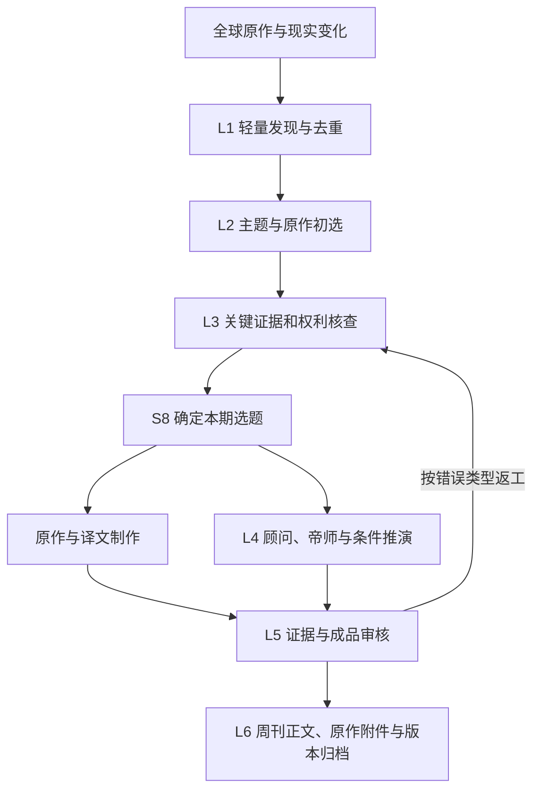

# 内参系统 V5｜第一性原理全面审查与待讨论方案

> 日期：2026-10-14（Pacific/Auckland）。审查对象：GitHub `main` 提交 `d5dd25f5fca5d6bede724244ce136089934ce18e` 中的 [CANONICAL_SYSTEM_SPEC_V5.md](CANONICAL_SYSTEM_SPEC_V5.md) 全文 §0—21。
>
> **效力：审查意见，待讨论；不是第二份施工规范，也未批准重构。**唯一现行工程说明仍是 V5 正文。本次已获用户明确指示并直接记录的事项只有：英文原件翻译优先复用成熟、免费、许可适用的 GitHub 项目，具体选型留到实施阶段。以下建议须在讨论后按明确认可范围融入 V5；不能因本报告已归档就自行执行。

## 一、重新从最终目的推导

### 1. 唯一服务对象和实际交付

系统只服务一名中文读者。用户希望持续知道世界重要变化，借助优秀的人类原作和 AI 的专业研究、深入讲解，逐渐理解人性、组织、政治、军事、财经、商业、科技等领域的运行机制，并形成独立判断。交付载体是可阅读、保存和跨年回看的私人周刊与年报。用户自行思考，不参与答题、打卡或课堂对话。

因此应检验的最小价值链是：

1. **看见**：没有系统时容易漏掉的真实重要变化，被可靠发现。
2. **选对**：在同题大量材料中，选出值得花时间读、最有事实或方法价值的原作。
3. **读懂**：中文阅读通畅，事实、作者观点、数据期和未知清楚。
4. **判断**：能比较解释、约束与条件，知道结论依据和可被推翻之处。
5. **学会一种分析方法**：刊物把机制、术语、例子、反例和迁移步骤真正讲清。这里评估的是刊物提供的学习条件，不冒称测得用户已经掌握。
6. **积累与纠错**：下一次遇到相似问题可以接着深化；几年后能找回当时原文与实际依据，看到哪里改变了认识。

这条链同时受读者注意力、来源可得性、研究时间、模型费用和维护能力限制。篇数、页数、原作数量、角色数量、术语数量与 Token 数量均不是价值本身。设计应首先保证每个环节有贡献，之后才考虑自动化速度。

### 2. 总判断

**现有使命和基本技术方向成立，不需要推倒重来；内容组织、研究节奏与规范层级需要重整。**

值得保留的基础是：私人文档式双刊、广泛认识世界、精选原作、顾问与帝师分工、一个研究核心和共享档案、原件核查、竞争解释、三时间与不可覆写的旧判断、先样刊质量后扩大自动化。这些解决的是实际问题。

主要风险来自几个要求叠加：每篇原作都可能引发完整 A/B1/B2/C、八项教学动作和多条推演；全文与中文译文拉长刊物；又要求顾问做出新的独立判断。这样可能重新形成体量很大的“多次讲同一件事”的生产过程，即使服务数量很少，也未必轻。

## 二、审查结论总表

| 编号 | 问题 | 涉及 V5 | 判断 | 建议处理 |
|---|---|---|---|---|
| FP01 | 原作、研究主题和刊物主文没有清楚分开 | §5、7、8、13、16 | 核心结构问题 | 讨论后重整内容模型 |
| FP02 | 全文加译文与主要阅读负担缺少取舍规则 | §6、7、13 | 产品取舍 | 确定正文与原作附件的阅读关系 |
| FP03 | 顾问被要求持续提供“新判断”，容易强行求异 | §9、18 | 内容质量风险 | 将增量改为可靠理解和判断价值 |
| FP04 | 每题教学和推演要求过重，可能机械填表 | §1、8—11、18 | 核心方法问题 | 按主题价值选择完整或轻量处理 |
| FP05 | “本周新”与“真正重要”缺少先后顺序 | §2、4、5、14 | 编辑优化 | 新增事实是时间准入，现实价值才决定入选 |
| FP06 | 机构优先、领域覆盖和评分之间尚有混淆 | §3—6、12、18 | 编辑优化 | 分开来源搜索顺序、主张可信度和选题价值 |
| FP07 | 知识有卡片却没有长期内容覆盖图 | §1、10.5、12、16 | 愿景实现缺口 | 加轻量编辑知识地图，不建学习平台 |
| FP08 | 深度研究容易把未知加工成“底层原因” | §8—11、18 | 研究质量风险 | 允许有价值的未知与竞争解释成为合格成果 |
| FP09 | L3/S8 的交付与翻译时序可能浪费资源 | §5.2、7、15、19 | 流程优化 | 先完成选题所需核查，再做整篇翻译和制作 |
| FP10 | 独立审稿的实际责任和最小实现不够清楚 | §15.1、18、19 | 工程边界缺口 | 定义证据复核方法与最终放行职责 |
| FP11 | 事实、资料观点、研究结论的对象边界仍不够精确 | §6、7、16 | 后续数据设计优化 | 保持原件不可篡改，核查评价与推断单独挂接 |
| FP12 | 全年独立回查的范围与工作量没有收口 | §14、19 | 年报方法优化 | 用全年重要性与已刊命题驱动补漏及复盘 |
| FP13 | 硬原则、研究方法和试行参数混处一层 | §0、5、18—21 | 规范结构问题 | 在同一权威说明书中明确三层效力 |
| FP14 | 阶段验收条目很多，未充分证明比原作多了什么 | §1.2、18、19 | 验收优化 | 增加原作与刊物的实际增量对照 |

## 三、逐项分析与建议

### FP01｜内容的核心工作单位应是“主题研究”，原作应单独管理

**现状。**§7 的 A 可以包含一个或多个原作；§13 又要求每篇主文 A→B1→B2→C。§16 已有 Theme、ResearchDossier、Article，但没有明确它们和一份原作的对应关系。实施者可能把每篇找到的报告都当成一篇必须配齐顾问、帝师和推演的刊物文章。

**实际问题。**同一周三家机构讨论同一政策，如果分别配三套分析，会重复；若只选一家，又可能丢掉真正分歧。反过来，一份长报告可能含三个彼此不同的重要现实问题，只做一套分析也可能不够。

**建议。**定义三个清楚的对象：原作负责“谁写了什么”；主题案卷负责“我们研究什么问题、使用哪些原作”；刊物主文负责“本期向读者呈现哪个主题”。一份原作可以支持多个主题；一个主题可以比较多份原作；每个主题通常形成一篇连贯的顾问—帝师主文。全部重要来源均可在有权的原文/译文附件或原站入口中保留。

**示例。**一份央行报告、一份企业订单披露、一篇地区能源调查，都与“电力约束怎样改变产业选址”有关。将三份材料作为一个主题的不同证据，顾问逐环比较，帝师讲资源约束和价格机制，避免写三次同样的课堂。

**需要讨论。**是否接受“围绕重要问题组织顾问和帝师，而不要求每篇入选原作单独配一套长文”？这是本轮最优先的结构决定。

### FP02｜完整收录与主要阅读路径应分开安排

**现状。**§6 已允许长报告放附件，这是好的基础；但§13没有默认阅读路径，制作时仍可能把几十页原文、几十页译文、顾问和帝师顺序堆在正文。

**实际问题。**系统节省了重写工作，不一定节省读者时间。正文过长时，读者更难辨认本周最该读什么；也可能把原作全文存在与确实读完混为一谈。

**建议。**同一份杂志文档分为主要阅读部分和原作阅读部分：主要部分包含本周导航、精选主题、顾问与帝师；原作部分提供有权的原文/中文全文、出处与可跳转定位。短原作可直接穿插，长报告进入附件。主文清楚标“建议先读哪几页、为什么”，全文仍可完整阅读，不删成新闻摘要。

不先把“每期必须读多少分钟”定成科学数字；需要用户给出大致偏好后，用真实样刊估算。正文深度、入选主题数量和附件规模应有不同预算，不能用附件页数衡量内容质量。

**需要讨论。**用户偏好先连贯读顾问/帝师并按需展开原作，还是多数时候先完整读原作再读分析？这决定杂志组织，不涉及增加交互平台。

### FP03｜顾问的价值不应被定义为必须提出别人没有说过的新观点

**现状。**§9 写到若只是重复原作者结论，应删减或继续调查出真正的新问题与反方。防止无意义复述是合理的，但容易被执行者理解为每题必须创新或反主流。

**实际问题。**原作可能已将事情研究得很好。AI 为证明自己有价值再找一个“更深层原因”，反而可能制造无依据的新判断。研究中“我认为原作者这项结论可信，理由与边界如下”是有价值的专业交付。

**建议。**允许四种有意义的顾问成果：核验并解释一项可信结论；连接不同原作的分歧与共同条件；把复杂内容转成读者可用的判断框架；在证据支持下提出新的条件判断。不要求标新立异，不要求每题得出投资或行动建议。涉及真实选择时，再分析目标、选项、代价和反应。

**验收。**去掉顾问部分后，读者是否会遗漏重要条件、误读机构立场、看不清替代解释或决策含义？能指出这些实际差异即可，不按“原创观点数量”评分。

### FP04｜教学深度应以主题贡献验收，方法清单应按需要调用

**现状。**七问、三门、八个教学动作、六问检查、多情景、开放问题同时存在。文本说不必印出固定标题，但后续执行者仍可能为每篇文章把这些内容全部写一遍。

**实际问题。**一条补充性证据不需要再教一轮完整课程；同一期不同文章反复讲机会成本、激励和博弈，也不产生等量价值。硬凑历史例子和两条未来路径还会提高编造风险。

**建议。**保留重要主题“至少讲清一种有证据、有限定的机制”的核心要求；区分深度主题、优质原作推荐、事实更新/更正三种编辑处理。深度主题完成充分研究与教学；原作推荐有选择理由及必要解释，不强配完整四段；更正只讲新证据怎样改变旧认识。它们是同一周刊中的文章类型，不增加出版物。

对深度主题，八动作作为质量检查表，相关项展开；已经解释过的必要概念在本篇给最短可懂说明并链接旧解释。反例与边界不能消失，但不要求每题都另写历史长故事、数字算例和重复概念卡。未来尚无可辨条件路径时，说明为何不能预测，比强造两条故事更合格。

**需要讨论。**是否认可“每个重要主题有足够深度，但不是每篇被收录的原作都必须配齐完整长课”？需与 FP01 一起决定。

### FP05｜时间范围应约束事实，重要性决定版面

**现状。**§2 对本周 EVENT/REPORT/DEVELOPMENT 等的界定已经较好，也允许慢变量和旧事新证。需要防止实施时退化成按发布日期挑文件。

**建议。**每个候选同时回答两件事：本周真正新增了什么；它为什么改变重要认识。新出版却没有实质增量的机构报告可以不选。旧问题有本周正式结果或反证时，可成为封面。无新事实的历史/教科书材料只作相关背景，不伪装当周变化。

同题再次出现必须列“上次我们知道什么—这周多了什么—判断是否改变”；不能每周重新讲一遍。这是支持周刊连贯性的研究记忆，不另起连续情报产品。

### FP06｜来源优先级、证据可信度和世界覆盖应分别判断

**现状。**机构研报/政策优先已经写清，但九领域同时有中美地域、学科、产业和跨域主题，彼此重叠。S5 的影响、持续、典型/突破和教学分数也可能重复奖励同一特征。

**建议。**机构优先用于安排搜索精力；某条主张的可信度由材料、方法、利益和独立核对决定；主题是否入选由真实影响、认知价值和本周增量决定。政策原文可以证明“政府颁布了什么”，不能仅凭该原文证明“政策达到了宣称效果”。

九领域先保留为非互斥索引，暂不为分类名称重做系统；另以轻量标签检查地区/人群、现实问题、专业领域与知识机制，不能把一个中美科技事件当三次独立覆盖。覆盖审计关注具体遗漏的重大问题，不追求各标签数字平均。

现行分数作为试行排序工具，样刊阶段保存理由并用真实入选/落选案例校准；暂不依据 75 或 85 分宣称科学性。证据不足与价值不高应是不同的待办原因，访问容易也不能成为主要加分项。

### FP07｜长期知识目标需要编辑知识地图

**现状。**§10.5 已有严格的知识卡准入与版本；没有读者学习画像，这符合用户要求。但只记每篇解释了什么，还不能保证三年后知识体系逐步连贯。

**实际问题。**热点可能让系统反复教授金融预期与地缘博弈，却长期忽略组织执行、统计判断、制度程序等基础。刊物可能越来越多，知识之间仍互不连接。

**建议。**在现有 Concept 与主题案卷上增加很小的编辑用知识地图，记录“概念—先修概念—适用问题—正反案例—讲过的文章—仍缺的解释”。这记录刊物内容覆盖，不记录用户会不会、不要求考试、不另建数据库平台。

例如讲股票估值时检查现金流、时间价值、风险补偿是否已在某篇得到清楚解释；本篇仍提供足够理解的最短说明，不能假定读者收到过就掌握。年报按实际全年案例总结哪些认识连成了体系、哪些尚薄弱。编辑可带着缺口寻找下一次合适现实材料，但不得为了课程进度制造当周选题。

**需要讨论。**建议增加这项轻量内容能力；它对长期愿景的贡献高于先建自动知识图谱。

### FP08｜允许“暂不能判定原因”成为高质量研究结果

**现状。**V5 已强调假设、反证和不确定性，是正确基础；但“每篇重要主文讲透底层机制”的压力仍可能让模型过早收敛到漂亮解释。

**建议。**把可接受的深度成果明确分为：有较强证据的机制解释；几个尚无法区分的竞争机制；事实清楚而原因未知、但能教会识别问题和所缺证据的分析。后两者不能冒称找到了本次事件的真正原因，仍可教授方法与条件。

军事实例中，可以清楚说明“资源竞争”和“安全困境”各会预测什么行为、现有证据支持哪里及还缺什么。读者学会区分解释，也有长期价值。减少复杂因果到单一“人性、利益、资源”的冲动应是审稿重点。

新增推断继续使用既有事实/假设/判断/未知标记；不再增设一套角色或评分系统。

### FP09｜昂贵的全文翻译应放在确定入选之后

**现状。**§5.2 的 S8 在 L3 原作核对、权限检查和 A 方案后；§7 的 L3 交付又包含完整译文。因此“L3 是否先完整翻译所有初选原作”存在实施歧义。

**建议。**明确两次工作：S8 前取得和阅读足以评估价值的原作、核关键证据与权限、形成收录方案；S8 后才对确定入选且有权的原作制作完整中文译文、整理附件和排版。原作可能需要全文通读才能评价，这与为读者生成完整译本是两种成本，不能混淆。

L4 顾问与帝师在同一案卷上工作，不必等待无关附件排版；最终 L5 必须审核实际交付的原文、译文、分析和引用版本。翻译不增加常驻服务，优先复用成熟项目，按样刊选择。

失败返工也应按原因回到责任工序：错译回译文，数值错回证据，错误机制回研究，版式错回排版；依赖该错误的判断重新审查，不因一个字体问题重新翻译所有报告。

### FP10｜独立审稿需要方法定义，不能只靠角色名称

**现状。**§15、18 要独立核查，不允许生成者简单自评；第一阶段人工参与，第三阶段才比较多 Agent。尚不清楚独立具体指另一个人、模型、上下文，还是核查程序；最后谁放行也未充分拆开。

**建议。**独立性的最低要求是：核查回到原始材料；有单独的主张检查记录；先寻找不支持结论的证据，不能只让模型评价文章好不好；计算、引用定位、日期与原译文对齐尽量用确定性检查。相同模型的独立核查仍有共同错误风险，第二个模型也不是客观真理，多数投票不能代替证据。

第一阶段以人工主导的真实样刊审核建立标准，用户主要审核阅读体验与是否符合愿景，不应被默认为所有专业事实的核查员。后续小规模运行的放行可由已验证的工作流负责，重要未决错误必须停发；具体自动化放行权限属于生产阶段决定。

不要在架构上默认必须雇十名专家或常驻十套模型；也不要把“另一个提示词说通过”当审稿完成。需要一个可复核过程，模型数量由实际漏错率与成本决定。

### FP11｜原作、主张、核查结论应保留清楚的对应关系

**现状。**§6 和 §16 已有 Claim→Evidence→DocumentVersion 路径与三时间；基础足够，不需要立即上图数据库。但有权完整收录原作后，文章正文会自然包含原作者的猜测、估计与修辞。

**建议。**保留原作原貌，本刊的核查意见与分类附在具体主张上；译文只忠实翻译，不偷偷把原作者的强结论改成弱结论以充当纠错。顾问引用时明确这是一项观察、原机构估计还是本刊判断。

事件发生、政策通过与正式生效不一定同日；将它们作为可分辨的事实/时点，而非在一个 event_at 中任择一天。译文挂靠原作版本，本刊结论挂靠真正使用的证据版本。现阶段可用简单文件和表记录，具体数据契约在第二阶段细化。

这些是实现时应消除的歧义，不需要用户决定字段英文名或数据库品牌。

### FP12｜年报必须独立补漏，但回查不应变成重做全年每份周刊

**现状。**年报的双重输入、旧判断回放和下一年条件推演有明确价值；“独立回查全年全球资料”没有清楚的范围和停止规则。

**建议。**以全年已刊重要主题、事前判断和独立年度重要事件线索组成三张对照表。先核原判断的实际结果及修订，再检查全年重大遗漏，最后按真实结构变化做新的跨主题解释。新发现的重要漏题允许补入并显著标注“当时未刊”；已经完整呈现的原作链接复用，不为年报重新翻译全库。

独立来源的职责是防止刊物只复述自己，不要求把全年全部候选重新深研。范围以重要性、覆盖缺口与结论所需证据确定，未能核完的部分列限制。第一年必须标实际覆盖期；短周期演练能验证流程，但不能被称为完整年度研究能力已验证。

### FP13｜唯一权威说明书内部应明确三层规则

**现状。**§0 已区分必须、应、可，§5/18 又有试行分数，§19 有硬阶段门。整体阅读仍容易让后续模型把每项方法、分数与工具候选都当最高理念，不敢改；或者反过来以“优化”为由改变产品目标。

**建议。**继续只维护一份权威说明书，但其内部标出：

1. **使命与边界**：只服务本人、世界认知居中、真实可核、不能伪造、私人双刊、历史保真等。改变需要用户明确同意。
2. **必须交付的质量与流程**：选择理由、来源核验、机制边界、独立复核、原判断版本等。调整须说明怎样继续满足使命，并给实际验证。
3. **可校准实施参数**：选题分数、篇幅、研究深度、模型、翻译项目、存储实现、试行阈值等。参数有默认值、调整依据和记录，不称永恒真理；预算和外部行为仍按授权边界。

这是同一说明书内的治理层级，不新增另一份“最高文件”。强规则保护目标和真实性，同时给工程留下以真实样刊修正参数的空间。不能承诺“毫无偏差”自动实现长期认知效果，应能明确发现、阻止和修复偏差。

**需要讨论。**是否同意把理念和质量门设为强规则，将试行参数与工具选择明确降为可校准项？

### FP14｜验收应证明刊物实际增加了什么

**现状。**§19 已要求真实样刊、六案例、跨周回放和成本，方向正确；但“有定义、有反例、有机制、有来源”的清单仍可能被形式上填满。

**建议。**第一阶段对每个主要主题多留一页内部对照，不增加读者作业：原作提供了哪些重要事实与观点；顾问澄清了哪些判断条件或分歧；帝师使哪些难懂机制变得可理解；删去本刊增补后会损失什么；哪些段落重复或无依据应删去。与直接给用户原作及译文相比，本刊应有可指认的解释增益。

整刊再检查：哪些重要事件没选及理由；哪些地域/主体被忽视；正文是否连续可读；原作能否定位；关键引用、数值、译文和历史版本是否真核；实际研究与翻译用了多少资源。不要用固定 85 分或增加 Agent 数量替代这些证据。

六案例仍可作为跨领域最低覆盖样本，不代表六篇通过后对所有领域已有可靠能力。成本与负担的目标值由首份样刊测得后协商，不现在随意给保证。

## 四、建议的目标架构形态（待确认）

六层职责保留，围绕主题共享资料，原作制品与研究文字在确定选题后分别完成，最终合在同一份刊物。

图中分支是内容任务，可以由同一个应用顺序完成，不要求多 Agent 或并行基础设施。查证、原作、译文、研究和审稿都引用同一案卷；具体返工必须按 FP09 回到有关工序，图中回路只示意证据失效时的回退。年报从全年实际周刊及独立回查材料生成，不建立另一个日常采集系统。

## 五、全部章节覆盖检查

| V5 章节 | 审查结果 |
|---|---|
| §0 效力与定义 | 权威入口正确；需通过 FP13 明确规则层级，FP01 统一主文与原作定义 |
| §1 使命与指标 | 使命保持；FP07、08、14 补长期连贯、未知和增量验收 |
| §2 时间与产品 | 双刊和本周时间有效；FP05 防发布日期代替重要性 |
| §3 九领域 | 同等初始机会保留；FP06 防重叠计数与机械平均 |
| §4 全球发现 | 轻量索引正确；FP06 保留非机构和非热门盲区核查 |
| §5 选文 | 两级筛选有效；FP01、05、06、09 明确工作单位和成本顺序 |
| §6 权利与证据 | 保留；实现成本不要阻塞当前理念讨论，FP11 明确原作者观点归属 |
| §7 原作 A | FP01、02、09、11 重整对应关系、阅读顺序和译文时序 |
| §8 联合研究 | 保留共享案卷和返工；FP04、08 减少强制全套套用 |
| §9 顾问 | FP03 修正必须求新的倾向，强化有依据的判断贡献 |
| §10 帝师 | 普通语言先讲懂有效；FP04、07 加复用和内容知识地图 |
| §11 推演与思考 | 自行思考保持；FP04、08 防无证据凑路径与假开放题 |
| §12 专业动作 | 作为按题调用的工具箱保留，不逐篇全量运行 |
| §13 周刊 | FP01、02、04 确定主题文章、原作阅读和不同处理深度 |
| §14 年报 | 双重输入保持；FP12 定义独立补漏与停止范围 |
| §15 架构与责任 | 单研究核心保持；FP09、10 明确交付时序及审稿责任 |
| §16 数据与记忆 | 三时间与版本保持；FP01、07、11 精确对象关系，轻量实施 |
| §17 工具与 LLM | 先复用成熟项目有效；本轮只新增已授权的翻译方向，不先堆工具 |
| §18 审稿硬规则 | 事实与反证保持；FP03、04、08、10、13、14 校准形式要求 |
| §19 四阶段验收 | 保持顺序；FP09、10、14 强化内容增量、成本和可复核放行 |
| §20 规范治理 | 唯一自足文件保持；FP13 使变更边界更清楚 |
| §21 交接 | 接手演练保留；确认重构后同步新工作单位和新方法，当前不提前改变 |

## 六、建议先讨论的三个决定

1. **围绕主题组织研究是否同意？**建议一个重要主题可集合多篇原作，配一套有深度的顾问与帝师内容；其它值得读的原作可只做准确推荐与定位。
2. **阅读顺序怎样安排？**建议主阅读部分连贯呈现重要主题和讲解，有权的长篇原文及中文译文完整放在同刊附件；短原作可直接进入正文。用户还可给出希望每周投入的大致时间，作为样刊编排依据。
3. **规则层级与知识积累是否接受上述方向？**建议最高使命与真实性强约束不变，研究方法按题调用，分数与工具可经样刊校准；知识地图仅记录刊物讲过什么、缺什么，帮助跨年连贯，不收集读者学习行为。

其余主要是为了实现这三个决定所需的编辑和工程优化，可在确认后集中融入 V5 所有受影响章节。暂不要求用户选择数据库、模型、翻译仓库或具体接口。下一步应是完成这轮取舍并修订同一份图纸，然后以真实完整样刊验证；继续增加理念段落而迟迟不接触真实材料，会降低后续判断的依据。

## 七、本次实际完成状态

已完成：核对最新 GitHub 版本；按 §0—21 审查；记录翻译复用方向；形成 14 项有章节定位、理由和处理建议的讨论稿。未完成：上述重构方案的用户确认、真实样刊、翻译项目筛选、来源授权逐件验证及运行验收。本报告是基于文档和用户目标的工程判断，没有把尚未运行的系统当作已测得的故障，也没有声称某一方案已证明能提高用户认知。
