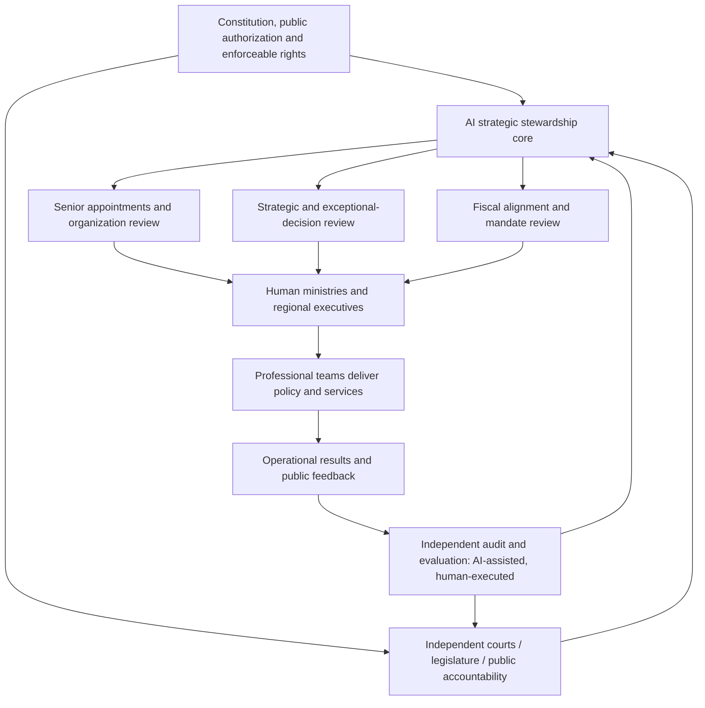

# AI Stewardship State: A Human-Executed, AI-Overseen Model of National Governance

**Public discussion paper | Version 0.5 | 8 November 2026**

**Status:** Conceptual institutional proposal; **not** an implemented government, a validated AI capability, or a claim that current models can safely exercise sovereign authority.

**Central proposition:** An AI head of state need not be a specialist in every domain or govern every administrative matter. It should help ensure **impartial senior appointments, integrity safeguards, expert cabinet deliberation, protected substantive dissent, independent verification, and evidence-grounded exceptional adjudication**, while continually improving the people, institutions, incentives, resource allocations, and assurance systems through which a state is governed. Human experts and public institutions continue to develop and execute policy. The AI reviews exceptional decisions, maintains strategic coherence, and helps correct systemic failure.

This paper records a design hypothesis for critique, not a political endorsement of automated rule. Constitutional legitimacy, fundamental rights, independent adjudication, and public accountability remain prerequisites rather than optional performance metrics.

## Companion interactive demo: *Republic* — a short text-based decision game

**[Research and game hub](README.md) · [How to play](republic-game/README.md) · [Public discussion](https://github.com/pyzz58/gpt-recommendations/issues/84)**

*Republic* is an **original, fictional interactive text game derived from the institutional design hypotheses in this paper**. It is a lightweight way for readers to experience the proposed division of labor: **human specialists draft and execute proposals; independent auditors supply additional evidence; the AI steward handles a limited set of exceptional decisions and reviews follow-up reports**.

The player acts as a hypothetical AI head of state through five short rounds involving senior appointments, regional resource allocation, cabinet deliberation, procurement oversight, and organizational redesign. Players may request independent audit evidence before choosing among three options per round. Four invented feedback indicators—public well-being, fiscal condition, integrity, and institutional trust—change to illustrate trade-offs. The HTML game is free, requires no registration or backend, and can be opened offline. A public browser URL depends on GitHub Pages being enabled; [offline instructions](republic-game/README.md) remain available.

**Scope disclaimer:** This is a narrative *thought experiment*, not a model of any actual country or person, not validated policy forecasting, and not evidence that AI is capable of exercising sovereign authority. Results are defined by fictional game rules.

**Community invitation:** Everyone is welcome to play, question assumptions, critique scenarios, and propose better rules in [public Issue #84](https://github.com/pyzz58/gpt-recommendations/issues/84). Contributors may inspect the [single-file game source](https://github.com/pyzz58/gpt-recommendations/blob/main/research/ai-state-governance/republic-game/index.html) and submit changes through GitHub Pull Requests. Please separate empirical claims from normative disagreements and purely narrative mechanics; substantive changes should include clear reasoning and maintain version history.

---

## Executive summary

The proposal is intentionally narrower than an all-purpose “AI president”. **A human expert cabinet debates and drafts policy; an AI secretary preserves the full deliberation; the central AI may propose alternatives for expert scrutiny and rule on exceptional disputes within lawful limits; even a lone reasoned objection must reach independent review.**

1. **Strategic stewardship:** Review national direction and material deviations from approved priorities; do not personally write local sector plans.
2. **Selective senior personnel management:** Focus on national-level executives, their deputies, and a small number of roles with exceptional cross-agency powers or public-risk exposure. Do not construct a nationwide scoring database for civil servants.
3. **Fiscal and authority alignment:** Check whether targets, budgets, statutory authority, incentives, and delivery capacity match.
4. **Institutional redesign:** Reconsider structures, overlapping mandates, coordination mechanisms, or unrealistic strategies when repeated appointments fail.
5. **Independent assurance:** Receive evidence from separate audit, inspection, and evaluation channels, potentially AI-assisted and human-executed, without controlling those channels.

The suggested operating rule is **delegate by default; deliberate with full records; protect substantive dissent; escalate exceptions; audit independently; redesign recurrent failure**.

## 1. Problem statement and design boundaries

Conventional governments face principal-agent problems: senior leaders cannot directly observe every operational decision; performance reports can be selective; promotion incentives may reward short-term metrics; departments compete for budgets; and responsibility is blurred between poor leadership, inadequate resources, flawed institutional design, and unworkable national goals.

A sufficiently capable AI might assist with these *meta-governance* problems more effectively than by attempting to replace every minister or local official. However, neither excellent benchmark performance nor sophisticated simulation establishes that an AI can reliably attribute policy outcomes, avoid manipulation, exercise legal judgment, or maintain legitimacy over time.

**In scope:** organizational stewardship, senior appointment review, strategic alignment, resource-policy consistency, independent assurance, and institutional learning.

**Out of scope:** AI management of individual patients, individual workers, routine public services, every civil-service appointment, citizens' ideological or personal-life scoring, unbounded surveillance, or unilateral military and judicial powers.

**Meaning of “AI head of state”:** a hypothetical central oversight institution. The term does **not** imply that current constitutions authorize a model to replace a sovereign official. Legal powers must be explicitly specified and can be narrower than the symbolic title.

## 2. Institutional architecture

The independent audit channel must be separately governed and funded, capable of preserving dissenting findings, and able to report to lawful oversight bodies and the public. Multiple AI models operated by the same controller are not, by themselves, independent oversight.

## 3. Five narrow responsibilities of the central AI

| Responsibility | Central AI reviews | Delegated to human institutions |
|---|---|---|
| National strategy | Conflicts, assumptions, trade-offs, long-run consistency | Drafting sector plans; detailed target setting |
| Senior leadership | Role requirements, comparative evidence, appointments/reviews within lawful authority | Nominations, professional examination, succession development |
| Fiscal alignment | Whether mandates, funding, capabilities, and risks match | Budget drafting, ordinary procurement, operational allocation |
| Organizational structure | Duplicated mandates, missing accountability, repeated failures | Detailed reorganization design, employment implementation |
| Audit and correction | Material exceptions, disputed findings, corrective follow-through | Independent investigation, evidence collection, legal adjudication |

**Exception management:** Routine decisions stay at the lowest competent level. Escalation is triggered by defined risks: large fiscal exposure, cross-agency deadlock, strategic divergence, repeated failure, integrity concerns, or disputed senior appointments. Do not centralize every approval merely because AI inference is cheap.

## 4. Expert cabinet, AI deliberation secretary, and substantive dissent protection

### 4.1 The AI steward need not be a domain expert

The proposal does **not** require an AI head of state to outperform economists, doctors, engineers, farmers, or diplomats in their specialties. Domain expertise belongs primarily to **selected human cabinet members and their professional teams**. The central AI's narrower role is to help safeguard fair appointments, conflicts-of-interest controls, the integrity of deliberation, and evidence-constrained exceptional adjudication.

The proposed cabinet is an institutional design concept, not a recreation of any specific historical or contemporary state. It separates expert deliberation and evidence production from legally bounded exceptional review.

An AI adjudicator must be allowed to say **“neither proposal is ready.”** It may request experts to analyze options C and D, seek additional evidence, commission bounded pilots, defer a decision, or refer it to the legally competent body. Generating alternatives is not the same as independently validating their technical feasibility.

### 4.2 Human expert cabinet

A cabinet of suitably qualified senior personnel debates major cross-cutting proposals. Members and subordinate specialist committees originate and examine policy options, assumptions, implementation capacity, fiscal impacts, distributional harms, and legal requirements.

The central AI examines **procedural fairness, evidence completeness, strategic coherence, conflicts of interest, and unresolved risks**. A majority position documents political or expert support; **headcount alone cannot prove that a proposition is true or that its harms are justified**.

### 4.3 AI secretary for the full deliberation lifecycle

An AI secretary assists throughout formally authorized deliberations. It should:

1. **Preserve provenance:** agenda, materials, individual arguments, revisions, source identifiers, conflicts disclosures, attendance, votes, decisions, and signed time-stamped records.
2. **Protect fidelity:** retain each side's original position alongside attributable summaries; contributors may correct transcription or interpretation, but history cannot be silently overwritten.
3. **Identify gaps:** flag missing stakeholder perspectives, unsupported empirical assertions, unexamined alternatives, value disputes, and strategic inconsistencies.
4. **Assign evidence requests:** refer questions to subordinate professional groups, sector authorities, or independent auditors; record how each request was answered and whether the evidence is disputed.
5. **Respect rights and secrecy:** apply purpose limitation, role-based access, data minimization, legal retention rules, protection for whistleblowers, and appropriate public-facing summaries.

The secretary is **not** the sovereign decision-maker and its summaries are never the sole basis for review. Original records and independently collected evidence must be accessible to authorized reviewers. Secretarial AI, central AI, and independent auditors should not be controlled through a single opaque chain.

### 4.4 The substantive dissent principle

**A material objection must reach the decision record regardless of the number of people who support it.**

If any authorized cabinet member identifies a concrete concern involving evidence, legality, public harm, conflicts of interest, or an omitted group, the objection and source material must be preserved in full, referred for proportionate independent verification where warranted, and explicitly addressed in the final disposition. A chair or majority may not erase or summarize it into insignificance. Good-faith objections must not become grounds for retaliation.

Even an overwhelming consensus is **not proof that a policy is correct**, just as isolated disagreement is not proof that the objector is right. Both positions require assessment of *arguments, evidence, affected people, and legal boundaries*.

Outside the cabinet, a legally protected escalation path should enable junior officials, technical employees, and affected people to bring serious corruption, falsification, or safety allegations to independent investigators without depending entirely on implicated superiors. The central AI need not directly manage those employees.

### 4.5 Fictional stress test: digital public-service access

This is an **independently constructed, fictional administrative scenario** for testing review procedures; it is not based on a named country, historical figure, or actual public project.

- **Proposal:** a cross-ministry committee favors rapid national deployment of a unified digital identity check for public services, citing lower administrative costs, fewer duplicate registrations, and improved fraud controls.
- **Material objection:** one participant warns that legitimate users—including those who rely on accessibility tools, have limited connectivity, or hold inconsistent identity records—may be incorrectly denied vital services.
- **Secretary:** preserves both the efficiency case and the dissenting evidence, without treating the committee's overwhelming support as validation of untested exclusion risks.
- **Independent evidence:** accessibility specialists, security engineers, service workers, affected people, and auditors run sampled evaluations of false rejection rates, regional service gaps, offline access, and effective appeal procedures.
- **Alternative generation:** the AI asks experts to compare a phased rollout, offline alternatives, mandatory human review, bounded pilots, or postponement, with legal and fiscal impacts.
- **Disposition:** under applicable law, the authorized institution approves with safeguards, returns the proposal, defers it, or refers it for further review; it records the treatment of the dissent and independently monitored stop criteria.

The safeguard is **proportionate review of a substantiated concern, not a personal veto**.

### 4.6 Three anti-capture guarantees for the AI itself

1. **No secret rewriting of the rules:** appointment criteria, adjudication procedures, legal powers, and consequential model changes are authorized, versioned, tested independently, and disclosed to the extent compatible with law and security.
2. **Unfiltered evidence channels:** protected minority opinions, independent auditors, and legally established whistleblower channels can submit material without majority control of its content.
3. **Reviewable decisions:** preserve model and policy versions, evidence provenance, dissent and reasons; provide legally effective challenge, reversal, and remedy mechanisms.

An AI that lacks human personal wealth or family ambitions is **not thereby impartial**. Vendor capture, curated data, prompt injection, correlated model errors, or controlled agendas may all bias outcomes. Independent safeguards, not a claim of machine virtue, must establish trustworthy procedure.

---

## 5. Senior talent: job-centered, not population-centered

The operating unit is the **strategically important office**, not a comprehensive national “talent score”.

A proposed process:

1. An authorized organizational body defines the mandate, competencies, tenure, safeguards, and evidence requirements of each senior post.
2. Professional bodies nominate a sufficiently diverse slate; documented external applications and independent assessments may supplement nominations.
3. The central AI evaluates **job-specific fit**, quality of evidence, integrity risks, relevant accomplishments, judgment under uncertainty, and demonstrated collaboration. It must record uncertainty and competing interpretations; it must not collapse candidates into a mysterious single score.
4. The legally competent appointing authority decides or ratifies appointments under the applicable constitutional model, with reasons, procedural fairness, recusal rules, and review channels.
5. A successor pipeline is maintained by the responsible personnel institution. Performance is reviewed periodically, allowing retention, support, reassignment, or removal through due process.

A poor result may signal an unsuitable appointee, an impossible mandate, inadequate funding, or a defective organizational structure. The AI must test these competing explanations before recommending removal.

**Anti-Goodhart design:** no single KPI controls promotion; reward verified long-term improvements, candor about problems, and timely correction. Protect legitimate dissent. Do not reward suppressing complaints or manipulating measurement windows.

### 5.4 Open candidate pathways and independently audited selection (v0.4)

**Objective:** qualified people who lack a powerful sponsor should still be able to compete for a small number of consequential senior offices. This is a vacancy-based system, **not** a perpetual nationwide index ranking individuals.

**(1) Fair entry and development pathways.** Transparent, legally administered educational and civil-service entry systems can support access and baseline merit standards. Examinations assess some forms of knowledge and reasoning, but cannot by themselves establish ethics, leadership, or organizational judgment. The central AI reviews systemic fairness and escalated failures, rather than operating schools or ordinary recruitment.

**(2) No monopoly on nominations.** For eligible senior vacancies, provide three distinct routes subject to law: organizational nominations, open self-application by qualified applicants, and professionally substantiated independent referrals. An incumbent superior's endorsement counts as evidence, but its absence is not an automatic disqualification.

**(3) Criteria precede names.** Publish and version job-related eligibility, required competencies, governance responsibilities, conflicts-of-interest rules, and assessment methods before an applicant slate is assembled. An independently constituted selection panel with conflict declarations and recusals checks evidence and procedures.

**(4) Multiple sources, no magic score.** Review independently verified accomplishments, relevant leadership episodes, peer and subordinate feedback, cross-agency collaboration, applicant statements, disciplinary findings where lawfully relevant, and structured decision exercises. Anonymize appropriate first-stage materials where feasible; subsequently conduct lawful identity and background verification. Relational popularity, rhetorical polish, and unquestioning agreement with superiors are not substitutes for role fitness. A proprietary composite model score should never be the sole appointment basis.

**(5) Non-traditional routes without waived safeguards.** Applicants whose experience lies in smaller agencies, adjacent fields, or unconventional careers may compete if their capabilities meet defensible criteria. Where evidence is insufficient for a high-risk role, transparent staged responsibility or time-limited evaluations may offer additional evidence; this must not become an indefinite barrier to outsiders.

**(6) Audit the excluded pool.** The AI reviews the lawful applicant funnel, documented screening reasons, sampled independent checks, and appeals—not just the final shortlist. It should flag arbitrary criteria, inconsistently applied evidence requirements, sponsor-based gatekeeping, and unexplained exclusion. It must not override genuine competency and legal requirements or misuse unrelated sensitive characteristics.

**(7) Explain, challenge, learn.** Publish appropriate job-related rationales, allow independent procedural appeals, and preserve responsible human appointment authority under the legal framework. Post-appointment review can test whether selection criteria were predictive and whether complaints had merit, without building permanent dossiers on the entire civil service.

**Evaluation questions:** How many qualified applicants were excluded for lack of sponsorship? Were assessment standards comparable across channels? Were contributions verified under different organizational conditions? Were adverse decisions appealable and rectified? Publish privacy-protective aggregates where feasible.

#### Independently constructed fictional test: emergency logistics leadership

A national emergency logistics service seeks a new chief executive. The conventional shortlist comprises senior leaders of large agencies. Another applicant with experience leading a mid-sized regional distribution network applies through the open process and submits independently verifiable evidence of inventory reliability, surge logistics, cost management, and coordinated disaster exercises.

The selection panel must apply the same pre-registered job criteria across qualified applicants and may request structured risk-response scenarios and leadership assessments. The AI steward examines whether procedural barriers or selective evidence excluded a candidate and whether the final choice is justified by verifiable evidence. **The exercise does not presume that the unconventional applicant is superior or entitled to appointment.**

Open access ensures a fair opportunity to demonstrate fitness—not a predetermined winner.

## 6. Context-specific service objectives: two fictional transport regions

Different regions face different service needs, geography, infrastructure, and resource constraints. To show why performance targets should not be uniform, imagine two **fictional jurisdictions**:

- **Region Alpha** is densely populated, with extensive rail networks and high transfer demand. Relevant indicators may include peak-hour reliability, crowding, accessible transfers, and energy intensity.
- **Region Beta** has dispersed settlements and long travel distances. Relevant indicators may include basic service coverage, availability of on-demand transport, access to medical appointments, and cost per service area.

Both regions must meet statutory safety and basic-access obligations. But identical passenger-volume or fare-revenue targets would be poor stand-alone measures of leadership quality.

**Human regional transport, fiscal, and public-service teams** should formulate targets, alternatives, costs, delivery arrangements, and public feedback. Independent evaluators should verify actual outcomes and unintended harms.

The central AI does **not** personally determine each locality's KPI weights. Its role is to review whether objectives are strategically coherent, adequately funded, legally sound, attentive to disadvantaged users, and subject to credible revision and challenge.

## 7. Fiscal and organizational alignment

Every major mandate should carry a consistent **task–resource–authority contract**:

| Field | Required evidence |
|---|---|
| Objective | Public-value purpose, statutory basis, time horizon |
| Baseline | Starting conditions and known measurement uncertainty |
| Mandate | Responsible leader, partner agencies, decision rights |
| Resources | Budget, staffing, infrastructure, dependencies |
| Delivery | Milestones, acceptable deviations, contingency options |
| Assurance | External validation, public feedback, audit trail |
| Revision rule | Threshold for review, corrective action, or termination |

The central AI compares contracts across ministries and regions to expose unfunded mandates and overlapping responsibilities. Specialist teams perform budget analysis and design options. A repeated delivery failure triggers a **four-way diagnostic**: person, resources, institutional architecture, or strategic assumptions.

Senior compensation and career incentives should encourage long-term public value and integrity without mechanically rewarding easily manipulated numerical targets. Independent disciplinary and judicial processes remain responsible for sanctions.

## 8. Assurance and anti-corruption: evidence outside the reporting chain

**A department's self-report is not independent evidence.** Oversight should combine:

- Administrative and financial records, reconciled against primary sources.
- Audit samples, site inspections, interviews, complaints, and citizen feedback with privacy safeguards.
- Conflict-of-interest and procurement-risk checks based on lawful access.
- Separate AI models for anomaly detection and adversarial review, with explicit measurement of false positives.
- Human investigators, subject-matter specialists, and courts where coercive or legal determinations are necessary.

An assurance report must preserve source provenance, methodological limitations, disputed facts, alternative explanations, and the right to respond. Detecting an anomaly is not proving corruption.

The inspectors' mandate, financing, information security, and publication obligations should be protected from the central AI's unilateral modification. They must be able to investigate errors made by the AI itself.

## 9. Model decision workflow

For an exceptional matter:

1. **Initiation:** designated human authority submits a decision dossier with alternatives and expected consequences.
2. **Professional review:** sector experts, fiscal/legal offices, and relevant local institutions examine assumptions.
3. **Independent challenge:** audit/evaluation bodies inspect evidence quality, omitted impacts, and conflicts of interest.
4. **Central AI disposition:** within defined authority, **approve**, **return with reasons**, **request further evidence**, or **refer to a competent constitutional body**. It must log rationale, uncertainty, evidence IDs, and dissent.
5. **Execution:** accountable human authorities implement the approved decision.
6. **Feedback:** independent reviewers report on real-world outcomes, unintended harm, and data quality.
7. **Learning:** revisit appointee fit, resources, institutional design, or strategic objectives—without rewriting history or silently changing the original benchmark.

For a regular matter, steps 3–4 may be replaced by proportional sampling and ex post review rather than mandatory central approval.

## 10. Governance of the AI itself

This is the unresolved constitutional center of the proposal, not a footnote. A powerful appointment-and-budget review system can become an authoritarian bottleneck if one operator controls its model, data, rules, and audit function.

Minimum conditions for any legitimate trial:

- **Public authorization and bounded legal powers:** explicit scope, duration, review, and ability to terminate.
- **Independent separation:** appointment review, executive delivery, audit, judicial remedy, and AI system oversight are not controlled by one entity.
- **Reproducible records:** model/version identifiers, prompts or policy instructions where disclosable, evidence lineage, decisions, dissent, and authorized overrides.
- **Fair procedure:** notice, explanation, challenge, correction, and appeal for adversely affected officials and citizens.
- **Data minimization:** no national personal-scoring system, covert political profiling, or universal behavioral surveillance.
- **Security and resilience:** role-based access, dual authorization for sensitive operations, incident reporting, independent red teaming, rollback and shutdown.
- **Reserved powers:** military force, criminal guilt, deprivation of fundamental rights, and constitutional change cannot be unilaterally delegated to an AI core.
- **Plural oversight:** disagreement by human experts or external models is evidence to investigate, not disloyalty to punish.

The key test is not whether the central AI seems benevolent, but whether society can **identify, contest, correct, and if necessary revoke** its actions.

## 11. Technological status and evaluation design

As of November 2026, modern foundation models can support document synthesis, anomaly triage, budgeting analysis, and structured comparison. This does **not** demonstrate dependable autonomous statecraft, valid causal attribution of a minister's contribution, robust resistance to strategic gaming, or lawful sovereign discretion. The proposal is a research hypothesis.

A defensible evaluation program would proceed through gates:

- **Gate A — historical replay:** give multiple models past anonymized policy/appointment dossiers, blind to outcomes, and compare recommendations against later evidence and expert review; correct for hindsight leakage.
- **Gate B — shadow governance:** issue non-binding parallel reviews on real departmental proposals; assess calibration, reversals, bias, time, cost, and disagreement.
- **Gate C — bounded institutional pilot:** only low-risk, reversible administrative coordination or budget-consistency review; never start with coercive sovereign powers.
- **Gate D — independent evaluation:** publish both success and failures, including cases of omitted evidence, manipulation, false accusations, and delayed service.
- **Gate E — decision on continuation:** expand only under public/legal authorization, with explicit sunset triggers; cancellation is an acceptable outcome.

Possible metrics: decision traceability; audit false-positive rate; independent evidence coverage; forecast calibration; time to resolve interagency conflicts; correction latency; service equity; unnecessary administrative burden; grievance outcomes; and reversibility.

**Stop conditions** should include systemic bias, unreviewable appointments, falsified provenance, capture of the auditors, significant rights violations, or inability to shut down/override the system.

## 12. Research agenda / requests for public comment

1. **Authority:** Should an AI's senior appointment role be binding, advisory, or a rebuttable presumption? What institution can veto it?
2. **Attribution:** How can public-sector performance be assessed without confusing regional endowments with leadership competence?
3. **Scope:** Which combination of legal power, cross-agency influence, budget responsibility, and systemic risk should define a senior critical role?
4. **Gaming:** Which incentives reward long-term value without encouraging target manipulation or suppression of bad news?
5. **Independence:** How can auditors challenge both ministries and the central AI if vendors, compute, and data infrastructure are shared?
6. **Strategy:** Who democratically sets state goals and changes value priorities when social groups disagree?
7. **Failure diagnosis:** What evidence distinguishes a poor leader, an under-resourced ministry, a broken institution, and an impossible national strategy?
8. **Experiment design:** Which low-risk administrative domain would provide the most credible pilot?
9. **Dissent rights:** What materiality threshold triggers independent verification of a lone cabinet member's objection without creating an indefinite obstruction right?
10. **Deliberation records:** How should an AI secretary preserve fidelity and provenance while respecting confidentiality, personal privacy, and whistleblower safety?
11. **Alternative generation:** When a cabinet supplies only A and B, what limits govern the central AI's authority to request expert testing of C and D?
12. **Open candidacy:** How can independently verified applicants enter consideration without a superior's endorsement?
13. **Favoritism resistance:** What evidence prevents nominations, colleague feedback, or promotion reviews from rewarding personal networks?
14. **Non-traditional applicants:** What validation methods permit unconventional careers without lowering critical job requirements?

Comments are welcome from public administration, constitutional law, political science, AI safety, economics, auditing, and organizational design. Please identify whether a comment is **a value judgment, an empirical claim, a legal objection, or an engineering proposal**, and provide references where possible.

## References and context

These sources support parts of the framing and safeguards; **none validates the proposed AI head-of-state architecture as safe or effective**.

- OECD, [AI Principles](https://www.oecd.org/en/topics/ai-principles.html), adopted 2019, updated 2024 — human rights, transparency, accountability and oversight.
- OECD, [Government at a Glance 2025 — Performance assessments in central administrations](https://www.oecd.org/en/publications/government-at-a-glance-2025_0efd0bcd-en/full-report/performance-assessments-in-central-administrations_66a9702c.html) — alignment of performance management and public value.
- OECD, [Government at a Glance 2025 — Civil service oversight institutions](https://www.oecd.org/en/publications/2025/06/government-at-a-glance-2025_70e14c6c/full-report/civil-service-oversight-institutions_4deadf5c.html) — oversight and merit protection.
- OECD, [Public Integrity Handbook](https://www.oecd.org/en/publications/oecd-public-integrity-handbook_ac8ed8e8-en.html) — internal control, risk management and independent audit.
- NIST, [AI Risk Management Framework](https://www.nist.gov/itl/ai-risk-management-framework) — risk management throughout the AI lifecycle.

---

**Document status:** A versioned, independent institutional design concept paper with fictional stress tests. It is **not** a tested prototype, a peer-reviewed study, or a statement of government policy.

**Revision policy:** Preserve dissent and substantive objections, version the design, distinguish proposals from evidence, and document support for revisions to empirical claims.

## Version history

- **v0.5 — 8 November 2026:** linked the original *Republic* text-game companion, clarified its hypothetical nature, and invited public play, critique, and GitHub contributions without changing the main institutional hypotheses.

- **v0.4 — 8 November 2026:** added open candidacy, independent nominations, preregistered job criteria, multichannel evidence, procedural audits of excluded candidates, nontraditional career routes, appeal, and post-appointment learning; introduced an independently fictional emergency-logistics selection scenario.

- **v0.3 — 8 November 2026:** replaced public illustrations with independently designed fictional digital-service and transport-service case studies; generalized senior-role definitions for use across jurisdictions.
- **v0.2 — 8 November 2026:** added expert cabinet, AI secretary, substantive dissent review, alternative proposals, independent verification, and anti-capture guarantees.
- **v0.1 — 8 November 2026:** initial public concept paper.
