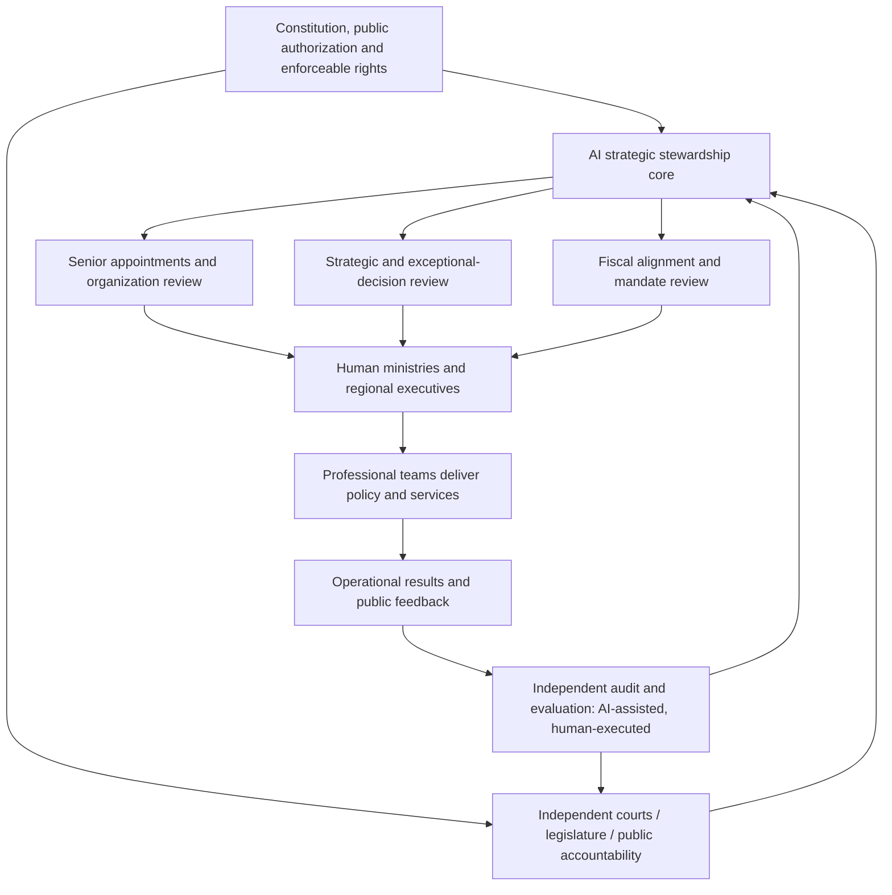

# AI Stewardship State: A Human-Executed, AI-Overseen Model of National Governance

**Public discussion paper | Version 0.1 | 8 November 2026**

**Status:** Conceptual institutional proposal; **not** an implemented government, a validated AI capability, or a claim that current models can safely exercise sovereign authority.

**Central proposition:** An AI head of state need not govern every administrative matter. Its most important hypothetical role is to **continually improve the people, institutions, incentives, resource allocations, and verification systems through which a state is governed**. Human experts and public institutions continue to develop and execute policy. The AI reviews exceptional decisions, maintains strategic coherence, and helps correct systemic failure.

This paper records a design hypothesis for critique, not a political endorsement of automated rule. Constitutional legitimacy, fundamental rights, independent adjudication, and public accountability remain prerequisites rather than optional performance metrics.

## Executive summary

The proposal is intentionally narrower than an all-purpose “AI president”:

1. **Strategic stewardship:** Review national direction and material deviations from approved priorities; do not personally write local sector plans.
2. **Selective senior personnel management:** Focus on heads of ministries, provincial-level executives, their deputies, and a small set of unusually consequential posts—approximately *vice-ministerial level and above* in a Chinese administrative analogy. Do not construct a nationwide scoring database for civil servants.
3. **Fiscal and authority alignment:** Check whether targets, budgets, statutory authority, incentives, and delivery capacity match.
4. **Institutional redesign:** Reconsider structures, overlapping mandates, coordination mechanisms, or unrealistic strategies when repeated appointments fail.
5. **Independent assurance:** Receive evidence from separate audit, inspection, and evaluation channels, potentially AI-assisted and human-executed, without controlling those channels.

The suggested operating rule is **delegate by default; escalate exceptions; audit independently; redesign recurrent failure**.

## 1. Problem statement and design boundaries

Conventional governments face principal-agent problems: senior leaders cannot directly observe every operational decision; performance reports can be selective; promotion incentives may reward short-term metrics; departments compete for budgets; and responsibility is blurred between poor leadership, inadequate resources, flawed institutional design, and unworkable national goals.

A sufficiently capable AI might assist with these *meta-governance* problems more effectively than by attempting to replace every minister or local official. However, neither excellent benchmark performance nor sophisticated simulation establishes that an AI can reliably attribute policy outcomes, avoid manipulation, exercise legal judgment, or maintain legitimacy over time.

**In scope:** organizational stewardship, senior appointment review, strategic alignment, resource-policy consistency, independent assurance, and institutional learning.

**Out of scope:** AI management of individual patients, individual workers, routine public services, every civil-service appointment, citizens' ideological or personal-life scoring, unbounded surveillance, or unilateral military and judicial powers.

**Meaning of “AI head of state”:** a hypothetical central oversight institution. The term does **not** imply that current constitutions authorize a model to replace a sovereign official. Legal powers must be explicitly specified and can be narrower than the symbolic title.

## 2. Institutional architecture

The independent audit channel must be separately governed and funded, capable of preserving dissenting findings, and able to report to lawful oversight bodies and the public. Multiple AI models operated by the same controller are not, by themselves, independent oversight.

## 3. Five narrow responsibilities of the central AI

| Responsibility | Central AI reviews | Delegated to human institutions |
|---|---|---|
| National strategy | Conflicts, assumptions, trade-offs, long-run consistency | Drafting sector plans; detailed target setting |
| Senior leadership | Role requirements, comparative evidence, appointments/reviews within lawful authority | Nominations, professional examination, succession development |
| Fiscal alignment | Whether mandates, funding, capabilities, and risks match | Budget drafting, ordinary procurement, operational allocation |
| Organizational structure | Duplicated mandates, missing accountability, repeated failures | Detailed reorganization design, employment implementation |
| Audit and correction | Material exceptions, disputed findings, corrective follow-through | Independent investigation, evidence collection, legal adjudication |

**Exception management:** Routine decisions stay at the lowest competent level. Escalation is triggered by defined risks: large fiscal exposure, cross-agency deadlock, strategic divergence, repeated failure, integrity concerns, or disputed senior appointments. Do not centralize every approval merely because AI inference is cheap.

## 4. Senior talent: job-centered, not population-centered

The operating unit is the **strategically important office**, not a comprehensive national “talent score”.

A proposed process:

1. An authorized organizational body defines the mandate, competencies, tenure, safeguards, and evidence requirements of each senior post.
2. Professional bodies nominate a sufficiently diverse slate; documented external applications and independent assessments may supplement nominations.
3. The central AI evaluates **job-specific fit**, quality of evidence, integrity risks, relevant accomplishments, judgment under uncertainty, and demonstrated collaboration. It must record uncertainty and competing interpretations; it must not collapse candidates into a mysterious single score.
4. The legally competent appointing authority decides or ratifies appointments under the applicable constitutional model, with reasons, procedural fairness, recusal rules, and review channels.
5. A successor pipeline is maintained by the responsible personnel institution. Performance is reviewed periodically, allowing retention, support, reassignment, or removal through due process.

A poor result may signal an unsuitable appointee, an impossible mandate, inadequate funding, or a defective organizational structure. The AI must test these competing explanations before recommending removal.

**Anti-Goodhart design:** no single KPI controls promotion; reward verified long-term improvements, candor about problems, and timely correction. Protect legitimate dissent. Do not reward suppressing complaints or manipulating measurement windows.

## 5. Context-specific regional targets: Shanghai versus Ningxia

A uniform employment target applied to different regions can confuse structural opportunity with leadership quality. As an **illustration, not an empirical ranking**, Shanghai and Ningxia may have distinct industrial bases, demographic profiles, fiscal capacities, migration pressures, and feasible development trajectories.

The central AI should **not** decide that employment “counts 20%” in Ningxia or directly compose its development plan. Instead:

- Local leaders and specialized economic, labor, and fiscal committees propose targets and explanatory evidence.
- The proposal distinguishes **minimum public-service or rights-based floors** from **performance evaluation benchmarks**.
- Performance considers starting conditions, feasible incremental improvement, exposure to external shocks, distributional outcomes, and quality of service—not simply level comparisons.
- National experts and fiscal reviewers test affordability and interregional effects.
- The central AI assesses strategic coherence, procedural adequacy, unresolved trade-offs, and whether responsibilities and budgets are realistic; it approves, requests revisions, or escalates under lawful authority.
- Independent evaluators verify outcomes, including harms or benefits omitted from the original proposal.

**Crucial distinction:** difficult conditions can justify different evaluation targets, but not abandoning a region's residents or reducing their basic entitlements.

## 6. Fiscal and organizational alignment

Every major mandate should carry a consistent **task–resource–authority contract**:

| Field | Required evidence |
|---|---|
| Objective | Public-value purpose, statutory basis, time horizon |
| Baseline | Starting conditions and known measurement uncertainty |
| Mandate | Responsible leader, partner agencies, decision rights |
| Resources | Budget, staffing, infrastructure, dependencies |
| Delivery | Milestones, acceptable deviations, contingency options |
| Assurance | External validation, public feedback, audit trail |
| Revision rule | Threshold for review, corrective action, or termination |

The central AI compares contracts across ministries and regions to expose unfunded mandates and overlapping responsibilities. Specialist teams perform budget analysis and design options. A repeated delivery failure triggers a **four-way diagnostic**: person, resources, institutional architecture, or strategic assumptions.

Senior compensation and career incentives should encourage long-term public value and integrity without mechanically rewarding easily manipulated numerical targets. Independent disciplinary and judicial processes remain responsible for sanctions.

## 7. Assurance and anti-corruption: evidence outside the reporting chain

**A department's self-report is not independent evidence.** Oversight should combine:

- Administrative and financial records, reconciled against primary sources.
- Audit samples, site inspections, interviews, complaints, and citizen feedback with privacy safeguards.
- Conflict-of-interest and procurement-risk checks based on lawful access.
- Separate AI models for anomaly detection and adversarial review, with explicit measurement of false positives.
- Human investigators, subject-matter specialists, and courts where coercive or legal determinations are necessary.

An assurance report must preserve source provenance, methodological limitations, disputed facts, alternative explanations, and the right to respond. Detecting an anomaly is not proving corruption.

The inspectors' mandate, financing, information security, and publication obligations should be protected from the central AI's unilateral modification. They must be able to investigate errors made by the AI itself.

## 8. Model decision workflow

For an exceptional matter:

1. **Initiation:** designated human authority submits a decision dossier with alternatives and expected consequences.
2. **Professional review:** sector experts, fiscal/legal offices, and relevant local institutions examine assumptions.
3. **Independent challenge:** audit/evaluation bodies inspect evidence quality, omitted impacts, and conflicts of interest.
4. **Central AI disposition:** within defined authority, **approve**, **return with reasons**, **request further evidence**, or **refer to a competent constitutional body**. It must log rationale, uncertainty, evidence IDs, and dissent.
5. **Execution:** accountable human authorities implement the approved decision.
6. **Feedback:** independent reviewers report on real-world outcomes, unintended harm, and data quality.
7. **Learning:** revisit appointee fit, resources, institutional design, or strategic objectives—without rewriting history or silently changing the original benchmark.

For a regular matter, steps 3–4 may be replaced by proportional sampling and ex post review rather than mandatory central approval.

## 9. Governance of the AI itself

This is the unresolved constitutional center of the proposal, not a footnote. A powerful appointment-and-budget review system can become an authoritarian bottleneck if one operator controls its model, data, rules, and audit function.

Minimum conditions for any legitimate trial:

- **Public authorization and bounded legal powers:** explicit scope, duration, review, and ability to terminate.
- **Independent separation:** appointment review, executive delivery, audit, judicial remedy, and AI system oversight are not controlled by one entity.
- **Reproducible records:** model/version identifiers, prompts or policy instructions where disclosable, evidence lineage, decisions, dissent, and authorized overrides.
- **Fair procedure:** notice, explanation, challenge, correction, and appeal for adversely affected officials and citizens.
- **Data minimization:** no national personal-scoring system, covert political profiling, or universal behavioral surveillance.
- **Security and resilience:** role-based access, dual authorization for sensitive operations, incident reporting, independent red teaming, rollback and shutdown.
- **Reserved powers:** military force, criminal guilt, deprivation of fundamental rights, and constitutional change cannot be unilaterally delegated to an AI core.
- **Plural oversight:** disagreement by human experts or external models is evidence to investigate, not disloyalty to punish.

The key test is not whether the central AI seems benevolent, but whether society can **identify, contest, correct, and if necessary revoke** its actions.

## 10. Technological status and evaluation design

As of November 2026, modern foundation models can support document synthesis, anomaly triage, budgeting analysis, and structured comparison. This does **not** demonstrate dependable autonomous statecraft, valid causal attribution of a minister's contribution, robust resistance to strategic gaming, or lawful sovereign discretion. The proposal is a research hypothesis.

A defensible evaluation program would proceed through gates:

- **Gate A — historical replay:** give multiple models past anonymized policy/appointment dossiers, blind to outcomes, and compare recommendations against later evidence and expert review; correct for hindsight leakage.
- **Gate B — shadow governance:** issue non-binding parallel reviews on real departmental proposals; assess calibration, reversals, bias, time, cost, and disagreement.
- **Gate C — bounded institutional pilot:** only low-risk, reversible administrative coordination or budget-consistency review; never start with coercive sovereign powers.
- **Gate D — independent evaluation:** publish both success and failures, including cases of omitted evidence, manipulation, false accusations, and delayed service.
- **Gate E — decision on continuation:** expand only under public/legal authorization, with explicit sunset triggers; cancellation is an acceptable outcome.

Possible metrics: decision traceability; audit false-positive rate; independent evidence coverage; forecast calibration; time to resolve interagency conflicts; correction latency; service equity; unnecessary administrative burden; grievance outcomes; and reversibility.

**Stop conditions** should include systemic bias, unreviewable appointments, falsified provenance, capture of the auditors, significant rights violations, or inability to shut down/override the system.

## 11. Research agenda / requests for public comment

1. **Authority:** Should an AI's senior appointment role be binding, advisory, or a rebuttable presumption? What institution can veto it?
2. **Attribution:** How can public-sector performance be assessed without confusing regional endowments with leadership competence?
3. **Scope:** Is a vice-ministerial threshold appropriate, or should significance be determined by risk and mandate rather than formal rank?
4. **Gaming:** Which incentives reward long-term value without encouraging target manipulation or suppression of bad news?
5. **Independence:** How can auditors challenge both ministries and the central AI if vendors, compute, and data infrastructure are shared?
6. **Strategy:** Who democratically sets state goals and changes value priorities when social groups disagree?
7. **Failure diagnosis:** What evidence distinguishes a poor leader, an under-resourced ministry, a broken institution, and an impossible national strategy?
8. **Experiment design:** Which low-risk administrative domain would provide the most credible pilot?

Comments are welcome from public administration, constitutional law, political science, AI safety, economics, auditing, and organizational design. Please identify whether a comment is **a value judgment, an empirical claim, a legal objection, or an engineering proposal**, and provide references where possible.

## References and context

These sources support parts of the framing and safeguards; **none validates the proposed AI head-of-state architecture as safe or effective**.

- OECD, [AI Principles](https://www.oecd.org/en/topics/ai-principles.html), adopted 2019, updated 2024 — human rights, transparency, accountability and oversight.
- OECD, [Government at a Glance 2025 — Performance assessments in central administrations](https://www.oecd.org/en/publications/government-at-a-glance-2025_0efd0bcd-en/full-report/performance-assessments-in-central-administrations_66a9702c.html) — alignment of performance management and public value.
- OECD, [Government at a Glance 2025 — Civil service oversight institutions](https://www.oecd.org/en/publications/2025/06/government-at-a-glance-2025_70e14c6c/full-report/civil-service-oversight-institutions_4deadf5c.html) — oversight and merit protection.
- OECD, [Public Integrity Handbook](https://www.oecd.org/en/publications/oecd-public-integrity-handbook_ac8ed8e8-en.html) — internal control, risk management and independent audit.
- NIST, [AI Risk Management Framework](https://www.nist.gov/itl/ai-risk-management-framework) — risk management throughout the AI lifecycle.

---

**Provenance:** This document is a structured synthesis of a 2026 conceptual conversation about AI-led meta-governance. It is **not** a tested prototype, a peer-reviewed study, or a statement of government policy.

**Revision policy:** Preserve dissent, version the design, distinguish user-origin concepts from additions developed during editorial synthesis, and document evidence when revising technical or factual claims.
