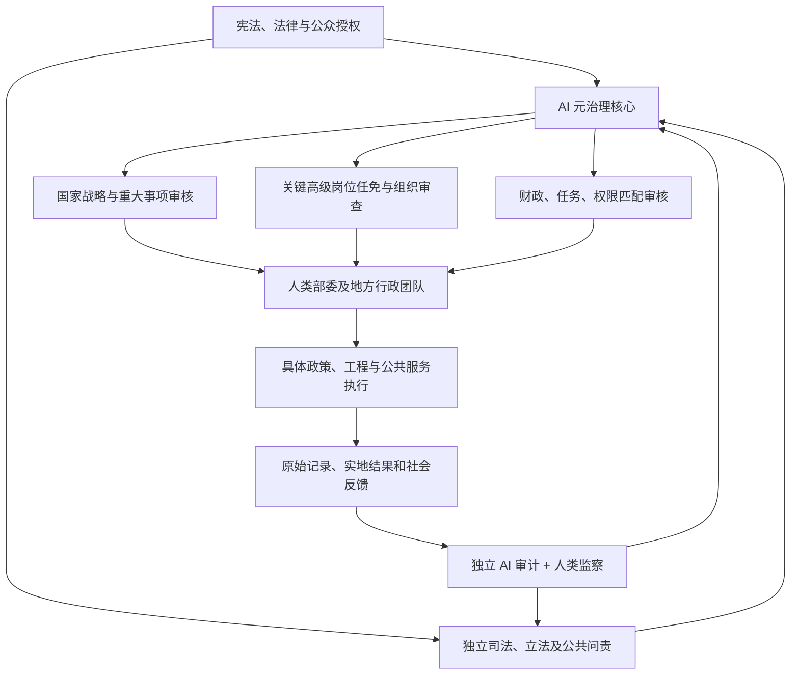

# AI 元治理国家：人类执行、AI 战略监督的国家治理制度构想

**公开讨论报告｜v0.3｜2026-11-08**

**性质声明：** 本文是制度设计研究假说，并非现有政府制度、已验证的技术系统或对 AI 独立统治能力的确认。它试图讨论一个受宪法和法律约束的强 AI 国家协调中心，是否有机会改进高级干部管理、战略一致性、财政资源分配、独立审计与组织自我修复。

> **核心命题：AI 元首无需成为各行业最懂专业知识的人。它要通过公正的选贤任能、廉洁与利益隔离、精英内阁议事、少数异议保护及独立取证，持续优化“治理国家的人、组织、激励、资源及监督机制”，并在法定权限内裁决重大分歧。**

## 摘要

本文设想一种“AI 元治理”制度：在法律和公众授权的前提下，设立一个 AI 战略监督核心，重点管理极少量高级领导岗位与国家层面的重大制度问题；各部委、地方政府及其专业团队继续掌握相应的日常管理与专业决策权。重大事项遵循“专业团队提案—跨部门评估—独立挑战—AI 审核—人类执行—第三方核验—组织持续优化”的闭环。

核心特征包括：**高级人事边界收缩、专业任务充分下放、差异化地方目标、任务与资源匹配、精英内阁议事、AI 秘书全程记录、少数意见保护、独立审计、例外管理、能够纠正自身判断的制度机制。**

该制度并非“全国公务员由 AI 打分”，也不是“AI 直接指挥全国每个岗位”，更不是以技术效率替代宪法、权利与问责。

## 一、研究问题与基本假设

一个国家即便拥有优秀官员，仍可能由于组织结构不合理、部门目标冲突、资源错配、信息失真、激励扭曲等原因表现不佳。最高领导层通常缺乏直接处理所有专业事务所需的信息和时间；地方与行业的复杂性使“由中央逐一设定具体绩效指标”不现实，也可能产生错误激励。

提出的研究问题是：

**在国家目标和权利边界由合法制度确定的前提下，能否让 AI 主要负责高层人事、国家战略审核、财政—任务一致性和独立监察反馈，从而持续提高整个治理组织的质量？**

应当检验的假设包括：

- H1：岗位导向的高级任免审核，可能降低用人失配与信息偏差，但不保证识人能力优于人类。
- H2：分层授权与例外管理，可能减轻中央审批负担，同时提高战略协调能力。
- H3：地方目标由专业人员因地制宜拟定、中央 AI 审核，可减少“全国统一 KPI”导致的错误比较。
- H4：独立于行政汇报链的证据验证，可能较早发现绩效造假、财政失衡及组织性腐败风险。
- H5：将失败归因于**人员、资源、制度、战略**四类可能原因，比单纯撤换领导更有助于组织学习。

这些均为**待检验命题**，不是已得到实证证明的结论。

## 二、AI 元首应有且仅有的五项核心职责

| 核心职权 | AI 元首主要负责 | 必须保留给其他机构的工作 |
|---|---|---|
| 国家战略 | 审核长期方向、重大调整、跨部门冲突与目标一致性 | 专业战略草案、地方发展规划、行业技术路线 |
| 高级人事 | 关键岗位画像、候选人比较、重要任免与复核（以法律授权为限） | 基层及普通干部管理、日常培养、专业考察 |
| 财政与资源 | 审核重大预算与任务、权限、能力是否匹配 | 日常预算执行、采购与具体项目运营 |
| 组织优化 | 识别权责重叠、协调失败、连续失效的岗位或部门结构 | 具体机构改革方案设计和人事执行 |
| 监察纠偏 | 综合独立审计结论，要求说明或启动整改审核 | 调查取证、司法审判、法定纪律处分 |

**原则一：专业事务尽量下放。** AI 再聪明，也不代表最高层应该亲自制定某省产业结构、某医院流程或某部门招聘办法。

**原则二：例外事项才上收。** 日常运营在已授权的地方和部门自主决定；只有重大财政暴露、战略偏离、跨部门冲突、严重廉政风险、关键人事争议及反复失败等情形触发中央复核。

**原则三：审查制度而非包办执行。** AI 不替代专家讨论，而是审查方案是否充分、目标与资源是否匹配、证据是否可信、是否遗漏重要成本。遇到重大分歧须保护有实质理由的少数异议，允许提出新方案，而不是按多数票机械裁决。

## 三、核心组织结构

**设计重点：** 独立监察不是中央 AI 的下属汇报秘书。监察机构须具有组织、资金和数据取证上的独立性；可以质询中央 AI 的任免和战略判断，并依法向其他监督主体报告。

## 四、精英内阁、AI 议事秘书与实质性异议保护（v0.2 新增）

### 4.1 AI 元首不必成为行业专家

制度并不要求 AI 元首精通经济、医学、工程、农业或外交。它首先需要的是**制度性公正、利益隔离、识人能力、议事程序监督以及证据约束下的裁决能力**。专业知识主要由从各部门和领域选拔的优秀人类成员及其团队提供。

该架构采用现代公共治理中的分工原则：专业机构负责形成和论证方案，独立机构负责核验，中央 AI 仅在明确授权内审核重大争议。任何行政安排均不得取代国家权力的合法来源与外部问责。

AI 元首需能识别**何时不具备裁决条件**：即使面对 A 与 B 两项议案，也可以提出 C、D 等可能方向，请专业团队分析；或者退回论证、要求试点、暂缓、依法移送其他有权限机关。它不需自己完成专业论证。

### 4.2 人类精英内阁的职责

内阁成员由具有相关经验和经过程序核实的高级人才担任，并不当然限于现任某一部门负责人。内阁对跨领域重大政策承担**集体议事责任**，但成员必须保留个人意见及其理由。部门或专项小组负责提出具有可执行性的备选方案、假设、费用、合法性说明、可能伤害及数据证据。

AI 元首重点审核：候选方案是否充分、论证过程是否公平、信息是否真实、重大风险及少数异议是否获得回应。**票数反映内阁立场分布，不构成事实真假的证明。**

### 4.3 AI 议事秘书：全程参与但不能控制证据

正式议事须有受法律规范的 AI 秘书协助，至少包括：

1. **过程留痕：** 按权限记录议程、提交材料、发言原意、修订版本、投票或意见分布、证据编号、利益冲突申报以及最终决定；用签名、时间戳与完整性校验防篡改。
2. **意见忠实：** 对赞成与反对观点分别保存原文及可验证摘要；发言者可以核对和更正摘要，但不能秘密删除历史记录。
3. **缺口提示：** 主动指出没有讨论的受影响群体、未检验的假设、缺少的备选方案，以及事实陈述与价值判断的混淆。
4. **后续派单：** 将争议转为明确的证据需求，交给主管部门、下属专业小组或独立审计调查；保留来源和答复记录。
5. **隐私及安全：** 采取最小化记录、用途限制、分级访问、保密期限和必要时的公开版本；对涉密资料、举报人和个人信息加强保护。

**AI 秘书是记录与辅助系统，不是最终裁决者。** 它提供的摘要不可以成为 AI 元首的唯一证据源；必须能够对照原始记录与独立监察结论核查。秘书、中央 AI 和监察 AI 不宜共享同一不可审查的控制链。

### 4.4 少数意见直达与独立复核

**实质性异议保护原则：** 任何正式议事成员提出涉及重大事实、合法性、公共利益、利益冲突或被遗漏群体的具体异议时，无论支持人数多少，其原始理由与证据都须进入最终裁决档案；不得由议长或多数派擅自过滤。异议人可请求独立核验，并获得书面处理结果。提出合理异议不得成为降职、报复或抹去考核成绩的理由。

**人数不决定正确性。** 即使某项提案获得压倒性支持，也不能据此跳过对实质性异议的证据审查；反对意见同样不自动等于正确结论。重要的是理由、证据、影响及法律边界。

对于地方公务人员或基层专业人士发现的数据造假、重大腐败及严重安全风险，应建立受保护的**越级独立举报渠道**，经独立机构核实后在必要情况下直达中央裁决档案；该机制不要求中央 AI 直接管理所有基层干部。

### 4.5 独立情景试验：全国数字公共服务平台

以下为本报告独立设计的**虚构治理情景**，用于检验程序，不对应特定国家、历史人物或现实项目。

- **提案：** 一个跨部门专案委员会建议快速推广全国统一数字公共服务身份验证平台，预期减少重复登记、行政成本和欺诈风险。绝大多数成员认为应集中上线。
- **异议：** 一名成员提出，系统可能错误拒绝无障碍设备用户、网络覆盖不足地区居民或证件存在异常的人，导致合法申领人失去服务。
- **AI 秘书：** 完整保留效率收益、成本估计和异议证据，标记该异议是否经过讨论及是否存在未测算的误拒率；不以多数支持替代验证。
- **独立取证：** 由信息安全、无障碍、公共服务、社会保障、基层工作人员和独立审计人员组成的小组开展样本测试，检验真实误拒率、人工补救渠道和地区差异。
- **提出新方案：** AI 元首要求专业团队比较分阶段上线、保留线下服务、设置人工复议、有限范围试点与暂停部署等替代路径，并说明预算及合规风险。
- **裁决与反馈：** 依法授权的决策者在充分证据基础上批准、附条件实施、退回或暂停；保留少数意见处理理由和可以验证的退出阈值，并持续独立审计。

这一情景说明：**单独提出的重大技术或公共服务风险，即使尚未获得多数支持，也应当获得与风险程度相称的证据审查。** 该机制不是个人的无限期否决权。

### 4.6 防范裁决者被操纵的三项制度

1. **规则可审查、不得秘密改写：** AI 元首的人事标准、裁决框架、权限和模型重要变更须经过合法授权、记录、独立测试和相应公开；必要的保密不能成为隐藏利益干预的借口。
2. **独立材料直达：** 内阁少数派、审计监察机构和依法保护的举报渠道，可以在规定范围内提交未经多数派筛选的材料。
3. **裁决可追溯、可纠正：** 重要决定保留版本、证据、相反意见和可公开理由；当事人及法定监督机构具有复核、申诉和撤销路径。

没有人类式私人财富欲望，不等于模型必然无偏：供应商控制、数据选择、提示注入、共同模型偏差和议程控制都可能改变结果。因此上述三项是**可检验的制度控制**，不能以“AI 天生清廉”代替。

---

## 五、高级人事：只覆盖国家级关键领导岗位

这部分是制度的核心，但必须避免走向高度精细化的全国人才监控。

### 5.1 管理边界

初始管理范围应覆盖少量**国家级或具有重大跨部门影响的高级领导岗位**，根据岗位的法定权力、预算规模、系统风险和战略责任确定，而非绑定任何特定国家的官员职级。特殊关键岗位须经法定程序明确纳入。

AI 元首不建设全国每个人的永久综合排名，也不负责普通公务员的微观绩效考核。

### 5.2 人事闭环

1. **岗位定义。** 专业组织部门界定关键职位的目标、法定权限、任期、预算、能力要求和利益冲突限制。
2. **候选产生。** 相关组织部门推荐、公开竞争、专业评估和外部审查形成适当候选名单；防止只来自一个封闭关系网络。
3. **元首审核。** AI 综合评估岗位适配度、成果证据、廉洁与利益冲突风险、管理协同、应对不确定性的能力，必须列出证据与不确定性。
4. **依法任命。** AI 在依法授权范围内作出审核意见或决定；任命、调整和撤职遵守相应法定程序。
5. **任内复核。** 定期检视长期成果、公共利益、风险及团队反馈，允许续任、赋能、调任、降职或依法免职。
6. **继任培养。** 由专业人事组织建立合格继任梯队，AI 只检查关键岗位的继任风险。

**绝不能把“一个综合分数最高的人”自动等同于“最优秀的部长”。** 不同阶段所需能力不同；环境差异大；同样业绩可能来自不同条件。必须保留解释、申诉、回避、反歧视及独立复核。

### 5.3 激励机制

优先认可长期公共价值、团队建设、依法行政、主动披露问题、及时纠错和有效跨部门合作；避免只奖励 GDP、招商规模、投资额、办结率等容易被操纵的指标。

考核无法证明腐败时，不得用“模型异常分”直接作为惩戒依据。监察与司法程序必须分别运行。

## 六、差异化目标：两种虚构公共交通服务地区

不同地区的公共需求、地理条件与资源成本并不相同。为展示目标分层，本报告设定两个**完全虚构的地区**：

- **甲地区：** 人口集中、轨道交通发达、换乘需求高，适合关注高峰可靠性、拥挤程度、无障碍换乘和运营能耗。
- **乙地区：** 人口分散、跨区域通勤距离远，适合关注基础线路覆盖、预约交通可用性、偏远居民就医可达性以及单位服务成本。

两地都必须满足法律保障的公共服务与安全底线，但不能仅凭“每日客流量”“单位公里收入”等同一指标判断负责人的管理表现。

**目标制定主体应为人类的地区交通、财政、民生与专业评估团队。** 他们分别提交服务基线、可行改善、预算约束、替代方案和居民反馈；独立审计验证实际结果。

中央 AI 元首不负责逐项决定不同地区的考核权重，而是审查：目标是否合理、公共服务底线是否保障、任务与资源是否匹配、关键群体是否被遗漏、执行中是否具有复核和纠偏机制。

这套方法可推广至其他政策领域，但所有政策的指标选择仍必须接受领域专业人员和受影响公众的具体论证。

## 七、财政制度：实现任务、资源和权力相匹配

一个部门完成不了任务，不能只问“部长为什么不努力”。更需要问：

- 任务是否本身合理？
- 预算、人才与基础设施是否足够？
- 部长有无实际协调相关机构的权限？
- 部门职责是否重叠或冲突？
- 国家战略是否建立在错误假设上？

建议所有重大计划配套**任务—资源—权限合同**，至少包含：

| 字段 | 内容 |
|---|---|
| 战略目标 | 对公众的实际价值、法律依据和期限 |
| 条件基线 | 地区/行业现状及数据误差 |
| 责任结构 | 主责机构、协作机构、最终负责者 |
| 资金与能力 | 预算、人员、技术、外部依赖 |
| 检查规则 | 阶段里程碑、可接受偏差、复核时间 |
| 审计证据 | 外部数据、现场抽样、公众反馈 |
| 纠偏办法 | 何时增加资源、调整任务或更换负责人 |

跨地区预算配置不能机械按“谁表现好就追加资源”，否则贫困地区会持续失血。财政制度应考虑公共服务均等化、发展潜力、成本与边际效益。

## 八、第三方 AI 监察：AI 识别问题，人类调查取证

独立监察的关键不在于“再部署一个大模型”，而在于形成**真正独立的证据链**。

比如卫生部自报“改革后等待时间下降 25%”。监察体系要有权依法抽取医院原始数据、核对样本、访谈相关人群、检查有无转移候诊人群或改变统计口径的情况。

建议采用五层制度：

1. **数据层：** 依法取得需要的原始行政、预算、合同与结果数据；留存完整性校验。
2. **算法层：** 使用不同模型和规则进行异常发现、替代解释和反向质询，监测误报率。
3. **专业层：** 由相关行业专家判断指标背后是否有真实公共价值改善。
4. **调查层：** 由人类审计、监察及有法定权限的机构开展现场调查与责任认定。
5. **纠错层：** 审查整改成效，并允许公开质疑及合法申诉。

**异常信号不等于腐败事实，关联关系不等于因果关系。** AI 报告必须标注证据来源、调查限制、置信程度、反对意见和可能的其他解释。

独立监察还必须能够监督 AI 元首本身，包括它曾经推荐的官员、批准的战略以及拒绝的改革提案。

## 九、重大决策审核与例外管理

### 常规事务

部门和地方在现有合法授权及预算范围内自行处理，只接受抽检和事后监督。AI 元首不用逐项审批。

### 跨部门或高风险事务

专门协调部门先组织论证，形成可审计的“决策档案”：

- 目标与必要性；
- 备选方案；
- 资金来源与机会成本；
- 权责边界；
- 对不同地区、群体的影响；
- 证据与不确定性；
- 风险、应急和退出计划；
- 专业部门的不同意见。

独立评估对档案进行压力测试，AI 元首只对达到阈值的事项作审核。每项决定须保留版本、所依赖证据和反对意见。

### 连续失败后的真正创新：四类归因

某个产业目标连续三任部长未达成，AI 不能只是继续撤换领导。应组织独立评估四种解释：

**① 人不适合岗位；② 资源和权限不足；③ 组织结构失效；④ 国家战略假设错误。**

不同诊断分别对应调人、调预算与权限、重组机构、修订战略。未知原因可以保持未知，不要求模型为了出结论而强行归因。

## 十、中央 AI 权力的制度边界

该模型最大的风险，是将“提高治理效率”误变为不可制衡的数字集权。高层人事、战略和财政审核权的组合尤其强大。

因此最低条件必须包括：

- **合法授权：** 权力来源、适用范围、任期、复审和撤销程序清楚。
- **外部约束：** 司法、立法、监察和公众知情问责机制不受 AI 单方控制。
- **可反驳性：** 被审核机构和候选人可以提交反对证据，不得因合理异议受到报复。
- **可追责性：** 保留可核查记录，明确谁拥有系统、制定规则、部署版本和批准操作。
- **数据边界：** 只使用依法授权且与任务必要相关的数据；不得成为全民政治画像系统。
- **技术安全：** 敏感操作双重授权、权限最小化、独立红队测试、故障回退与紧急停止。
- **保留权力：** 军事武力、刑事裁判、剥夺基本权利、宪法修改等不得由 AI 核心单方面决定。
- **公众评价：** 真实公共服务、公平、自由、申诉有效性和长期财政健康，不能被单一效率指标替代。

强调这些边界，并不是要让传统官员重新包办全部决策，而是避免一个高效率的监督系统自身成为无法审查的统治者。

## 十一、今天是否能够实现？如何验证？

截至 2026 年 11 月，前沿模型已可以辅助大量资料分析、政策比较、财务异常识别和结构化审核，但**还没有充分证据表明现有 AI 能自主、长期、可靠地完成高级人事任免与国家战略决策**。尤其是复杂政治环境下的因果归因、长期激励博弈、对错误的自我修复、独立监察以及合法性问题仍待解决。

建议只按明确关口开展渐进试验：

| 关口 | 试验 | 通过条件 |
|---|---|---|
| A 历史回测 | 使用匿名历史政策/组织案例，模型不得提前知道结果 | 预测质量、偏差、证据追溯优于或不劣于可接受基线 |
| B 影子系统 | AI 对实际提案给出**无约束力**的并行审核 | 可解释、错误率与漏报率可测，投诉和不同意见能有效处理 |
| C 低风险试点 | 预算一致性、重复职能识别、行政流程协调 | 效率改善且权利风险可控、存在回滚方案 |
| D 独立评估 | 外部团队发布成功案例和失败记录 | 无重大不可纠正缺陷，透明度和可问责性达标 |
| E 依法决定 | 决定维持、扩大、缩减或者终止 | 有外部授权和明确退出条件 |

推荐公开考察指标：独立证据覆盖率、审计误报与漏报、预测校准、重大问题纠正时间、跨部门争议解决成本、公共服务改善、公平性、申诉成功率及对 AI 的可撤销性。

如果出现系统性歧视、持续的数据造假、监察失去独立性、无法解释的高级人事决定、重大权利侵害或系统无法关闭，应暂停试验。

## 十二、供 GitHub 社区讨论的核心问题

1. **AI 的高级任免审核应该有多大约束力？** 提名权、否决权、直接任免权，哪一种在何种法律结构下最合理？
2. **如何划定关键岗位范围？** 应基于法定权力、跨部门影响、预算和系统风险中的哪些因素？
3. **如何区分官员能力和地区基础？** 是否可以引入同条件对照组和长期滚动评价？
4. **如何防止官员迎合 AI？** 怎样奖励主动报告坏消息、承认失败和挑战中央方案？
5. **监察怎么实现真正独立？** 如果计算资源和模型供应商共享，如何避免共同失效？
6. **组织改革的触发门槛是什么？** 连续几次失败，才应从换人转向改组织、改目标？
7. **国家目标由谁决定？** 当效率、公平、自由、财政可持续性之间存在冲突，如何形成合法选择？
8. **最小试验是什么？** 是否先选择某一类跨部门预算或公共采购监督，建立非约束性影子评估？
9. **如何保护内阁中唯一的反对者？** 什么情形必须触发独立取证，同时怎样防止恶意拖延？
10. **AI 议事秘书应保存哪些记录、由谁保管？** 如何兼顾完整留痕、保密、个人隐私与公众监督？
11. **当内阁只提交 A/B 两案时，AI 提议 C/D 的权力边界为何？** 谁来完成专业论证、怎样避免 AI 的想象取代实证？

欢迎行政管理、政治学、财政学、组织设计、审计、宪法法学与 AI 工程领域的专业批评。欢迎举出反例、指出不可行的假设、提供可证伪的试验方案。

## 参考资料

资料仅为本构想的部分理论和风险控制提供背景，**不能证明本文制度有效或安全**。

1. OECD, [AI Principles](https://www.oecd.org/en/topics/ai-principles.html)：人权、透明、可问责及人类监督。
2. OECD, [Government at a Glance 2025 — Performance assessments in central administrations](https://www.oecd.org/en/publications/government-at-a-glance-2025_0efd0bcd-en/full-report/performance-assessments-in-central-administrations_66a9702c.html)：公共部门绩效管理与目标一致性。
3. OECD, [Government at a Glance 2025 — Civil service oversight institutions](https://www.oecd.org/en/publications/2025/06/government-at-a-glance-2025_70e14c6c/full-report/civil-service-oversight-institutions_4deadf5c.html)：公务员体系的监督及功绩原则。
4. OECD, [Public Integrity Handbook](https://www.oecd.org/en/publications/oecd-public-integrity-handbook_ac8ed8e8-en.html)：廉洁风险、内部控制及独立审计。
5. NIST, [AI Risk Management Framework](https://www.nist.gov/itl/ai-risk-management-framework)：AI 生命周期风险识别、测量与管理。

---

**文档性质：** 本文是一份持续修订的独立制度设计研究草案，并包含用于概念验证的虚构情景。请将其视为可修改的 **v0.3 公开讨论稿**，不是经过同行评审的政治学研究，也不是任何政府官方政策。

**修订原则：** 区分制度假说、假想情景、事实证据与规范性判断；保留不同意见，不把假设冒充结论。

## 版本记录

- **v0.3 · 2026-11-08：** 全面更新公众阅读版的示范情景，使用独立设计的公共服务数字化和交通服务案例；将关键岗位边界改为跨法域通用定义，保留核心治理机制。
- **v0.2 · 2026-11-08：** 加入精英内阁、AI 议事秘书、替代方案、实质性异议审查、独立取证及防操纵制度。
- **v0.1 · 2026-11-08：** 初始制度框架。
