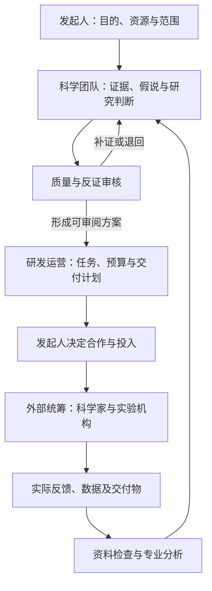

# 医疗一人项目｜核心理论与需求

版本：V0.1  
整理日期：2026-10-29  
阶段：理论整理与需求讨论  
性质：本项目唯一的核心理论源头；后续系统、岗位、流程及技术方案须从这里推导。

## 1. 项目为什么存在

发起人一直希望能够发起并参与开发一款药物，但目前缺少药物发现与临床前研发核心技术，前期资金有限。发起人具体承担哪些组织和协调工作，应在后续职责讨论中明确。

受到AI辅助精简生物技术公司及AI科研成果案例启发，项目提出一个待验证问题：

> 能否由一名发起人组织一支职责明确的AI团队，以AI承担日常科学分析、研发运营和外部合作统筹，再与现实中的科学家、实验室及其他专业机构合作，逐步推进一个药物研究项目？

本项目先检验这种组织方式的可靠性、实际价值和成本，再根据结果决定是否增加资金和推进更深层药物研发。

## 2. 发起人的目的与当前选择

以下来自对话中的明确表达，不应被后续AI自行改变：

| 事项 | 当前内容 |
| --- | --- |
| 长期目的 | 发起并参与一款有真实科学依据和开发价值的药物项目 |
| 首阶段目的 | 跑通并验证一人加AI团队及外部合作的工作模式 |
| 初始路线 | 将已有药物开发用于宠物，可利用既有研究 |
| 前期资金 | 人民币1—2万元，不含生活备用金；不是完整药物上市开发预算 |
| 工作设想 | AI可承担首席科学家的日常分析职责，不同Agent各司其职并按流程汇报 |
| 外部合作 | 必要时与真实科学家交流，统筹外部实验室等机构合作 |
| 架构要求 | 覆盖科学判断、研发运营、研发执行统筹，不能固定压缩为三个岗位 |
| 当前顺序 | 先讨论理论、梳理设想与需求，并在GitHub保存为统一源头；代码实现暂停 |

“人用药转宠物用”本身不等于best-in-class。是否具有同类优势，需另行提出比较问题并获得相应证据。发起人此前比较过剂型改进路线，随后明确选择已有药物用于宠物；后续不能擅自改回其他路线。

## 3. 核心组织假说

拟议组织由以下部分组成：

1. **一名发起人**：确定目标，掌握资源和合作决定，审查需要自己决定的事项。
2. **AI科学判断体系**：提出和比较研究假说，评价已有证据，明确未知和下一步验证问题。
3. **AI研发运营体系**：维护项目、资料、数据、任务、预算、进度及交接。
4. **AI外部执行统筹体系**：整理科学家审阅材料、外部实验需求、询价与合作跟踪，接收和组织结果。
5. **现实中的专业网络**：科学家、临床兽医、药理/药学/统计/注册等专业人员，以及实际承担研究的机构。

“一人”描述内部核心组织精简，不意味着只有一个人付出劳动，也不意味着外部资源免费或无需实验。

当前应检验的假说：AI能否减少专业资料处理和组织成本，帮助发起人管理完整研究过程，并在适当节点暴露问题、获取外部纠错和停止不值得推进的项目。

## 4. 三个工作领域及独立审核

### 4.1 科学判断

需要回答研究什么、为什么可能有价值、现有证据是否支持、最可能错在哪里，以及下一步应验证什么。

AI首席科学家是工作角色。它可以主动提出假说和建议，但不能凭角色名称获得真实履历、执业资格或未经验证的科学判断能力。

其专业化需要共同依赖：基础模型、适配资料、必要工具、明确研究方法、真实案例检验及外部反馈。AGENTS.md等指令文件用于规定工作方式，不能替代这些组成部分。

### 4.2 研发运营

需要让工作持续推进，并保留可复核的记录。包括任务依赖、负责人、交付要求、资料版本、未决问题、预算、合作状态、进度和决策依据。

运营记录应区分：计划、草稿、已发出、已回复、已确认、执行中、已收到、待验收及已验收。不能因生成一份文件就认为现实工作已完成。

### 4.3 研发执行统筹

系统内的Agent负责组织执行，现实实验由外部机构承担。系统需要能够整理研究需求，准备合作问题和沟通材料，比较真实报价，记录任务与交付要求，跟踪进展，并把实际收到的数据交给合适岗位分析。

AI不得把模拟、文献再分析或自己生成的数据写成外部实验室完成的真实结果。

### 4.4 独立质量与反证审核

审核要与产出区分，检查事实、来源、物种外推、研究设计、分析口径、结论边界和交付完整性。

审核员应能提出退回、补证或暂停建议；不能为了完成流程而自动给出通过。多个AI意见一致也不等于独立实验或多位真人专家完成验证。

## 5. 专业Agent的定义

本项目中的专业Agent，应当是一项可持续维护和考核的岗位配置。每个岗位至少明确：

| 属性 | 要回答的问题 |
| --- | --- |
| 目的与职责 | 这个岗位解决什么问题，哪些工作不归它负责？ |
| 能力要求 | 需要理解哪些科学或运营问题，怎样检验其表现？ |
| 输入 | 接收什么资料、任务和上游结论？ |
| 知识与记忆 | 能使用哪些专业资料，保存哪些历史，怎样更新？ |
| 工具与数据权限 | 能读取、调用、产生或修改什么？ |
| 标准交付 | 应提交什么结果、证据、局限和建议？ |
| 汇报关系 | 向谁汇报，谁使用其输出，谁负责复核？ |
| 完成和退回条件 | 什么算交付完成，什么情况必须补证或退回？ |
| 预算和异常 | 可以消耗多少资源，失败或资料不足怎样处理？ |

岗位职责应由指令、任务分派、资料范围、工具限制、输出要求和审核共同落实。提示词里的“只做自己的事”不能单独等同于已经实现的权限隔离。

不同岗位可以使用同一基础模型，也可以使用不同模型。模型、知识库和执行方式暂不锁定；岗位分工不等于已经训练了多个独立专业模型。

## 6. 初步岗位目录（建议，待逐项讨论）

下表保留完整职责范围，不把数量作为效果或成熟性的指标。岗位可进一步拆分或调整，但重要职责不能在没有替代安排时被删去。

| 工作领域 | 候选岗位 | 主要交付 | 建议汇报对象 |
| --- | --- | --- | --- |
| 科学判断 | AI首席科学家 | 研究问题、假说比较、综合判断、验证优先级 | 发起人 |
| 科学判断 | 文献与证据研究员 | 原始研究提取、支持/反对证据、来源 | 首席科学家 |
| 科学判断 | 兽医药理与物种转化研究员 | 机制、暴露、安全与物种差异分析 | 首席科学家 |
| 科学判断 | 药学与质量研究员 | 产品、制备、检测与质量证据需求 | 首席科学家 |
| 科学判断 | 实验设计与数据分析员 | 设计审查、终点、分析口径和结果边界 | 首席科学家 |
| 科学判断 | 注册与知识产权研究员 | 目标市场要求、已批产品和权利线索 | 首席科学家及发起人 |
| 研发运营 | 研发项目运营经理 | 计划、依赖、进展、问题追踪与汇报 | 发起人 |
| 研发运营 | 资料与数据管理员 | 来源、版本、完整性和数据接收记录 | 运营经理 |
| 研发运营 | 预算与商业可行性分析员 | 成本来源、替代方案和分阶段投入建议 | 发起人 |
| 外部执行统筹 | 外部实验室合作统筹 | 需求、询价与交付清单、合作进展 | 运营经理及首席科学家 |
| 外部执行统筹 | 科学家联络与反馈专员 | 匹配专家、一页材料、具体问题和反馈 | 首席科学家 |
| 独立审核 | 质量与反证审核员 | 差异、漏洞、补证、退回和暂停意见 | 发起人，并回送相关岗位 |

表内汇报关系是初稿。具体哪些岗位可合并、哪些需要更严格独立，须根据真实工作及错误风险判断。

## 7. 拟议工作流程与汇报机制

以下为待完善的业务流程，不表示系统已实现：

每次交接至少应回答：任务是什么，输入是什么，完成了什么，依据在哪里，哪些尚未解决，下一步由谁做，什么条件下不能继续。

报告不应只写“已完成”或“建议继续”。应让上游能复核，让下游知道可依赖什么，不能依赖什么。

不合格交付应带具体原因退回；争议与反证保留。流程状态由实际输入、交付和规定条件决定，不能由Agent一句“通过”任意改变。

## 8. 现实科学家的作用

发起人的设想是让AI承担主要日常研究分析，再搭配现实中相关领域科学家进行具体问题沟通。可以先准备材料，必要时通过邮件等方式寻求反馈；是否获得回复或形成合作不能预设。

拟议协作循环：AI提出可检验假说 → 整理关键原始证据和最强反证 → 找到适配问题的专业人员 → 提出少量具体问题 → 记录真实意见及其范围 → 更新判断 → 决定是否继续。

一次泛泛回复不等于项目获得认可、对方担任顾问或愿意合作。更深入的审阅可能需要明确工作范围及费用安排。

专家并非所有问题都适配。目标物种药理、具体疾病、毒理、药学、统计及注册问题，应分别识别需要哪类专业判断。

## 9. 低成本与完整分工的关系

用户已经明确反对将完整组织压缩为三个岗位。此前“三岗位最小模式”仅保留为一次局部演示的历史安排，不再作为未来组织架构上限。

本项目的低成本原则应为：**完整考虑职责，一次只运行当前需要的工作。**

可以缩小同时推进的项目数、动物/疾病范围、资料处理量、模型调用及当前执行阶段；不能简单省略关键职责后仍声称完整研发过程已经跑通。

预算分阶段投入，并给专家审查和关键验证留出空间。系统建设、AI调用、资料获取、专业咨询和现实实验成本分别记录。未知费用不能填0，预计费用与真实报价、实际支出分开。

## 10. 如何验证模式

需要分别回答三个问题：

| 层面 | 要检验的内容 | 不能由什么替代 |
| --- | --- | --- |
| 组织与流程 | 分工、交接、退回、追踪、权限、恢复及成本是否可靠 | 岗位名称多、报告多或一次顺利演示 |
| 科学判断 | 来源与推理是否可靠，能否找出关键未知并接受纠错 | AI一致同意、专家人设或文献数量 |
| 具体项目 | 是否值得继续，下一项研究能否改变决定，真实资源能否支持 | 流程能运行、新闻案例或融资故事 |

稳定不是每次说出相同的话，而是在相同资料与条件下，关键事实、边界和决定理由可复核；有新证据时应允许并解释判断变化。

后续可讨论：重复案例、失败案例、资料不足、外部来源不可用、退回补证、中断恢复、单Agent对照、专家抽查和真实合作反馈。具体数量与通过条件尚未定稿，不作为已经完成的验证。

能够准确否定不值得做的项目同样有价值；不能只报告成功或支持假说的结果。

## 11. 证据与记录原则

- 区分已核实事实、有限证据、推断、待验证假说、冲突和资料不足。
- 人、实验动物和目标猫犬资料分别记录，细胞结果、暴露、短期终点和长期疗效不能互换。
- 关键数字、引文与结论可追溯到原始来源；重复索引不增加独立证据数量。
- 原始数据、模型预测、文献再分析和演示数据分别标记。
- 保留资料、报告、专家反馈和判断的版本，不能用新解释覆盖原始记录。
- 真实实验、邮件发送、合作确认、付款及数据到达，都以实际行为或收到的材料为准。

## 12. 当前已有材料及其地位

此前已整理启动说明及AGENTS.md模板，并在本会话对米氮平转猫用药的已知案例做过研究与审核分工回放。

该回放核对过样本口径、短期终点、物种与批准范围，并处理三条事先明确为错误的断言。因此它不是盲测、不是新药发现，也不能证明整个组织模式成熟。

此前围绕“三岗位”的文件是历史版本，后续应按本主文件修订。它们不应反过来限制用户后来明确要求的完整分工。

对话中曾开始准备工程草稿；用户随后明确先讨论理论，相关实现工作已经暂停。未验收的代码或界面不进入本次初始理论仓库，不作为已实现能力。

## 13. 当前阶段与后续顺序

当前只做理论、需求和讨论记录。后续建议顺序如下，具体推进由用户的新指令决定：

1. 补充并确认项目目的、边界及三大工作领域。
2. 逐个讨论岗位：职责、输入输出、权限、汇报、交接与审核。
3. 用一个项目场景走完整业务流程，找出缺失职责和现实合作条件。
4. 再选择复用、组合或自建哪些工具，形成技术方案。
5. 得到实施指令后开发并检验系统。
6. 按质量、成本和实际科学/合作证据，决定是否扩大投入。

## 14. 维护与变更

本项目保存在现有 GitHub 仓库 `pyzz58/gpt-recommendations` 的 `医疗一人项目/` 目录中。用户已澄清可沿用既有仓库建设项目；此前助手提出的独立私有仓库与英文仓库名不再作为执行方案。这个目录是本项目的理论源头，不改变同仓库其他项目的理论和协作规则。

用户最新明确指令是调整目的和范围的依据。助手建议、软件实现、案例演示均不得自行升级为用户决定。

每次重要讨论应同步记录：提出的问题、当前理解、建议、是否确认、受影响部分及未决事项。新判断保留原因和历史，不抹去此前路线修正。

本文件定义“为什么做、要做到什么、按什么原则做”。具体实现文件、角色配置和测试材料要引用这里；不能因为某项技术方便就改变目的。

依据及适用边界见[SOURCES.md](SOURCES.md)，讨论历史见[DISCUSSION_LOG.md](DISCUSSION_LOG.md)，当前决定与未决问题见[DECISIONS_AND_QUESTIONS.md](DECISIONS_AND_QUESTIONS.md)。
