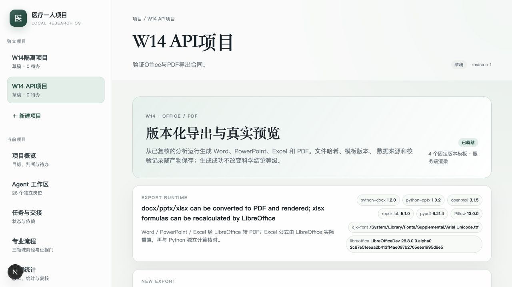
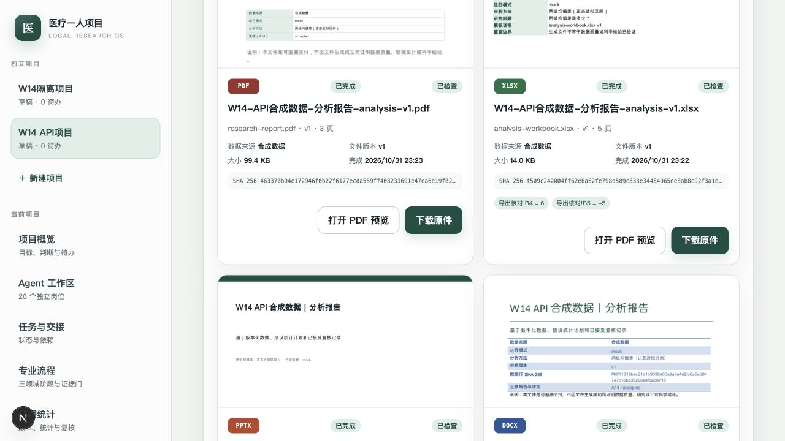
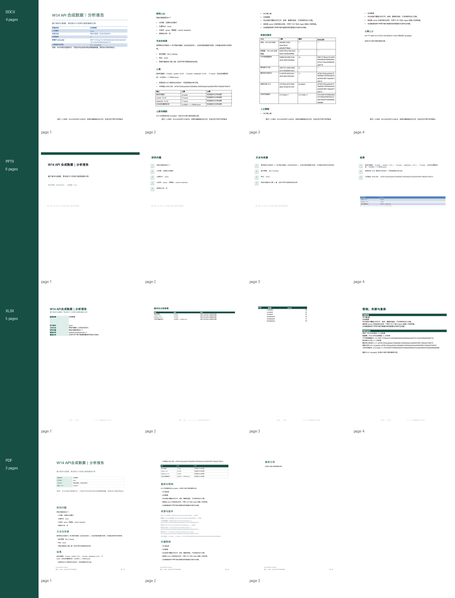

# W14 Word/PPT/Excel/PDF导出接手说明

对应：RQ-014、RQ-023及相关Office/PDF交付要求；TR-03、TR-04、TR-14、
TR-17、TR-18、TR-19、TR-20、TR-25；W14；AT-014、AT-023。

状态：IMPLEMENTED，未VERIFIED。四种真实文件、可编辑内容、预览、Excel实际
重算、模板/来源/输入/输出hash和页面记录已通过本机合成分析验收；完整视觉质量、
跨Office套件兼容、大型/复杂模板、独立科学审核和W21跨包验收仍未完成。

## 已交付

- 只允许最新复核为`accepted`的W13分析运行导出；无复核、失败分析或最新复核
  非接受时拒绝生成。
- 每次导出先保存`running`记录，再在进程外临时目录生成文件；成功后原子登记
  `artifact_versions`和`artifact_exports`，失败保留明确错误状态。
- 结构化报告绑定研究问题、方法、结果、来源、限制、复核、数据来源声明和分析
  计算结果；模板版本与内容hash分别保存。
- DOCX使用python-docx生成封面、元数据、章节、结果表和来源表；Open XML文件
  重新打开并检查标题、章节、表格。
- PPTX使用python-pptx生成16:9可编辑演示、结果表和来源页；重新打开并检查
  形状边界和必需文本。
- XLSX使用openpyxl写入数据、结果、公式和核对说明；LibreOffice实际重算文件，
  openpyxl分别读取公式原文与缓存值，并与Python对同一行数据的独立结果比较。
- PDF由reportlab生成，嵌入可用的CJK TrueType字体；检查页数与可提取哨兵文本。
- DOCX/PPTX/XLSX经LibreOffice转PDF，再由`pdftoppm`逐页渲染；空白页、页数、
  必需哨兵文本和首页预览均进入校验记录。
- 导出运行、生成文件和预览位于项目RLS边界内；下载与预览每次核对项目，
  SHA-256在读取时复验，并设置`private, no-store`。
- 同一幂等键和参数重放同一导出版本；同键改格式/标题/模板返回409。
- 新模板目录`config/templates/catalog.yaml`固定DOCX、PPTX、XLSX、PDF四个
  v1默认模板。

## 主要路径

- 导出/报告合同：`services/core/src/medical_one_person/domain/exports.py`
- 分析报告组装、导出记录和下载：`services/core/src/medical_one_person/application/exports.py`
- Office/PDF生成与文件校验：`services/core/src/medical_one_person/infrastructure/exports/engine.py`
- LibreOffice/Poppler/CJK字体运行时：`services/core/src/medical_one_person/infrastructure/exports/renderer.py`
- 模板注册：`services/core/src/medical_one_person/infrastructure/exports/templates.py`
- API：`services/core/src/medical_one_person/api/artifacts.py`
- 迁移：`services/core/migrations/versions/6a2d9c4e8b71_w14_artifact_exports.py`
- 页面：`apps/web/src/app/projects/[id]/artifacts/page.tsx`
- Schema：`schemas/structured-report.v1.schema.json`、`schemas/export-template-catalog.v1.schema.json`

## 运行依赖

安装LibreOffice headless、Poppler和一个CJK TrueType字体后配置：

```bash
MEDICAL_ONE_OFFICE_SOFFICE_PATH=/absolute/path/to/soffice
MEDICAL_ONE_OFFICE_PDFTOPPM_PATH=/absolute/path/to/pdftoppm
MEDICAL_ONE_OFFICE_PDF_FONT_PATH=/absolute/path/to/cjk-font.ttf
```

PDF字体路径可省略，应用会检查macOS/Linux的已知字体位置。Office转换会生成隔离
临时LibreOffice profile及`fontconfig`配置；不会继承模型/provider密钥。缺少
CJK字体时运行时明确`unavailable`，不会把中文缺失的预览记录为通过。

本轮实际使用LibreOfficeDev 26.8.0 alpha、Poppler页图和系统Arial Unicode字体。
这是本机原生运行证据，不是Docker/Compose或生产容器镜像验收。

## 验收

```bash
export MEDICAL_ONE_TEST_DATABASE_URL='postgresql+psycopg://admin@127.0.0.1:5432/medical_one_test'
export MEDICAL_ONE_OFFICE_SOFFICE_PATH='/path/to/soffice'
export MEDICAL_ONE_OFFICE_PDFTOPPM_PATH='/path/to/pdftoppm'
PATH="/Users/zz/Library/pnpm/bin:$PATH" make test
PATH="/Users/zz/Library/pnpm/bin:$PATH" make lint
PATH="/Users/zz/Library/pnpm/bin:$PATH" make build
```

本轮结果：

```text
76 core tests passed
W14 migration: bee2b2f5fefa -> 6a2d9c4e8b71 round-trip passed
57 RLS policies; artifact_exports FORCE RLS
DOCX: real file reopened; 4 rendered pages
PPTX: real file reopened; 6 rendered pages; shape bounds passed
XLSX: LibreOffice formula cache matched independent Python calculation
PDF: real file reopened; embedded CJK text rendered; 3 pages
Export API: same key -> same record/hash; changed request -> 409
Project isolation: cross-project artifact download -> 404
Browser: reviewed analysis -> four exports -> thumbnails/PDF preview/download
Ruff and mypy passed
Next.js lint, typecheck and production build passed
```

界面与文件版式证据：







## 边界与未完成

- 自动预览检查能发现打不开、空页、部分必需文本缺失和PPT形状越界，不能证明
  所有字体、分页、图表、表格或业务版式都无问题；本轮已人工查看关键页，
  但未建立完整多模板视觉回归集。
- Office文件由LibreOffice渲染，不等价于Microsoft Word/PowerPoint/Excel原生
  打开后的像素一致性；未测试WPS、旧版Office和移动端。
- XLSX只核对明确的样本数、均值差或比例公式格，不是任意公式引擎；未支持用户
  上传Excel模板、复杂数组公式、宏、外部链接或跨工作簿计算。
- 当前不支持用户自定义模板、复杂修订、批注回写、图表编辑或大型长报告。
- W06通用`office.docx`容器技能仍因Docker/固定镜像不可用；W14通过应用服务完成
  可审计导出，未将其冒充已验证的隔离技能容器。
- A14/A25/A26复核是owner记录的岗位合同，不是W17独立Agent或真人专家审查。
- PDF/Office文件生成和版式检查不证明合成数据真实、研究设计正确、统计结论成立
  或真实外包合作已发生。
