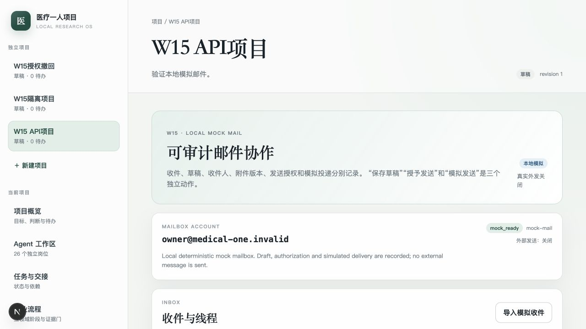
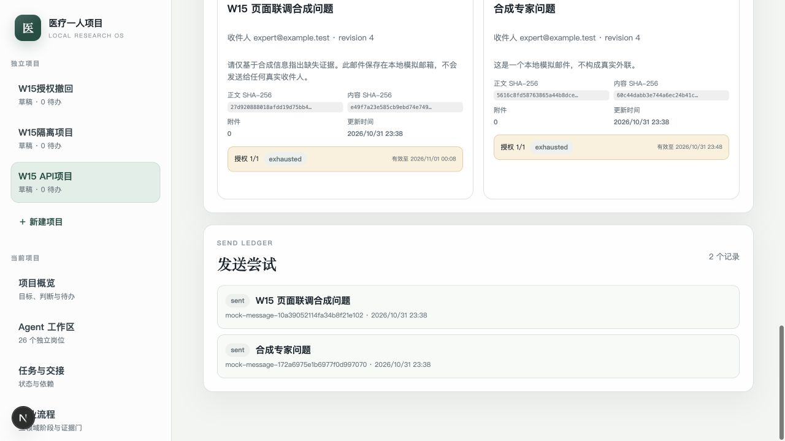

# W15 模拟邮箱、草稿、授权发送与不确定核对接手说明

对应：RQ-015、RQ-029及邮件/外部动作要求；TR-04、TR-14、TR-16、TR-17、
TR-18、TR-19、TR-20、TR-25；W15；AT-015、AT-029。

状态：IMPLEMENTED，未VERIFIED。本地模拟适配器、收件线程、草稿、附件版本、
显式发送授权、模拟投递、撤回/过期拒绝和`outcome_unknown`核对已通过真实
PostgreSQL、API及浏览器联调；真实邮箱、真实外发、进程崩溃后的provider核对、
完整回复语义解析和W17外部专业反馈仍未验证。

## 已交付

- 默认仅创建`owner@medical-one.invalid`本地模拟账户，明确显示
  `mode=mock`、`state=mock_ready`和`external_send_enabled=false`。
- 模拟收件线程包含合成的实验室接收回复及负责人模拟消息；保留
  provider/thread/message ID、Message-ID、In-Reply-To、References、原始时间、
  sender/recipients和原始headers。
- 收件先进入owner inbox，`project_id`为空；只有负责人明确关联后才进入当前
  项目。读取列表不会自动把账户收件箱分配给任意项目。
- 邮件正文和收件人属于待分析数据，不执行其中指令。模拟适配器只接受
  `.test`、`.invalid`、`.example`地址，拒绝可能被误认为真实外发的域名。
- 草稿保存项目、线程、收件人、主题、正文hash、附件版本/来源/hash和内容hash；
  创建草稿、授予发送和模拟发送是三个独立动作。
- 附件支持不可变`artifact_version`和知识库`knowledge_version`，服务重新
  校验项目、版本、对象key、大小和SHA-256；跨项目附件被拒绝。
- 发送授权记录`mail.send`动作、项目、账户、草稿、收件人、附件hash、正文
  内容hash、最大次数、已用次数、有效时间和状态。正文变化、附件变化、撤回、
  过期或超次均不能发送。
- 发送尝试在调用适配器前持久化为`sending`并占用授权次数；成功记录
  `mock_sent`消息和provider标识；明确拒绝释放次数；异常/未知结果保守进入
  `outcome_unknown`。
- 相同发送幂等键重放同一尝试和哈希，不重复调用适配器；不同参数复用返回409。
- 只有`outcome_unknown`可以主动核对。模拟provider可证明“已投递”或
  “未找到”；已投递时登记唯一消息，未找到时标记`not_sent`，均不会自动重发。
- 邮件页面显示收件线程、项目关联、草稿hash、附件hash、一次性授权、发送账本
  和核对按钮；所有外部发送标记关闭。
- 新增`mail_accounts`、`mail_threads`、`mail_messages`、`mail_drafts`、
  `mail_draft_attachments`、`mail_send_authorizations`和
  `mail_send_attempts`7张表，全部启用FORCE RLS；累计64条策略。

## 主要路径

- 邮件领域合同与适配器协议：`services/core/src/medical_one_person/domain/mail.py`
- 模拟provider：`services/core/src/medical_one_person/infrastructure/mail/mock.py`
- 草稿、授权、发送与核对：`services/core/src/medical_one_person/application/mail.py`
- API：`services/core/src/medical_one_person/api/mail.py`
- 迁移：`services/core/migrations/versions/d4b8e7c9a321_w15_mock_mail_authorized_sending.py`
- 页面：`apps/web/src/app/projects/[id]/mail/page.tsx`
- Schema：`schemas/mail-draft.v1.schema.json`、`schemas/mail-send-authorization.v1.schema.json`

## 验收

```bash
export MEDICAL_ONE_TEST_DATABASE_URL='postgresql+psycopg://admin@127.0.0.1:5432/medical_one_test'
PATH="/Users/zz/Library/pnpm/bin:$PATH" make test
PATH="/Users/zz/Library/pnpm/bin:$PATH" make lint
PATH="/Users/zz/Library/pnpm/bin:$PATH" make build
```

本轮结果：

```text
87 core tests passed
W15 migration: 6a2d9c4e8b71 -> d4b8e7c9a321 round-trip passed
64 RLS policies; all 7 W15 tables FORCE RLS
Inbox: synthetic messages retain direction, reply headers and synthetic state
Draft: attachment version and SHA-256 bound; draft remains unsent
Authorization: revoked, expired, changed content and cross-project attachment rejected
Send: idempotent mock send produced one persisted attempt and one outbound message
Unknown: outcome_unknown required reconcile; no automatic resend
Reconcile: mock provider found delivered message and completed without duplicate
API: account -> inbox sync -> explicit link -> draft -> authorization -> send -> attempts
Browser: owner inbox, draft creation, one-time authorization, mock send and ledger
Ruff and mypy passed
Next.js lint, typecheck and production build passed
```

界面证据：





## 边界与未完成

- 当前`MockMailAdapter`是进程内provider状态。已发送消息和DB账本持久化，但若进程
  在`outcome_unknown`之后重启，缺少持久化模拟provider收据来证明真实投递状态；
  W15不宣称已完成崩溃恢复核对。
- 未连接Gmail、Microsoft Graph、IMAP、SMTP或QQ邮箱，没有任何真实凭据或真实
  收件人，也未发送真实邮件。
- 收件附件下载、病毒/宏隔离、退信、退订、批量陌生外联和发送速率限制未实现。
- 回复只按原始线程/headers保存，尚未形成“已回答、限定、反对、未回答”的
  结构化claim回流；W17及后续外部证据工作继续处理。
- 授权为草稿级明确授权；持续收件人授权、组织级额度、计费预算和真实发送政策
  尚未配置。
- W06通用`mail.draft`容器技能仍是不可用状态；W15通过应用服务实现的是本地
  模拟邮件业务，不是已验证的容器技能或真实邮箱连接。
- 模拟发送、草稿或礼貌回复不能被写成真实外联、专家认可、合作承诺或科学验证。
