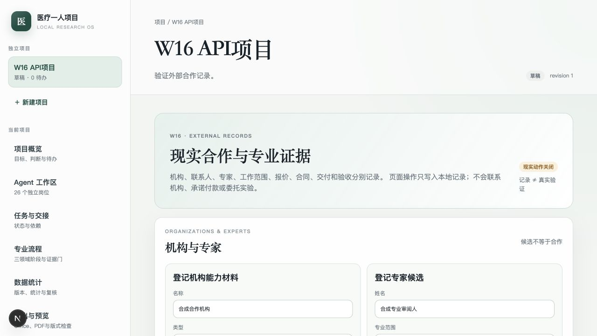
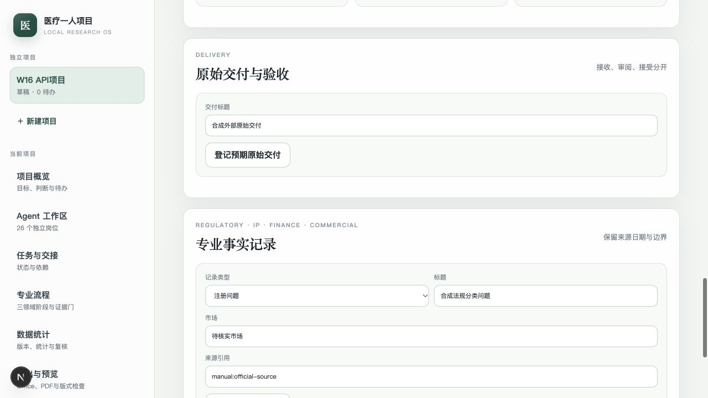

# W16 外部合作、报价、合同、交付与专业事实记录接手说明

对应：RQ-016、RQ-018—RQ-021、RQ-023、RQ-029；TR-04、TR-14、TR-15、
TR-16、TR-17、TR-18、TR-19、TR-20、TR-25；W16；AT-016、AT-018—AT-021。

状态：IMPLEMENTED，未VERIFIED。机构/联系人/专家、外部工作范围、报价、
合同草案与签署记录、授权、原始交付接收/A25复核，以及注册、专利、财务、
商业事实记录已通过真实PostgreSQL、API及页面测试；没有联系真实机构、签署
真实合同、付款、委托实验或取得真实原始数据。

## 已交付

- `ExternalOrganization`区分CDMO、CRO、SMO、中心实验室、检测实验室、
  样本/原型供应方、监管/伦理和其他机构；候选、已联系、已核实、已拒绝
  分别记录，核实必须有来源引用。
- 联系人保存角色、邮箱、来源和核实状态；专家候选保存专业范围、公开来源、
  联系方式和利益冲突说明。`candidate/replied/limited_review/engaged`等状态
  不互相替代。
- `EngagementWorkPackage`保存科学问题、为何需要外部、可改变的决定、输入、
  交付、方法与质量、权利/保密、验收责任、时间与预算范围，并生成稳定
  `scope_sha256`。
- 工作包状态按draft→scope_ready→requested→quoted→authorized→executing
  →delivered→under_review→accepted→closed推进；非法跳转拒绝。进入执行前
  必须有已接受报价、双方签署且有原件的合同、有效外部授权。
- 报价必须关联项目内原件版本；金额未知保持null，记录币种、税务/运输是否包含、
  假设、排除项和有效期。比较接口只比较同一engagement/scope报价，并提示
  不同币种、未知税务/运输和排除项。
- 合同可由AI或owner登记草案，但草案不显示已签；只有内部与外部签署标记都为真、
  存在已登记签署文件时才可记录signed。
- 外部授权记录对象、范围hash、动作说明、金额上限、币种、有效期和状态；
  撤权/过期不删除历史。授权只记录内部许可，不执行采购或外部动作。
- 原始/报告/原型/服务/批准交付保存预期项、接收原件版本、manifest、缺件、
  接收摘要、A25/A26复核和发现。接收不等于接受；有缺件不能接受；所有交付
  接受后才可将工作包记录为accepted。
- 专业事实记录分regulatory、patent、financial、commercial：
  - 注册记录强制市场、产品范围与核查日；official_confirmed必须官方来源；
  - 专利记录强制辖区、状态与核查日，临时申请不会被写成授权；
  - 财务预算、承诺、付款、支出分事件记录，承诺/付款/支出必须有来源；
  - 商业假设、公开宣传、真实访谈、市场报告和未知分开，有来源验证要求的类型
    不能无来源保存。
- 新增9张FORCE RLS表，累计73条策略；所有项目记录经过owner/项目/RLS校验。

## 主要路径

- 合同与枚举：`services/core/src/medical_one_person/domain/external.py`
- 服务：`services/core/src/medical_one_person/application/external.py`
- API：`services/core/src/medical_one_person/api/external.py`
- 迁移：`services/core/migrations/versions/b8c1e5f7a942_w16_external_records.py`
- 页面：`apps/web/src/app/projects/[id]/external/page.tsx`
- Schemas：`schemas/external-*.v1.schema.json`、`schemas/professional-record.v1.schema.json`

## 验收

```bash
export MEDICAL_ONE_TEST_DATABASE_URL='postgresql+psycopg://admin@127.0.0.1:5432/medical_one_test'
PATH="/Users/zz/Library/pnpm/bin:$PATH" make test
PATH="/Users/zz/Library/pnpm/bin:$PATH" make lint
PATH="/Users/zz/Library/pnpm/bin:$PATH" make build
```

本轮结果：

```text
92 core tests passed
W16 migration: d4b8e7c9a321 -> b8c1e5f7a942 round-trip passed
73 RLS policies; all 9 W16 tables FORCE RLS
Work package: explicit scope hash and state transitions
Quote: original document, amount, assumptions, exclusions and validity recorded
Contract: draft and signed remain distinct; signing requires both flags and document
Authorization: amount/time bounded local record; execution blocked without it
Deliverable: raw original received, A25 completeness review separate from receipt
Professional records: regulatory source/date, provisional patent, commitments/spend
and unknown commercial evidence remain separate
API: organization -> engagement -> professional records -> external workspace
Browser: organization/expert forms, engagement board, quote/contract, delivery
and professional record sections
Ruff and mypy passed
Next.js lint, typecheck and production build passed
```

界面证据：





## 边界与未完成

- 没有联系任何真实机构或专家，没有发送真实邮件、签约、付款、采购或委托，
  也没有收到真实实验/检测原始数据。当前机构、专家、报价、合同和交付均为
  合成契约测试记录。
- “verified”只表示已登记来源与核实状态，不是本项目完成的独立背景调查。
  “signed”是录入的签署状态，不证明签名真伪、法律效力或付款。
- A25/A26交付复核是owner代表岗位合同记录，不是W17独立Agent或真人专家审查。
- 报价比较不是总价评分器；不同scope不能直接横比，税务/运输/排除项仍要人工
  核对。当前未接真实询价、合同审查、付款或发票系统。
- W12阶段页仍将所有现实前置条件标为`unverified_w16`；W16已保存数据，但尚未
  自动判断某条StageAssessment应由哪些外部记录放行。该绑定和独立审核在W17完成。
- 当前支持PDF/文本等已上传知识版本作为报价/合同/交付来源，未实现原生邮件附件
  回填、供应商门户、签名服务或DICOM/大型多文件数据包。
- 注册、专利、财务和商业记录是事实台账，不是法律、监管或投资保证。
