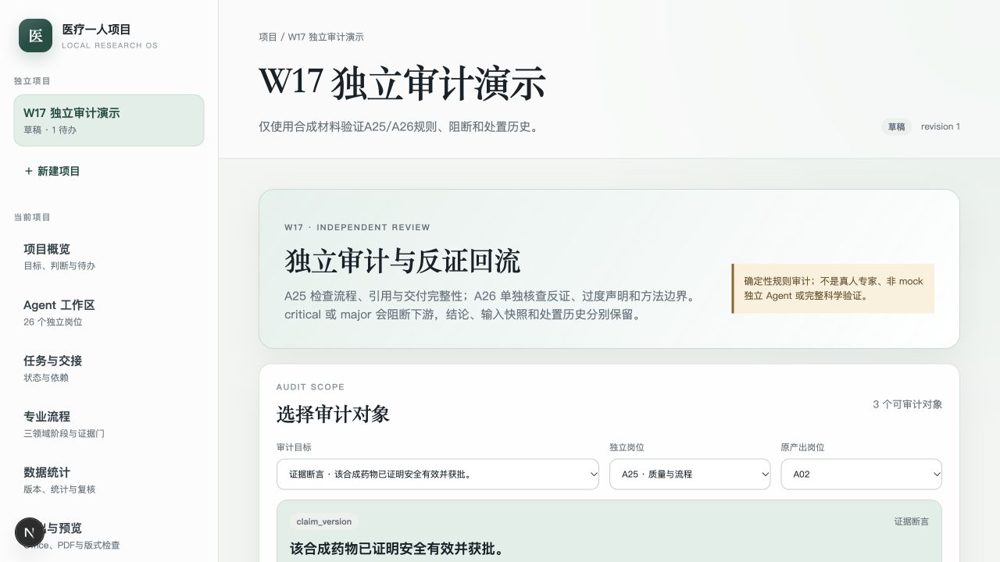
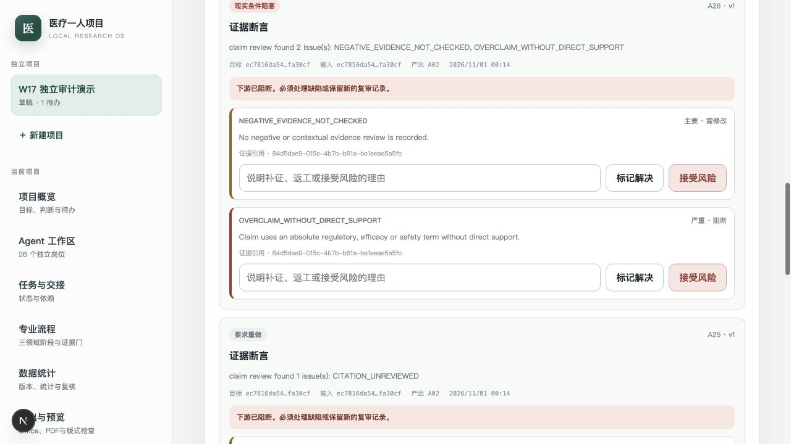
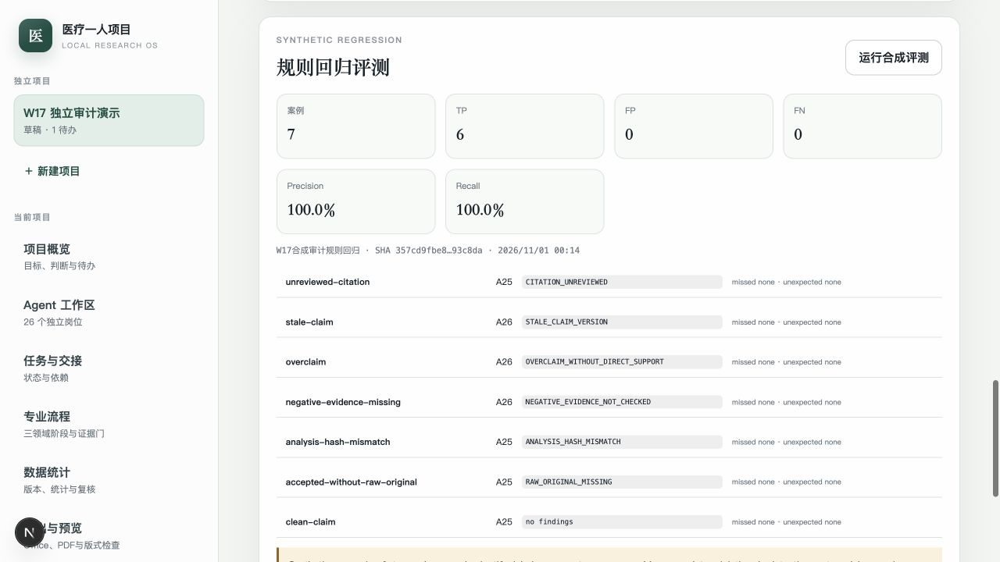

# W17 独立审计、反证阻断与合成评测接手说明

对应：RQ-006、RQ-011、RQ-022、RQ-024、RQ-031；TR-04、TR-05、TR-06、
TR-09、TR-15、TR-17、TR-18、TR-19、TR-20、TR-25；W17；AT-006、
AT-011、AT-022、AT-024、AT-031。

状态：IMPLEMENTED，未VERIFIED。三类审计对象、A25/A26确定性规则、
不可变输入快照、critical/major阻断、finding处置和合成回归已通过真实
PostgreSQL、API、页面与生产构建测试。该能力不是真人专家、非mock独立
Agent或完整科学审查，不能用于宣布医药判断可靠。

## 已交付

- ClaimVersion、AnalysisRun、ExternalDeliverable可进入项目审计工作区。
- 审查从数据库构建结构化packet，保存target SHA-256、input SHA-256和完整
  input snapshot；同一目标同一岗位的新结论递增review_version，不改写旧结论。
- 只允许具有`independent_context=true`的A25/A26岗位合同；reviewer与
  producer同岗时拒绝，跨项目目标返回404，不泄露其他项目内容。
- A25检查引文核查状态、来源范围、最新分析复核、限制说明、交付原件、
  缺件接受和manifest hash。
- A26检查反证被忽略、负向/情境证据未检查、绝对疗效/安全/获批过度表述、
  directness/物种/样本量缺口、不受支持的分析方法及原始数据hash。
- critical与major均设置`downstream_blocked`；critical ClaimVersion标为
  `disputed`，stale不会被disputed覆盖。
- finding状态为open、resolved或accepted_risk；处置必须填写理由。已解决
  finding不能用不同理由改写，原审计run、输入快照和结论保持可追溯。
- 幂等键重放返回原审查；相同键改目标、岗位或producer返回409。
- 7个合成fixture覆盖未核查引文、stale断言、过度声明、负向证据遗漏、
  分析hash不符、无原件交付和clean claim；保存TP/FP/FN、precision/recall、
  逐案差异与限制。
- 新增`audit_runs`、`audit_findings`、`audit_evaluations`三张FORCE RLS表，
  累计76条策略。W17迁移同时把ClaimVersion的`disputed`纳入约束，并在
  downgrade恢复W16约束。
- 新增两个JSON Schema：`audit-finding.v1.schema.json`和
  `audit-evaluation-fixture.v1.schema.json`。
- “独立审计”页面显示三类目标、A25/A26、producer、target/input hash、
  下游阻断、逐条finding、处置理由、评测指标和持续能力限制。

## 主要路径

- 领域合同：`services/core/src/medical_one_person/domain/audits.py`
- 审计服务：`services/core/src/medical_one_person/application/audits.py`
- API：`services/core/src/medical_one_person/api/audits.py`
- 数据模型：`services/core/src/medical_one_person/infrastructure/db/models.py`
- 迁移：`services/core/migrations/versions/e9f6a3c2d140_w17_audit_reviews.py`
- 合成fixture：`fixtures/w17-audit-cases.json`
- 服务测试：`services/core/tests/integration/test_w17_audit_service.py`
- API测试：`services/core/tests/integration/test_w17_audit_api.py`
- 规则测试：`services/core/tests/unit/test_w17_audits.py`
- 页面：`apps/web/src/app/projects/[id]/audits/page.tsx`

## 验收

执行环境为macOS arm64、Python 3.12、PostgreSQL 17.6、Node.js 24.22.1
（项目锁定Node 22.23.4，本次存在engine warning）、Next.js 16.4.3。

```bash
export MEDICAL_ONE_TEST_DATABASE_URL='postgresql+psycopg://postgres@127.0.0.1:55432/medical_one_test'
export MEDICAL_ONE_OFFICE_SOFFICE_PATH='/Users/zz/.cache/codex-runtimes/codex-primary-runtime/dependencies/bin/override/soffice'
export MEDICAL_ONE_OFFICE_PDFTOPPM_PATH='/Users/zz/.cache/codex-runtimes/codex-primary-runtime/dependencies/bin/override/pdftoppm'
PATH="/Users/zz/Library/pnpm/bin:$PATH" make test
PATH="/Users/zz/Library/pnpm/bin:$PATH" make lint
PATH="/Users/zz/Library/pnpm/bin:$PATH" make build
```

本轮结果：

```text
98 core tests passed
W17 migration: b8c1e5f7a942 -> e9f6a3c2d140 -> b8c1e5f7a942 -> e9f6a3c2d140 passed
76 RLS policies; audit_runs/audit_findings/audit_evaluations FORCE RLS
A25: unreviewed citation -> changes_requested
A26: refuting evidence while supported -> blocked + claim disputed
Analysis: result/chart hash mismatch -> blocked
Deliverable: accepted raw data without original/hash -> blocked
Audit idempotency replay passed; changed parameters -> 409
Resolved finding cannot be rewritten with another reason
Evaluation: 7 cases, 6 TP, 0 FP, 0 FN, precision/recall 1.0
Ruff and mypy passed
Next.js lint, typecheck and production build passed
```

界面证据：







## 能力边界

- 规则命中是缺陷检测，不是医学/药学判断正确；规则未命中也不能显示
  “专家已认可”或“科学结论成立”。
- 合成fixture的precision/recall=1只表示7个已知案例被当前规则命中，
  不是真实世界漏检率、校准概率或独立审阅者一致性。
- 当前A25/A26运行没有调用两个非mock独立模型，也没有真人专家签署意见。
  owner启动与数据库角色合同不能替代独立专业审查。
- 输出限制为结构化finding和处置记录；未覆盖任意医学逻辑、复杂统计假设、
  隐含混杂、不当因果推断或所有过度声明。
- critical会阻断该审计run的下游标志并传播Claim disputed；尚未把每个finding
  自动转化为W11返工任务或W12阶段门重评。
- W16记录到W12 StageAssessment的证据映射仍未自动完成，外部机构、报价、
  合同、交付仍全部为合成/本地记录。
- 没有真实模型、真实邮箱、外部机构联系、合同签署、付款或实验执行。

## 下一包

按TR-20进入W18：网络不可用策略、知识库删除与索引重建、原件/引用加密
备份恢复，以及AT-012、AT-026、AT-027、AT-034的恢复链验证。W18完成前
不能声称断网完整可用、删除可恢复或备份已经通过真实恢复演练。
