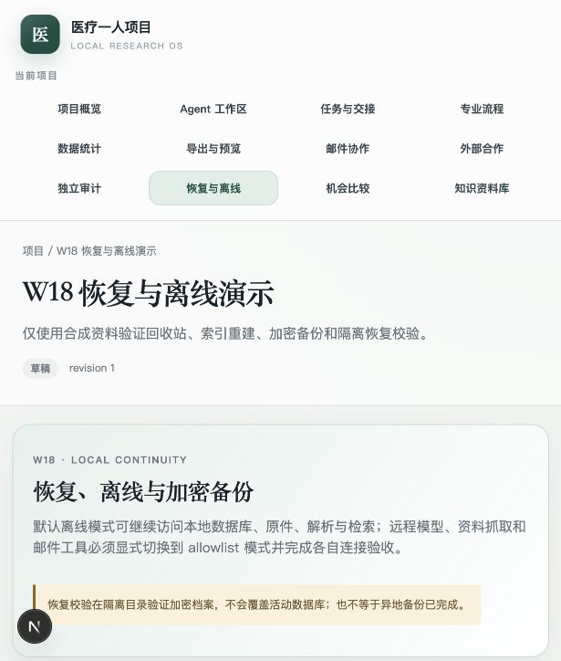
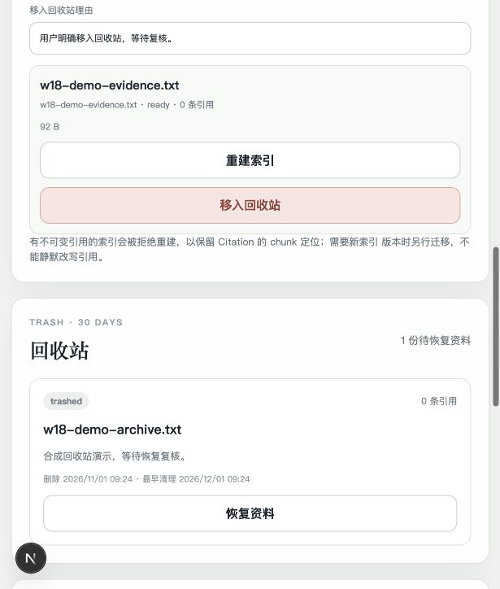
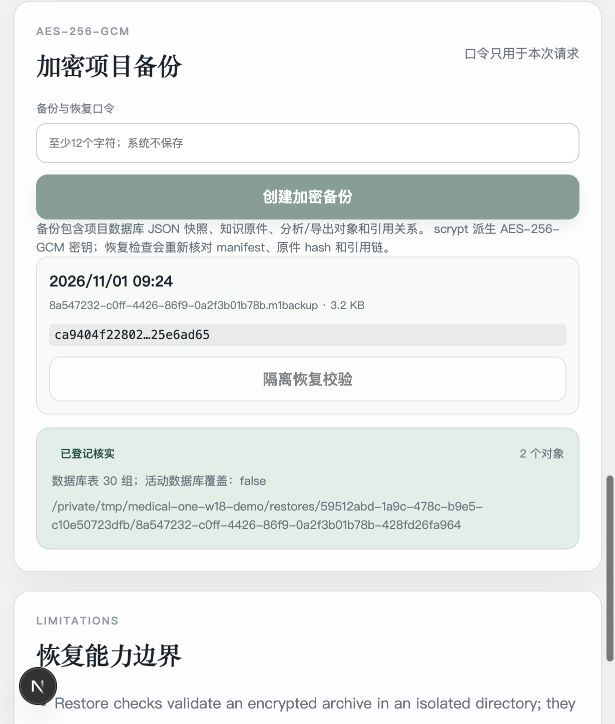

# W18 离线、回收站、索引重建与恢复接手说明

对应：RQ-012、RQ-026、RQ-027、RQ-034；TR-10、TR-16、TR-17、TR-18、
TR-20、TR-21、TR-25；W18；AT-012、AT-026、AT-027、AT-034。

状态：IMPLEMENTED，未VERIFIED。核心实现、独立PostgreSQL表回放和本地
API/页面证据存在；活动数据库切换、异地介质、密钥丢失和真实主机故障没有验证。

## 已交付

- 默认`network_mode=offline`。ToolGateway在调用网络handler前拒绝远程工具，
  并写denied审计；本地数据库、原件、解析、检索和mock流程不依赖网络。
- 文档逻辑删除进入回收站，保存每个版本原access_state、引用数、理由、30天
  清理提示和操作者。列表、详情、搜索和下载不再暴露trashed版本。
- 恢复时按原版本状态返回；引用历史仍保留。恢复不会撤销现实邮件、合同、
  付款或实验等外部副作用。
- 无Citation的版本可从最新完整解析重建索引；仍有immutable Citation时拒绝
  重建，避免静默移动chunk定位。
- 项目备份包含数据库JSON快照、知识原件、分析/导出对象、Citation和证据关系；
  使用scrypt派生密钥和AES-256-GCM流式加密，口令和密钥不入库。
- 恢复校验在隔离目录解密，核对备份hash、manifest、表计数、对象hash及
  Citation→chunk、EvidenceLink→Citation引用链；不覆盖活动数据库。
- 独立PostgreSQL回放工具按迁移后的外键顺序重放工作区、用户、项目、任务/
  版本、引用、预算账本等表快照，并重新验证关系与input snapshot。
- 任务生命周期与`input_validity`拆分。任务保存输入版本、引用列表、引用hash、
  捕获时间和snapshot整体SHA-256。
- 知识库current版本变化在同一事务内失效相关任务及未取消下游；historical
  TaskVersion保留accepted事实，新输入通过新版本恢复并重新派工/验收。
- 调度领取、结果提交、计划派发和审核接受均拒绝stale/under_review输入。
- 直接Citation.task_id及类型化document引用也进入换版影响集，不再只依赖
  RetrievalSnapshot。
- 受限mock后台worker持续分发outbox、领取job、执行Runner并恢复过期租约；
  返工和验收后解锁任务自动入队。
- 新增`trash_entries`、`backup_snapshots`、`restore_checks`三张FORCE RLS表；
  累计79条策略。W19 input-validity迁移增加任务列和索引。
- “恢复与离线”页面显示网络策略、索引修复、回收站、加密备份和恢复历史；
  任务页显示输入有效性与失效原因。

## 主要路径

- 领域合同：`services/core/src/medical_one_person/domain/recovery.py`
- 恢复服务：`services/core/src/medical_one_person/application/recovery.py`
- 任务输入：`services/core/src/medical_one_person/application/tasks.py`
- 调度门：`services/core/src/medical_one_person/application/scheduling.py`
- 知识库换版：`services/core/src/medical_one_person/application/knowledge.py`
- API：`services/core/src/medical_one_person/api/recovery.py`
- W18迁移：`services/core/migrations/versions/a7c4e2f9b610_w18_recovery_and_backups.py`
- A-03迁移：`services/core/migrations/versions/b2e7d4a9c310_w19_task_input_validity.py`
- 页面：`apps/web/src/app/projects/[id]/recovery/page.tsx`

## 验收范围

本地验收使用真实PostgreSQL 17.6、真实事务/RLS、API和Next.js页面。最终命令、
被测源码完整SHA、退出码和未覆盖项记录在
`traceability/acceptance-records.json`，不与旧的远端HEAD混用。

只有以下范围有通过证据：

- mock/本地模式；
- 原生PostgreSQL事务与RLS；
- 合成原件、合成引用和合成备份；
- 隔离恢复目录中的hash/引用链校验；
- 独立PostgreSQL迁移后表回放和关系检查；
- Next.js lint/typecheck/build。

没有通过或没有执行的：

- 活动数据库原地恢复和回滚切换；
- 异地备份介质、离机加密密钥托管；
- 真实主机损坏、磁盘故障或密钥丢失恢复；
- 真实邮箱、真实机构、真实合同、付款或实验；
- 真人专家和非mock独立Agent审查。

界面证据：

## 下一包

W19继续实现policy bundle、配置/数据库迁移影响与旧run基线固定。不得因W18
备份在隔离目录通过就宣称生产恢复完成。
