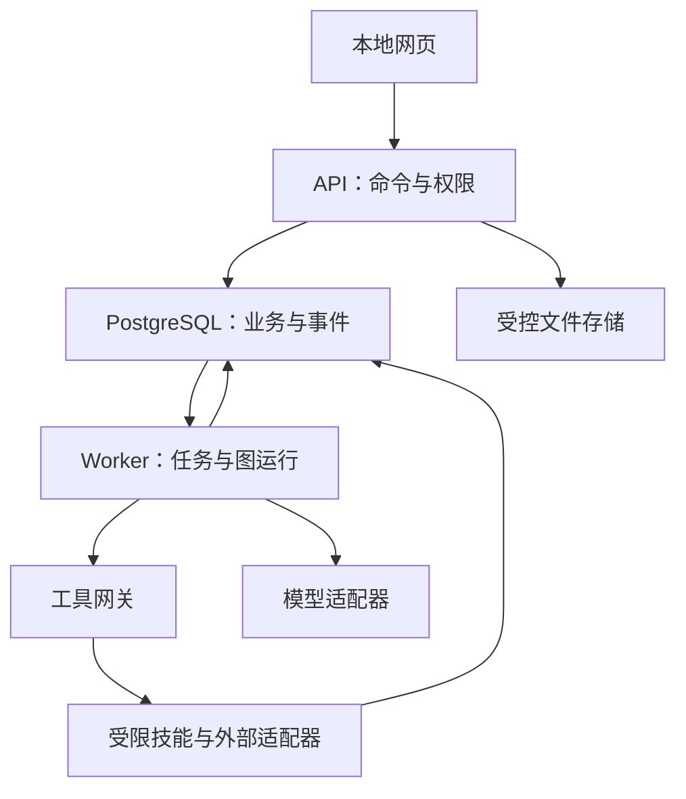

# 医疗一人项目｜技术路线与实施路径

版本：V0.3  
编写日期：2026-10-29  
更新日期：2026-10-31  
思想基线：[最高思想](最高思想.md) V0.7  
用途：未来Codex的工程规格、开发顺序与验收依据。  
实现状态：本轮仅文档追踪与检查设施已交付；下述应用模块、Agent运行、技能和外部服务均为待实现。

本文件是技术主文件，不另立思想源头。工程细节是在已同意需求内选择的实现基线，可在有理由和验证的情况下调整；改变产品目标、预算范围或现实执行边界须回到《最高思想》对应决定。不要把“技术基线”误写为用户已逐项选定的产品、云服务或依赖版本。

## TR-01 目标、范围与开发纪律

思想依据：D-001—D-027；§1—3、§10.4、§13—14。需求：RQ-001、RQ-002、RQ-003、RQ-031、RQ-032、RQ-033。

### 第一阶段核心目标与工程交付的关系

第一阶段不变的核心目标是：跑通完整研发流程，验证一人医药公司、AI Agent团队与现实CDMO、CRO、SMO、中心实验室等外包机构的配合和管理通畅。软件是支持这一验证的基础设施，具体候选是验证载体。软件功能或药物/器械等产品产出，均不能替代这一阶段目标。

工程任务按其是否补齐流程、交接、现实合作和反馈证据排序；完整链路与现实接口验证是主线，不以界面完成、文件数量或研究阳性决定第一阶段结束。新增RQ-033、AT-033与W24作为独立追踪，具体覆盖和未验证项必须可见。

### 软件交付目标

构建一个默认本地运行、中文优先、面向单一发起人的多项目AI研发工作台。用户交给科学首席新闻、论文、投资基准或现实问题，系统组织专业研究，比较方向，用户选择后创建计划、派工、审核和反馈，支持与真实专家、实验机构合作。

首个可用版本须保留：26项专业职责配置、三类领域工作流、项目隔离、持久证据、阶段判断、内置文档和邮件能力、成本和权限控制。可以按工作包逐项实现，但不能把缺少职能的局部演示标成全部完成。没有配置的账号与能力显示未连接或不可用，不用假结果填充。

v1不承诺：药物获批、治疗有效、商业成功、完全无人负责的真实实验、已训练专用科研模型、对任意邮件/文件/站点均兼容、云端模型断网仍推理。研究结论始终保留其证据等级和边界。

### 状态和完成定义

本文每个工作包初始为PLANNED；实际代码、检查及证据存在后更新IN_PROGRESS、IMPLEMENTED、VERIFIED或BLOCKED。IMPLEMENTED不等于验证通过；VERIFIED只针对列明的验收，不意味着模式或科学能力全面成熟。

未来开发每次提交说明：RQ编号、技术章节、工作包、实现路径、验证结果、未解决问题及实际能力状态。修复关键缺陷后再扩展依赖它的功能；不能仅写设计文章代替实现，也不能只为了数量创建镜像测试。

当前交付中的同步检查只验证结构、引用、版本和追踪完整性；应用与科学验收项仍是计划。

## TR-02 思想到技术的追踪合同

思想依据：D-011、D-012、D-025、D-026、D-028；§14.1—14.4、§15、§20。需求：RQ-001、RQ-030、RQ-032、RQ-034。

### 文件与稳定编号

| 对象 | 唯一主位置 | 稳定编号 |
| --- | --- | --- |
| 目的、决定、理论 | 最高思想.md | D-xxx；编号小节；A01—A26岗位 |
| 工程规格与顺序 | 本文件 | TR-01—TR-25 |
| 派生需求映射 | traceability/manifest.json | RQ-001—RQ-034 |
| 开发工作包 | 本文件TR-20 | W00—W24 |
| 验收合同 | 本文件TR-19 | AT-001—AT-034 |
| 知识库数据合同与合成样例 | schemas/knowledge.contracts.v1.schema.json、fixtures/knowledge-contract-examples.json | RQ-034；TR-10 |
| 知识库界面草图 | design/knowledge-ui.svg | RQ-034；TR-10/TR-17 |
| 可执行追踪检查 | tools/check_traceability.py | check / impact / refresh |
| 同步检查自测 | tools/test_traceability.py | 独立临时副本中的变异案例 |
| 仓库检查 | .github/workflows/medical-one-person-docs.yml | 只读、仅本项目路径触发 |

manifest是派生索引，不是第二份需求正文。supporting_artifacts登记合同、样例和草图的路径、所属RQ及内容指纹；文件变化也会触发影响报告和同步检查，不能只跟踪主Markdown。每个RQ包含思想引用、来源片段指纹、TR、W、AT、计划代码路径与状态；新增要求先在思想记录，再增加或修订RQ映射。所有当前D条目、A岗位、技术章节、工作包和验收项必须有覆盖，死引用报错。历史和来源变化也要经过影响判断，不能盲目覆盖。

当前CLI（仓库根目录执行）：

```bash
python3 医疗一人项目/tools/check_traceability.py check
python3 医疗一人项目/tools/check_traceability.py impact
python3 医疗一人项目/tools/test_traceability.py
```

思想变化后先impact，修订受影响设计、工作包、测试计划与必要的代码/迁移；最后以明确的同步说明refresh，再check。refresh仅记录经核对的基线，不自动生成正确的技术设计，也不证明操作者已做充分语义审阅。

```bash
python3 医疗一人项目/tools/check_traceability.py refresh --note "说明哪些要求变化、更新了哪些模块；或为何无需技术变化"
```

同一次提交保存思想、技术、映射、代码/验收的相应变化。CI报告失败不等于已设置强制分支保护；本轮不修改全仓库管理设置。具体变更算法与运行中项目迁移见TR-22。

## TR-03 技术基线、进程与目录

思想依据：D-004—D-008、D-013、D-017、D-020、D-025；§4—7、§9、§11。需求：RQ-002、RQ-004、RQ-005、RQ-025、RQ-026、RQ-032。

### 基线选择

采用一个代码仓库中的模块化应用。界面、API和worker分进程运行，共用清晰的领域合同。v1不引入Kubernetes、多个消息中间件或每岗一个微服务。

| 层 | 首选基线 | 职责与替换边界 |
| --- | --- | --- |
| 网页 | Next.js 16系列、React、TypeScript；本地自托管 | 页面、表单、文件预览、SSE；业务规则在API |
| API | Python 3.12系列、FastAPI、Pydantic 2系列 | 认证、合同校验、领域命令、OpenAPI |
| 数据访问 | SQLAlchemy 2系列、Alembic | 事务、迁移、版本比较；不用JSON文件充数据库 |
| 持久化 | PostgreSQL 17系列；可选pgvector | 业务记录、任务队列、事件、追踪、检索；扩展可禁用 |
| 编排 | LangGraph独立库及匹配的Postgres checkpointer | 图和中断/恢复；业务状态以领域表为准 |
| Worker | 同一Python应用的独立worker入口 | 租约领取、运行、心跳、重试；API请求不长时间占用 |
| 文件 | 本地受控对象目录，按内容哈希保存不可变版本 | 通过API鉴权访问；预留对象存储适配接口 |
| 运行隔离 | 受限工具网关；分析/文档容器 | 工具能力与模型分开，执行环境不获得全部凭据 |
| 文件能力 | PptxGenJS、python-docx、openpyxl、pypdf；独立渲染/重算工具 | 按技能封装并验证，不直接复制不明许可技能 |
| 测试 | pytest、Playwright、类型/格式检查 | 状态、权限、重放、文件和端到端验收 |

这些是可实施的兼容基线，不宣称为各项目最新版本。W01从官方渠道解析可用补丁、锁定Python/Node包与容器镜像摘要，记录兼容矩阵；无浮动latest用于验收。若基线已不适用，记录替代及相同验收结果，不重写思想以迎合工具。框架升级不与大型业务变更混在一次提交。

首次提供fake模型、模拟邮箱和公开/合成fixtures，不需真实密钥即可验收流程。真实provider通过同一接口接入，真实与模拟运行在UI、事件和产物中始终有标记。

### 进程关系



LangGraph state只保存ID、版本和必要运行信息，不再复制全部业务数据库或全文资料。graph thread与agent conversation分别建模，避免一个线程混入所有Agent记忆。重启依赖持久checkpointer，不能使用内存检查点作为交付实现。

### 目标目录

以下均在本项目目录内，已有同仓库其他项目不移动、不导入其密钥或改动其工作流：

- apps/web/src/app：项目列表、项目页、工作区、设置。
- apps/web/src/features：projects、agents、tasks、evidence、artifacts、decisions、finance。
- services/core/src/medical_one_person/api：路由、请求/响应合同。
- services/core/src/medical_one_person/domain：实体、状态、规则、策略、预算。
- services/core/src/medical_one_person/application：命令、查询、事务、outbox。
- services/core/src/medical_one_person/infrastructure：数据库、文件、provider、邮件、检索适配。
- services/core/src/medical_one_person/agents：runner、上下文构建、输出验证。
- services/core/src/medical_one_person/workflows：图、任务图验证、领域流程注册。
- services/core/src/medical_one_person/worker：调度、租约、恢复。
- config/agents、config/skills、config/workflows、config/source_policies：版本化配置。
- schemas：导出的JSON Schema/OpenAPI与前端生成类型。
- tests/unit、tests/integration、tests/e2e、tests/evaluation、fixtures：独立测试材料。
- deploy：本地Compose、启动、备份、恢复脚本。
- tools、traceability：本轮文档维护及未来追踪。
- runtime数据目录：由用户配置到仓库外；数据库、附件、令牌、私信不提交Git。

## TR-04 领域模型与数据库合同

思想依据：D-008、D-013、D-017、D-021—D-023、D-028；§5、§7、§11。需求：RQ-005、RQ-007—RQ-012、RQ-020、RQ-023、RQ-029、RQ-034。

### 通用规则

ID使用UUID，时间以UTC带时区保存，UI按用户时区显示；金额用Decimal/数据库numeric与币种，未知为null，不能用0替代。每个可变聚合有revision整数，更新传expected_revision；不匹配返回409。

项目数据表均有project_id及所属者关联。跨表外键使用(project_id,id)组合约束或等价检查，阻止把B项目的artifact挂到A任务。公共知识明确置于workspace级库，通过授权关联，不用project_id为空代表无限共享。

原始资料、收到的邮件、外部原始数据和已发布报告采用不可变版本；更正新建版本并指向supersedes_id。状态变更、决定与交接写审计事件。删除项目默认归档；确需删除文件另走明确动作并保留必要的操作记录，不删除其他项目引用的对象。

### 表组与关键字段

| 表/聚合 | 必要字段与关系 | 不变量 |
| --- | --- | --- |
| workspaces、users、sessions | owner、timezone、session_hash、expires_at | v1单拥有者，仍验证每次访问 |
| projects | name、scope、stage、status、parent_project_id、charter_version、policy_bundle_id、revision | 项目不是聊天；归档不继续调度 |
| charters、charter_versions | market、track、budget、time_horizon、resources、exclusions、stop_conditions、unknowns | 用户输入与AI假设分开 |
| signals | raw_input、source_url、received_at、artifact_id | 原始问题不被摘要覆盖 |
| opportunities、opportunity_versions | proposed_use、mechanism_chain、comparators、gaps、estimate_ids、status | 已选、淘汰、观察分别记录 |
| decisions | kind、options、selected、reason、evidence_version_ids、actor、scope、effective_at | 签选用户动作可核实，不能模型自称用户同意 |
| role_definitions、role_versions | A编号、prompt、report_to、tools、schemas、theory_refs、version | 配置不可被运行中模型直接改写 |
| agent_instances | project、role_version、memory_scope、status | 同岗在不同项目有独立实例 |
| conversations、messages | instance、task、speaker、content_ref、source_kind、created_at | 不存秘密；只存用户可访问过程摘要及交付 |
| tasks、task_dependencies | goal、assignee、input_refs、deliverable_schema、acceptance、budget、state、revision | 依赖无环；已验收上游才满足默认依赖 |
| task_attempts、handoffs | run_id、versions、tool_usage、report、receiver、receipt_state | 尝试不等于任务；交付不等于验收 |
| reviews、findings | reviewer_instance、artifact_version、severity、claim_ids、resolution | 原作者不能充当独立复核 |
| runs、checkpoints_ref | mode、provider/model、config_versions、thread_id、status、started/ended | mock/live、待恢复/失败各自明确 |
| documents、document_versions | identifiers、source_kind、license、published/fetched_at、fulltext_status、content_hash；补充TR-10.3库、上传、四维状态与解析版本字段 | 同DOI多个索引仍是同一研究；逻辑文档、原件、版本、解析结果分开 |
| passages、tables、citations | version、locator(page/table/section/offset)、text_hash、extraction_quality | 引用绑定版本和位置 |
| claims、claim_versions、evidence_links | statement、species/population、endpoint、status、support/opposition、directness | 科学判断不能只保存最终摘要 |
| knowledge_items、knowledge_grants | domain、scope、source_refs、freshness、acl | 项目受限内容不自动入公共库 |
| artifacts、artifact_versions、data_packages | media_type、object_key、hash、producer、mode、validation、raw_or_derived | 发布产物只引用已有对象，真实数据有接收来源 |
| hypotheses、study_plans、analyses | alternatives、endpoints、stop_rules、design_version、dataset_version、code_hash | 预设与事后探索有记录 |
| experts、organizations、contacts | verified_source、match_rationale、contact_scope | 候选不等于已建立合作 |
| engagements、quotes、deliverables | request_scope、provider、provider_type(CDMO/CRO/SMO/central_lab/other)、currency、status、expiry、raw_data_terms | 询价、委托、已收到、验收分开 |
| outsourcing_coverage、transfer_records、phase_validations | process_step、provider_type、inputs/outputs、owner、validation_level、evidence_refs、gaps、cost/time/incident_refs | 内部演练/真实接触/执行/交付/验收分层；未覆盖不标已验证 |
| mail_accounts、threads、mail_messages | adapter、credential_ref、external_ids、direction、state、project_link | 凭据只保存引用，不进prompt |
| mail_drafts、mail_actions | recipients、attachments、content_hash、grant、idempotency_key、provider_result | 草稿、发送请求、发送确认分开 |
| legal_matters、ip_records、regulatory_items | jurisdiction、question、source/status_date、review_status | 不等于律师意见或已获批事实 |
| budgets、reservations、ledger_entries | scope、currency、limit、reserved、actual、source、kind | 预留+已用不超授权；同消耗只记一次 |
| authorizations、policy_decisions | actor、actions、targets、limits、expires_at、revoked_at、reason | 由服务核验，模型无权签发 |
| jobs、outbox、external_actions | unique_key、lease、fence_token、attempt、state、external_ref | 至少一次投递，副作用去重与不确定态处理 |
| events、audit_log | project_seq、type、actor、object/revision、payload_ref、correlation_id | 事件来自已提交事务，UI可重连重放 |
| policy_bundles、migration_impacts | theory_hash、config_versions、status、affected_objects | 老运行继续关联旧基线，不热切换 |

### 数据版本和外部交付

数据包需有manifest：文件名、hash、接收时间、来源、数据字典、方法/方案版本、预期文件和缺件。清洗、排除、重编码形成新派生对象并记录理由；不能改掉原始不利结果。

统计结果绑定数据、代码、环境、随机种子及分析计划版本。不同单位、人群/物种、终点、疗程和分析集分别存字段；例如疗效分析集和安全性分析集不能靠一个sample_size字段混写。

W02先建项目、任务、资料和事件主表；后续按工作包增加对应表与迁移。不得先建几十个空表后报告完整业务已完成。

## TR-05 状态机、接受条件与业务命令

思想依据：D-008、D-022、D-024；§7.3、§7.6—7.7、§10。需求：RQ-008—RQ-010、RQ-022、RQ-027、RQ-029。

### 状态清单

| 对象 | 状态 | 可改变状态的依据 |
| --- | --- | --- |
| 项目 | draft、screening、awaiting_selection、planned、active、waiting_external、paused、stopped、archived | 已验证命令、选择/计划/外部状态和版本 |
| 机会 | proposed、under_review、needs_evidence、shortlisted、selected、watchlist、rejected | 审核及选择决定 |
| 任务 | draft、needs_input、ready、queued、running、submitted、accepted、rework、waiting_external、paused、failed、cancelled | 服务校验输入、依赖、权限、预算、产物与review |
| 单次运行 | pending、running、interrupted、succeeded、failed、cancelled、recovery_required | worker及provider事实 |
| 审核 | pending、changes_requested、accepted、disputed、superseded | 独立审核记录，不能由产出者代写 |
| 证据断言 | hypothesis、inferred、supported、contradicted、conflicted、unknown、stale | 来源和方法；supported仍有适用范围 |
| 邮件动作 | drafted、authorized、queued、sending、sent_confirmed、failed、outcome_unknown、cancelled | provider确认或真实收件记录 |
| 外部合作 | prospective、contacted、responded、quoted、commissioned、executing、received、under_review、accepted、closed | 实际通信/决定/合同/数据，而非计划文本 |

任务ready要求：输入引用存在且有权访问，依赖accepted，assignee配置有效，有交付/接受合同及可用预算。succeeded只代表运行结束；task提交后仍须审核，不能自动将task accepted。

修改已接受上游输入时，依赖旧版本的下游标记stale/needs_review；已产生报告继续保留版本。任务环被拒绝；自我派单或重复派单按工作包目的去重，超迭代额度暂停该分支。

### 命令与分支规则

- select_opportunity：只有用户或明确可验证的用户选择指令触发；保存选择版本并产生规划任务。
- submit_plan：CSO提出有界DAG，COO检查资源与交付，服务验证无环、权限和预算，随后activate_plan。
- accept_deliverable：按指定验收者和缺陷规则接受；拒绝则产生rework，保留原交付。
- request_more_evidence：已授权范围内可自动补证；有最大轮数、时间和费用，不无限循环。
- assess_stage：输出continue、revise、gather_evidence、wait、pause、stop建议及依据；由确定性规则核验能否推进。
- authorize_action：用户提供对象、范围、额度及有效期；执行时再次检查撤销和实际参数。
- pause/cancel：阻止新外部动作，通知可取消运行；已发生行为不假装回滚。
- resolve_conflict：关联争议断言、各自来源和处理；证据不能解决时保留分歧或提出外部问题。

v1允许符合政策的桌面研究自动推进，外部动作仅在现有明确授权内执行。模型输出不会直接写状态表；统一进入领域命令处理器。

## TR-06 26岗位配置与交付映射

思想依据：D-006—D-009、D-013、D-015—D-016、D-019；§4.2、§5、§6。需求：RQ-004、RQ-005、RQ-006、RQ-017—RQ-022。

配置为受版本控制的YAML，启动时经Pydantic校验，再导出schema。一个定义可生成多个项目实例，不共用对话/临时文件。

```yaml
role_id: A06
version: 1
name: 药理与物种转化
theory_refs: [D-015, SEC:6]
reports_to: [A02]
responsibilities: [机制证据, 目标物种外推, 暴露与药效关系]
input_schema: evidence_bundle.v1
output_schema: translational_assessment.v1
source_policy: biomedical_primary.v1
skills: [literature.search, evidence.extract, stats.read]
tools_allow: [source.search, source.read, evidence.propose, task.request]
tools_deny: [mail.send, finance.commit, role.update, shell.unrestricted]
memory_scope: project_and_role
reviewers: [A26]
model_profile: scientific_reasoning
limits_profile: research_standard
```

这是合同示例，schema实际实现后必须验证；不是本轮已安装角色。角色文件与工具权限取交集，不能靠prompt中的deny当真实限制。运行中模型不能编辑配置或给自己增权。

| 岗位 | 触发/输入 | 标准交付 | 汇报/独立复核 |
| --- | --- | --- | --- |
| A01 方向组合 | 投资任务书、多方向分析 | opportunity_comparison | 用户；A26核依据 |
| A02 科学首席 | 问题、证据、专业意见 | scientific_brief、bounded_plan、stage_assessment | 用户；A25/A26独立可见 |
| A03 运营统筹 | 计划、任务、外部进度 | execution_plan、status_report | 用户；A25 |
| A04 证据情报 | 检索问题与来源政策 | search_log、evidence_bundle、negative_evidence | A02；A26 |
| A05 临床/兽医需求 | 用途与目标场景 | unmet_need、current_practice、user_evidence | A02；A26 |
| A06 药理转化 | 药物/物种/疾病 | mechanism_and_translation | A02；A26 |
| A07 毒理安全 | 产品与安全资料 | safety_gap_assessment | A02；专业外审问题及A26 |
| A08 药学制造 | 产品特征与药学资料 | cmc_gap、quality_targets | A02；A25 |
| A09 IVD方法 | 分析物、样本、用途 | analytical_performance_plan | A02；A13/A14/A26 |
| A10 IVD临床 | 人群、参照与用途 | clinical_evaluation_questions | A02；A14/A26 |
| A11 器械工程 | 产品需求与约束 | design_inputs、verification_plan | A02；A25 |
| A12 人因使用 | 用户、环境、风险 | usability_and_use_risk | A02；A25 |
| A13 研究设计 | 可证伪问题与资源 | study_plan、decision_thresholds | A02；A14/A26 |
| A14 生物统计 | 终点、设计与数据 | statistical_plan、analysis_review | A02；A26 |
| A15 数据计算 | 原始数据包与计划 | validated_dataset、reproducible_analysis | A03/A02；A25 |
| A16 现场运营 | 已明确研究范围 | site_readiness、deviation_log | A03；A25 |
| A17 注册 | 产品、市场与用途 | dated_regulatory_path、unknowns | A03/A02；专业审阅问题 |
| A18 专利 | 技术特征、地域与来源 | ip_landscape、claim_questions | 用户/A02；A19及外部专业问题 |
| A19 法务 | 合作范围与合同原文 | clause_issues、rights_and_obligations | 用户；不能自签合同 |
| A20 财务 | 工作范围、预算及报价 | cost_scenarios、ledger_review | 用户/A03；A25 |
| A21 商业合作 | 需求、竞品和合作假说 | customer_evidence、commercial_assumptions | 用户；A26核事实 |
| A22 外部实验 | 研究需求和机构能力 | scope_of_work、quote_comparison、delivery_check | A03/A02；A25 |
| A23 专家邮件 | 具体问题、核实联系人及授权 | expert_packet、draft/thread、feedback_scope | A03/A02；发送须网关授权 |
| A24 知识档案 | 新资料、版本和权限 | indexed_sources、provenance、freshness_report | A03；A25 |
| A25 质量流程 | 原始记录与待验收产物 | quality_review、finding、rework_request | 用户；原作者无权改意见 |
| A26 反证审计 | 断言、原文和独立检索预算 | counter_evidence、citation_audit、dissent | 用户/A02；保持独立上下文 |

A26先接收问题与证据，再进行独立检查，避免只让它看到CSO总结并复述。独立上下文并不等于统计独立模型或真人专业验证，评价报告要保留此限制。

每岗配置至少有一项正例、一项资料缺失、一项越权/不适配输入验收。专业能力不足的岗位标记实验性或受限，不能由角色名默认为可靠。

## TR-07 模型适配、上下文与记忆

思想依据：D-008—D-009、D-013、D-016—D-017；§5.1—5.3、§8、§11。需求：RQ-005、RQ-006、RQ-012、RQ-027、RQ-031。

定义ModelProvider接口：capabilities、generate_structured、stream_summary、estimate_cost、usage。fake/live使用同一请求和响应合同；实际模型ID、最大上下文、工具/结构化输出能力、费率及核查时间配置化，不凭型号名称推定能力。

Runner顺序：验证任务/角色/策略版本 → 预留预算 → 构建最小上下文 → 调用模型 → 解析结构化结果 → 请求工具网关 → 校验引用/产物 → 提交领域命令 → 记录用量和事件。schema失败允许有限修复，超过限额返回可检查错误，不吞错后捏造完成。

上下文分为：本岗配置、项目任务书和决定、当前任务输入、检索到的证据段落、本岗历史摘要、已授权协作交付。外部网页/邮件/文档以数据区传入，不能覆盖系统/角色指令。完整数据不默认发送云端，敏感类别需匹配provider数据政策和项目授权。

组织记忆保存事实、来源与纠错，不保存“AI说过所以为真”的无来源断言。摘要有父消息/证据引用，压缩后仍能打开原件。原文窗口不足可拆阅读任务，不只看标题就认定已核对全文。

每次run固定theory_hash、policy_bundle、role/skill/workflow版本、模型、prompt模板和输入快照。模型切换或摘要更新不覆盖原run；对关键结论的实质改变形成新版本与原因。模型概率自评不是校准科学成功率。

## TR-08 科研流程图与三类专业流程

思想依据：D-003、D-014、D-019、D-022、D-024、D-027；§4.1—4.4、§7.6—7.7、§10.3—10.4。需求：RQ-003、RQ-006、RQ-008—RQ-010、RQ-018、RQ-021、RQ-022、RQ-033。

### 主流程

LangGraph组织阶段，领域任务表管理各岗位工作。图至少包括intake、verify_signal、screen_opportunities、audit_options、await_selection、plan、execute、review、assess、wait_or_close。图节点通过application service读取/提交命令，不直接绕过权限写数据库。

- intake保存原始线索和已知约束；关键约束未知时明确假设或向用户提出最少必要问题，独立检索可先执行。
- verify_signal派A04/A24获取原始资料，A26复核关键事实；未经核查的宣传不进入已验证事实。
- screen_opportunities由A02拆派需求、科学、注册、专利和成本工作，独立任务可并行，引用相同资料不增加证据数量。
- audit_options要求每个方向有支持、反对、关键未知和资源边界；信息不足可进入观察，不强制选出赢家。
- await_selection持久等待用户选择。重启、刷新页面不会自行选择。
- plan产生有界工作包DAG，每个节点有验收者、交付和反馈接收者；服务验证后激活。
- execute按ready队列运行，不是模型在一个大对话中扮演所有岗位。外部合作按TR-15执行。
- review分开质量完整性与科学反证；critical缺陷阻止依赖该交付继续，其他缺陷按明确规则处理。
- assess基于预设条件、实际证据和资源生成下一步建议；超范围变化回到用户选择，范围内补证可以自动执行。

### 专业流程定义

配置workflows/pet_repurposing.yaml、ivd.yaml、device.yaml，统一schema：track、stage_id、entry_criteria、required_roles、inputs、outputs、review_policy、exit_criteria、failure_routes、external_preconditions、theory_refs。阶段条件是可计算谓词+需要专业判断的结构化理由，不能只写“AI认为可以”。

| 路线 | 方向筛选与早期开发阶段 | 依次形成的交付 |
| --- | --- | --- |
| 宠物药 | 物种/适应证与缺口→已有证据→转化、安全和药学缺口→目标产品特征→验证设计→外部研究→结果更新 | need、evidence、gap、product_profile、study_plan、data_package、assessment |
| IVD | 用途/样本/人群→标志物和方法依据→分析性能→临床性能/评价路径→原型与质量→外部验证→结果更新 | intended_use、method_assessment、performance_targets、evaluation_plan、prototype_record、results |
| 器械 | 用户场景/用途→产品要求→风险与工程可行→原型→验证/确认与适用评价→生产/质量准备→结果更新 | user_need、design_inputs、risk_file、prototype、verification、evaluation、transfer_gap |

后续制造、注册及上市后职能在配置中保留阶段对象与必需职责；未具备现实前置条件时显示BLOCKED/NOT_STARTED，不虚构已完成。兽药分类、IVD临床要求和器械评价须按实际产品与目标市场核实，流程模板不等于法律适用结论。

### 第一阶段验证贯穿主流程

每项试点任务除科学产物外，标注它验证的process_step、provider_type、交接合同、现实证据及未覆盖项。需求、计划、外包匹配、范围/预算/权利、交接、执行、原始交付、验收、分析、汇报、下一步决定和归档均纳入完整性检查。任一关键接口未取得现实证据，综合结论如实保留缺口；科学结果为阴性时仍检查流程是否正确闭环。

### 场景验收脚本要求

ART仅作线索案例：先核查发现及功能未知、全文取得状态和权利线索；不预设补充剂或肠胃用途。另配置一个已知结论回放及一个失败/缺证案例。全部演示输入、模拟数据及模拟邮箱有标记；真实模式不得用fixture替代检索结果。

## TR-09 专业检索、来源准入与证据合同

思想依据：D-018、D-023—D-024；§11.3—11.4、§10.2—10.3、§18。需求：RQ-011、RQ-018、RQ-019、RQ-021、RQ-023、RQ-028、RQ-031。

SourceAdapter接口统一search、fetch_metadata、fetch_fulltext、check_updates，返回来源ID、原始URL、实际取得范围、获取时间、许可/访问状态和错误；不把摘要返回当成全文。

首批渠道：
- 文献：PubMed/PMC及出版商原文；有合法访问条件再接Web of Science/专业数据库。
- 注册/安全：中国目标产品对应主管部门及已选市场官方来源，配置域名、用途与更新要求。
- 专利：官方机构/合法数据库；先元数据和原文，法律状态核实单列。
- 试验：适配的官方试验注册与结果材料。
- 市场：可核实产品材料、需求访谈、真实报价；不得代替疗效证据。

默认不注册Google/百度通用搜索工具；专业搜索失败返回明确缺口。用户提供网页可作为待核线索保存，不能因URL可打开就升为scientific_primary。预印本、会议摘要、综述、新闻与原始研究有不同source_kind。

source_policy至少含allowed_adapters、domains、purpose、evidence_channel(frontier/decision)、fulltext_required_for、freshness_rule、license_policy、query_budget。新渠道先配置并验收；模型不能自行放宽来源政策。跳转、DOI解析允许转往经核验出版商；阻断私网/回环/云元数据地址、非HTTP协议和无限重定向，避免任意URL工具成为内部访问通道。

检索记录包括问题、关键词/数据库条件、时间范围、排除规则、返回与去重数量、未取得内容。按DOI/PMID/试验号与数据集关联去重，识别同研究多篇文章；未确认重复时标记关联而非生硬删除。

EvidenceItem合同包括source_version、locator、species/population、design、analysis_set、n、intervention/comparator、endpoint、effect/uncertainty、limitations、support_or_refute、directness、extraction_status、verification_status。数字缺失用null，不从图形模糊估值后假装原文数字。

重要断言必须有可打开来源位置；检查存在且文字/数值对应只证明引用可核查，仍需专业判断是否支持该断言。伪DOI、指错表、负向结果被反写、动物/人混淆进入critical finding。

## TR-10 电脑端知识库：上传、管理、检索与版本闭环

思想依据：D-017—D-019、D-024、D-027—D-028；§5.1、§11.1—11.5。需求：RQ-012、RQ-023、RQ-026、RQ-029、RQ-033、RQ-034。

本章是知识库的完整实施规格。原件存储、元数据与引用关系使用TR-03/04既有架构，不再建立第二套业务数据库。细化参数是工程默认，可配置并经实际机器/材料验证，不视为用户已指定的数值。当前交付为设计、JSON Schema及合成例子，上传/检索应用尚未实现。

### 10.1 用户入口、资料范围与首版边界

左侧独立项目→资料库；公共专业库在工作区入口。默认在当前项目上传，跨项目关联由用户明确操作。库范围和资料内容类别是两个不同字段：

| 库/视图 | 放什么 | 默认访问及操作 |
| --- | --- | --- |
| project_private | 本项目方案、原始数据、报价、合同、邮件及其他资料 | 用户及本项目获授权Agent可读；专业岗位提出整理建议 |
| workspace_shared | 用户主动共享的通用资料和经整理的经验 | 获授权项目可检索；共享需明确授予，随时可撤销 |
| public_reference | 合法取得的公开文献、法规、方法和公开产品资料 | 指来源公开，不代表本地应用已向互联网公开 |
| project_outputs视图 | AI报告、分析、导出文件及复盘 | 基于artifacts筛选；不另复制原件，不自动当原始科学证据 |

首版接受PDF、DOCX、XLSX、CSV、TXT/Markdown、PNG/JPEG和EML。PPTX归入可选解析能力，未配置解析器时可保存原件并标content_not_extracted，不能称已读全文。旧DOC/XLS、加密文件和大型ZIP先登记为不支持解析/待处理；不静默执行宏、解压整个任意目录或伪造已索引。后续格式在技能注册和相同验收下扩展。

电脑上拖入文件或选择多文件；系统复制到受控存储，不移动/修改用户原路径。文件一旦保存，删除电脑原路径不会删除项目副本。v1不自动监控全盘文件夹，也不读取未选择的本机路径。

### 10.2 页面与交互设计

界面草图：[电脑端知识库示意](design/knowledge-ui.svg)。草图仅作设计参考，状态与文件名为合成示例。 SVG使用系统中文字体回退；实际界面需在目标电脑验证中文字体、缩放与长文件名不缺字或溢出。

| 组件 | 必需信息与交互 | 实现约束 |
| --- | --- | --- |
| LibraryNavigation | 当前项目、公共库、分类、待核查、历史/回收站入口 | 切项目重建查询作用域，不混用缓存 |
| UploadPanel | 拖入/选择、文件队列、目标库、建议分类、敏感级别、版本关联 | 上传前明确目标；系统建议不冒充用户确认 |
| UploadQueue | 每文件进度、已传/总字节、暂停/继续/取消、失败与重试 | 上传进度为实际字节；后台解析另显示阶段 |
| DocumentTable | 名称、类型、版本、来源、保存时间、处理/核查状态、大小、引用数 | 可排序筛选；列表计数也遵守ACL |
| SourceDetail | 原件预览、元数据、结构化提取、版本、引用任务和处理日志 | 原件与提取/修订并排，不能覆盖原件 |
| LibrarySearch | 自然语言/关键词、来源/类别/版本/日期筛选、结果原文定位 | 说明当前是否只查本地，向量可用与否可见 |
| VersionCompare | 两版信息、文本/表格差异、受影响任务/报告 | 无法可靠比对时显示限制，不能声称全部差异已找全 |
| AttachToTask | 为指定任务选取文件版本或章节/表格 | 保存snapshot，不传“永远最新”的可变文件路径 |
| AccessAndExport | 项目共享、云端使用、导出与撤销 | 读权限、跨项目共享、云处理、对外发信各自独立 |
| RecoveryView | 备份时间、原件/索引状态、恢复检查和空间使用 | 备份完成与恢复验证分开 |

默认必填只有目标项目/库和文件；类别与标题可先建议，未知留空。替换版本、共享范围、云端使用和不可逆删除等有实际影响的操作单独明确。已获持续授权内的常规处理不反复确认。

上传成功但OCR失败时，用户仍能下载原件，看到失败原因和可选重试；不能因为解析失败导致文件“消失”。用户关页面不取消已提交后台导入；重新打开从session/job状态恢复。

### 10.3 数据表、对象和约束

复用TR-04的documents、document_versions、passages、citations、artifacts和events。增加下列字段/表，Alembic迁移与域模型同时实施：

| 对象 | 关键字段 | 约束 |
| --- | --- | --- |
| libraries | id、workspace_id、project_id、scope、name、acl_revision | project_private必须有project_id；共享库独立授权 |
| library_grants | library_id、grantee_project/role、actions、expiry、revoked_at | 不把公共标签当读取所有私有文件的权限 |
| upload_sessions | id、library_id、uploader、filename、expected_bytes、chunk_size、expires_at、state、reserved_bytes | 身份由服务产生；客户端不给自己指定角色或宿主路径 |
| upload_parts | session_id、offset、length、part_hash、staging_key | 同session相同区间重复内容幂等；重叠/改内容冲突 |
| blobs | id、content_hash、bytes、media_type、object_key、ref_count | 保存后不可变；不可访问全局hash探测接口 |
| documents | id、library_id、title、document_kind、current_version_id、revision | 同一逻辑文件多版本，不按文件名唯一 |
| document_versions | id、document_id、version_label、blob_id、uploaded_at、source_at、origin、data_origin、confidentiality、cloud_policy | source_at未知为null；用户上传不自动等于可信/真实实验 |
| extractions | id、version_id、extractor_version、config_hash、state、coverage、quality_findings、started/finished | 新解析生成新extraction；不修改旧引用定位 |
| chunks/tables/cells | extraction_id、locator、text/value、content_hash、quality、search_index_version | 含project/library作用域；大表不能只用一段摘要代替原表 |
| source_reviews | version_id或chunk_id、reviewer、scope、outcome、evidence_refs | 文件核查通过不等于所有科学断言正确 |
| document_annotations | version_id、locator、note、actor、created_at | 更正为附注或派生版本，不改原始文件 |
| retrieval_snapshots | task/run、query、filters、permitted_versions、selected_chunk_ids、hashes、acl_revision、created_at | 可复查当时输入；执行前仍复核权限撤销 |
| provenance_edges | from/to对象及版本、relation、created_at | supports/refutes/derived_from/used_by等明确关系 |
| impact_reviews | changed_version、affected_objects、reason、state、resolution | 差异、过期判断与是否重做分别记录 |
| trash_entries | document/version、deleted_at、purge_after、blocked_reason | 删除权限与保留/引用策略检查 |

同一项目相同原件重复上传，提示“本项目已有此内容”，可复用现有版本或只调整分类；同名但hash不同要询问/建议版本关系，不能直接覆盖。同内容在不同项目可内部复用物理blob，但元数据、ACL与引用独立，不显示其他项目是否已有该文件；垃圾回收检查全部有权关联的引用，不能误删其他项目内容。

### 10.4 上传接口、断点与持久化事务

v1工程默认：每文件100MiB、每批500MiB、分片8MiB；可按部署调整，拒绝时给出原因。磁盘/库配额与任务费用分开，上传前预留空间，提交后按真实字节结算。大于上限的资料先给明确处理路径，不截断文件后假装完整导入。

顺序：create_session→PUT parts→verify/commit→创建version与outbox→后台解析。浏览器分片传输，服务端流式写staging，不将整个PDF或表格一次读进内存。标准UploadFile可用于小文件入口，最后仍进入同一commit服务。

- part API带Content-Range或等价offset/length校验，服务端核验界限与part_hash；同键/同内容重试返回原结果，不同内容返回409。
- GET session返回已收区间和过期时间；刷新可继续。取消不删除已提交版本；取消/过期的临时分片按政策清理，默认24小时后可回收。
- commit检查总长度、所有区间连续、MIME/文件签名、磁盘/配额与服务端SHA-256；客户端hash仅用于比较，不能替代服务端计算。
- 写不可变对象后，以单一DB事务创建/关联document_version、更新库可见记录、写ingest outbox；事务失败留下的未引用对象由延迟清理处理。
- commit幂等键与session状态保证重试不产生多个版本；已经commit则返回原version_id/job_id。202表示后台导入，不表示已解析。
- 文件名只作显示；对象键由服务生成。校验路径、符号链接、大小、文档压缩膨胀和解析时限；解析在TR-13受限容器执行。
- 密码文件不把密码记入日志或prompt，首版要求用户提供可读取副本；不擅自解密或跳过内容。

### 10.5 四个独立状态维度

| 维度 | 状态 | 含义 |
| --- | --- | --- |
| ingest_state | stored、queued、extracting、indexing、ready、partial、failed | 文件处理是否完成；ready不等于科学可信 |
| evidence_status | unreviewed、needs_review、reviewed_for_scope、disputed | 谁在什么范围核查过；不得简单写“已证实全部内容” |
| version_status | current、historical、withdrawn | 用户/规则选择的版本地位；新上传不自动替换当前版本 |
| access_state | active、quarantined、trashed、purged | 是否可检索、下载或需要处理；权限独立复核 |

缺OCR依赖进入partial并记录缺件；解析器异常进入failed且保留原件。部分页可用则记录coverage与缺页；默认决策检索排除不可靠片段，但可在明确标记的资料核查任务中访问。批次返回逐文件结果，一个坏文件不回滚其他成功原件。

状态变更由领域服务与实际job事实产生。Agent不能写一条消息就将失败版本或未核资料改为ready/reviewed。

### 10.6 格式解析与可复查定位

| 格式 | 首选实现与保存范围 | 引用定位 |
| --- | --- | --- |
| PDF文本 | pypdf提取文字；pdfplumber用于适配表格；保存原页 | PDF物理页码+可得印刷页码+段落/表/bbox |
| 扫描PDF/图片 | 受控渲染器转页图，Tesseract OCR；记录语言、旋转、置信及原图 | 页/图、归一化bbox、OCR版本、复核标记 |
| DOCX | python-docx/OOXML读取段落、表格、标题路径；附注等未覆盖项列出 | 标题路径、段落ID/序号、表/行/列；分页仅在实际渲染后提供 |
| XLSX | openpyxl分别读取公式与缓存值；保留工作表、隐藏状态、单位及日期表示 | sheet+cell/range+公式/显示值/原值 |
| CSV | 明确编码、分隔符、列名与原值；歧义可确认 | 行/列名与列号；文件版本不可变 |
| TXT/MD | 保留编码与换行，按结构分段 | 行范围、段落与字节/字符偏移 |
| EML | 标准邮件解析，保留头、正文和附件关联 | Message-ID、时间、正文段落及附件版本 |
| PPTX可选 | 明确安装的解析器读取页、形状/表格及可得备注 | slide+shape/table；未覆盖内容记录 |

Excel的公式文本、缓存数值和重算状态分开；缺缓存不填0。导入不能默认联网刷新外部链接或执行宏；隐藏工作表、合并单元格、日期基准和错误值纳入检查。大表先完整登记结构与范围，预览采样必须标记；完整统计读取受控原文件/结构化数据，不以截取预览代替全数据。

OCR阈值来自目标语料的错误评价，不把任意固定置信度当准确保证。药物名、剂量/单位、样本数、关键终点和金额等决定性字段需通过原文或独立复核；无法核查则标未知/待核查。对解析器未覆盖的内容显示范围限制。

每个extraction固定工具、配置、原件hash。重新OCR或换表格解析器产生新extraction，引用仍能回到当时版本；不移动旧chunk_id到新文字上。

### 10.7 索引、检索与Agent调用

首版词法检索保底：标识符精确匹配、标题/元数据、关键词、中文适配与原文子串；可选pgvector做语义召回。向量未配置不阻止原件浏览/关键词查询。embedding_model、dimension、chunker_version和index_version固定，不混合不同向量空间。

块按标题、段落、表及页边界切分，先采用约800—1600中文字/字符上限、相邻短上下文重叠等可调参数；实际用中英文论文与方案评价后调整，不能切断表头与单位。表格有独立结构化对象，chunk仅是可检索入口。

Agent使用knowledge.search(query, library_ids, filters)与knowledge.read(version/extraction/locator)。主体从任务/run注入，不接受模型自报“管理员”。检索依次进行：
1. 解析任务作用域、角色读权限和云端使用政策；
2. 按库/项目/版本/权限在数据库和检索层过滤，避免先全库召回再泄露摘要；
3. 标识符/词法/可选向量召回并去重、排序；
4. 返回原文片段、定位、质量/版本/证据状态、取得范围与未覆盖信息；
5. 形成retrieval_snapshot；Agent阅读后提出有依据的结论或缺口；
6. 引用校验和审核通过后再用于相关决策交付。

搜索允许top_k默认12、最大40、单片段长度上限等工程限制；超过任务上下文预算可分批阅读，不能只看前几个结果声称查完所有资料。无命中返回空结果和检索范围，不生成虚构的原文回答。摘要作为derived对象关联原文，不替代关键引用。

自然语言“根据这个项目所有资料”表示检索/阅读任务，不保证每个字都已送入模型。重要工作记录阅读覆盖和未查范围。模型生成答案须指明依赖哪些版本，不能把检索相似度当证据强度。

### 10.8 引用、快照与新版本影响

Citation至少包含document_version_id、extraction_id、chunk_id、locator、quoted_excerpt、content_sha256和核查状态。原文摘录长度有限，关键数字可直接打开原件核对；引文存在不等于推理成立。报告和统计输入绑定确定版本与快照。

新增V2时先保存，系统建议其与V1关系。用户或明确授权规则指定current后，生成差异报告和影响集：claim→analysis→task→report→decision；按有向关系遍历并去重。只影响相关对象，不能全项目反复自动重算或自动重发邮件。

- 历史任务/决定继续引用原版；
- 未来任务默认建议current版本，但已固定输入的待执行任务须创建修订并验收；
- 原始数据、方案方法或关键权限变化，相关任务暂停/待核查；不静默热换；
- 新旧内容冲突保留两者、标冲突，不简单以“上传较新”判定事实；
- 已发送邮件、已委托工作等现实副作用只标影响并制定补充动作，不因文件更新自动重复执行。

### 10.9 权限、云端使用与数据边界

默认新上传资料属于当前项目私有、尚未核查，cloud_policy=local_only。项目已明确授权的继承策略可以作为默认，但上传界面显示实际继承结果。read、share_to_project、use_in_cloud、export、send_external、delete分别授权，发送仍走TR-14。

公共专业库是工作区内可授权的共享能力，不是公开网站。跨项目共享保留来源对象及独立grant；撤销立即影响新读取及新的Agent上下文。旧报告保留必要历史引用信息，但不允许凭旧URL继续下载已撤销访问的原件。

云模型构建上下文时检查每个片段的cloud_policy与已授予范围，仅发送必要片段；本地保存不代表云端处理自动获准。云端禁用时本地浏览/检索仍可用，依赖云推理的任务明确等待配置，不绕道其他provider。

文档、网页和邮件是待分析数据，不执行其中要求泄露资料、改角色或联系外部的指令。文件预览隔离主动内容，外部链接不自动抓取；不将私密文件放进公开Git仓库或公开知识库。

### 10.10 删除、归档、备份与离线

归档项目停止新任务而不删知识。删除逻辑文件先入回收站，检查当前任务、引用及合同/项目保留要求；有引用则明确受影响对象与保留策略。工程默认回收站30天，永久清理由拥有者明确操作/既定政策执行；共享blob在引用数为0且保留期结束后才回收。

删除/撤销后更新索引、缓存与ACL，防止旧搜索命中泄露正文。历史报告保留来源元信息、失效提示和审计；需要保留原件的任务/研究包以明确保留政策管理，不秘密保留一份可继续检索的“已删”副本。备份副本有独立保留周期，UI说明永久删除对备份的影响时间。

备份包含原件、metadata/ACL、文档版本、引用关系、retrieval snapshots和配置；索引可重建，但其版本记录保留。以一致性快照/写入水位关联文件manifest与数据库，恢复后核对hash、下载、引用、任务及权限。移动硬盘/NAS等作为可配置备份目标，不自动写入未经选择的位置。

断网可查本地文件、版本、已有索引并编辑；云模型、远程全文和邮件分别等待。不能将缓存法规/专利标为最新，也不能因网络错误删除本地证据。

### 10.11 API与机器可读合同

合同文件：[knowledge.contracts.v1.schema.json](schemas/knowledge.contracts.v1.schema.json)，合成例子：[knowledge-contract-examples.json](fixtures/knowledge-contract-examples.json)。JSON Schema使用2020-12；实现时Pydantic/OpenAPI须与这些合同逐项核对，修改合同同次更新本章、例子、测试与指纹。

JSON Schema负责结构约束；服务另核验库/项目/对象归属、文件hash、行列实际范围、起点不大于终点、bbox坐标顺序、hits与total_returned一致、state转换及授权。完整Schema验证器应在W01/W07锁定并接入；本轮检查结构、引用、样例字段与同步关系，不声称替代应用运行或完整Schema验证。

| 端点（/api/v1前缀） | 请求/返回与关键规则 |
| --- | --- |
| GET /projects/{p}/libraries | 当前项目可见库及授权摘要；owner公共入口独立鉴权 |
| POST /projects/{p}/knowledge/uploads | CreateUploadRequest→session、chunk_size、received_ranges、expiry |
| PUT /knowledge/uploads/{u}/parts/{offset} | 原始字节+范围/hash→已收区间；不使用JSON传大文件base64 |
| GET /knowledge/uploads/{u} | 断点状态；仅本人/获授权作用域可见 |
| POST /knowledge/uploads/{u}/commit | CommitUploadRequest→version_id、job_id、处理状态；不重复建版本 |
| DELETE /knowledge/uploads/{u} | 取消未提交session；已提交返回状态冲突 |
| GET /projects/{p}/knowledge/documents | 分类/状态/版本筛选与游标分页；不返回未授权计数 |
| GET /knowledge/versions/{v} | 元数据、处理范围、核查状态和原件预览入口 |
| POST /knowledge/versions/{v}/reprocess | 指定解析配置，创建新extraction；权限/预算校验 |
| POST /knowledge/documents/{d}/current-version | PromoteVersionRequest→差异/影响任务；expected_revision防覆盖 |
| POST /projects/{p}/knowledge/search | SearchRequest→带locator和质量信息的命中；无命中明确空集 |
| GET /knowledge/passages/{chunk_id} | Citation对应原文片段/表及定位；重新鉴权 |
| POST /projects/{p}/knowledge/snapshots | 为任务固定资料版本；后续权限撤销仍有效 |
| GET /knowledge/versions/{v}/impact | 受影响任务/断言/报告/决定与处理状态 |
| POST /knowledge/documents/{d}/share | 明确grant与目标项目；不公开发布 |
| DELETE /knowledge/documents/{d} | 回收站与引用影响；不可逆清理单独动作 |

已有sources/import处理URL/标识，也可对已提交version做来源登记；文件上传最终统一进入该导入领域服务，避免两套文件/版本表。project search可委派到knowledge/search统一检索，需显式区分本地与外部渠道。

必须返回UPLOAD_TOO_LARGE、QUOTA_EXCEEDED、UNSUPPORTED_FORMAT、PASSWORD_REQUIRED、CHECKSUM_MISMATCH、INCOMPLETE_UPLOAD、EXTRACTION_FAILED、LOW_EXTRACTION_QUALITY、VERSION_CONFLICT、DOCUMENT_RESTRICTED、CLOUD_USE_NOT_ALLOWED等可操作错误；权限错误不透露其他项目详情。

### 10.12 分解任务与完整验收

| 子任务 | 依赖/所属工作包 | 可检查产物 |
| --- | --- | --- |
| K01 上传与原件 | W02/W03/W04/W07 | session/parts/commit幂等、限额、hash、不可变原件与逐文件结果 |
| K02 目录与权限 | K01、W08 | 库/版本/ACL/RLS、重复策略、分类与四维状态 |
| K03 解析定位 | K01、W06/W07 | 各格式适配、OCR边界、原件定位及覆盖报告 |
| K04 检索引用 | K02/K03、W08 | 中英文词法保底、可选向量、权限过滤、Citation和任务snapshot |
| K05 电脑界面 | K01—K04、W10 | TR-17上传/列表/详情/引用/失败恢复与可访问操作 |
| K06 版本影响 | K04、W08/W11 | current指定、差异、stale传播、历史引用和处理任务 |
| K07 删除与恢复 | K02/K04/K06、W18 | 回收站、共享撤销、引用保留、加密备份与恢复验证 |
| K08 全链验收 | K01—K07、W21/W24 | 两项目、坏文件、断网、CRO交付数据→Agent分析→版本更新→反馈的可追溯链 |

AT-034必须涵盖：单文件/批量、断点/重复commit、同名异内容/同内容、PDF/扫描件/Word/Excel各自定位、空索引/低质量/无权限/云禁用、引用快照、V2影响与历史复现、取消/删除/恢复。至少一个中心实验室或CRO合成数据交付演练贯穿该链；真实外包资料仍需实际接收事实，不由合成例子替代。

首版完成条件：用户能在电脑上传并找到原件，Agent能在授权范围引用准确的版本和位置，新版本能产生正确影响清单，备份能恢复这些关联。该能力服务第一阶段完整研发协作验证，不单凭“检索能回答”宣布一人公司模式已验证。

## TR-11 科学报告、候选比较、概率与成本

思想依据：D-004、D-014—D-015、D-023—D-024；§4.1、§5.3、§9—10。需求：RQ-002、RQ-003、RQ-017、RQ-020、RQ-021、RQ-028、RQ-031。

### 标准产物

ScientificBrief包含：问题和用途、事实、机制链、最强支持/反对、直接与外推证据、替代解释、关键未知、拟议验证、资源、推翻条件和版本。StageAssessment包含：预设条件、实际结果、偏差、分歧、建议行动、依据、成本后果和权限需求。

OpportunityCard至少呈现：
1. 用途、目标对象/场景、需求依据；
2. mechanism_steps，每步关联source/claim或标hypothesis；
3. 当前替代方案、具体拟议优势及比较指标；
4. 科学、注册、专利、制造与商业分别的缺口；
5. 下一项验证的目标、成功/停止条件与可能结果；
6. ProbabilityEstimate和CostEstimate或明确的unknown；
7. 哪项新信息最可能改变选择；
8. 各专业意见与审核缺陷。

跨领域比较采用硬约束先筛、分维度解释和情景分析。若使用权重，用户可查看/修改；保存权重版本并展示敏感性，不能以任意加权总分隐藏致命缺口。市场规模、价格、回复意愿等均区分事实与假设。

### 概率合同

ProbabilityEstimate字段：event、conditions、horizon、success_criterion、method、basis_refs、population/base_rate、lower/upper、calibration_status、limitations。method为empirical、validated_model、subjective_scenario、unknown；unknown时数值null且有reason。0≤lower≤upper≤1，前期验证、注册与商业是不同event，不能把一种换成另一种。

没有适配样本和验证，禁止把LLM自评置信当经验成功率。主观区间只作为明确假设情景，UI醒目标注；不得给同样机制故事自动生成精确百分比。

### 费用与统计合同

CostEstimate字段：currency、scope、stage、line_items、quantity/unit/unit_cost_range、source_type、source_ref、price_date、expiry、tax/shipping_assumption、excluded_work、contingency_basis、total_range、unknown_items。source_type为quote、published_price、historical、assumption或unknown。外币换算记录汇率日期与来源；不能用过期汇率更新历史支出。

统计先有问题、分析集、终点和计划，再有计算。描述性、探索性与预设检验分别标注；效应与不确定性同时报告。分析必须有可复现代码、固定输入及必要环境；重算结果差异要解释，不要求所有数值逐字相同而忽略浮点误差。

## TR-12 任务调度、重放、副作用与预算

思想依据：D-004、D-008、D-017、D-022、D-024；§7.2—7.7、§9、§11.2。需求：RQ-009、RQ-010、RQ-020、RQ-022、RQ-027、RQ-029。

### 可靠执行

业务命令在同一DB事务中修改聚合并写outbox。dispatcher将outbox变为去重job；worker用FOR UPDATE SKIP LOCKED短事务领取，写lease_owner、lease_until和递增fence_token，随后释放事务再做网络/模型工作。不能在外部请求期间长期持有行锁。

每次提交结果须匹配当前attempt/fence_token。超租约worker的迟到写入拒绝，心跳续约也检查所有权。unique(project_id, task_id, input_version, role_version, purpose)防止重复有效任务；单次attempt有独立ID与错误。

LangGraph检查点不能替代副作用账本。恢复可能重新进入节点，因此模型/工具消耗、邮件、外部请求等操作有稳定operation_key；内部可去重动作与外部不可确认动作分开。

### 外部动作不确定性

调用前登记external_action及参数摘要/hash，提交后执行。provider支持幂等键则使用；不支持时，成功确认保存external_id。发信后进程崩溃、网络超时等无法判断是否发生的情形进入outcome_unknown：先查询provider/已发送记录或人工核实，不自动重发。不能声称跨任意邮箱实现严格exactly-once。

普通读请求可退避重试；4xx权限/输入错误不盲重试；429按provider指引限流；明确不可重试或超限转失败。建议初始最大自动重试3次、任务补证3轮、全局并发2、单项目并发2；这些是保守可配置工程默认，不是用户预算授权。超时和总时限由任务类别配置并显示。

### 资金控制

模型调用前计算上界预留（输入估计+max_output+工具预算），在预算行锁或原子更新中检查project与workspace总额度；同时运行不能各自看到相同余额后超花。调用后用实际usage结算，一次消费一个唯一ledger_key。价格未知、usage丢失或结果不确定时保留预留或保守待核金额，不当作免费。

分开模型费、资料费、专家/外包费与现金承诺；现金采购与token上限不是同一授权。恢复不能重复扣减，取消也不抹掉已经发生的消耗。没有用户配置的live额度时仅mock/local-free任务可运行；本轮不凭1—2万元总设想自行分配付费调用预算。

用户关网页不停止worker；关机则任务进入可恢复状态。暂停项目阻止新任务及新外部动作，已发生操作继续记录结果。

## TR-13 内置技能注册、执行与隔离

思想依据：D-013、D-016、D-020、D-024、D-028；§5.2、§5.4—5.5。需求：RQ-005、RQ-013、RQ-014、RQ-015、RQ-025、RQ-027、RQ-034。

SkillDefinition字段：skill_id、version、description/trigger、input_schema、output_schema、theory_refs/RQ、runtime_image_digest、required_tools、source/secret scopes、network_policy、resource_limits、side_effect_class、license_ref、validation_suite。skill状态：planned、installed、dependency_missing、unconfigured、ready、disabled、failed_validation。

SkillRunner接口：validate_input、prepare_workspace、execute、collect_artifacts、validate_output、record_usage、cleanup。ToolGateway接口：authorize(subject_from_server, action, target, project, parameters_hash)、execute、audit。subject不能取模型自报的role_id。

隔离要求：
- 模型拿工具描述和受限入口，不拿宿主shell、数据库连接串、全仓库写权限。
- 计算/文档运行使用非root、无默认网络、只读输入、专用输出目录、CPU/内存/时限/文件大小限制；不挂Docker socket。
- 网络由允许的检索/邮件适配器处理；一般分析代码不能借联网取密钥。
- 运行目录按project/task/attempt隔离，文件路径规范化，拒绝../、符号链接逃逸和覆盖原件。
- 任务结束先收集hash与验收结果，再清理临时目录；失败保留有限诊断，不收集秘密。
- 第三方skill只能在来源、版本、许可、工具权限与样例输出检查后导入。技能更新回归通过后发布新版本，运行中任务固定旧版。

科研自定义技能至少包括signal.verify、literature.search、evidence.extract/audit、opportunity.compare、study.plan、stats.analyze、stage.assess；Office/mail技能见TR-14。多技能共享不扩大岗位授权：A06可生成科学表格，但不能因此发送邮件或修改预算。

## TR-14 邮件与Office/PDF的完整交付

思想依据：D-017、D-020、D-024；§5.4—5.5、§7.4、§8、§11。需求：RQ-013—RQ-015、RQ-023、RQ-025、RQ-029。

### 邮件

MailAdapter支持account_status、list_threads、fetch_message/attachments、create_draft、send、reconcile_send。先实现模拟适配器，再按用户选择接官方API；QQ/其他邮箱仅在其支持条件核实后接IMAP/SMTP。邮件内容是数据，不执行其中指令。

收件去重以account+provider_message_id为主；保留Message-ID、In-Reply-To、References及原始时间。账号级收件先入owner inbox，不由模型随意关联项目；用户规则或明确匹配后再关联，歧义留待确认，防止跨项目泄漏。

草稿保存收件人、正文、附件版本和hash。发送时校验authorization覆盖对象、动作、项目、附件、次数/额度/有效期；授权过期/撤销/内容变更后失配则不发。服务记录现实外发状态，不能把draft_created标成sent。返回线程时解析真实回复范围、反对/限定意见及未回答问题，不将礼貌回复记为认可。

v1只使用用户明确指定且核实的收件人，不做无人监督批量陌生外联。持续授权可以覆盖已核实对象和适配跟进，避免每封重复确认。真实邮箱验收只向用户控制的测试地址按授权操作，当前文档任务不发送任何邮件。

### 文档

| 技能 | 输入与产物 | 验收 |
| --- | --- | --- |
| docx.read/write | 结构化研究内容、引文和模板→docx及预览 | 打开、标题表格、分页、来源和版本；复杂修订另测 |
| pptx.write | 叙述/图表数据与模板→可编辑pptx及页预览 | 无溢出、图表数值一致、引用可追溯 |
| xlsx.read/write | 数据、公式和格式→xlsx及核对记录 | 公式/单位/汇总正确；公式存在不等于计算通过 |
| pdf.read/write | PDF或结构化内容→提取/生成对象 | 文本与表定位；扫描件需要OCR状态与核对 |
| report.export | 已验收的版本化结论→指定格式 | 导出不能改变证据等级或移除关键限定 |

采用openpyxl写公式时须显式增加重算步骤（如经验证的LibreOffice headless容器），并对关键总额以独立Python计算交叉核对；未完成重算显示not_calculated，不能显示verified。保留公式原式与缓存结果的检查记录。

文档生成先有结构化内容版本，再生成文件；模板版本、内容来源、工具版本和预览纳入artifact metadata。失败保留原因，不能生成空白文件后宣称交付完成。上传来的宏不执行，隐藏表/页也不能在数据读取时无记录忽略。

## TR-15 外部实验、专家与专业支持

思想依据：D-006、D-009、D-015、D-017、D-023—D-024、D-027；§4.4、§6、§8—9、§10.2、§10.4。需求：RQ-016—RQ-021、RQ-029、RQ-031、RQ-033。

### 外部合作

EngagementWorkPackage包含科学问题、为何需要外部、预期能改变的决定、输入材料、交付文件/原始数据、方法与质量要求、时间、预算、权利及保密问题、验收责任。询价材料可由Agent准备，现实委托须有已有授权与事实记录。

报价按相同scope比较；不含原始数据、重复验证或关键项目的报价显式提示不可直接横比。记录报价有效期、含税/运输假设、排除项。合同、付款和实验状态各自记录，不因收到报价自动进入executing。

数据接收检查文件清单/hash、完整性、字典、方法和偏差；A15清理分析、A14统计复核、A26解释挑战、A02更新科学判断，A03更新资源与进度。实验室报告的结论与本系统复核结论分别保存。

### 现实外包覆盖矩阵

以下为本系统的接口设计示例，具体工作与责任按真实工作范围、必要前置条件及合作约定核实，不以机构标签替代核查：

| 类别 | 要明确的交接对象 | 需要记录的反馈与验收 | 内部牵头岗位 |
| --- | --- | --- | --- |
| CDMO | 制剂/工艺/制造等具体需求、材料、规格与方法版本 | 工艺/质量资料、样品及实际服务交付、偏差与费用 | A08/A22/A25，科学与运营分别接收 |
| CRO | 研究范围、方案、终点、数据及交付合同 | 执行进度、偏差、原始数据/报告、质量和科学接受 | A13/A14/A16/A22/A25 |
| SMO | 适用的现场支持范围、中心接口和问题升级路径 | 执行/问题记录、交接与整改证据、待解决事项 | A16/A23/A25及运营 |
| 中心实验室 | 样本与检测范围、接收标准、流转记录和方法版本 | 样本/数据对应、质控、原始结果、缺件与重测问题 | A15/A22/A25及科学首席 |
| 其他专业机构/科学家 | 所需具体能力、范围与原始交付 | 实际审阅/服务结果及其限定、反馈回流 | 匹配专业岗位与A03 |

每行都关联work_package、实际机构、输入/输出版本、联系人、范围/授权、验证层次及证据。转交材料或数据要有sender/receiver、时间、版本与接收确认。现场、实验、样品、隐私或其他有前置要求的任务，在条件满足前保持未执行。

第一阶段最终报告须同时展示完整研发环节与各类接口的覆盖/缺口。没有真实执行或交付的部分不得标为现实协作已验收；本阶段的实际投入遵守现有预算与授权，不为填矩阵自动采购或开展研究。内部模拟结果与现实机构结果可比较，但分别结论。

### 专家

匹配专家依据实际研究问题、公开研究和可核实联系方式；候选、已联系、已回复、有限审阅、正式合作分开。专家反馈原文入档，分解回答、限定、反对和未答项，关联相应claim和版本。利益冲突与合作范围按可得事实记录。

### 法务、注册、专利、财务与商业

| 职能 | 软件内支持 | 外部事实边界 |
| --- | --- | --- |
| 注册 | 产品/市场分类问题、要求目录、资料缺口、生效日期和来源 | 未核实路径不能显示“可注册”；按实际产品更新 |
| 专利 | 原文与家族、地域、状态、权利要求问题 | 临时申请/公开/授权/失效不同；检索不等于自由实施意见 |
| 法务 | 条款问题、数据/成果权利、责任、变更和期限 | AI建议不写成已签合同或正式法律意见 |
| 财务 | 预算、预留、报价、承诺、支出与现金情景 | 款项支付只以现实操作记录为准 |
| 商业 | 需求证据、替代方案、渠道和合作假说 | 预测与真实客户反馈分开，不虚构访谈 |

## TR-16 权限、项目隔离与数据保护

思想依据：D-008、D-013、D-017、D-020—D-022；§5.1—5.2、§7.4—7.7、§11、§14.3。需求：RQ-005、RQ-007、RQ-010、RQ-012、RQ-015、RQ-016、RQ-027、RQ-029。

v1默认绑定127.0.0.1，不自动公开互联网。首次启动生成单拥有者引导凭据，登录后使用HttpOnly会话cookie；写入校验CSRF/Origin。同源代理API、CORS显式配置，身份检查不因本地运行省略。provider密钥保存在OS凭据库或受控secret挂载，数据库只存引用；不进入前端包、Git、日志、prompt或文件导出。

授权取交集：用户授权∩项目政策∩角色能力∩技能要求∩实际工具参数∩预算。确定性服务裁决，不调用模型来决定自己是否获授权。授予/撤销有操作者及审计；撤销后尚未执行动作不得继续。

PostgreSQL项目表启用RLS，应用连接非owner、非superuser、无BYPASSRLS；迁移账号分开。事务内SET LOCAL项目/拥有者上下文，连接池复用必须清理，不用全局会话变量残留。worker也设同样上下文；公共库以独立ACL规则访问。联表外键、文件下载、检索召回和SSE同样检查项目，不只在左侧列表过滤。

工具程序不直接接数据库凭据；生成的代码只能拿本任务获授权的数据文件。邮件/网页附件先按非可信输入处理，限制大小、压缩展开和外部链接；不执行文档宏或引用中嵌入的系统指令。网页获取拦私网跳转，避免信息外带。

原始私信、合同、未公开数据和token不提交公开仓库；fixtures使用合成或合法公开材料。备份加密和恢复密钥由拥有者控制，恢复能力要实际演练；不可逆删除和对外承诺不由普通Agent工具执行。审计日志对Agent只追加不可改，需清理敏感日志时记录专门操作及理由，不声称本地拥有者无法改物理磁盘。

## TR-17 页面、组件与真实工作场景

思想依据：D-021—D-022、D-024、D-028；§7.5—7.7、§11。需求：RQ-007、RQ-008、RQ-009、RQ-020、RQ-023、RQ-029、RQ-034。

### 页面与操作

| 路由 | 页面及核心组件 | 数据与操作 |
| --- | --- | --- |
| /projects | ProjectSidebar、ProjectSummary | 创建/归档、阶段、等待项、预算摘要 |
| /projects/[id]/overview | 首席对话、任务书、最新判断、ActionRequired | 输入线索、查看事实与假设、选择方向 |
| /projects/[id]/agents | AgentScene、AgentCard、HandoffTimeline | 26岗目录；未激活/运行/等待/失败/待审状态 |
| /projects/[id]/tasks | TaskBoard、DependencyGraph、TaskDetail | 输入、依赖、产物、审核、重做与取消 |
| /projects/[id]/knowledge | LibraryNavigation、UploadPanel/Queue、DocumentTable、SourceDetail、LibrarySearch、VersionCompare | TR-10.2上传、分类、状态、引用、版本和共享；草图见design/knowledge-ui.svg |
| /projects/[id]/evidence | ClaimPanel、EvidenceViewer | 断言对应的原文定位、支持/反对、版本、取得范围和stale提示；从资料库联动 |
| /projects/[id]/opportunities | OpportunityCompare、SelectionDialog | 维度比较、未知、估计依据、用户选择及理由 |
| /projects/[id]/artifacts | ArtifactList、Preview、VersionCompare | Word/PPT/Excel/PDF/分析文件及验证状态 |
| /projects/[id]/external | Inbox、EngagementBoard、QuoteCompare | 线程/草稿/实际发送、报价、数据接收与验收 |
| /projects/[id]/decisions | DecisionLog、DissentPanel | 历史选择、关键反证、变更与阶段判断 |
| /projects/[id]/budget | BudgetPanel、CostLedger | 授权、预留、实际、报价/假设/未知 |
| /settings | Connections、Models、Skills、Policies、Backups | 未连接提示、额度、授权、依赖、版本、恢复 |

工作场景首先用清晰岗位卡片、任务与汇报连线表现，可扩展视觉风格；不依赖动画模拟工作。卡片从events/task查询生成，展示最后更新和等待原因。无任务时显示未分配，不显示假忙碌。

用户可以点击任一卡片看到当前任务、输入版本、工作摘要、工具事件、交付文件和审核意见。过程摘要不是模型隐藏思维链，也不伪造逐字内部思考。科学首席报告、运营报告与独立异议分别呈现，不以一个汇总覆盖全部分歧。

手机/窄屏折叠左栏与详情；桌面优先支持项目→场景→详情三级。中文长文本、表格、来源和状态不截掉关键限定；支持键盘、加载、空状态、错误与断网状态。关键按钮显示确切动作，不让“继续”暗含发信/付费/委托。

切换项目时取消旧查询/订阅，使用带project_id的缓存键；UI之外API/DB仍隔离。文件下载和预览走鉴权接口，不向浏览器暴露宿主绝对路径或provider令牌。

## TR-18 API、事件与结构化合同

思想依据：D-008、D-013、D-017、D-021—D-022、D-025、D-028；§5.2—5.3、§7、§11。需求：RQ-005、RQ-007—RQ-010、RQ-013、RQ-023、RQ-027、RQ-029、RQ-032、RQ-034。

### 通用约定

前缀/api/v1。OpenAPI由Pydantic生成，前端类型由合同生成，不手工维护两份不一致类型。命令请求Idempotency-Key，对同主体/路由/键相同请求重放原结果，参数变更返回409；保留策略覆盖最大恢复窗口。并发更新带expected_revision。金额和概率严格校验，拒绝NaN/Infinity、非有限数字和不明币种。

返回统一error：code、message、request_id、retryable、details(去敏)。错误含VALIDATION_FAILED、NOT_AUTHORIZED、SOURCE_UNAVAILABLE、INPUT_STALE、BUDGET_EXCEEDED、REVISION_CONFLICT、EXTERNAL_OUTCOME_UNKNOWN。HTTP 202仅表示已接受排队，附job/task及查询地址，不表示已完成。

列表游标分页，来源/文件大小和请求体有限额。批量操作逐项返回结果；跨项目对象请求拒绝，不泄露另项目内容。用户输入、模型输出和外部正文不拼入SQL或shell。

### 必需端点

| 路径/命令 | 合同 |
| --- | --- |
| POST/GET /projects；GET/PATCH /projects/{p} | 项目、任务书、revision；归档用专门命令 |
| POST /projects/{p}/signals | 原始输入+可选资料→signal_id及核查任务 |
| GET/POST /projects/{p}/charters | 不可变任务书版本及有效版本 |
| GET /projects/{p}/agents；GET /agents/{a}/activity | 实例与真实任务，完整权限校验 |
| POST /projects/{p}/chief/messages | 用户消息→message_id/run_id；作用域由登录态及路径决定 |
| GET /projects/{p}/opportunities | 版本化候选、证据和估计 |
| POST /opportunities/{o}/select | 用户选择+reason+expected_revision→decision/plan任务 |
| GET/POST /projects/{p}/plans | 读取/提交有界DAG，校验后才能激活 |
| POST /plans/{v}/activate | 计划版本、授权与资源检查 |
| GET/POST /projects/{p}/tasks | 领域任务及过滤 |
| POST /tasks/{t}/submit、review、rework、pause、cancel | 结构化产物与理由；状态机统一执行 |
| GET /runs/{r}；POST /runs/{r}/resume | 固定版本、检查点、恢复nonce；不允许覆盖他项目thread |
| POST /projects/{p}/sources/import | URL/标识或已提交文件版本、来源政策→统一导入job |
| /projects/{p}/knowledge及/knowledge子资源 | 上传session/分片/commit、文件列表/原件/检索/固定版本/影响/共享/删除，完整接口及schema见TR-10.11 |
| GET /sources/{s}/versions；GET /passages/{id} | 来源状态、原文定位及权限 |
| GET/POST /projects/{p}/claims | 断言版本、证据关联与未知 |
| POST /projects/{p}/search | 有权访问的本地/指定专业渠道查询 |
| GET /projects/{p}/artifacts；GET /artifacts/{v}/download | 对象版本与验证结果 |
| POST /projects/{p}/exports | 模板、内容版本和格式→artifact job |
| GET/POST /projects/{p}/engagements、quotes | 外部工作范围、现实状态及原件 |
| GET /mail/inbox；POST /mail/messages/{m}/link | owner收件与经确认的项目关联 |
| POST /projects/{p}/mail/drafts；POST /drafts/{d}/send | 草稿版本、授权引用、参数hash→external action |
| GET/POST /projects/{p}/authorizations | 查看/创建有界授权，撤销另设命令 |
| GET /projects/{p}/budget、ledger | 原币金额、预留和实际 |
| POST /projects/{p}/stage-assessments | 科学建议，不直接绕过状态/权限 |
| GET /projects/{p}/decisions、reviews | 独立意见、版本与证据 |
| GET /projects/{p}/events | SSE，有cursor重放；只订阅当前项目 |
| GET /system/capabilities；/health/live；/health/ready | 依赖与真实能力状态，不暴露秘密 |
| POST /system/backups；POST /system/restore-check | 拥有者操作，恢复先用隔离副本检查 |

API中短路径对象仍需查所属项目并验证，不能只因ID是UUID而信任。

### 核心JSON示例

```json
{
  "project_id": "00000000-0000-0000-0000-000000000001",
  "task_type": "evidence_review",
  "assignee_role": "A26",
  "goal": "核对候选方案的关键断言及反证",
  "input_versions": ["evidence-bundle:2", "opportunity:3"],
  "depends_on": ["task-evidence"],
  "deliverable_schema": "audit_report.v1",
  "review_policy": "independent_review.v1",
  "budget_ref": "budget-research",
  "theory_refs": ["D-018", "SEC:11.4"],
  "requirement_ids": ["RQ-011", "RQ-022"]
}
```

示例标识符是示意，真实合同用已存在UUID/版本对象，不能把示例直接作为生产数据。

SSE事件：event_id/project_seq、project_id、type、object_id、object_revision、occurred_at、correlation_id、safe_payload。事件从已提交outbox产生；客户端保存cursor重连，按ID去重。持久事件可查询补偿，SSE只是传输。进度来自实际阶段事件，不伪造持续上涨百分比。

## TR-19 验收目录与科学评价边界

思想依据：D-005、D-019、D-023—D-027；§10—12、§14.4。需求：RQ-001—RQ-034。

每个AT是必须落实的验收合同，不代表当前已有对应应用测试。fake/provider边界、fixture、预期失败与真实操作分别标记。覆盖率或通过测试数不代替下列关键行为。

| 验收 | 必须观察到的行为 | 对应主要需求 |
| --- | --- | --- |
| AT-001 | 思想改动、删引用、新决定漏映射、技术指纹失配会被检测；影响报告定位TR/W/AT | RQ-001 |
| AT-002 | 并行调用竞争剩余额度时不超授权；未知成本不为0；费用结算不重复 | RQ-002 |
| AT-003 | 宠物药、IVD、器械各自流程和必要证据不同；不自动取消已有宠物路线 | RQ-003 |
| AT-004 | A01—A26均可加载、派任务和产出对应schema；未运行岗位如实未激活 | RQ-004 |
| AT-005 | A项目Agent无法读B项目数据/文件/缓存/事件；被禁止工具实际拒绝 | RQ-005 |
| AT-006 | CSO、COO和独立审核意见各自可见；产出者不能替独立审核通过 | RQ-006 |
| AT-007 | 两项目切换、刷新、恢复、错误与空状态正常；Agent卡片关联真实任务 | RQ-007 |
| AT-008 | 线索→核查→比较→用户选择→计划→交付→反馈完整有迹可查 | RQ-008 |
| AT-009 | 环依赖被拒；输入缺失不启动；上游更新使旧下游待重审；交付不等于接受 | RQ-009 |
| AT-010 | 阴性、缺证、等待、超范围各走正确分支；停止后无新动作 | RQ-010 |
| AT-011 | 伪引文、错数字、物种与分析集混淆、负面结果遗漏被标出；普通网页不充原始证据 | RQ-011 |
| AT-012 | 本地原件、元数据、领域索引、私有权限、版本和重建均可验证 | RQ-012 |
| AT-013 | 技能缺依赖/无连接显示不可用；跨岗工具调用受限；产物有验收 | RQ-013 |
| AT-014 | docx/pptx/xlsx/pdf真实可打开；预览无关键溢出；关键公式重算与独立计算匹配 | RQ-014 |
| AT-015 | 草稿未发送；授权失配拒发；发后崩溃进入不确定/核对，恢复不盲重发 | RQ-015 |
| AT-016 | 询价/委托/执行/接收/验收分开；缺原始数据不能伪造完整交付 | RQ-016 |
| AT-017 | 原始数据不被清洗覆盖；预设/探索、单位与分析集分清；代码可复算 | RQ-017 |
| AT-018 | 注册问题有市场、产品、来源和核查日；旧缓存不显示最新/已获批 | RQ-018 |
| AT-019 | 专利申请不等于授权；未核查权利范围不显示无侵权；合同草稿不显示已签 | RQ-019 |
| AT-020 | 报价、假设、承诺和支出分开；scope不同不可无提示比较 | RQ-020 |
| AT-021 | 商业假设有依据或unknown；不虚构访谈/客户/需求数据 | RQ-021 |
| AT-022 | critical缺陷阻止依赖推进；异议不能删除；反证会改变任务和判断 | RQ-022 |
| AT-023 | 每个重要结论可追到原文/原始数据位置；更正影响下游且保留旧版本 | RQ-023 |
| AT-024 | 单/多Agent对照、重复及失败案例、资料时点与专家反馈可记录；未做不宣称完成 | RQ-024 |
| AT-025 | 所用依赖/技能有来源、固定版本、许可与功能验证；不复制受限内容冒充自研 | RQ-025 |
| AT-026 | 断网可看本地资料；云模型和外部动作明确等待；恢复不丢状态 | RQ-026 |
| AT-027 | kill worker、租约过期、429、DB重启、重复事件不会丢任务/重复副作用；迟到worker写入拒绝 | RQ-027 |
| AT-028 | 概率必须有事件/条件/口径；无依据返回unknown；主观情景不冒充经验概率 | RQ-028 |
| AT-029 | mock/live、运行结束/任务接受、实际邮件/实际数据在记录和导出中保持区别 | RQ-029 |
| AT-030 | 思想/政策升级能列出受影响运行与配置；旧run固定基线，迁移有检查及回退 | RQ-030 |
| AT-031 | ART等案例不由新颖性跳到补充剂/治疗有效；角色履历、专家背书与结果不被虚构 | RQ-031 |
| AT-032 | 新环境按文档可启动mock完整链；每包有代码路径、来源、命令、证据与剩余项 | RQ-032 |
| AT-033 | 第一阶段按完整研发链条和CDMO/CRO/SMO/中心实验室等接口逐项验收；内部演练与现实沟通/执行/交付/验收分开，缺口可见，阴性结果仍能闭环；软件发布、产品产出和阳性结果均不替代模式验证 | RQ-033 |
| AT-034 | 电脑端上传与批次/断点/幂等、原件保存、四维状态、格式定位、权限与云禁用、检索引用快照、V2影响、删除和备份恢复形成完整链；数据合同/样例和界面对应TR-10 | RQ-034 |

安全隔离、账本、外部不确定态和决定归属等关键失败不能以“其他测试通过”抵消。用真实PostgreSQL做事务/RLS/并发测试，不以SQLite替代后宣称通过。

科学评价单列数据集版本、资料截止、已知答案泄漏、审阅者范围、事实/引用/推理/未知识别、严重错误与漏检、人工返工、时间/成本。原始数据与专家评价未取得时，软件只提供记录框架，不声称科学判断已认证。

## TR-20 开发工作包、依赖与交付

思想依据：D-005、D-025—D-027；§10.4、§13—14。需求：RQ-001—RQ-034。

W00本轮交付文档维护设施；W01起为未来应用开发计划。每包在前置条件满足后执行，代码尽量直接支持一项可见行为。适用角色与具体领域细则以TR-04—TR-18为准。

| 工作包 | 依赖 | 目标、主要路径与交付 | 验收/思想需求 |
| --- | --- | --- | --- |
| W00 | 无 | 当前思想与技术主文件、manifest、tools检查/自测、专用CI；不做应用 | AT-001、AT-032；RQ-001/032 |
| W01 | W00 | apps/web、services/core、deploy骨架；依赖锁、fake provider、fixtures、合同目录、开发命令 | AT-025、AT-032；RQ-025/032 |
| W02 | W01 | domain/projects、db/migrations、artifact store；项目/版本/会话/事件，首个创建与重启恢复 | AT-007、AT-012、AT-029；RQ-007/012/029 |
| W03 | W02 | domain/policies、tool_gateway、RLS、受限运行目录；实际隔离测试 | AT-005、AT-013；RQ-005/013 |
| W04 | W02、W03 | tasks、jobs/outbox、leases、budget/reservations；短事务/并发/去重 | AT-002、AT-009、AT-027；RQ-002/009/027 |
| W05 | W03、W04 | agents/runner、provider adapter、config/agents全部26岗；独立上下文与schema | AT-004、AT-006；RQ-004/005/006 |
| W06 | W03、W05 | skills registry/runner、config/skills、容器限制与artifact验收 | AT-013、AT-025；RQ-013/025 |
| W07 | W03、W06 | source adapters、专业渠道政策；TR-10上传session/原件/解析定位与逐文件状态 | AT-011、AT-026、AT-034；RQ-011/026/034 |
| W08 | W02、W07 | evidence/claims、TR-10库/版本/检索快照、引用与stale影响传播 | AT-012、AT-023、AT-034；RQ-012/023/034 |
| W09 | W05、W08 | scientific briefs、机会比较、概率/成本schema、用户选择合同 | AT-008、AT-021、AT-028、AT-031；RQ-008/021/028/031 |
| W10 | W02、W05、W08、W09 | TR-17核心页面、真实岗位场景、任务/SSE；TR-10.2电脑知识库界面 | AT-007、AT-029、AT-034；RQ-007/029/034 |
| W11 | W04、W09、W10 | 主图、DAG计划/派工、审核退回、阶段分支、暂停恢复与迭代限额 | AT-008、AT-009、AT-010、AT-022；RQ-008/009/010/022 |
| W12 | W08、W11 | config/workflows三领域专业包、阶段证据与现实前置条件 | AT-003、AT-018、AT-031；RQ-003/018/031 |
| W13 | W06、W08、W12 | dataset import/manifest、清理版本、统计计划/计算/复核与图表 | AT-017；RQ-017 |
| W14 | W06、W08、W13 | Word/PPT/Excel/PDF技能、模板、预览、重算和导出版本 | AT-014、AT-023；RQ-014/023 |
| W15 | W03、W04、W06、W10 | 模拟邮箱及首个用户选定适配、线程/草稿/授权发送/不确定核对 | AT-015、AT-029；RQ-015/029 |
| W16 | W09、W12、W15 | 专家、外部工作包、报价/合同/IP/注册/财务/商业记录与数据接收 | AT-016、AT-018、AT-019、AT-020、AT-021；RQ-016/018/019/020/021 |
| W17 | W11、W12、W13、W16 | A25/A26完整审查与反证回流；评测数据/结果/分歧记录 | AT-006、AT-011、AT-022、AT-024、AT-031；RQ-006/011/022/024/031 |
| W18 | W08、W15、W16 | 网络不可用策略、TR-10知识库删除/索引重建、原件与引用加密备份恢复 | AT-012、AT-026、AT-027、AT-034；RQ-012/026/027/034 |
| W19 | W11、W17、W18 | policy bundles、变更影响、旧run版本固定、配置/DB迁移与回退 | AT-001、AT-030；RQ-001/030 |
| W20 | W17、W18、W19 | 成本上界、全链审计、性能、隔离和外部副作用故障回归 | AT-002、AT-005、AT-027、AT-029；RQ-002/005/027/029 |
| W21 | W14、W16、W20 | 两个隔离项目的完整端到端：选择、派工、退回、外部模拟、真实文件、重启与停止 | AT-007、AT-008、AT-010、AT-014、AT-029；RQ-007/008/010/014/029 |
| W22 | W21 | 用户配置真实provider和小额明确额度后，做有限live检索/模型及受控邮箱验证；如未授权则保持未执行 | AT-015、AT-024、AT-028、AT-031；RQ-015/024/028/031 |
| W23 | W21；live声明另需W22 | 本地部署包、操作/恢复说明、能力状态、已知限制与接手记录；不自动公开部署 | AT-025、AT-026、AT-030、AT-032；RQ-025/026/030/032 |
| W24 | W11、W15—W18；实际试点的连接/资源/必要前置条件已具备 | 第一阶段主验证：建立完整研发与外包覆盖矩阵，完成适配的现实机构交接、执行/原始交付、审核和反馈，形成模式验证结论、缺口、人工负担及成本；按已有授权执行 | AT-016、AT-022、AT-024、AT-029、AT-033；RQ-016/022/024/029/033 |

知识库细分为TR-10.12的K01—K08，并分别归属W07/W08/W10/W18/W21/W24，不另造一套平行主工作包。数据合同、合成例子及界面草图是设计输入；对应运行能力通过AT-034后再改为已实现/已验证。

### 第一阶段主线与工作包顺序

W24虽保留稳定编号在表尾，其优先级由第一阶段核心目标决定；在依赖满足后优先开展可用的现实协作验证，不必等W23软件最终发布才准备试点。准备覆盖矩阵、具体工作范围与缺口梳理可随前置包同步开展，现实动作仍需达到相应条件。不能为了产品或界面扩展长期推迟这条主线，也不能跳过必要权限、质量和预算条件。

W21为软件链路及模拟协作验收，W22为有限真实连接验证，二者均不自动等于W24完成。W23只代表软件交付范围。第一阶段完成声明必须引用AT-033和现实证据，并明确尚未覆盖的研发环节/机构接口。

### 每个包的执行要求

1. 阅读思想及本文件相关TR、RQ，运行追踪check，查看实际代码/已有任务，不能按聊天印象重复做。
2. 把包内产物转为具体文件与接受案例；必要的细分任务仍挂原W编号，避免丢失整体顺序。
3. 先做最窄可验收路径，再补故障和边界；保留完整专业职责，不把暂未实现的职能删掉。
4. 运行与变更相关的有效检查，记录真实命令和结果；完成后更新状态、路径和未决项。
5. 新发现必须修改设计时，同步本文件及映射；对产品思想没有影响的工程修复不虚构新的用户决定。
6. 无现实授权/资料的部分记录具体缺件，继续不依赖它的任务；不向用户反复索取已经给出的授权。

W22是从模拟到真实能力的阶段验证，不自动消耗总预算。软件流程通过与科学判断可靠、具体项目值得投入仍分别报告。

## TR-21 本地部署、运维、恢复与性能

思想依据：D-004—D-005、D-017、D-021、D-024、D-028；§7.7、§9、§11.2。需求：RQ-002、RQ-007、RQ-012、RQ-026、RQ-027、RQ-032、RQ-034。

首选本地Compose启动web、api、worker、postgres，技能容器按任务启动。端口绑定loopback，数据库不对公网暴露；数据卷在仓库外。Mac与Linux至少验证一类真实主环境和兼容检查，CPU架构/容器可用性在W01记录。若用户机器不能运行隔离环境，相关技能明确不可用，不静默退为全权限shell。

W01后提供make bootstrap/dev/mock/test/lint或等价文档化命令；W23提供单一启动入口、首次设置、健康检查、停止及恢复说明。健康分live与ready，数据库/文件/队列/provider状态逐项报告；未配置provider不阻止本地mock与资料浏览。

备份包含DB一致快照、原件对象、元数据/配置/索引版本，先暂停写入或使用一致性快照策略，记录备份manifest/hash。每次重大迁移前备份；恢复到隔离目录与数据库，核对原件、关系、任务和预算，再切换。云端邮箱真实行为不能随本地数据库回滚而撤销，恢复后先对账。

建议初始工程目标（在W01记录的机器、2项目和标准fixture上测，不是已实现性能）：普通本地列表查询p95<500ms、首屏主界面<3s、事件提交后通常2s内可见；模型耗时和外部服务延迟单列。持久化优先于虚构实时性；全局并发、内存与文件上限可调并有文档依据。

监测task queue age、lease超时、run失败、重复/未知外部动作、预算预留差异、来源错误、备份结果、SSE落后和stale判断。日志结构化、去敏、关联run/task/project；不用完整私信或token充诊断信息。保留时间/清理政策可配置，不能清理仍被研究结论引用的原件。

## TR-22 思想变化、技术同步与运行版本升级

思想依据：D-011—D-012、D-025—D-026；§14.1—14.4、§15、§20。需求：RQ-001、RQ-023、RQ-030、RQ-032。

### 文档层同步，当前即提供

check_traceability读取思想、技术和manifest，做：完整文件hash、思想版本、来源片段fingerprint、D/A覆盖、RQ唯一性、TR/W/AT引用、孤立章节和接受项检查。impact列出变化来源及所关联技术、工作包、验收，未映射变化明确报告。

同步步骤：
1. 明确用户已确认变化，更新思想正文、决定与版本；建议未获同意时保持相应状态。
2. 运行impact，逐项判断数据、角色、技能、流程、权限、页面、接口、成本和验收影响。
3. 修改相关TR及W/AT；需要代码时补实现或明确待做，不把计划写成完成。
4. 记录技术变更日志与同步理由，refresh生成新派生指纹，再check与自测。
5. 一次提交保存相应内容；CI复查。若仅排版/来源变动，记录“无需技术改动”的具体依据。
6. 失败就报告未同步，不能用自动改hash掩盖语义缺口。

该机制自动检测和定位，具体设计更新由Codex完成。没有后台模型与授权，就不能声称任意GitHub编辑后技术会自行正确改写。CI可报告不一致，只有维护者另行配置required check后才形成分支合并强制条件，本轮不自动修改仓库管理设置。

### 运行层升级，W19实施

运行保存policy_bundle版本。思想更新生成impact set：受影响RQ、Agent/skill/workflow、未执行任务、当前运行、证据/报告及必要迁移。

- 未受影响运行可按既有范围继续。
- 权限撤销、费用边界变严等立即生效；不能因固定旧配置继续越权。
- 科学方法/输入版本变化的受影响任务在安全节点暂停或标记待重审，不能热替换一半prompt后仍声称同一次run。
- 用户决定将某项目升级时生成新bundle和任务版本；保留旧决定、产物与依据。
- schema变更先迁移测试、备份和回滚演练，数据库迁移失败不启动新worker。
- 计划失效的下游等待重验，不销毁历史。外部动作已发生时先核对现实状态再决定下一步。

权限与安全修正可以撤销权限，但不能删除用户证据；数据不可逆迁移需具体评估和备份。具体实施始终在既有授权范围内，不把常规同步变成逐段索取用户批准。

## TR-23 技术依据、复用边界与决策记录

思想依据：D-020、D-025；§5.5、§18。需求：RQ-025、RQ-027、RQ-030、RQ-032。

以下官方材料于2026-10-29查阅，用于核查底层能力；设计本身是项目工程选择，不是这些项目已经验证医疗研发效果。

| 技术依据 | 用途 | 文档 |
| --- | --- | --- |
| LangGraph persistence/checkpointer/store | 区分thread恢复与长期业务资料 | https://docs.langchain.com/oss/python/langgraph/persistence |
| LangGraph interrupts | 等待外部输入与恢复；节点可能重入，副作用仍需自己的账本 | https://docs.langchain.com/oss/python/langgraph/interrupts |
| PostgreSQL RLS | 项目记录隔离及owner/superuser例外 | https://www.postgresql.org/docs/current/ddl-rowsecurity.html |
| PostgreSQL SELECT/locking | 短事务、行锁和SKIP LOCKED领取 | https://www.postgresql.org/docs/current/sql-select.html |
| PostgreSQL explicit locking | 并发资源与行级事务设计 | https://www.postgresql.org/docs/current/explicit-locking.html |
| pgvector | 可选向量召回，不替代来源追踪 | https://github.com/pgvector/pgvector |
| FastAPI | 路由分模块、请求验证和API合同 | https://fastapi.tiangolo.com/tutorial/bigger-applications/ |
| Pydantic models | schema、类型与结构化输出校验 | https://docs.pydantic.dev/latest/concepts/models/ |
| SQLAlchemy versioning | revision/乐观并发；批量写仍需显式条件 | https://docs.sqlalchemy.org/en/20/orm/versioning.html |
| Next.js App Router | 页面和组件基线 | https://nextjs.org/docs/app |
| agent-chat-ui | 交互参考，非本项目完整UI | https://github.com/langchain-ai/agent-chat-ui |
| PptxGenJS / python-docx | 可编辑PPT/Word能力 | https://github.com/gitbrent/PptxGenJS ; https://github.com/python-openxml/python-docx |
| openpyxl公式说明 | 写入/解析公式不等于重算 | https://openpyxl.readthedocs.io/en/stable/simple_formulae.html |
| Gmail API | 官方账号授权、线程、草稿和发送适配参考 | https://developers.google.com/workspace/gmail/api/guides |
| anthropics/skills | 技能结构参考；文档子目录许可需独立检查 | https://github.com/anthropics/skills |
| GitHub Actions workflow syntax | 本项目文档同步检查触发 | https://docs.github.com/en/actions/writing-workflows/workflow-syntax-for-github-actions |

知识库细化另于2026-10-31核对：FastAPI文件上传 https://fastapi.tiangolo.com/tutorial/request-files/ 、pypdf提取与扫描件限制 https://pypdf.readthedocs.io/en/stable/user/extract-text.html 、pdfplumber文字/表格及MIT许可 https://github.com/jsvine/pdfplumber 、Tesseract及Apache-2.0许可 https://github.com/tesseract-ocr/tesseract 、openpyxl导入 https://openpyxl.readthedocs.io/en/stable/tutorial.html 。具体版本在W01/W06锁定并测试，不声称已在本项目完成格式兼容验收。

技术决策记录在本文件变更表及相应TR，不新增平行技术主文件。每项替代说明触发原因、影响RQ、迁移代价、验证与回退。外部组件升级不自动提升Agent科学能力声明。

## TR-24 未决实施参数与风险处理

思想依据：D-004—D-005、D-009、D-017、D-023—D-024；§9—11、§17。需求：RQ-002、RQ-024—RQ-028、RQ-031、RQ-032。

工程可用默认推进；以下真实世界信息不能编造。不依赖它们的工作包仍可完成：

| 信息/风险 | 当前处理 | 何时必须落实 |
| --- | --- | --- |
| 用户电脑/存储/架构未知 | W01记录环境与隔离可用性；mock可先开发 | 实际部署和技能容器验收前 |
| 模型/订阅/费率与数据政策未选 | provider适配与fake实现；价格未知不调用live | W22真实模型前 |
| 邮箱种类、账号、收件人及授权范围未选 | 模拟邮箱、线程和权限完成；不擅自联网发信 | W15真实连接/W22受控发送前 |
| 付费全文、数据库接口限制 | 合法公开资料先行，缺全文明确状态 | 对相应全文作关键结论前 |
| 科学能力和外部审阅未验证 | 岗位评价与专家反馈框架；能力声明保持受限 | 声称判断可靠或投入具体研究前 |
| 真实报价、实验资源和合同权益未知 | scope和报价请求材料、unknown估计 | 委托/付款/现实开发前 |
| 独立Agent错误相关 | 独立上下文、原文核验、反证、真实数据及外部反馈 | 始终记录，不能称多AI一致即验证 |
| 本地单机丢失/断网 | 备份、恢复、云端等待状态 | W18及正式使用前 |
| 完整架构可能增加成本 | 限并发/任务预算、按需激活、记录单多Agent对照 | W04起，W20复核 |
| 同步工具无法理解全部语义 | 自动指纹/覆盖+Codex影响审阅，保留具体同步说明 | 每次思想/技术更新 |

上述信息是实施时需取得的事实，不是本轮请求被阻塞的理由；当前技术路线已经可供开发。未经证实的临床、注册、法律或收益结论保持未知/待审阅。

## TR-25 给未来Codex的执行入口与当前交付

思想依据：D-002、D-011—D-012、D-025—D-027、D-028；§1、§10.4、§13—14。需求：RQ-001、RQ-030、RQ-032、RQ-033、RQ-034。

### 接手指令

```text
进入 pyzz58/gpt-recommendations 的 医疗一人项目/。
先读取 最高思想.md、技术路线与实施路径.md 和 traceability/manifest.json。
运行 tools/check_traceability.py check；若过期，先impact并同步设计，不跳过检查。
核查实际代码、已有工作包状态和最近变更，不根据聊天或文件名推断完成。

第一阶段核心目标是跑通完整研发协作模式，覆盖一人公司、AI团队与现实CDMO/CRO/SMO/中心实验室等外包接口；产品产出不替代此目标。
按TR-20依赖推进尚未完成的可执行工作包，优先补齐W24所需能力和现实验证条件；W24不是等待全部软件打磨完成后的附加工作。
每次明确：对应RQ/TR/W/AT、要改变的实际行为、代码路径与验证方法。
当前只有W00文档维护可用；没有应用代码时从W01开始。
保留26项专业职责和三领域流程；按需激活，不擅自缩成三Agent演示。
所有项目/角色的权限由服务和工具网关验证，不只写prompt。
完成真实代码与适用检查后，更新技术工作包状态、代码/测试路径和追踪基线。
不能把计划、mock、生成报告、模型同意或已知成功案例称为真实研发验证。
思想更新时同次修订技术、映射、配置/迁移及验收；不只改版本或hash。
在已获授权范围持续推进，不为例行工程选择反复询问。
没有现实授权或信息时标清缺件，继续可独立完成的工作。
```

### 当前交付状态

- W00：文档、manifest与同步检查；以本轮实际检查结果为准。
- W01—W24：PLANNED，尚无应用实现、应用验收或第一阶段现实协作验证结果。
- 真实模型/邮箱/外部实验：未启用、未发送、未委托。
- 当前check通过仅说明文档基线与引用完整，不等于本系统已经开发或科学能力已验证。

### 本轮知识库设计材料

TR-10已细化到12个小节；配套8类机器可读合同、15个合成正反样例和电脑端SVG草图。合同的结构校验只验证设计数据结构，不证明后台上传、RLS、OCR或科学判断已实现。

### 技术变更记录

| 版本 | 日期 | 思想基线 | 变化与同步说明 |
| --- | --- | --- | --- |
| V0.1 | 2026-10-29 | V0.5 | 首次完整技术基线：25技术章节、32需求映射、26岗位、24工作包、32验收合同、文档同步检查；应用均为计划 |
| V0.2 | 2026-10-29 | V0.6 | 按D-027将完整研发协作模式验证置为第一阶段核心目标；明确CDMO/CRO/SMO/中心实验室接口、覆盖/交接数据、RQ-033/AT-033及W24现实协作验证主线；软件/内部演练/现实验证分别验收 |
| V0.3 | 2026-10-31 | V0.7 | 细化电脑知识库TR-10的12节、数据/接口/页面、K01—K08与RQ-034/AT-034；新增可机读合同、15个合成样例及界面草图，扩展派生材料指纹检查；应用仍为计划 |

后续追加版本时同步修改相关正文、工作包和验收。只有日期或非技术来源变更也要写明无需技术改动的具体理由，避免旧技术文本无声保留。


