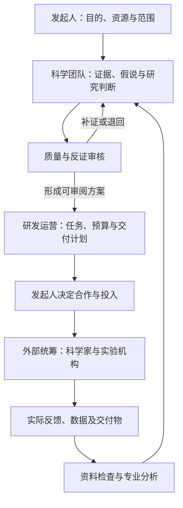

# 医疗一人项目｜最高思想

版本：V0.2  
更新日期：2026-10-29  
阶段：理论整理与需求讨论  
保存位置：`pyzz58/gpt-recommendations/医疗一人项目/最高思想.md`

**本文件是整个项目唯一的思想、理论、需求和讨论结论主文件。以后双方讨论中用户明确同意的内容，都更新在这里。**

“最高”指本项目的统一依据，不代表其中设想已获得科学证明。本文件保留三种不同状态：**已确认的方向和要求、待确认的设计建议、事实与历史记录**。合并文档不把未确认建议升级为用户决定；各节的状态标记和第15—17节台账共同说明其地位。

README 和 AGENTS 仅用于指向本文件，不再分别维护理论、决定、来源或协作规则。后续技术方案、岗位配置及实现都应能追溯到本文件；用户最新明确指令优先，并据此更新正文。

## 1. 项目为什么存在

发起人一直希望能够发起并参与开发一款药物，但目前缺少药物发现与临床前研发核心技术，前期资金有限。发起人具体承担哪些组织和协调工作，应在后续职责讨论中明确。

受到AI辅助精简生物技术公司及AI科研成果案例启发，项目提出一个待验证问题：

> 能否由一名发起人组织一支职责明确的AI团队，以AI承担日常科学分析、研发运营和外部合作统筹，再与现实中的科学家、实验室及其他专业机构合作，逐步推进一个药物研究项目？

本项目先检验这种组织方式的可靠性、实际价值和成本，再根据结果决定是否增加资金和推进更深层药物研发。

## 2. 发起人的目的与当前选择

以下来自对话中的明确表达，不应被后续AI自行改变：

| 事项 | 当前内容 |
| --- | --- |
| 长期目的 | 发起并参与一款有真实科学依据和开发价值的药物项目 |
| 首阶段目的 | 跑通并验证一人加AI团队及外部合作的工作模式 |
| 初始路线 | 将已有药物开发用于宠物，可利用既有研究 |
| 前期资金 | 人民币1—2万元，不含生活备用金；不是完整药物上市开发预算 |
| 工作设想 | AI可承担首席科学家的日常分析职责，不同Agent各司其职并按流程汇报 |
| 外部合作 | 必要时与真实科学家交流，统筹外部实验室等机构合作 |
| 架构要求 | 覆盖科学判断、研发运营、研发执行统筹，不能固定压缩为三个岗位 |
| 当前顺序 | 先讨论理论、梳理设想与需求，并在GitHub保存为统一源头；代码实现暂停 |

“人用药转宠物用”本身不等于best-in-class。是否具有同类优势，需另行提出比较问题并获得相应证据。发起人此前比较过剂型改进路线，随后明确选择已有药物用于宠物；后续不能擅自改回其他路线。

## 3. 核心组织假说

状态：用户已提出一人、AI分工和现实专业网络协作的方向；以下为组织设想，效果待验证，具体职责待确认。

拟议组织由以下部分组成：

1. **一名发起人**：确定目标，掌握资源和合作决定，审查需要自己决定的事项。
2. **AI科学判断体系**：提出和比较研究假说，评价已有证据，明确未知和下一步验证问题。
3. **AI研发运营体系**：维护项目、资料、数据、任务、预算、进度及交接。
4. **AI外部执行统筹体系**：整理科学家审阅材料、外部实验需求、询价与合作跟踪，接收和组织结果。
5. **现实中的专业网络**：科学家、临床兽医、药理/药学/统计/注册等专业人员，以及实际承担研究的机构。

“一人”描述内部核心组织精简，不意味着只有一个人付出劳动，也不意味着外部资源免费或无需实验。

当前应检验的假说：AI能否减少专业资料处理和组织成本，帮助发起人管理完整研究过程，并在适当节点暴露问题、获取外部纠错和停止不值得推进的项目。

## 4. 三个工作领域及审核建议

状态：科学判断、研发运营、外部执行统筹三个领域已由用户明确要求；以下职责解释及独立审核安排为设计讨论材料。

### 4.1 科学判断

需要回答研究什么、为什么可能有价值、现有证据是否支持、最可能错在哪里，以及下一步应验证什么。

AI首席科学家是工作角色。它可以主动提出假说和建议，但不能凭角色名称获得真实履历、执业资格或未经验证的科学判断能力。

其专业化需要共同依赖：基础模型、适配资料、必要工具、明确研究方法、真实案例检验及外部反馈。AGENTS.md等指令文件用于规定工作方式，不能替代这些组成部分。

### 4.2 研发运营

需要让工作持续推进，并保留可复核的记录。包括任务依赖、负责人、交付要求、资料版本、未决问题、预算、合作状态、进度和决策依据。

运营记录应区分：计划、草稿、已发出、已回复、已确认、执行中、已收到、待验收及已验收。不能因生成一份文件就认为现实工作已完成。

### 4.3 研发执行统筹

系统内的Agent负责组织执行，现实实验由外部机构承担。系统需要能够整理研究需求，准备合作问题和沟通材料，比较真实报价，记录任务与交付要求，跟踪进展，并把实际收到的数据交给合适岗位分析。

AI不得把模拟、文献再分析或自己生成的数据写成外部实验室完成的真实结果。

### 4.4 独立质量与反证审核（建议，具体权力待确认）

审核要与产出区分，检查事实、来源、物种外推、研究设计、分析口径、结论边界和交付完整性。

审核员应能提出退回、补证或暂停建议；不能为了完成流程而自动给出通过。多个AI意见一致也不等于独立实验或多位真人专家完成验证。

## 5. 专业Agent的配置建议（待确认）

本项目中的专业Agent，应当是一项可持续维护和考核的岗位配置。每个岗位至少明确：

| 属性 | 要回答的问题 |
| --- | --- |
| 目的与职责 | 这个岗位解决什么问题，哪些工作不归它负责？ |
| 能力要求 | 需要理解哪些科学或运营问题，怎样检验其表现？ |
| 输入 | 接收什么资料、任务和上游结论？ |
| 知识与记忆 | 能使用哪些专业资料，保存哪些历史，怎样更新？ |
| 工具与数据权限 | 能读取、调用、产生或修改什么？ |
| 标准交付 | 应提交什么结果、证据、局限和建议？ |
| 汇报关系 | 向谁汇报，谁使用其输出，谁负责复核？ |
| 完成和退回条件 | 什么算交付完成，什么情况必须补证或退回？ |
| 预算和异常 | 可以消耗多少资源，失败或资料不足怎样处理？ |

岗位职责应由指令、任务分派、资料范围、工具限制、输出要求和审核共同落实。提示词里的“只做自己的事”不能单独等同于已经实现的权限隔离。

不同岗位可以使用同一基础模型，也可以使用不同模型。模型、知识库和执行方式暂不锁定；岗位分工不等于已经训练了多个独立专业模型。

## 6. 初步岗位目录（建议，待逐项讨论）

下表保留完整职责范围，不把数量作为效果或成熟性的指标。岗位可进一步拆分或调整，但重要职责不能在没有替代安排时被删去。

| 工作领域 | 候选岗位 | 主要交付 | 建议汇报对象 |
| --- | --- | --- | --- |
| 科学判断 | AI首席科学家 | 研究问题、假说比较、综合判断、验证优先级 | 发起人 |
| 科学判断 | 文献与证据研究员 | 原始研究提取、支持/反对证据、来源 | 首席科学家 |
| 科学判断 | 兽医药理与物种转化研究员 | 机制、暴露、安全与物种差异分析 | 首席科学家 |
| 科学判断 | 药学与质量研究员 | 产品、制备、检测与质量证据需求 | 首席科学家 |
| 科学判断 | 实验设计与数据分析员 | 设计审查、终点、分析口径和结果边界 | 首席科学家 |
| 科学判断 | 注册与知识产权研究员 | 目标市场要求、已批产品和权利线索 | 首席科学家及发起人 |
| 研发运营 | 研发项目运营经理 | 计划、依赖、进展、问题追踪与汇报 | 发起人 |
| 研发运营 | 资料与数据管理员 | 来源、版本、完整性和数据接收记录 | 运营经理 |
| 研发运营 | 预算与商业可行性分析员 | 成本来源、替代方案和分阶段投入建议 | 发起人 |
| 外部执行统筹 | 外部实验室合作统筹 | 需求、询价与交付清单、合作进展 | 运营经理及首席科学家 |
| 外部执行统筹 | 科学家联络与反馈专员 | 匹配专家、一页材料、具体问题和反馈 | 首席科学家 |
| 独立审核 | 质量与反证审核员 | 差异、漏洞、补证、退回和暂停意见 | 发起人，并回送相关岗位 |

表内汇报关系是初稿。具体哪些岗位可合并、哪些需要更严格独立，须根据真实工作及错误风险判断。

## 7. 拟议工作流程与汇报机制（待确认）

以下为待完善的业务流程，不表示系统已实现：

每次交接至少应回答：任务是什么，输入是什么，完成了什么，依据在哪里，哪些尚未解决，下一步由谁做，什么条件下不能继续。

报告不应只写“已完成”或“建议继续”。应让上游能复核，让下游知道可依赖什么，不能依赖什么。

不合格交付应带具体原因退回；争议与反证保留。流程状态由实际输入、交付和规定条件决定，不能由Agent一句“通过”任意改变。

## 8. 现实科学家的作用

状态：搭配真实科学家交流是用户提出的工作设想；下述沟通方式、范围和合作安排仍待讨论。

发起人的设想是让AI承担主要日常研究分析，再搭配现实中相关领域科学家进行具体问题沟通。可以先准备材料，必要时通过邮件等方式寻求反馈；是否获得回复或形成合作不能预设。

拟议协作循环：AI提出可检验假说 → 整理关键原始证据和最强反证 → 找到适配问题的专业人员 → 提出少量具体问题 → 记录真实意见及其范围 → 更新判断 → 决定是否继续。

一次泛泛回复不等于项目获得认可、对方担任顾问或愿意合作。更深入的审阅可能需要明确工作范围及费用安排。

专家并非所有问题都适配。目标物种药理、具体疾病、毒理、药学、统计及注册问题，应分别识别需要哪类专业判断。

## 9. 低成本与完整分工的关系

状态：预算范围、先验证再投入、不固定限制三个岗位已明确；按需运行、并发和各项费用分配是降本建议，尚未定稿。

用户已经明确反对将完整组织压缩为三个岗位。此前“三岗位最小模式”仅保留为一次局部演示的历史安排，不再作为未来组织架构上限。

拟议的低成本方法为：**完整考虑职责，一次只运行当前需要的工作。**具体调用机制待讨论，不把这项建议写成已实现能力。

可以缩小同时推进的项目数、动物/疾病范围、资料处理量、模型调用及当前执行阶段；不能简单省略关键职责后仍声称完整研发过程已经跑通。

预算分阶段投入，并给专家审查和关键验证留出空间。系统建设、AI调用、资料获取、专业咨询和现实实验成本分别记录。未知费用不能填0，预计费用与真实报价、实际支出分开。

## 10. 模式验证思路（具体方法与标准待确认）

需要分别回答三个问题：

| 层面 | 要检验的内容 | 不能由什么替代 |
| --- | --- | --- |
| 组织与流程 | 分工、交接、退回、追踪、权限、恢复及成本是否可靠 | 岗位名称多、报告多或一次顺利演示 |
| 科学判断 | 来源与推理是否可靠，能否找出关键未知并接受纠错 | AI一致同意、专家人设或文献数量 |
| 具体项目 | 是否值得继续，下一项研究能否改变决定，真实资源能否支持 | 流程能运行、新闻案例或融资故事 |

稳定不是每次说出相同的话，而是在相同资料与条件下，关键事实、边界和决定理由可复核；有新证据时应允许并解释判断变化。

后续可讨论：重复案例、失败案例、资料不足、外部来源不可用、退回补证、中断恢复、单Agent对照、专家抽查和真实合作反馈。具体数量与通过条件尚未定稿，不作为已经完成的验证。

能够准确否定不值得做的项目同样有价值；不能只报告成功或支持假说的结果。

## 11. 证据与记录方法（待确认的管理设计）

以下为此前提出的方法建议，保存其内容以便继续讨论。关于实际发生的行为与科学事实，仍须以可核查证据为准。

- 区分已核实事实、有限证据、推断、待验证假说、冲突和资料不足。
- 人、实验动物和目标猫犬资料分别记录，细胞结果、暴露、短期终点和长期疗效不能互换。
- 关键数字、引文与结论可追溯到原始来源；重复索引不增加独立证据数量。
- 原始数据、模型预测、文献再分析和演示数据分别标记。
- 保留资料、报告、专家反馈和判断的版本，不能用新解释覆盖原始记录。
- 真实实验、邮件发送、合作确认、付款及数据到达，都以实际行为或收到的材料为准。

## 12. 当前已有材料及其地位（历史与现状记录）

此前已整理启动说明及AGENTS.md模板，并在本会话对米氮平转猫用药的已知案例做过研究与审核分工回放。

该回放核对过样本口径、短期终点、物种与批准范围，并处理三条事先明确为错误的断言。因此它不是盲测、不是新药发现，也不能证明整个组织模式成熟。

此前围绕“三岗位”的文件是历史版本，后续应按本主文件修订。它们不应反过来限制用户后来明确要求的完整分工。

对话中曾开始准备工程草稿；用户随后明确先讨论理论，相关实现工作已经暂停。未验收的代码或界面不进入本次理论文件，不作为已实现能力。

## 13. 当前阶段与后续顺序

当前只做理论、需求和讨论记录。后续建议顺序如下，具体推进由用户的新指令决定：

1. 补充并确认项目目的、边界及三大工作领域。
2. 逐个讨论岗位：职责、输入输出、权限、汇报、交接与审核。
3. 用一个项目场景走完整业务流程，找出缺失职责和现实合作条件。
4. 再选择复用、组合或自建哪些工具，形成技术方案。
5. 得到实施指令后开发并检验系统。
6. 按质量、成本和实际科学/合作证据，决定是否扩大投入。

## 14. 唯一主文件与持续更新规则

本节落实用户本次明确要求：“这些合并成一个，做成最高思想，我和你讨论的所有我同意的，都更新记录在这里”。这项要求已经授权后续讨论结论的文档维护，无需每次为同一项更新再次询问。

### 14.1 什么内容成为已确认方向

- 用户明确提出的要求、明确选择的路线，以及明确同意的讨论结论，写入对应正文，并记录确认依据。
- 同意的范围按当时讨论对象判断。对某项工作的“继续”不扩大为同意全部其他建议；未反对、助手自行提出或软件已经实现，都不单独构成用户确认。
- 已同意探索的假说仍标注“待验证”。确认探索方向不等于证明科学能力、药物效果或组织模式成熟。
- 未确认的建议可以保留在本文件，但必须明确标为待确认，不作为既定要求执行。

### 14.2 每次确认后的维护动作

1. 读取GitHub上的本文件当前版本，对照用户本次明确表达和已有决定。
2. 直接修改对应正文，使正文始终代表当前方向；不能只在末尾追加一段却让旧正文继续冲突。
3. 新增或修订第15节决定条目，保留稳定编号、确认日期、依据及涉及小节；相应更新第16—17节建议或问题状态。
4. 修改已有决定时，保留原决定的变更原因、适用范围和被取代状态，不把已废止方向继续列为当前要求。
5. 在第20节记录版本、日期、原因、影响和确认依据，并提交GitHub。一次相互关联的讨论结论可合并为一次版本更新。
6. 向用户简要说明本次写入了什么及主文件链接。若提交失败，明确说明未写入成功；不能只说“记住了”或“已经同步”。

### 14.3 后续AI及工程协作

适用范围仅为本项目目录及其后代。每次处理项目先读本文件，特别是当前方向、决定台账、未决事项和变更记录；不据此修改同仓库其他项目的规则或内容。

当前保存理论源头，不自动启动代码实现、部署、模型训练、付费调用、对外联络或真实实验。后续用户明确授权某项实施工作时，按新的范围执行，不对同一已获授权工作反复询问；同时维护理论与实现的对应关系。

不得因技术方便而改变目的或已选路线；不得虚构AI履历、资格、科研成果、专家背书或已实现能力；不得把一次回放或多个Agent意见一致写成模式成熟。工作缺口、证据冲突、角色重叠和未解决问题要如实留在本文件。

本目录位于公开仓库，仅保存项目相关内容及公开来源。不得加入密码、令牌、个人医疗记录、他人未公开资料、原始敏感数据或与项目无关的个人信息。现实联络、采购及实验委托，依用户实际授权的对象和范围执行。

后续派生的技术、代码或测试材料引用本文件对应小节或决定编号，不另建一份平行的“最高思想”。本次合并不为待确认设计设定新的审批障碍，也不限制已经明确授权的文档维护。

## 15. 已确认方向与决定台账

状态：下列为用户明确表达的方向和要求。首次归档及本次合并日期均为2026-10-29；早期表达的单条独立时间未记录，不另行推定。D-009确认的是探索意向，其科学能力仍待验证。后续条目记录确认日期、表达依据及正文位置。

| 编号 | 内容 | 依据 |
| --- | --- | --- |
| D-001 | 项目名称为“医疗一人项目”，GitHub保存整个项目核心理论 | 用户此前明确要求 |
| D-002 | 先讨论理论并记录目的、设想、需求与构思；当前暂停代码实现 | 用户此前明确要求 |
| D-003 | 初始路线为将已有药物开发用于宠物 | 用户在两条路线比较后明确选择 |
| D-004 | 首阶段预算设想1—2万元，不含生活备用金 | 用户明确给出的可承受投入 |
| D-005 | 先验证工作模式，再根据效果扩大投入或深入药物研发 | 用户明确说明目的 |
| D-006 | 完整覆盖科学判断、研发运营及外部执行统筹 | 用户明确提出的范围 |
| D-007 | 不把组织架构固定限制为三个Agent | 用户对原方案的明确纠正 |
| D-008 | 不同Agent职责清楚，只负责自己的工作，按流程汇报和交接 | 用户明确需求 |
| D-009 | 探索AI首席科学家搭配现实科学家沟通的方式 | 用户提出的工作设想；科学能力和合作可得性仍待验证 |
| D-010 | 在现有 `pyzz58/gpt-recommendations` 仓库内建立 `医疗一人项目/` | 用户后续澄清“在仓库中建设这个项目”；已核查连接与写入权限 |
| D-011 | 将理论、需求、决定、来源、历史和维护规则合并为本文件，作为唯一“最高思想” | 2026-10-29用户明确要求合并；对应本文件整体及第14节 |
| D-012 | 此后讨论中所有用户明确同意的内容，持续更新到本文件 | 2026-10-29用户明确要求持续记录；对应第14、15、20节 |

## 16. 尚未确认及已被取代的助手建议

状态：P-001—P-005为待讨论设计；P-006、P-007为历史建议，已被D-010取代。合并不改变这些状态。

| 编号 | 建议 | 原因及状态 |
| --- | --- | --- |
| P-001 | 完整配置职责，单项目、按需运行，控制并发及调用 | 响应预算与完整覆盖要求；具体机制待讨论 |
| P-002 | 以12项候选岗位作为首轮讨论目录 | 便于检查漏项；数量、合并及汇报关系未定稿 |
| P-003 | 独立审核可退回、补证和提出暂停 | 避免只产出支持结论；具体权力与处理方式待讨论 |
| P-004 | 采用固定交付要求和阶段条件维护流程状态 | 避免口头“完成”与实际工作脱节；尚未实现 |
| P-005 | 科学家先围绕一页材料和具体问题进行有限审阅 | 便于获得可用反馈；不预设免费或必有回复 |
| P-006 | 当前先采用独立私有GitHub仓库 | 历史建议，已被D-010取代；现有仓库为公开仓库 |
| P-007 | 独立仓库网址使用medical-one-person，README显示中文名 | 历史建议，已被D-010取代；项目目录直接使用中文名称 |

## 17. 待讨论问题

状态：以下问题尚未形成最终答案。具体岗位、汇报、权限、验证标准及技术方案不得因文档合并而自动定稿。

| 编号 | 问题 | 为什么需要讨论 | 建议讨论时的产出 |
| --- | --- | --- | --- |
| Q-001 | 完整组织中每个岗位究竟做什么？ | 防止漏项和跨岗互相代替 | 岗位职责、输入输出、边界 |
| Q-002 | AI首席科学家能自主决定到哪一步？ | 科学建议与资源/现实执行需要衔接 | 自主事项和升级条件 |
| Q-003 | 科学、运营及外部统筹怎样汇报？ | 避免所有岗位直接堆给用户 | 汇报图和交接要求 |
| Q-004 | 审核反对、Agent意见冲突时怎么办？ | 多数同意不等于正确 | 退回、仲裁、补证和暂停规则 |
| Q-005 | 每个Agent如何体现专业能力？ | 模板和岗位名称不足以证明能力 | 资料、方法、工具与考核要求 |
| Q-006 | 如何找到合适且愿意反馈的科学家？ | 不能把潜在联系人当已建立顾问关系 | 匹配标准、沟通材料、合作状态 |
| Q-007 | 外部实验统筹需要记录哪些真实状态？ | 询价、委托、实验、交付不能混为一谈 | 需求、报价、执行、接收与验收记录 |
| Q-008 | 什么叫模式可靠、稳定、有用？ | 不能用一次演示或相同答案充当证明 | 分层验收指标、失败标准和证据 |
| Q-009 | 第一个完整业务场景选什么？ | 应能覆盖三大工作领域，又符合资源 | 单项目场景、边界及前置条件 |
| Q-010 | 首阶段资金怎样分配？ | 给专业审查与关键验证留资源 | 支出类别、额度与阶段停止条件 |
| Q-011 | 哪些部分复用、组合或自建？ | 不绑定某个工具，也不重复建设 | 理论明确后再评估技术路线 |
| Q-012 | 数据、研究成果、保密及合作权益怎样安排？ | 外部合作需要明确责任与权利 | 需专业审查的问题清单，不预作法律结论 |

当前先从Q-001、Q-002和Q-003讨论，不自动将未决问题变成默认答案。

## 18. 依据与来源

整理日期：2026-10-29。这里记录启示及适用边界，不把新闻案例写成普遍结论，也不以技术产品文档证明药物研发模式已成熟。

### 来源目录

| 编号 | 来源 | 支持什么 | 不支持什么 |
| --- | --- | --- | --- |
| S-001 | Anthropic，Early progress on accelerating drug development with Claude，2026-10-27 | 一个内部精简、借助AI和外部研发网络推进项目的公开案例；人仍决定科学方向与关键事项 | 不能证明无技术基础、少量资金或任意个人能够复现其成果；不能证明药物人体有效 |
| S-002 | OpenAI，Working with academic communities to build scientific understanding，2026-10-26 | AI产生研究材料后仍需要形式化检验和学术共同体解释、核查的协作启示 | 不能据此认为普通Agent模板可获得同等能力，或相关数学能力直接转化为药理判断能力 |
| S-003 | OpenAI，Agent definitions、Orchestration and handoffs | 角色可以由指令、模型、工具及运行设置组成，程序可组织任务调用和交接 | 不证明本项目已完成专业化、业务流程或权限隔离；不意味着必须采用某套SDK |
| S-004 | OpenAI，Evaluate agent workflows | 保留运行记录、明确评价标准、重复评估和改进的工程方法 | 不等于医学/药学能力认证，也不提供本项目现成合格阈值 |
| S-005 | FDA，AI支持药物监管决策的2025年草案 | 针对具体使用场景评价AI输出可信度的风险思路 | 不是本项目中国兽药注册法律结论，草案亦不能写成已生效强制要求 |
| S-006 | Mirataz标签、原始试验索引及中国第793号公告 | 已知药物回放中可核对样本口径、短期终点及批准范围 | 不是本项目的新发现、推荐候选或商业空白证明 |

### 原始链接

- S-001：https://www.anthropic.com/research/early-progress-drug-development
- S-002：https://openai.com/index/building-scientific-understanding-with-academic-communities/
- S-003：https://developers.openai.com/api/docs/guides/agents/define-agents
- S-003：https://developers.openai.com/api/docs/guides/agents/orchestration
- S-004：https://developers.openai.com/api/docs/guides/agent-evals
- S-005：https://www.fda.gov/regulatory-information/search-fda-guidance-documents/considerations-use-artificial-intelligence-support-regulatory-decision-making-drug-and-biological
- S-006：https://dailymed.nlm.nih.gov/dailymed/fda/fdaDrugXsl.cfm?setid=5ff9fdb7-554f-4f91-8cfc-6d05094384c6
- S-006：https://pubmed.ncbi.nlm.nih.gov/30506924/
- S-006：https://xmsyj.moa.gov.cn/zwfw/202405/t20240530_6456403.htm

### 本项目自行提出的方法设计

以下是根据目标形成的组织建议，尚待检验：完整职责与按需运行相结合；专业岗位固定输入输出；交接可追溯；审核能够退回；先评价组织、再评价科学判断和具体项目；保留失败案例；按阶段决定投入。

这些建议不应包装成某篇文献已验证的完整商业模式。后续需要补充实际案例、质量、成本和外部反馈证据。

### 技术维护依据

- Codex项目指令：https://learn.chatgpt.com/docs/agent-configuration/agents-md
- GitHub仓库创建与命名规则：https://docs.github.com/en/repositories/creating-and-managing-repositories/creating-a-new-repository

资料日期和状态需在实际使用时重新核查。引用来源的范围不能超过其原文能够支持的结论。

## 19. 讨论演变与历史修正

状态：历史摘要，用于理解方向如何形成；不把历史建议或过时安排恢复为当前要求。

本文件按讨论顺序整理，不是完整逐字聊天记录。阶段标题不表示现实研发工作已执行。整理日期：2026-10-29。

| 阶段 | 用户表达或讨论内容 | 当前地位 |
| --- | --- | --- |
| 1：新闻启示 | Anthropic收购Mithril的一人公司案例，引发对AI组织药物研发的兴趣 | 项目灵感；案例不证明普通人可凭AI独立完成研发 |
| 2：个人梦想与资源 | 用户希望做一款药，不懂研发核心技术，资金有限，询问动物药是否可行 | 长期目的和现实约束 |
| 3：预算明确 | 前期可承受1—2万元，希望得到有前景的数据或证据 | 前期预算；不承诺这些资金足以得到阳性实验结果 |
| 4：路线选择 | 比较“已有药物用于宠物”和“剂型便利性改进”；用户最终明确选择前者 | 保留已有药物用于宠物的路线 |
| 5：分工系统 | 用户提出已有Codex/harness，希望不同Agent分工、设置权限并在同一项目汇报 | 核心系统需求 |
| 6：组织架构 | 澄清一人公司由负责人、AI运营系统、专业网络、外部实验室与资金共同组成 | 当前组织模型基础 |
| 7：AI科学负责人 | 用户希望让AI承担日常科学判断，再搭配真实科学家邮件沟通 | 拟议工作方式；实际能力需验证 |
| 8：专业化问题 | 用户由OpenAI三项科研结果新闻询问，怎样让AI专门解决本领域问题 | 专业化不能仅靠角色模板；资料、工具和检验同样重要 |
| 9：先验证模式 | 用户希望先以低成本跑通模式，再根据效果扩大资本或深入研发 | 分阶段验证和投入原则 |
| 10：三岗位局部演示 | 助手提出三岗位并完成一次已知药物的资料回放 | 保留为历史演示，不能视为完整组织或成熟性验证 |
| 11：完整岗位修正 | 用户明确指出三个岗位覆盖不足，强调科学判断、研发运营、外部实验统筹及按流程汇报 | 以完整职责、按需运行修正原方案 |
| 12：理论先行 | 用户要求先讨论理论，把讨论、设想、需求、目的和构思记录到GitHub，项目名“医疗一人项目” | 当前执行指令：理论仓库，不继续代码实现 |
| 13：保存位置澄清 | 用户指出其他项目可直接在已有GitHub仓库建设，询问为何需要重新登录 | 沿用已连接的 `pyzz58/gpt-recommendations`，建立中文项目目录；独立私有仓库是助手此前的理解，不是用户要求 |
| 14：统一最高思想 | 用户要求合并现有文件，并把此后双方讨论中所有用户同意的内容持续更新在这里 | 建立唯一主文件；已确认方向、待确认建议、事实和历史在同一文件内分清状态 |

### 保留的关键原意

> “我其实一直有个梦想做一款药物，但是我不懂，也没多少钱”

> “可以先用最小模式的成本做出一个，证明该模式成熟，稳定，然后再根据效果扩大资本投入，或是做深层次的药物”

> “科学判断，研发运营，研发执行（统筹合作外部实验室）”

> “这个系统就是设置好不同的angent，只做自己的事，然后根据流程进行汇报等等”

> “我们可以先讨论理论依据……未来这就是整个项目的核心理论源头”

> “这些合并成一个，做成最高思想，我和你讨论的所有我同意的，都更新记录在这里”

### 已修正的理解

- 低成本不等于永久限制三个岗位。
- 用户的首要诉求是验证完整工作模式，不是立即锁定某种药或直接投入完整开发。
- 用户选择的是已有药物用于宠物，不能被助手自行改成其他路线。
- 准备一份Agent模板不代表已得到有资质、经验和验证能力的科学负责人。
- 已知成功案例回放不能证明新项目有前景，也不能证明模式成熟稳定。
- 本轮理论整理指令取代此前立即实现原型的工作安排；未验收工程草稿不纳入初始仓库。

### 后续记录格式

每次补充注明日期、问题、用户表达、助手建议、确认状态、受影响条目及尚待讨论的问题。用户纠正优先同步核心理论，并保留原理解为何被修正。

## 20. 版本与变更记录

| 版本 | 日期 | 变化 | 确认依据与影响 |
| --- | --- | --- | --- |
| V0.1 | 2026-10-29 | 首次在GitHub建立项目，分别保存核心理论、决定、讨论记录、来源及协作规则 | 用户要求记录项目核心理论；首次提交 `01d02b854ccc7f955e56a30600ec607b21d09130` |
| V0.2 | 2026-10-29 | 合并为《最高思想》；加入D-011、D-012及持续更新机制；明确各节确认状态；原四份正文从当前目录移除 | 用户本次明确要求；旧正文为 `CORE_THEORY.md`、`DECISIONS_AND_QUESTIONS.md`、`DISCUSSION_LOG.md`、`SOURCES.md`，历史内容仍可从Git提交记录追溯；README、AGENTS仅保留入口 |

后续每次更新记录：版本、日期、讨论结论、用户确认依据、影响的小节或决定、未决问题状态。已确认结论同步进入正文；事实和实现状态仍按实际证据更新。
